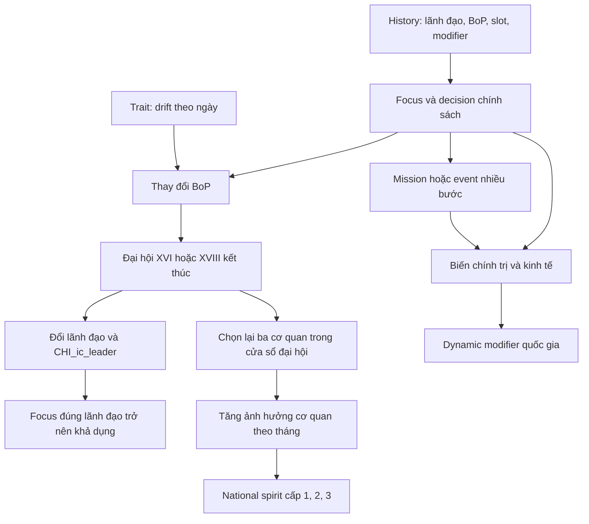

# Báo cáo nhánh focus chính trị Trung Quốc

**Kết luận:** Nhánh chính trị Trung Quốc hiện tại được xây dựng như một chiến dịch quản trị nhà nước qua nhiều thế hệ lãnh đạo. Người chơi điều chỉnh cán cân phe phái, chuẩn bị kế nhiệm qua đại hội, phát triển bộ máy Đảng và lựa chọn mô hình phát triển. Cấu trúc gồm **70 focus**, chia thành sáu cụm: Giang Trạch Dân, Hồ Cẩm Đào, chương trình nhà nước dùng chung, Tăng Khánh Hồng, Tập Cận Bình và Bạc Hy Lai. Điểm mạnh là chính trị tác động trực tiếp đến kinh tế, đối ngoại và quản trị vùng. Điểm cần hoàn thiện là cách giải thích kế nhiệm, một số điều kiện ngân sách, phần thưởng theo thời gian và sự nhất quán giữa tooltip với effect.

## 1. Phạm vi và cách đọc

Báo cáo phân tích **nội dung đang có trong checkout Millennium Dawn**, đọc ngày 13/10/2026. Tôi hiểu “nhánh chính trị của mình” là nhánh Trung Quốc trong repository này. Phần đề xuất ở cuối là hướng phát triển tiếp, không phải nội dung đã được triển khai.

Phạm vi chính là phần `# Political` trước `# Military` trong `common/national_focus/05_china.txt:52`. Các nhánh quân sự, kinh tế, ngoại giao và SAR được nhắc đến khi có liên kết gameplay trực tiếp; báo cáo không thống kê toàn bộ những nhánh đó.

Nhận định về ý tưởng lịch sử dựa trên tên focus và localisation English của mod. Đây là phân tích thiết kế trò chơi, không phải báo cáo kiểm chứng lịch sử ngoài đời. Không chạy game hoặc content validation. Tọa độ là tọa độ script đã cộng `relative_position_id`, không phải kết quả đo từ ảnh giao diện trong game.

Quy ước:

- **BoP**: Balance of Power, thanh cân bằng quyền lực giữa phe Shanghai/Princeling và Tuanpai/Youth League.
- **PP**: Political Power, quyền lực chính trị.
- **DM**: dynamic modifier, một modifier quốc gia đọc giá trị từ các biến.
- **pp** trong diễn giải tỷ lệ: điểm phần trăm. Ví dụ `stability_factor = 0.05` là modifier ổn định +5 điểm phần trăm; không đồng nghĩa với tăng trực tiếp ổn định bằng `add_stability`.
- Các giá trị `expected_*`, drift, intel và năng suất đặc thù MD được giữ theo tên hoặc giá trị script khi cần, tránh đánh đồng tất cả thành phần trăm.
- `cost` trong focus là thời gian. Với tốc độ cơ sở 7 ngày/đơn vị: 1/3/5/7/10/15 tương ứng 7/21/35/49/70/105 ngày, trước các hiệu ứng thay đổi thời gian. Chi ngân khố là effect riêng.

## 2. Ý tưởng nội dung: quyền lực, phát triển và kế nhiệm

### 2.1. Trọng tâm là những lựa chọn bên trong cùng một hệ thống

Các cửa vào Hồ, Tăng, Tập và Bạc kiểm tra **lãnh đạo đang tại vị**, còn trục chương trình nhà nước kiểm tra `emerging_communist_state_are_in_power`. Vì vậy, hình thức của nhánh này là cạnh tranh đường lối và nhân sự trong chế độ hiện hữu. Trong 70 focus được thống kê, không có một tuyến riêng chuyển sang quân chủ hay dân chủ đa đảng.

Ba câu hỏi xuyên suốt thiết kế:

1. **Ai có quyền quyết định?** Phe Thượng Hải/Thái tử Đảng, Đoàn phái, tập thể hay cá nhân lãnh đạo.
2. **Nhà nước phát triển theo cách nào?** Tăng trưởng ven biển, cân bằng vùng, phúc lợi, công nghiệp chiến lược hoặc huy động đại chúng.
3. **Quyền lực được chuyển giao thế nào?** Thanh BoP quyết định người kế nhiệm tại đại hội, sau đó focus của người đó mới khả dụng.

Đây là ý tưởng gameplay rõ nhất của nhánh: mỗi chính sách vừa tạo năng lực quốc gia, vừa tác động đến khả năng chọn người kế nhiệm. Người chơi có thể muốn một bonus kinh tế nhưng phải trả giá bằng việc đẩy BoP sang phía không phù hợp với kế hoạch nhân sự.

### 2.2. Sáu cụm nội dung

| Cụm | Số focus | Ý tưởng thể hiện trong nội dung | Vai trò gameplay |
| --- | ---: | --- | --- |
| Giang Trạch Dân | 12 | Three Represents, mở cửa, phát triển vùng, an ninh và di sản | Thiết lập nền kinh tế và cán cân trước đại hội XVI |
| Hồ Cẩm Đào | 10 | Phát triển khoa học, cán bộ, cân bằng vùng, giám sát, ứng phó khẩn cấp | Quản trị kỹ trị, tăng ảnh hưởng Đoàn phái, giảm áp lực nợ địa phương |
| Chương trình nhà nước dùng chung | 10 | Kế hoạch 5 năm, ngân hàng, SASAC, y tế, WTO, đường sắt, tiền tệ | Trục tiến trình giữa hai lần kế nhiệm; nối chính trị với các hệ thống kinh tế |
| Tăng Khánh Hồng | 9 | Ban Tổ chức, mạng lưới cán bộ, ưu tiên ven biển, kế nhiệm có sắp đặt | Tăng quyền lực phe Thượng Hải, xây năng lực công nghiệp và bộ máy |
| Tập Cận Bình | 18 | Chinese Dream, kỷ luật, tập trung chỉ đạo, BRI, công nghiệp, hai cách củng cố chế độ | Phân nhánh giữa cá nhân hóa quyền lực và duy trì bộ máy lâu dài |
| Bạc Hy Lai | 11 | Mô hình Trùng Khánh, nhà ở công, chiến dịch chính trị, tái phân phối và an ninh | Tuyến giả định với huy động đại chúng và phát triển nhà nước dẫn dắt |

Nguồn: `common/national_focus/05_china.txt:55`, `:673`, `:1094`, `:1566`, `:1979`, `:2733`.

## 3. Kiến trúc kỹ thuật

### 3.1. Phân chia trách nhiệm

| Lớp | File chính | Trách nhiệm |
| --- | --- | --- |
| Cây focus | `common/national_focus/05_china.txt:3` | Bố trí, prerequisite, loại trừ, điều kiện lãnh đạo, reward và trọng số AI |
| Cán cân phe phái | `common/bop/CHI.txt:1` | Giá trị khởi đầu, hai phe, các vùng ngưỡng và bonus/penalty |
| Đại hội và dự án | `common/decisions/05_CHI_decisions.txt:1974` | Bộ đếm đại hội, đổi lãnh đạo, mission kế hoạch 5 năm, nhà ở, Olympic |
| Điều kiện hiển thị decision | `common/decisions/categories/99_CHI_decision_categories.txt:223` | Hiển thị từng nhóm nội dung khi focus hoặc trạng thái phù hợp |
| Effect tái sử dụng | `common/scripted_effects/05_CHI_scripted_effects.txt:2` | Reset slot, dự báo kế nhiệm, tăng ảnh hưởng ủy ban, nợ địa phương |
| Modifier tích lũy | `common/dynamic_modifiers/99_CHI_dynamic_modifiers.txt:344` | Chuyển biến `CHI_pol_*` và `CHI_economy_*` thành modifier thực tế |
| National spirit | `common/ideas/05_china.txt:2869` | Bonus tạm thời, trạng thái chính sách, nâng cấp ủy ban, effect khi idea hết hạn |
| Trait lãnh đạo | `common/country_leader/CHI_traits.txt:6` | BoP drift theo ngày, năng lực và đánh đổi riêng của người lãnh đạo |
| Event | `events/05_china.txt:9606` | Khủng hoảng, lựa chọn ưu tiên chính sách, thỏa hiệp kế nhiệm |
| Tác vụ định kỳ | `common/on_actions/99_CHI_on_actions.txt:71` | Cập nhật tháng cho nợ địa phương, ảnh hưởng ủy ban và các hệ thống liên quan |
| Giao diện trong cây focus | `common/focus_inlay_windows/chi_national_committee_inlay_window.txt:1` | Chân dung và lựa chọn ba cơ quan trong thời gian đại hội |
| Giao diện ảnh hưởng | `common/scripted_guis/99_CHI_scripted_guis.txt:3` | Thanh ảnh hưởng, cơ quan đang hoạt động, các mốc nâng cấp |
| Khởi tạo | `history/countries/CHI - China.txt:3117` | Lãnh đạo, slot, ảnh hưởng, BoP và trạng thái đầu chiến dịch |
| Văn bản | `localisation/english/MD_focus_CHI_l_english.yml:869` | Tên, mô tả và giải thích cơ chế cho người chơi |

### 3.2. Luồng dữ liệu chính



Focus không tự điều khiển mọi thứ. Nó đặt đường lối, tạo thưởng ban đầu hoặc mở một hệ thống. Decision và mission xử lý việc triển khai; đại hội xử lý nhân sự; DM và idea giữ tác động lâu dài.

### 3.3. Vì sao dùng dynamic modifier?

`CHI_political_system` đã được gắn từ history. Focus cộng vào biến như `CHI_pol_pp_gain`, `CHI_pol_stability_factor`, `CHI_pol_research_speed_factor`. DM đọc các biến này để tạo hiệu ứng quốc gia. Tương tự, các biến `CHI_economy_*` được `CHI_economy_modifier` sử dụng.

Ví dụ: `CHI_intra_party_democracy_experiments` cộng `0.035` vào modifier ổn định và trừ `0.10` khỏi phòng vệ chuyển dịch hệ tư tưởng. Chính sách tạo ổn định, nhưng cũng làm hệ thống dễ chịu tác động tư tưởng hơn. Đây là một đánh đổi có thể đọc được từ script, thay vì chỉ là một focus cộng bonus.

Ưu điểm là người chơi nhận một “hệ thống chính trị Trung Quốc” tích lũy qua nhiều chính sách. Nhược điểm là phải phân biệt rõ thưởng mới, tổng modifier hiện tại và thưởng của idea; chỉ nhìn tên focus sẽ không thấy toàn bộ sức mạnh đang cộng dồn.

Nguồn: `history/countries/CHI - China.txt:94`; `common/dynamic_modifiers/99_CHI_dynamic_modifiers.txt:344`; `common/national_focus/05_china.txt:810`.

## 4. Layout: cấu trúc theo tầng và trục trung tâm

### 4.1. Bố cục tổng thể

Cây sử dụng một bố cục theo thế hệ. Giang nằm trên cùng; Hồ bên trái, chương trình nhà nước ở giữa và Tăng bên phải. Sau đó trục chung dẫn xuống Tập bên trái và Bạc bên phải.

```text
                         Giang: (9,0)
                    Chính sách mở đầu: y=1..3
                     Kế nhiệm Thượng Hải: (9,4)
                                 |
          Hồ: (3,5)       Kế hoạch 5 năm: (9,5)       Tăng: (15,5)
          y=6..8             Trục chung y=6..10        y=6..10
                                 |
                     Văn phòng thông tin: (9,10)
                                 |
                  Tập: (5,11)              Bạc: (13,11)
                  y=12..14                 y=12..16
                    /   \
       Cá nhân hóa (3,15)   Bộ máy lâu dài (7,15)
             y=16..17          y=16..18
```

Đây là sơ đồ phân vùng. Các đường trong sơ đồ không thay thế prerequisite cụ thể. Ví dụ, Hồ và Tăng cùng lấy `The Shanghai Succession` làm prerequisite, nhưng người chơi chỉ bắt đầu được tuyến tương ứng với lãnh đạo đang tại vị.

Phạm vi tọa độ của 70 focus: `x = 0..17`, `y = 0..18`. Tổng `cost` của tất cả các nút là 468, tương đương 3.276 ngày cơ sở nếu cộng máy móc. **Con số này không phải thời gian một lượt chơi**, vì nhiều tuyến không thể hoàn thành cùng nhau và có các nút bypass.

### 4.2. Ý nghĩa của từng tầng

- **Tầng Giang, y=0..4:** tạo quyết định mở màn. Các nhánh con về kỹ trị, trấn áp/hòa dịu và hội nhập kinh tế hội tụ về vấn đề kế nhiệm.
- **Tầng Hồ/Tăng, y=5..10:** đặt hai mô hình nhân sự hai bên một chương trình phát triển quốc gia chung. Cách này tránh phải viết hai bộ focus giống nhau về ngân hàng, y tế và hạ tầng.
- **Tầng Tập/Bạc, từ y=11:** hình thành đường lối thế hệ sau. Tập có một tầng chuẩn bị chung rồi hai nhánh loại trừ. Bạc có các nhánh triển khai song song rồi hội tụ tại Common Prosperity.

`relative_position_id` giữ quan hệ hình học giữa các cụm. **Quan hệ hình học không phải quan hệ mở khóa.** Tập và Bạc được đặt tương đối với `CHI_eleventh_five_year_plan`, nhưng prerequisite thực tế là `CHI_state_council_information_office`.

### 4.3. AND, OR và loại trừ

Trong cấu trúc focus hiện tại:

- Nhiều block `prerequisite` độc lập tạo điều kiện **AND**.
- Nhiều `focus` trong cùng một block `prerequisite` tạo lựa chọn **OR**.
- `mutually_exclusive` là lựa chọn khóa nhau thật sự.
- Điều kiện `has_country_leader` là khóa theo trạng thái, không thay thế bằng một đường nối trên layout.

Ví dụ:

- `CHI_jiang_doctrine_taiwan` yêu cầu **610 Office hoặc Lighter Touch**, đồng thời phải có Great Western Development.
- `CHI_three_represents_codified` yêu cầu **Youth League Cohort và Jiang Doctrine Taiwan**.
- Hai cửa cuối của Tập đều yêu cầu đủ **Mass Line Education, Astana Speech, Made in China 2025 và Two Centenaries**, rồi loại trừ nhau.
- `CHI_davos_boycott` và `CHI_two_reaffirmations` chỉ yêu cầu **Cadre Rotation hoặc Politics-Law Commission Realigned**. Không phải bắt buộc cả hai.

Nguồn: `common/national_focus/05_china.txt:577`, `:211`, `:2310`, `:2518`, `:2968`.

## 5. Cơ chế gameplay chủ đạo

### 5.1. Thanh phe phái có ba chức năng

BoP bắt đầu tại **-0.35**. Giá trị âm nghiêng về Shanghai/Princeling; giá trị dương nghiêng về Tuanpai/Youth League.

Thanh này đồng thời:

1. Cấp bonus hoặc penalty tùy vùng.
2. Quyết định lãnh đạo tại hai mốc kế nhiệm.
3. Tạo chi phí cơ hội giữa chính sách hiện tại và mục tiêu dài hạn.

| Vùng | Khoảng được khai báo | Tác động chính |
| --- | --- | --- |
| Lãnh đạo tập thể | -0.30 đến +0.30 | PP/ngày +0.05; ổn định +10pp; xây dựng +3%; consumer goods factor -0.02 |
| Shanghai leaning | -0.71 đến -0.30 | PP/ngày +0.08; ổn định +5pp; consumer goods factor -0.02 |
| Shanghai ascendant | -0.90 đến -0.71 | PP/ngày +0.15; war support +3pp; consumer goods -0.03; compliance growth -0.03 |
| Legitimacy concentrated | -1.00 đến -0.90 | PP/ngày +0.25; ổn định -5pp; war support +5pp; consumer goods -0.04; compliance growth -0.05; conscription factor -0.05 |
| Youth League leaning | +0.30 đến +0.71 | PP/ngày +0.03; ổn định +5pp; nghiên cứu +3% |
| Youth League resurgent | +0.71 đến +0.90 | Ổn định +10pp; nghiên cứu +6%; consumer goods -0.02; drift defence +5% |
| Technocratic consolidation | +0.90 đến +1.00 | PP/ngày -0.05; ổn định +15pp; nghiên cứu +10%; consumer goods -0.04; drift defence +10% |

Các khoảng trên chép theo định nghĩa. Cách engine chọn modifier đúng tại biên giao nhau cần kiểm tra trong game; phần kế nhiệm dùng điều kiện range riêng và được localisation diễn giải bằng ngưỡng cụ thể.

Hai decision cho phép chủ động điều chỉnh thanh: `CHI_back_princeling_network` trừ **0.20**, `CHI_promote_youth_league` cộng **0.20**. Mỗi decision tốn **75 PP**, có `days_remove = 180`; dịch chuyển BoP nằm ở `complete_effect`, không chờ đến cuối 180 ngày.

Nguồn: `common/bop/CHI.txt:1`; `common/decisions/05_CHI_decisions.txt:11637`.

### 5.2. Lãnh đạo tạo drift theo thời gian

| Lãnh đạo/trait | BoP drift/ngày | Quy đổi gần đúng trong 365 ngày |
| --- | ---: | ---: |
| Giang ban đầu | +0.0002 | +0.073 |
| Hồ | +0.0002 | +0.073 |
| Tăng | -0.0001 | -0.0365 |
| Tập | -0.0001 | -0.0365 |
| Bạc | -0.00017 | -0.06205 |
| Giang sau khi bảo đảm di sản | +0.0004 | +0.146 |

Các con số năm chỉ là quy đổi drift của trait, chưa cộng focus, decision, idea hay giới hạn thanh. Một số trait bổ sung tiếp tục thay đổi drift: Succession Architect của Tăng là -0.0002/ngày; People's Champion của Tập cũng là -0.0002/ngày. Idea chống tham nhũng của Tập còn có `power_balance_weekly = 0.01` trong ba năm.

Vì vậy, để lên kế hoạch kế nhiệm, người chơi phải tính cả thời gian chờ. Một thanh đang ở “đúng phe” có thể vượt ngưỡng sau vài năm.

Nguồn: `common/country_leader/CHI_traits.txt:6`; `common/ideas/05_china.txt:3115`.

### 5.3. Đại hội mới thực hiện đổi lãnh đạo

**The Shanghai Succession không trực tiếp đưa Hồ hoặc Tăng lên cầm quyền.** Reward của nó sửa trait Giang và hiển thị tooltip. Thay người nằm trong `CHI_current_congress_mission.timeout_effect` khi sáu ngày đại hội kết thúc.

| Mốc | Quy tắc được script và tooltip diễn giải | Kết quả |
| --- | --- | --- |
| Đại hội XVI | BoP trên -0.30 | Hồ Cẩm Đào |
| Đại hội XVI | BoP tại hoặc dưới -0.30 | Tăng Khánh Hồng |
| Đại hội XVIII | BoP trên +0.30 | Bạc Hy Lai |
| Đại hội XVIII | BoP tại hoặc dưới +0.30 | Tập Cận Bình |

Các ngưỡng này là quy tắc của mod. Không nên suy ra rằng mọi nhân vật luôn tương ứng một phe cố định ngoài đời: Bạc được chọn nhờ điều kiện phía Tuanpai ở đại hội XVIII, nhưng nhiều focus và trait sau đó của Bạc lại kéo thanh về phía âm.

Đại hội XVI có countdown 1.042 ngày được kích hoạt từ history. Các countdown tiếp theo là 1.796, 1.845, 1.799, 1.818 và 1.824 ngày; mỗi kỳ còn có giai đoạn đại hội sáu ngày. Đó là chuỗi timer, không phải mỗi focus có một khóa ngày lịch sử tuyệt đối.

Khi đại hội XVI bắt đầu, nếu chưa có `CHI_the_shanghai_succession`, script gọi `unlock_national_focus` cho nút này. Mô tả tooltip nêu cơ chế bỏ qua chuỗi focus cần thiết để đạt tới nút kế nhiệm. Mục tiêu thiết kế là để lịch đại hội tiếp tục chạy dù người chơi chưa hoàn thành toàn bộ tầng Giang.

Nguồn: `common/decisions/05_CHI_decisions.txt:1974`, `:2154`; `history/countries/CHI - China.txt:3375`; `localisation/english/MD_focus_CHI_l_english.yml:1789`, `:1796`.

### 5.4. Bộ máy Đảng: chọn ưu tiên rồi tích lũy ảnh hưởng

Hệ thống có **ba slot** và **bảy loại cơ quan**:

| ID | Cơ quan |
| ---: | --- |
| 1 | Organization Department, Ban Tổ chức |
| 2 | Publicity Department, Ban Tuyên truyền |
| 3 | United Front Work Department, Ban Công tác Mặt trận Thống nhất |
| 4 | International Department, Ban Đối ngoại |
| 5 | Society Work Department, Ban Công tác Xã hội |
| 6 | Political and Legal Affairs Commission, Ủy ban Chính pháp |
| 7 | National Security Commission, Ủy ban An ninh Quốc gia |

Ban đầu ba slot là 1, 2, 3; ảnh hưởng tương ứng là 12, 16, 8. Mỗi cơ quan đang có trong slot tăng **0.25 ảnh hưởng mỗi tháng**, tối đa 100. Effect kiểm tra các mốc **trên 34, trên 69, trên 99**, còn GUI trình bày thành 35/70/100.

Các tier thay thế idea thấp hơn bằng idea cao hơn. Ví dụ Ban Tổ chức:

- Tier 1: PP factor +10%, drift defence +5%.
- Tier 2: PP factor +15%, drift defence +10%, ổn định +5pp, xây dựng +5%.
- Tier 3: PP factor +20%, drift defence +15%, ổn định +10pp, corruption cost factor -25%, xây dựng +10%.

Trong giai đoạn đại hội, slot được reset và người chơi chọn lại ưu tiên. An ninh Quốc gia mở tại đại hội XVIII; Công tác Xã hội mở tại đại hội XX. Hàm reset chỉ đưa ba slot về 0, không xóa toàn bộ ảnh hưởng đã tích lũy. Vì vậy, chuyên môn hóa bộ máy có tính liên tục qua nhiệm kỳ.

Với tốc độ cơ sở 0.25/tháng, một cơ quan từ 0 cần khoảng 140 tháng để tới mốc 35; đây là cơ chế dài hạn. Các giá trị khởi đầu giúp một số cơ quan tới tier đầu sớm hơn. Focus Organization Department Mandate của Tăng đặt slot 1 về Ban Tổ chức và gọi effect áp tier, nhưng **không tự tăng ảnh hưởng lên 35**.

Nguồn: `common/focus_inlay_windows/chi_national_committee_inlay_window.txt:123`; `common/scripted_effects/05_CHI_scripted_effects.txt:2`, `:44`, `:129`; `common/on_actions/99_CHI_on_actions.txt:319`; `common/ideas/05_china.txt:2370`.

### 5.5. Kế hoạch 5 năm là bài kiểm tra năng lực nhà nước

Focus `CHI_eleventh_five_year_plan` ghi lại mục tiêu theo nền kinh tế tại lúc hoàn thành:

- GDP/người: 110% giá trị ban đầu, có làm tròn.
- Số office: 110% giá trị ban đầu, có làm tròn.
- Nhà máy dân sự: giá trị ban đầu +20.

Mission kéo dài **1.825 ngày**. Để hoàn thành đầy đủ, người chơi còn cần hạ tầng trên 1 tại mọi state sở hữu, hai tech năng lượng, mức luật giáo dục/y tế/xã hội cần thiết và thu lớn hơn chi. GDP/người và office dùng dấu **`>`**, nhà máy dân sự dùng **`>=`**.

Thưởng hoàn thành đầy đủ: drift defence +15%, giảm yêu cầu thép bằng modifier -1, tốc độ xây hạ tầng tái tạo và lò phản ứng hạt nhân +15%. Khi hết hạn, script đếm sáu nhóm mục tiêu: đạt ít nhất hai nhóm nhận thưởng một phần; đạt dưới hai nhóm nhận idea thất bại ba năm. Idea thất bại làm giảm ổn định 10pp và tốc độ xây dựng 12.5%, đồng thời giảm communist drift.

Đây là một vòng lặp có chiều sâu: focus đặt kế hoạch, còn người chơi phải dùng xây dựng, luật và ngân sách để thực hiện. Kế hoạch là nhiệm vụ phát triển, không chỉ là một gói modifier.

Nguồn: `common/national_focus/05_china.txt:1094`; `common/decisions/05_CHI_decisions.txt:2318`; `common/ideas/05_china.txt:3031`.

### 5.6. Nợ địa phương gắn chính trị với tốc độ xây dựng

Property Tax Pilot của Hồ tăng `CHI_local_debt_tolerance` 30 và giảm **áp lực nợ** 5; Cadre Evaluation Reform tăng tolerance 40. Common Prosperity của Tập tăng tolerance 30 và giảm áp lực nợ 10.

Đây không phải trừ trực tiếp 5 hoặc 10 tỷ USD khỏi nợ quốc gia. Effect thay biến của hệ thống **nợ địa phương**, chỉ chạy khi chưa có flag đã giải quyết vấn đề. Tick tháng so sánh tổng nhà máy dân sự và office với tolerance; mức vượt làm tăng áp lực, còn không vượt thì giảm áp lực 0.5. Tolerance tự tăng 0.25/tháng.

Thiết kế này tạo một giới hạn mềm: mở rộng xây dựng nhanh cần đi kèm cải cách khả năng tài chính địa phương. Người chơi đi Hồ có các công cụ hỗ trợ sớm; tuyến thể chế của Tập có một đợt hỗ trợ tiếp theo.

Nguồn: `common/scripted_effects/05_CHI_scripted_effects.txt:1239`; `common/national_focus/05_china.txt:764`, `:1055`, `:2570`.

## 6. Danh mục 70 focus và effect

Bảng dùng **hậu tố sau `CHI_`** để dễ đọc. Ví dụ `the_three_represents` là `CHI_the_three_represents`. Cột vị trí đã cộng tọa độ tương đối; `c` là focus cost. Effect là thay đổi của focus đó, không phải tổng sức mạnh cuối cùng của quốc gia. Các idea có thể bổ sung effect riêng, đã giải thích ở những mục liên quan.

### 6.1. Giang Trạch Dân: 12 focus

Nguồn: `common/national_focus/05_china.txt:55` đến trước `CHI_hu_jintao_reign`.

| Focus | Vị trí; c | Nội dung và effect chính |
| --- | --- | --- |
| `the_three_represents` | (9,0); 10 | Mở tranh luận Three Represents; thêm idea với lợi ích nghiên cứu/sản xuất và tổn thất PP/ổn định; BoP -0.08 |
| `scientific_development_outlook_foreshadowed` | (6,1); 5 | Đặt nền cho phát triển kỹ trị; BoP +0.14; Scientific Outlook idea 2 năm, có effect giảm thời gian focus Scientific Outlook của Hồ |
| `invigorate_country_through_STE` | (5,2); 5 | Thêm idea nghiên cứu +7%, chi phí giáo dục +5%; đặt event `.8` sau 365 ngày để tiếp tục chương trình |
| `provincial_youth_league_cohort` | (7,2); 3 | Xây nguồn cán bộ Đoàn phái; BoP +0.06 |
| `three_represents_codified` | (7,4); 5 | Xóa idea tranh luận; BoP -0.18; DM nghiên cứu +5%, ổn định -5pp, PP/ngày -0.15, communist drift -0.05; hiệu suất tối đa +5%, xây dựng +3% |
| `yangtze_delta_integration` | (12,1); 7 | Xây dựng +10% tại state 540/541/538; mở mission 365 ngày; BoP -0.05 |
| `the_610_office_mandate` | (8,1); 7 | Loại trừ Lighter Touch; civilian intel to others -10, foreign subversive activities -0.125; thêm trait an ninh; BoP -0.02; resistance +7.5 tại 592 và 589 nếu sở hữu hoặc qua subject |
| `a_lighter_touch_on_dissent` | (10,1); 7 | Loại trừ 610 Office; BoP +0.03; compliance +7.5 và resistance -2.5 tại 592/589 nếu điều kiện lãnh thổ thỏa mãn |
| `the_great_western_development` | (11,2); 10 | Thêm hạ tầng/nhà máy dân sự/slot ở các state chỉ định; đổi trait Giang sang Reformer; nếu đã có 610 Office thì thêm resistance 10 tại 592; ngân khố -41 |
| `wto_accession_drive` | (13,2); 7 | WTO accession idea 1 năm; BoP -0.03; khi idea hết hạn chuyển sang WTO member |
| `jiang_doctrine_taiwan` | (9,3); 5 | Eight Points Doctrine: attack bonus against TAI -15%, foreign influence modifier hướng tới TAI +5%; BoP -0.02 |
| `the_shanghai_succession` | (9,4); 10 | Giang nhận Legacy Secured, có drift +0.0004/ngày và bonus PP/ổn định/quân đội/sản xuất; tooltip dự báo kế nhiệm theo đại hội |

**Cách xây dựng nội dung:** mở đầu bằng một học thuyết, cho phép chọn công cụ quản trị, rồi kết nối tăng trưởng kinh tế với kế nhiệm. Nội dung không dừng ở tên nhân vật; mỗi nhánh con có chức năng gameplay riêng.

**Đánh đổi nổi bật:** 610 Office tăng năng lực an ninh nhưng đẩy resistance lên; phát triển phía Tây đi sau lựa chọn trấn áp còn có thể làm resistance tăng thêm. Lighter Touch cải thiện compliance và giảm resistance, đồng thời tăng phía Đoàn phái.

### 6.2. Hồ Cẩm Đào: 10 focus

Nguồn: `common/national_focus/05_china.txt:673` đến trước `CHI_eleventh_five_year_plan`.

| Focus | Vị trí; c | Nội dung và effect chính |
| --- | --- | --- |
| `hu_jintao_reign` | (3,5); 1 | Cửa vào khi Hồ đang là lãnh đạo; BoP +0.10 |
| `scientific_outlook_on_development` | (2,6); 7 | BoP +0.06; aggression -3, clamp -50..50; consumer goods expected value -0.05; nghiên cứu +5%; nông nghiệp +10%; nếu không còn idea chuẩn bị thì kỳ vọng giáo dục/y tế mỗi loại +0.5 |
| `property_tax_pilot_program` | (1,7); 5 | Productivity growth modifier tại 540/583 +0.05; idea tax gain +5% trong 3 năm; BoP +0.04; tolerance nợ địa phương +30, áp lực -5 |
| `intra_party_democracy_experiments` | (0,8); 5 | Ổn định +3.5pp; drift defence -10%; BoP +0.05 |
| `inner_party_supervision_regulations` | (2,8); 3 | Idea 5 năm: corruption cost -15%, PP factor +5%; gọi `decrease_corruption` |
| `national_overall_emergency_response_plan` | (4,8); 5 | Repair factor +1%; bureaucracy cost +2.5%; là điều kiện nhận kết quả tốt hơn trong event SARS và động đất |
| `beijing_action_plan_green_olympics` | (6,8); 7 | Mở chuỗi decision Olympic và giới thiệu phần thưởng tương lai qua tooltip; không cộng ngay PP factor và influence được ghi trong `effect_tooltip` |
| `western_development_strategy` | (3,7); 7 | Xây dựng +10% và productivity growth modifier +0.05 tại 592/589 có guard và 588/560/578; BoP +0.03 |
| `youth_league_pipeline` | (5,7); 5 | BoP +0.15; PP/ngày +0.01 |
| `cadre_evaluation_reform` | (4,6); 5 | Idea 5 năm giảm corruption cost, nhiên liệu điện hóa thạch và consumer goods; BoP +0.05; tolerance nợ địa phương +40 |

**Bản sắc gameplay:** Hồ tạo một quốc gia có năng lực quản trị và phát triển vùng. Nhánh có lợi thế tài chính địa phương và công cụ chuẩn bị trước khủng hoảng. Tuy nhiên, nhánh không hoàn toàn miễn phí: kế hoạch khẩn cấp tăng chi phí hành chính, dân chủ nội bộ giảm phòng vệ hệ tư tưởng, còn Scientific Outlook nâng kỳ vọng dịch vụ công.

**Liên kết kế nhiệm:** hoàn thành các focus kéo thanh dương và giữ Hồ lâu năm khiến BoP tiếp tục tăng. Nếu muốn Tập thay vì Bạc tại đại hội XVIII, người chơi phải chủ động bù bằng các quyết định kéo thanh âm.

### 6.3. Chương trình nhà nước dùng chung: 10 focus

Nguồn: `common/national_focus/05_china.txt:1094` đến trước `CHI_zeng_qinghong_reign`.

| Focus | Vị trí; c | Nội dung và effect chính |
| --- | --- | --- |
| `eleventh_five_year_plan` | (9,5); 10 | Nghiên cứu +1%; đặt mục tiêu GDP/người, office và nhà máy; mission tự kích hoạt theo trạng thái hoàn thành focus |
| `banking_recapitalisation` | (10,6); 7 | Idea 3 năm: consumer goods -0.075, trade opinion +25%, ROI +0.025; hiệu suất tối đa +2.5%; ngân khố -250 |
| `reconstruction_development` | (11,7); 7 | Idea repair +35% trong 5 năm; khi bị loại bỏ tăng DM repair +10%; một bonus nghiên cứu xây dựng 50% |
| `sasac_founding` | (8,6); 3 | Idea SASAC 2 năm: cải thiện tăng/tối đa hiệu suất và năng suất dân sự, nhưng tăng chi phí/thời gian nhận đầu tư và giảm ROI |
| `public_health_reconstruction` | (7,7); 10 | Idea chi phí y tế -10% trong 5 năm; rural development DM 1.825 ngày tại 556/560/555/1097, xây dựng +10% |
| `wto_implementation` | (9,7); 7 | Nếu chưa có WTO Accession Drive: idea 5 năm; nếu đã có: DM xây dựng +5%, trade opinion +25%, nghiên cứu +10% |
| `high_speed_rail_one` | (8,8); 10 | Một bonus hạ tầng 50%; mở decision cải thiện đường sắt; với DLC Arms Against Tyranny tăng funds gain factor MIO CRRC +10% |
| `yuan_internationalisation` | (8,9); 10 | Nâng các nước đang có yuan/yuan_2 lên yuan_3; bảo đảm Trung Quốc có yuan_3 |
| `western_pipeline_corridor` | (10,8); 10 | Hạ tầng +1 tại 592 có guard và 560/559/540; dầu +8 tại 592, +4 tại 560; ngân khố -25.25 |
| `state_council_information_office` | (9,10); 3 | Civilian intel to others -0.02; drift defence +5%; war support +3pp; cửa prerequisite xuống Tập/Bạc |

**Vai trò kiến trúc:** đây là xương sống tiến trình. Hồ và Tăng có các focus chính trị riêng, nhưng đều có thể dùng bộ công cụ nhà nước ở giữa. Nó cũng làm thế hệ tiếp theo cần hoàn thành một nền tảng kinh tế và tổ chức trước khi đi sâu vào đường lối mới.

**Điểm đáng chú ý:** những focus này được gate bằng đảng cầm quyền, không chỉ tên Hồ hoặc Tăng. Trục chung có thể tiếp tục sau khi lãnh đạo đổi, miễn hệ thống chính trị vẫn đáp ứng điều kiện.

### 6.4. Tăng Khánh Hồng: 9 focus

Nguồn: `common/national_focus/05_china.txt:1566` đến trước `CHI_the_chinese_dream`.

| Focus | Vị trí; c | Nội dung và effect chính |
| --- | --- | --- |
| `zeng_qinghong_reign` | (15,5); 3 | Cửa vào khi Tăng đang là lãnh đạo; BoP -0.10 |
| `organisation_department_mandate` | (15,6); 7 | Slot 1 = Ban Tổ chức; gọi áp tier idea theo ảnh hưởng hiện có; BoP -0.10 |
| `provincial_reshuffle` | (13,7); 3 | BoP -0.10; PP/ngày +0.02; ổn định +1pp |
| `coastal_acceleration_doctrine` | (14,8); 5 | Tại 532/534/537/538/540/541: xây dựng +15%, productivity growth modifier +0.05, slot factor +5%; BoP -0.05 |
| `defence_industry_consolidation` | (15,9); 10 | Một bonus armor 50%, một bonus medium aircraft 25%; thêm 2 arms factories và 1 dockyard ở các state chỉ định; hiệu suất tối đa +3%, dockyard output +5%; BoP -0.05; ngân khố -25.5 |
| `china_among_the_starts` | (15,10); 5 | Giảm completion cost 20 theo effect cho danh sách 10 focus chương trình vũ trụ |
| `western_institutional_engagement` | (16,8); 3 | Idea 5 năm: trade opinion +10%, ROI +0.015; BoP -0.05 |
| `selective_anti_corruption` | (15,7); 5 | Idea 2 năm giảm corruption cost 10% nhưng ổn định -3pp; BoP -0.06; gọi giảm tham nhũng |
| `quiet_succession_engineering` | (17,7); 5 | BoP -0.06; PP/ngày +0.02; trait Succession Architect tạo thêm drift âm và PP |

**Bản sắc gameplay:** Tăng thiên về tổ chức cán bộ, tăng trưởng ven biển và quản trị mạng lưới quyền lực. Phần phát triển không tách khỏi chính trị: tái tổ chức tỉnh, chống tham nhũng có chọn lọc và kế nhiệm đều tăng sức mạnh phía âm.

**Khác Hồ:** Hồ mở rộng năng lực xã hội và cân bằng vùng; Tăng tạo một bộ máy chọn lọc, hỗ trợ các trung tâm tăng trưởng và dự án công nghiệp. Tuyến này có một liên kết đặc sắc: chính sách chính trị rút ngắn cả chuỗi focus vũ trụ.

### 6.5. Tập Cận Bình: 18 focus

Nguồn: `common/national_focus/05_china.txt:1979` đến trước `CHI_chongqing_model_nationalisation`.

| Focus | Vị trí; c | Nội dung và effect chính |
| --- | --- | --- |
| `the_chinese_dream` | (5,11); 10 | BoP -0.08; idea 3 năm với conscription factor +5%, war support +5pp |
| `document_nine` | (4,12); 7 | Idea 2 năm tăng communist drift và drift defence; BoP -0.05; các nước trong array democratic nhận opinion modifier đối với Trung Quốc |
| `tiger_and_flies` | (6,12); 7 | Idea purge 3 năm: corruption cost -15%, PP factor +5%, BoP weekly +0.01; gọi `decrease_corruption2` |
| `leading_small_group_doctrine` | (5,13); 10 | Cần Document Nine và Tiger and Flies; PP factor +10%; expected administration +1; BoP -0.05; giảm tham nhũng |
| `mass_line_education` | (2,14); 3 | Bureaucracy cost -10%; communist drift +0.05; compliance growth +0.05; giảm tham nhũng |
| `astana_speech` | (4,14); 7 | Hai bonus hạ tầng 50%, một bonus xây dựng 25%; BRI project slots +2; BRI base returns multiplier +0.05 |
| `made_in_china_2025` | (6,14); 10 | Sáu bonus CAT_civilian 50%; idea chuyển ưu tiên xây dựng 2 năm; opinion modifier với USA và EU potential; giảm lao động cần cho nhà máy dân sự 20%, xây dựng chung -15%, năng suất dân sự +25%, growth +0.01, consumer goods +0.05, high unemployment threshold -0.05 |
| `two_centeraries` | (8,14); 3 | Idea 5 năm tăng năng suất dân sự và xây dựng 5%; event `.4` chọn ưu tiên kỹ thuật, xã hội hoặc quân sự |
| `xi_jinping_thought_enshrined` | (3,15); 10 | Loại trừ Two Establishments; war support +5pp; agency upgrade time -10%; resistance garrison penetration chance -5%; xây internet +5% |
| `abolish_term_limits` | (2,16); 7 | Personal Rule Mandate; BoP -0.10; trait tăng command power/PP nhưng ổn định -5pp |
| `leader_of_the_people` | (2,17); 7 | Xóa rational và polished; thêm People's Champion với PP, ổn định, morale, drift defence và drift BoP âm |
| `cross_strait_military_posture` | (4,17); 7 | Xóa Eight Points Doctrine nếu có; thêm Strait Pressure spirit; giảm completion cost 10 cho 7 focus chuẩn bị/chiến dịch Đài Loan |
| `wolf_warrior_doctrine` | (4,16); 3 | Trait foreign influence +15%, PP factor +5%, chi phí duy trì cải thiện quan hệ +25% |
| `two_establishments` | (7,15); 7 | Loại trừ Xi Thought Enshrined; nghiên cứu +3%, bureaucracy cost -5% |
| `common_prosperity` | (7,16); 7 | Idea tăng kỳ vọng y tế/giáo dục mỗi loại +0.25; DM thêm kỳ vọng +0.05/+0.03; consumer goods expected value -0.05; tolerance nợ địa phương +30, áp lực -10 |
| `governance_moderenisation` | (6,17); 7 | Idea bureaucracy cost -10%, xây internet +20%; DM bureaucracy cost -5% nữa và xây dựng chung +3% |
| `designated_succesor` | (8,17); 7 | BoP thực tế -0.03; roadmap idea 3 năm; event `.5` lựa chọn thỏa hiệp phe phái |
| `the_party_that_lasts` | (7,18); 15 | Idea nghiên cứu +5%, xây dựng +3%, năng suất dân sự +3%; DM drift defence +7%, compliance growth +0.05, ổn định +5pp |

#### Hai hướng cuối của Tập

**Cá nhân hóa quyền lực:** Xi Thought Enshrined → Abolish Term Limits → Leader of the People, song song Wolf Warrior → Cross-Strait Military Posture. Tuyến này chuyển chính trị sang năng lực huy động, lãnh đạo cá nhân, ảnh hưởng đối ngoại và chuẩn bị đối đầu qua eo biển.

Personal Rule Mandate riêng đã tăng war support 10pp và max planning 0.10, nhưng giảm unit experience gain 5%. Abolish Term Limits còn thêm trait PP/ngày +0.20 và command power mult +20%, đổi lại ổn định -5pp. Các tác động này phải tính cùng BoP và các trait khác.

**Bộ máy lâu dài:** Two Establishments → Common Prosperity → Governance Modernisation và Designated Successor → The Party That Lasts. Tuyến này tích lũy năng lực hành chính, nghiên cứu, xây dựng, compliance và hỗ trợ nợ địa phương.

Từ “thể chế” ở đây mô tả chức năng gameplay. Localisation Two Establishments vẫn xác lập vai trò trung tâm của Tập. Tuyến này không tương đương dân chủ hóa. Tương tự, Designated Successor hiện mở event thỏa hiệp phe phái; event đó **không tạo và bổ nhiệm một lãnh đạo mới**.

#### Made in China 2025 là một gói chuyển đổi cơ cấu

Focus này có cả lợi ích và tổn thất dài hạn. Nhà máy dân sự cần ít lao động hơn, năng suất cao hơn, nhưng tốc độ xây dựng chung giảm và consumer goods factor tăng. Idea hai năm tăng tốc xây microchip/composite/rail terminal 25%, đồng thời giảm tốc xây fossil powerplant và agriculture district 50%.

Về thiết kế, nó buộc người chơi tận dụng khoảng ưu tiên công nghiệp mới, thay vì được tăng đồng loạt mọi chỉ số. Tuy nhiên, kết quả mạnh hay yếu cần đánh giá cùng nhu cầu lao động, điện, thất nghiệp và ngân sách trong một lượt chơi thực tế.

Nguồn bổ sung: `common/ideas/05_china.txt:287`, `:3125`, `:3145`, `:3172`; `events/05_china.txt:9669`, `:9719`; `common/country_leader/CHI_traits.txt:67`.

### 6.6. Bạc Hy Lai: 11 focus

Nguồn: `common/national_focus/05_china.txt:2733` đến trước phần quân sự.

| Focus | Vị trí; c | Nội dung và effect chính |
| --- | --- | --- |
| `chongqing_model_nationalisation` | (13,11); 10 | Chongqing Model idea: efficiency gain +5%, consumer goods -0.02, PP factor +5%; BoP -0.05 |
| `public_rental_housing_drive` | (11,12); 5 | Mở decision nhà ở công; hai bonus xây dựng 50% |
| `strike_black_sing_red` | (13,12); 7 | Idea 3 năm tăng PP factor, ổn định, war support, drift defence và communist drift; BoP -0.05 |
| `mass_line_renewed` | (15,12); 7 | Idea chiến dịch 3 năm; DM war support +6pp, drift defence +10%, communist drift +0.05; BoP +0.03 |
| `politics_law_commision_realigned` | (14,13); 7 | Cần Strike Black và Mass Line; ổn định +8pp, drift defence +15%, PP factor +5%; BoP -0.08 |
| `cadre_rotation` | (12,13); 5 | Cần Strike Black và Public Housing; PP/ngày +0.25, consumer goods expected value -0.01, hiệu suất tối đa +3% |
| `davos_boycott` | (12,14); 5 | Cần Cadre Rotation hoặc Politics-Law; consumer goods expected value -0.03, foreign subversive activities -0.15; BoP -0.05 |
| `two_reaffirmations` | (14,14); 5 | Cùng điều kiện OR như Davos; idea ideological consolidation 3 năm; BoP -0.05 |
| `common_prosperity_original` | (13,15); 7 | Cần Davos và Two Reaffirmations; consumer goods expected value -0.04, ổn định +8pp, PP/ngày +0.25; BoP +0.05 |
| `the_securitate_restructured` | (12,16); 7 | Ổn định +10pp, drift defence +20%, PP factor +5% |
| `Yangtze_confederation` | (14,16); 15 | Hiệu suất tối đa +5%, xây dựng +3%; hai bonus nghiên cứu công nghiệp 50% |

**Bản sắc gameplay:** nhà nước dẫn dắt, chiến dịch chính trị và phúc lợi hữu hình. Nhánh tiến từ chính sách nhà ở/cán bộ sang kiểm soát chính trị, rồi kết thúc bằng an ninh và năng lực công nghiệp.

Decision nhà ở là một ví dụ triển khai nhiều bước: tốn **75 PP**, sử dụng **15 nhà máy dân sự trong 730 ngày**, nhắm tới state core sở hữu và kiểm soát. Khi hoàn thành, nó giảm consumer goods expected value 0.01 và tăng population tax income multiplier 0.005 ở cấp quốc gia; state được đánh dấu đã làm dự án để tránh lặp lại tại cùng nơi.

`Yangtze_confederation` hiện là một focus kinh tế. Reward không tạo một liên bang, không thay cosmetic tag và không chuyển lãnh thổ. Tên gọi thể hiện chủ đề; cơ chế thực thi là phát triển công nghiệp.

Nguồn bổ sung: `common/decisions/05_CHI_decisions.txt:2448`; `common/ideas/05_china.txt:3182`.

## 7. Event, dự án và tác động ra ngoài nhánh

### 7.1. Khủng hoảng kiểm tra sự chuẩn bị

Event SARS kiểm tra National Overall Emergency Response Plan. Có kế hoạch thì nhận idea phản ứng hiệu quả một năm; không có thì nhận idea dịch bệnh không kiểm soát và DM ổn định -5pp.

Event động đất trừ 5.000 manpower tại state 586. Có kế hoạch khẩn cấp nhận idea tái thiết hai năm; không có thì ổn định -5pp và PP/ngày -0.05. Các event có caller trong hệ thống yearly effects, vì vậy chúng là tình huống được nối vào tiến trình chiến dịch, không chỉ là text độc lập.

Nguồn: `events/05_china.txt:9606`, `:9628`; `common/scripted_effects/00_yearly_effects.txt:568`, `:1233`.

### 7.2. Olympic là hệ thống dự án, nhưng reward hiện cần xem lại

Focus Olympic mở nhóm preparation decision. Mission có thời hạn 1.285 ngày và kiểm tra bốn hạng mục: địa điểm thi đấu, làng vận động viên, giao thông, môi trường. Các khoản ngân khố của bốn decision lần lượt là **15, 10, 10, 8**, tổng **43** theo đơn vị ngân khố MD.

Phần thưởng PP factor +10% và foreign influence +5% nằm trong `timeout_effect` của mission. Trong focus, chúng chỉ được hiển thị bằng `effect_tooltip`. Vì vậy, cần đọc rõ hành vi hiện tại: **focus không trao ngay phần thưởng đó**, và block timeout không kiểm tra lại việc đủ bốn chuẩn bị.

Nguồn: `common/national_focus/05_china.txt:923`; `common/decisions/05_CHI_decisions.txt:8588`.

### 7.3. Các liên kết liên ngành

| Chính sách chính trị | Hệ thống được tác động | Giá trị thiết kế |
| --- | --- | --- |
| Jiang Doctrine Taiwan | Quan hệ/khả năng chiến đấu với Đài Loan | Đường lối hòa dịu có hậu quả quân sự trực tiếp |
| Western Development, Lighter Touch, 610 Office | Resistance/compliance và phát triển vùng | Chính sách nội trị có hệ quả tại các vùng cụ thể |
| High-Speed Rail One | Decision hạ tầng và MIO CRRC | Focus mở năng lực triển khai, không tự xây toàn bộ mạng lưới |
| China Among the Stars | Chuỗi focus vũ trụ | Lựa chọn chính trị rút ngắn tiến trình ngành khác |
| Astana Speech | BRI | Tăng số dự án và hệ số lợi tức khi hệ thống BRI vận hành |
| Made in China 2025 | Lao động, năng suất, xây dựng ngành và opinion | Chuyển đổi cơ cấu có đánh đổi đối nội/đối ngoại |
| Cross-Strait Military Posture | Chuỗi chuẩn bị Đài Loan | Tăng tốc chuẩn bị và thay doctrine, không tự tuyên chiến |
| Public Rental Housing | Dự án theo state, nguồn lực nhà máy và thuế | Chính sách xã hội tạo một lựa chọn đầu tư dài hạn |

Astana Speech tăng các biến BRI nhưng không trực tiếp hoàn thành focus `CHI_Belt_and_Road_Initiative`. Tick BRI tháng có gate riêng. Tương tự, Cross-Strait Military Posture không tự trao wargoal trong reward của nó.

Nguồn: `common/national_focus/05_china.txt:2180`, `:2437`; `common/on_actions/99_CHI_on_actions.txt:193`.

## 8. AI và nhịp độ trải nghiệm

### 8.1. Mốc năm trong AI không phải điều kiện của người chơi

Nhiều focus có `date < ...` nằm **trong `ai_will_do`**. Những mốc như 2005, 2013, 2015 hoặc 2017 kiểm soát trọng số AI; chúng không tự khóa người chơi đến năm đó. Người chơi bị giới hạn bởi prerequisite, lãnh đạo và điều kiện `available` thực tế.

Điều này có nghĩa một tuyến có tên chính sách gắn với năm lịch sử vẫn có thể được người chơi thực hiện sớm hơn nếu điều kiện game cho phép. Cần phân biệt “nhịp kể chuyện AI” và “khóa tiến trình người chơi”.

### 8.2. Ba cấu hình AI có bảo đảm nhân sự

Script nhận diện các flag Historical, Peaceful Rise và Hegemon. Tại hai đại hội có kế nhiệm, AI còn có thể được **đặt lại giá trị BoP**, không chỉ được tăng trọng số chọn focus:

| Cấu hình | Đại hội XVI | Đại hội XVIII | Hướng focus cuối của Tập |
| --- | --- | --- | --- |
| Historical | BoP 0.40, chọn Hồ | BoP -0.45, chọn Tập | Ưu tiên Xi Thought Enshrined |
| Peaceful Rise | BoP -0.45, chọn Tăng | BoP -0.45, chọn Tập | Ưu tiên Two Establishments |
| Hegemon | BoP 0.40, chọn Hồ | BoP 0.45, chọn Bạc | Đi tuyến Bạc |

Các override này có `is_ai = yes`, nên không nên diễn giải chúng thành việc áp đặt nhân sự cho người chơi. Nếu không có cấu hình định hướng áp dụng, quy tắc BoP vẫn là cơ sở lựa chọn.

Nguồn: `common/decisions/05_CHI_decisions.txt:1993`, `:2070`; `common/national_focus/05_china.txt:2310`, `:2518`, `:2733`.

### 8.3. Vòng lặp chơi được thiết kế

1. **Chọn mục tiêu thế hệ sau:** muốn Hồ hay Tăng; sau đó muốn Tập hay Bạc.
2. **Chọn chính sách hiện tại:** nhận bonus, triển khai cải cách và chịu tác động BoP.
3. **Dành PP điều chỉnh cán cân:** cân đối decision phe phái với các nhu cầu luật và dự án khác.
4. **Triển khai phát triển:** làm kế hoạch 5 năm, xử lý nợ địa phương, xây nhà ở hoặc chuẩn bị Olympic.
5. **Đến đại hội:** chọn lại cơ quan, nhận kết quả nhân sự và chuyển sang focus đúng lãnh đạo.
6. **Củng cố đường lối:** tích lũy modifier lâu dài và liên kết với ngoại giao/quân sự/công nghiệp.

Nhịp độ có hai đồng hồ: focus hoàn thành theo tuần, còn đại hội/ủy ban/dự án chạy theo tháng hoặc năm. Chất lượng trải nghiệm phụ thuộc việc UI giải thích rõ hai đồng hồ này.

## 9. Đánh giá thiết kế và các điểm cần hoàn thiện

### 9.1. Những phần đã tạo bản sắc rõ

**Chính trị có hậu quả vật chất.** Các chính sách thay đổi nhà máy, lao động, ngân sách, khả năng xử lý nợ, resistance và năng lực nghiên cứu. Vì vậy, người chơi có lý do quan tâm nội dung ngoài việc nhận PP.

**Đường chung giảm trùng lặp.** Hồ và Tăng chia sẻ hạ tầng chương trình nhà nước, nhưng có các công cụ cán bộ và vùng phát triển khác nhau. Cách tổ chức này giữ được bản sắc mà không nhân đôi các gói focus tương tự.

**Một số đánh đổi rất cụ thể.** Trấn áp so với compliance, kỹ trị so với kỳ vọng xã hội, tăng năng suất so với tốc độ xây dựng, tập trung quyền lực so với ổn định và ngoại giao. Những ví dụ này làm lựa chọn có thể giải thích được bằng gameplay.

**Có hậu quả theo thời gian.** Idea Reconstruction sau năm năm để lại một bonus repair vĩnh viễn qua `on_remove`. Bộ máy ủy ban giữ ảnh hưởng qua nhiệm kỳ. Đây là cách tạo di sản chính sách có ý nghĩa.

### 9.2. Các lệch hoặc giới hạn đã xác định từ script

| Điểm | Bằng chứng | Ý nghĩa và hướng xử lý đề xuất |
| --- | --- | --- |
| Ngưỡng ngân khố của Banking Recapitalisation là >25 nhưng reward trừ 250 | `common/national_focus/05_china.txt:1156`, `:1166`; trigger `common/scripted_triggers/00_economic_triggers.txt:673` | Người chơi có thể thỏa điều kiện mà thiếu phần lớn khoản chi. Nên thống nhất chi phí, requirement và tooltip theo mục tiêu cân bằng |
| Designated Successor dùng `value = -0.03` nhưng `tooltip_side` là Tuanpai | `common/national_focus/05_china.txt:2672` | Effect thực tế kéo về phía âm; phần biểu diễn phe có thể gây hiểu sai. Cần xác định ý đồ trước khi sửa dấu hoặc tooltip |
| Olympic reward nằm ở timeout và không kiểm tra lại bốn hạng mục | `common/decisions/05_CHI_decisions.txt:8603` | Hết thời hạn có thể nhận reward dù chuẩn bị chưa đủ. Cần xác định thưởng thành công, thất bại và đường kết thúc sớm |
| UI lựa chọn cơ quan có nhánh click bỏ cơ quan, nhưng `available` loại cơ quan đã chọn | `common/focus_inlay_windows/chi_national_committee_inlay_window.txt:125`, `:144` | Qua đọc script, nhánh bỏ chọn khó đạt tới; khi đầy ba slot có nguy cơ không đổi được. Cần tái hiện trong game trước khi kết luận hành vi UI |
| “Designated Successor” chưa bổ nhiệm nhân vật kế nhiệm | `events/05_china.txt:9719` | Event `.5` chỉ đổi BoP và PP. Nếu muốn một cơ chế kế nhiệm thật, cần xác định thêm thời điểm và kết quả; nếu chỉ là thỏa hiệp, mô tả phải rõ |
| “Yangtze Confederation” chỉ có effect kinh tế | `common/national_focus/05_china.txt:3118` | Không nên giới thiệu cho người chơi như một cơ chế tạo liên bang khi reward chưa thực hiện việc đó |
| Bạc xuất hiện ở layout bên phải nhưng được chọn từ vùng BoP dương | `common/national_focus/05_china.txt:2738`; decision `:2098` | Vị trí hình học và phe phái không cùng một trục. Cần nhãn/tooltip tránh để người chơi suy luận trái-phải theo bố cục |
| Hai modifier civilian intel dùng giá trị -10 và -0.02 | `common/national_focus/05_china.txt:330`, `:1547`; `common/dynamic_modifiers/99_CHI_dynamic_modifiers.txt:354` | Cùng một biến modifier nhưng khác quy mô rất lớn. Không nên trình bày cả hai như giảm 10%/2% nếu chưa kiểm tra đơn vị và tooltip |
| Scientific Outlook có điều kiện về idea tạm thời | Focus `:741`; idea `common/ideas/05_china.txt:3076` | Khi hoàn thành lúc idea còn active, focus không cộng vĩnh viễn kỳ vọng giáo dục/y tế +0.5. Khi idea hết hạn, effect `on_remove` chỉ đảo phần giảm completion cost. Cần xác định chủ ý cho sự khác nhau theo thời điểm |
| Lịch đại hội có thể đổi lãnh đạo trước khi người chơi làm hết focus riêng | Decision `:1974`; điều kiện lãnh đạo trong các focus | Cần UI báo thời gian còn lại; người chơi phải biết một số cơ hội chính sách có cửa sổ nhiệm kỳ |

Các nhận định UI hoặc đơn vị chưa được kiểm tra runtime được ghi rõ là cần xác nhận. Báo cáo không tự sửa game file.

### 9.3. Rủi ro cân bằng cần playtest

**BoP dương là lựa chọn mạnh về ổn định/nghiên cứu.** Ở vùng cao nhất, thanh cho ổn định +15pp và nghiên cứu +10%, đổi lại PP/ngày -0.05. Phe âm cao nhất cho PP và war support nhưng chịu ổn định, compliance và manpower penalty. Cần kiểm tra xem đánh đổi có đủ sức tạo nhiều cách chơi hiệu quả hay không.

**Nhánh Bạc cộng nhiều ổn định và PP lâu dài.** Politics-Law, Common Prosperity và Securitate riêng đã cộng tổng 26pp modifier ổn định; Cadre Rotation và Common Prosperity cộng tổng PP/ngày +0.50. Đây chưa phải tổng cả tuyến vì còn idea, BoP và trait. Cần so sánh với tổng thưởng và chi phí của tuyến Tập.

**Thời gian chuyên môn hóa ủy ban dài.** Nếu chỉ dùng tick cơ sở, cơ quan từ 0 tới 100 cần khoảng 400 tháng. Người chơi có thể khó thấy tier cao trong thời lượng chiến dịch thông thường. Nên quyết định rõ tier 3 là mục tiêu cuối thế kỷ hay phải có thêm công cụ tăng ảnh hưởng đã được thiết kế cụ thể.

**Bài toán kế hoạch 5 năm có thể đổi độ khó khi mở rộng lãnh thổ.** Điều kiện `all_owned_state` bao gồm mọi state đang sở hữu. Một state mới có hạ tầng thấp có thể khiến requirement thất bại dù nền kinh tế chính đã phát triển tốt.

Những điểm này là giả thuyết cân bằng từ giá trị script, không phải kết luận từ số liệu playtest.

## 10. Đề xuất cách xây dựng tiếp nội dung

### 10.1. Giữ lõi hiện tại, làm rõ quyền quyết định của người chơi

Định hướng phù hợp nhất là tiếp tục lấy **đường lối → bộ máy → năng lực nhà nước → kế nhiệm** làm trục. Không cần thêm nhiều thanh quản lý mới khi BoP, PP, nợ địa phương, slot và mission đã cung cấp đủ nền tảng.

Mỗi focus mới nên trả lời được bốn câu hỏi:

1. Chính sách giải quyết vấn đề gì của Trung Quốc trong chiến dịch?
2. Người chơi nhận năng lực hoặc mở hành động nào?
3. Họ trả giá bằng ngân sách, PP, thời gian, lao động hoặc rủi ro gì?
4. Chính sách tác động thế nào đến thế hệ lãnh đạo sau hoặc các hệ thống liên quan?

Một focus chỉ có tên hay và cộng +5% ổn định nhưng không nối vào bốn câu hỏi này sẽ làm cây dài hơn mà ít làm gameplay sâu hơn.

### 10.2. Bản sắc mong muốn cho từng tuyến

| Tuyến | Trải nghiệm nên giữ và phát triển | Loại lựa chọn phù hợp |
| --- | --- | --- |
| Giang | Mở cửa trong khi sắp đặt chuyển giao | Chọn mức kiểm soát; cân bằng tốc độ hội nhập và chi phí chính trị |
| Hồ | Nhà nước kỹ trị và cân bằng phát triển | Dùng ngân sách cho dịch vụ công/khả năng chống khủng hoảng, có mục tiêu đo được |
| Tăng | Bộ máy cán bộ và trung tâm tăng trưởng | Chọn ưu tiên tổ chức, vùng phát triển và thời điểm tập trung dự án |
| Tập cá nhân hóa | Mệnh lệnh nhanh và năng lực huy động | Tăng quyền lực thực thi đổi lấy hạn chế ngoại giao, ổn định hoặc chất lượng tổ chức |
| Tập bộ máy lâu dài | Cải cách có tính liên tục qua nhiệm kỳ | Đặt cơ chế kế nhiệm rõ hơn, giữ di sản chính sách và tăng hiệu quả hành chính |
| Bạc | Huy động đại chúng và phúc lợi nhà nước | Dự án có chi phí thực; tăng tính chính danh đổi lấy áp lực ngân sách hoặc gián đoạn |

Đây là hướng thiết kế đề xuất. Các đánh đổi mới chưa được triển khai trong script hiện tại.

### 10.3. Nguyên tắc layout cho phần mở rộng

Giữ trục nhà nước ở giữa và mỗi lãnh đạo có một cụm nhận diện riêng. Những nút hội tụ nên đặt ngay dưới các prerequisite của chúng để người chơi đọc đường nối dễ hơn. Nút thay đổi đường lối lớn cần nhãn rõ và hình thức loại trừ nhất quán.

Giao diện bên cạnh cây nên hiển thị:

- Lãnh đạo hiện tại và ngày/đếm ngược đại hội.
- BoP hiện tại và **kết quả kế nhiệm dự kiến theo trạng thái hiện tại**.
- Ba cơ quan được chọn và tốc độ tích lũy ảnh hưởng.
- Mục tiêu kế hoạch 5 năm cùng tiến độ thực tế.
- Những focus thuộc nhiệm kỳ hiện tại có nguy cơ không làm kịp.

Dự báo nhân sự phải nói rõ nó có thể thay đổi trước lúc đại hội kết thúc. Tooltip nên phân biệt thưởng ngay, thưởng khi mission kết thúc và thưởng khi idea hết hạn.

### 10.4. Nguyên tắc effect

- **Focus đặt đường lối; decision triển khai dự án lặp hoặc có địa điểm.** Nhà ở hiện tại là một mẫu phù hợp.
- **DM lưu cải cách lâu dài; timed idea mô tả giai đoạn chuyển đổi.** Reconstruction là mẫu tốt vì giai đoạn tạm thời có di sản rõ.
- **Trait phản ánh người lãnh đạo; năng lực quốc gia nên ở DM/idea.** Cần chủ ý rõ bonus nào mất khi đổi người và bonus nào tồn tại.
- **Thưởng có điều kiện phải gắn vào effect thực thi có điều kiện.** Không dùng một tooltip thành công cho timeout vô điều kiện.
- **Tái sử dụng trạng thái hiện có.** Kiểm tra focus hoàn thành, idea, lãnh đạo hoặc biến hệ thống trước khi thêm flag mới.
- **Giới hạn gói bonus vĩnh viễn theo quy tắc repository.** Focus mới nên tuân thủ giới hạn năm effect vĩnh viễn; các bonus bổ sung ưu tiên timed idea có vai trò rõ.
- **Ngân sách và điều kiện phải cùng quy mô.** Xây công trình dùng effect có tính chi phí; tránh vừa helper tự thu tiền vừa trừ ngân khố lần nữa.

Nguồn quy tắc tác giả: `.claude/docs/focus-tree-reference.md:3`; `.claude/docs/hoi4-data-structures.md:15`.

### 10.5. Thứ tự hoàn thiện đề xuất

1. **Làm đúng và rõ cơ chế hiện tại:** ngưỡng chi phí ngân hàng, dấu BoP của Designated Successor, reward Olympic, thao tác slot và đơn vị intel.
2. **Làm rõ các cửa sổ nhiệm kỳ:** dự báo nhân sự, countdown đại hội, cảnh báo cơ hội focus sắp đóng.
3. **Cân bằng lại dựa trên lượt chơi:** so sánh Hồ/Tăng và Tập/Bạc theo PP, ngân sách, nghiên cứu, năng suất, ổn định và thời gian đến milestone.
4. **Bổ sung nội dung vào chỗ thiếu hậu quả:** nhất là cơ chế kế nhiệm thể chế và chi phí của tuyến Bạc; tránh thêm tuyến mới trước khi các tuyến hiện có khác nhau đủ rõ.

## 11. Kiểm chứng cần làm nếu triển khai thay đổi

Báo cáo đã đối chiếu ID và effect trong các file liên quan, thống kê 70 focus và tính tọa độ từ script. Chưa mở game, chưa kiểm tra rendering, save hoặc sức mạnh cân bằng trong chiến dịch. Không chạy content validation theo hướng dẫn repository.

Các tình huống kiểm tra trong game có giá trị nhất:

- BoP ở hai phía và đúng biên -0.30/+0.30 tại lúc đại hội kết thúc.
- Người chơi bỏ qua phần lớn tầng Giang, để countdown đại hội chạy và kiểm tra nhánh sau vẫn tiến được.
- Chọn đủ ba cơ quan, bỏ chọn và chọn lại trong sáu ngày đại hội; kiểm tra ảnh hưởng và tier qua nhiệm kỳ.
- Kế hoạch 5 năm: đủ mục tiêu, đúng hai nhóm mục tiêu, dưới hai nhóm và có thêm lãnh thổ mới.
- Olympic: hoàn thành đủ hạng mục sớm, không làm hạng mục nào, để hết hạn và kiểm tra thưởng/flag thực tế.
- Scientific Outlook: hoàn thành lúc idea chuẩn bị còn hiệu lực, sau khi idea hết hạn và đúng thời điểm hết hạn.
- Đổi lãnh đạo khi đang làm focus riêng của nhiệm kỳ; kiểm tra hủy/bypass và đường đi tiếp.
- Bốn cấu hình: người chơi tự điều khiển, AI Historical, AI Peaceful Rise và AI Hegemon.

Nếu sau đó sửa game file để triển khai các đề xuất, thay đổi đó cần đúng một dòng BLUF trong `Changelog.txt` dưới phiên bản hiện tại theo quy tắc repository. Báo cáo này chỉ thêm tài liệu phân tích, không sửa dữ liệu game.

## Phụ lục: prerequisite và cửa vào của toàn bộ 70 focus

Tất cả số dòng trong bảng thuộc `common/national_focus/05_china.txt`. ID rút gọn bỏ tiền tố `CHI_`. AND/OR được suy ra từ cách chia block prerequisite của script. Cột cửa vào chép điều kiện khả dụng, không phải điều kiện AI. Các focus Giang có bypass khi lãnh đạo không còn là Giang; các focus còn lại trong bảng không khai báo bypass riêng.

| Focus | Dòng | Prerequisite | Cửa vào |
| --- | ---: | --- | --- |
| `the_three_represents` | 55 | Không có | Jiang Zemin |
| `scientific_development_outlook_foreshadowed` | 84 | the_three_represents | Jiang Zemin |
| `invigorate_country_through_STE` | 129 | scientific_development_outlook_foreshadowed | Jiang Zemin |
| `provincial_youth_league_cohort` | 171 | scientific_development_outlook_foreshadowed | Jiang Zemin |
| `three_represents_codified` | 211 | provincial_youth_league_cohort AND jiang_doctrine_taiwan | Jiang Zemin |
| `yangtze_delta_integration` | 270 | the_three_represents | Jiang Zemin |
| `the_610_office_mandate` | 306 | the_three_represents | Jiang Zemin |
| `a_lighter_touch_on_dissent` | 372 | the_three_represents | Jiang Zemin |
| `the_great_western_development` | 440 | yangtze_delta_integration | Jiang Zemin |
| `wto_accession_drive` | 534 | yangtze_delta_integration | Jiang Zemin |
| `jiang_doctrine_taiwan` | 577 | (the_610_office_mandate OR a_lighter_touch_on_dissent) AND the_great_western_development | Jiang Zemin |
| `the_shanghai_succession` | 623 | jiang_doctrine_taiwan | Jiang Zemin |
| `hu_jintao_reign` | 673 | the_shanghai_succession | Hu Jintao |
| `scientific_outlook_on_development` | 715 | hu_jintao_reign | Hu Jintao |
| `property_tax_pilot_program` | 764 | scientific_outlook_on_development | Hu Jintao |
| `intra_party_democracy_experiments` | 810 | property_tax_pilot_program | Hu Jintao |
| `inner_party_supervision_regulations` | 848 | property_tax_pilot_program AND western_development_strategy | Hu Jintao |
| `national_overall_emergency_response_plan` | 884 | youth_league_pipeline AND western_development_strategy | Hu Jintao |
| `beijing_action_plan_green_olympics` | 923 | youth_league_pipeline | Hu Jintao |
| `western_development_strategy` | 967 | scientific_outlook_on_development AND cadre_evaluation_reform | Hu Jintao |
| `youth_league_pipeline` | 1018 | cadre_evaluation_reform | Hu Jintao |
| `cadre_evaluation_reform` | 1055 | hu_jintao_reign | Hu Jintao |
| `eleventh_five_year_plan` | 1094 | the_shanghai_succession | emerging_communist_state_are_in_power |
| `banking_recapitalisation` | 1141 | eleventh_five_year_plan | emerging_communist_state_are_in_power; treasury > 25 |
| `reconstruction_development` | 1188 | banking_recapitalisation | emerging_communist_state_are_in_power |
| `sasac_founding` | 1234 | eleventh_five_year_plan | emerging_communist_state_are_in_power |
| `public_health_reconstruction` | 1271 | sasac_founding | emerging_communist_state_are_in_power |
| `wto_implementation` | 1330 | eleventh_five_year_plan | emerging_communist_state_are_in_power |
| `high_speed_rail_one` | 1375 | public_health_reconstruction AND wto_implementation | emerging_communist_state_are_in_power |
| `yuan_internationalisation` | 1422 | high_speed_rail_one | emerging_communist_state_are_in_power |
| `western_pipeline_corridor` | 1474 | reconstruction_development AND wto_implementation | emerging_communist_state_are_in_power |
| `state_council_information_office` | 1528 | yuan_internationalisation AND western_pipeline_corridor | emerging_communist_state_are_in_power |
| `zeng_qinghong_reign` | 1566 | the_shanghai_succession | Zeng Qinghong |
| `organisation_department_mandate` | 1612 | zeng_qinghong_reign | Zeng Qinghong |
| `provincial_reshuffle` | 1649 | organisation_department_mandate | Zeng Qinghong |
| `coastal_acceleration_doctrine` | 1687 | provincial_reshuffle AND selective_anti_corruption | Zeng Qinghong |
| `defence_industry_consolidation` | 1728 | coastal_acceleration_doctrine AND western_institutional_engagement | Zeng Qinghong |
| `china_among_the_starts` | 1819 | defence_industry_consolidation | Zeng Qinghong |
| `western_institutional_engagement` | 1867 | quiet_succession_engineering AND selective_anti_corruption | Zeng Qinghong |
| `selective_anti_corruption` | 1903 | organisation_department_mandate | Zeng Qinghong |
| `quiet_succession_engineering` | 1940 | organisation_department_mandate | Zeng Qinghong |
| `the_chinese_dream` | 1979 | state_council_information_office | Xi Jinping |
| `document_nine` | 2022 | the_chinese_dream | Xi Jinping |
| `tiger_and_flies` | 2067 | the_chinese_dream | Xi Jinping |
| `leading_small_group_doctrine` | 2102 | document_nine AND tiger_and_flies | Xi Jinping |
| `mass_line_education` | 2142 | leading_small_group_doctrine | Xi Jinping |
| `astana_speech` | 2180 | leading_small_group_doctrine | Xi Jinping |
| `made_in_china_2025` | 2219 | leading_small_group_doctrine | Xi Jinping |
| `two_centeraries` | 2275 | leading_small_group_doctrine | Xi Jinping |
| `xi_jinping_thought_enshrined` | 2310 | mass_line_education AND astana_speech AND made_in_china_2025 AND two_centeraries | Xi Jinping |
| `abolish_term_limits` | 2364 | xi_jinping_thought_enshrined | Xi Jinping |
| `leader_of_the_people` | 2401 | abolish_term_limits | Xi Jinping |
| `cross_strait_military_posture` | 2437 | wolf_warrior_doctrine | emerging_communist_state_are_in_power |
| `wolf_warrior_doctrine` | 2484 | xi_jinping_thought_enshrined | Xi Jinping |
| `two_establishments` | 2518 | mass_line_education AND astana_speech AND made_in_china_2025 AND two_centeraries | Xi Jinping |
| `common_prosperity` | 2570 | two_establishments | Xi Jinping |
| `governance_moderenisation` | 2615 | common_prosperity | Xi Jinping |
| `designated_succesor` | 2655 | common_prosperity | Xi Jinping |
| `the_party_that_lasts` | 2691 | designated_succesor AND governance_moderenisation | Xi Jinping |
| `chongqing_model_nationalisation` | 2733 | state_council_information_office | Bo Xilai |
| `public_rental_housing_drive` | 2780 | chongqing_model_nationalisation | Bo Xilai |
| `strike_black_sing_red` | 2815 | chongqing_model_nationalisation | Bo Xilai |
| `mass_line_renewed` | 2851 | chongqing_model_nationalisation | Bo Xilai |
| `politics_law_commision_realigned` | 2890 | strike_black_sing_red AND mass_line_renewed | Bo Xilai |
| `cadre_rotation` | 2929 | strike_black_sing_red AND public_rental_housing_drive | Bo Xilai |
| `davos_boycott` | 2968 | (cadre_rotation OR politics_law_commision_realigned) | Bo Xilai |
| `two_reaffirmations` | 3005 | (cadre_rotation OR politics_law_commision_realigned) | Bo Xilai |
| `common_prosperity_original` | 3041 | two_reaffirmations AND davos_boycott | Bo Xilai |
| `the_securitate_restructured` | 3081 | common_prosperity_original | Bo Xilai |
| `Yangtze_confederation` | 3118 | common_prosperity_original | Bo Xilai |

BLUF
