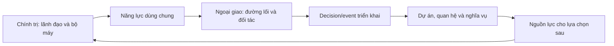
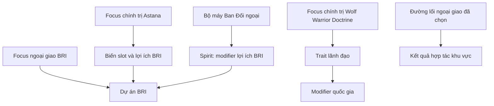
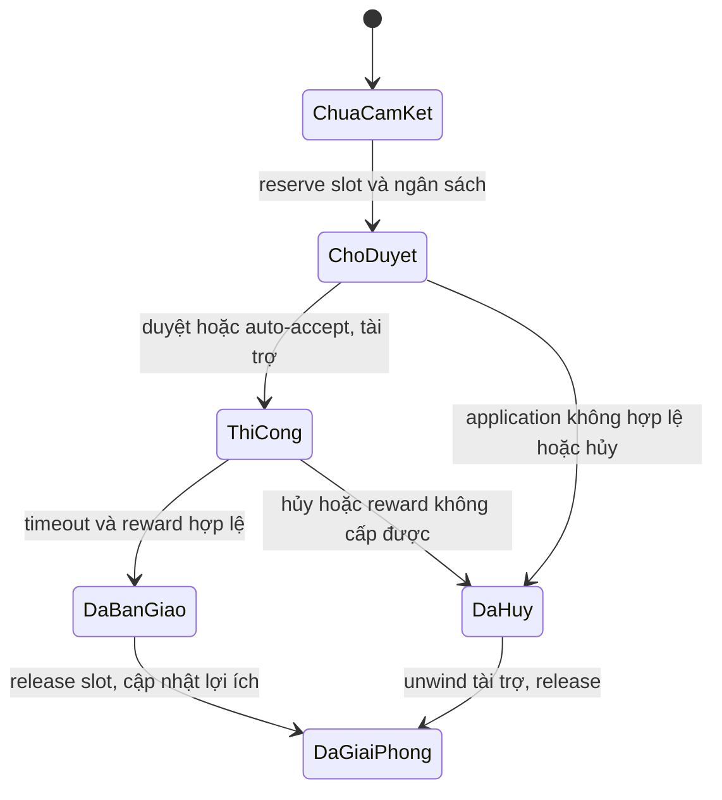
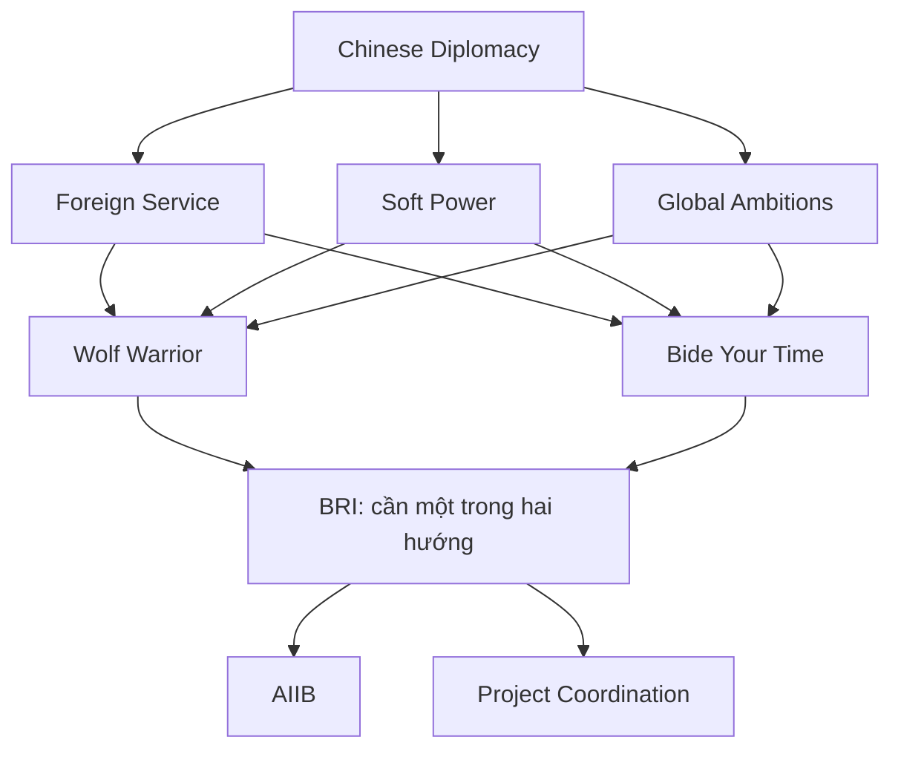

# Phân tích chính trị và ngoại giao/phát triển đối ngoại Trung Quốc — Millennium Dawn

## 1. Phạm vi, nguồn và phương pháp

> Đọc code ngày **14/10/2026**, từ bản MD Workshop `2777392649` đang cài. Đây là phân tích thiết kế/script; **chưa chạy engine, playtest hoặc xác nhận cân bằng Trung Quốc**. Nhân vật, tuyến thay thế và mục tiêu chiến lược mô tả nội dung mod, không xác nhận lịch sử ngoài đời.

**Kết luận:** chính trị và ngoại giao có cây tương đối độc lập. Chính trị cung cấp lãnh đạo, đặc tính, bộ máy và năng lực dự án; ngoại giao chọn cách sử dụng năng lực đó, đối tác và mục tiêu. Liên kết chính nằm ở trait, spirit, dynamic modifier và biến dự án dùng chung. Việt Nam có thể học cách phân trách nhiệm này, tận dụng BoP/cohesion/tier hiện có.

| Đoạn nội dung trong `05_china.txt` | Focus thường | Phạm vi |
|---|---:|---|
| Chính trị trước `# Military` | 70 | Sáu cụm lãnh đạo/chương trình nhà nước |
| Ngoại giao từ `# Diplomacy` | 81 | Biển Đông, tiểu lục địa Ấn Độ, Nhật và SCO |
| Phát triển đối ngoại từ tiêu đề tương ứng đến trước `CHI_coastal_sez_2nd_generation` | 69 | Đường lối, BRI và các khu vực đối tác |
| **Hai nhánh trong báo cáo** | **220** | **70 + 81 + 69** |

Toàn file có 558 focus thường. Không tính cửa sổ inlay là focus thường. Không đếm 20 focus kinh tế/vùng nằm tiếp sau ngoại giao vào phần phát triển đối ngoại.

Phương pháp: dùng parser của repo lấy ID, cost, prerequisite, mutex, available, reward và AI; cộng đệ quy `relative_position_id` để tính tọa độ tuyệt đối; đọc định nghĩa effect/trigger/idea/trait/DM/decision/event/on_action/history liên quan. Nguồn và số dòng ở mục 11.

Trong 150 focus đối ngoại, phép rà prerequisite và `has_completed_focus` **không tìm thấy tham chiếu trực tiếp tới 70 focus chính trị**. Đây là kết quả trong phạm vi nêu trên, không phủ nhận liên kết gián tiếp qua effect, modifier, trait hoặc AI. Snapshot đang cài không đại diện cho mọi phiên bản upstream.

## 2. Cấu trúc nội dung và vòng lặp gameplay

| Nhánh | Câu hỏi của người chơi | Hành động | Hậu quả |
|---|---|---|---|
| Chính trị | Ai lãnh đạo và bộ máy có năng lực gì? | Chọn chính sách, điều chỉnh BoP, chuẩn bị đại hội, chọn cơ quan | Kế nhiệm, trait, spirit và năng lực quốc gia |
| Đối ngoại | Dùng năng lực ấy với ai và theo điều kiện nào? | Chọn đường lối, mở hợp tác, triển khai, xử lý phản ứng | Quan hệ, ảnh hưởng, dự án và nghĩa vụ |

Đây là vòng lặp thiết kế tổng quát; không có nghĩa mọi khoản lợi ích ngoại giao đều viết trực tiếp vào BoP.

Nội dung được xây theo năm lớp: **chủ đề → chính sách focus → triển khai decision/mission → phản hồi event → trạng thái bền qua trait/idea/DM/flag/ledger**. Focus nhỏ có thể cấp kết quả trực tiếp; không phải mọi focus cần đủ năm lớp.

## 3. Nhánh chính trị

### 3.1. Nội dung qua các tuyến lãnh đạo

| Cụm | Focus | Vai trò trong chiến dịch của mod |
|---|---:|---|
| Giang Trạch Dân | 12 | Chính sách đầu chiến dịch, phát triển vùng, chuẩn bị kế nhiệm |
| Hồ Cẩm Đào | 10 | Quản trị, đánh giá cán bộ, giám sát và cân bằng phát triển |
| Chương trình nhà nước dùng chung | 10 | Kế hoạch, ngân hàng, DNNN, y tế, thương mại và đường sắt |
| Tăng Khánh Hồng | 9 | Tổ chức, mạng lưới cán bộ, ven biển và kế nhiệm |
| Tập Cận Bình | 18 | Kỷ luật, tập trung chỉ đạo, BRI, công nghiệp và củng cố chế độ |
| Bạc Hy Lai | 11 | Tuyến thay thế trong gameplay, huy động và tái phân phối |
| **Tổng** | **70** | **12 + 10 + 10 + 9 + 18 + 11** |

Các cửa lãnh đạo kiểm `has_country_leader`. Hoàn thành tiền đề không tự bảo đảm tuyến kế tiếp mở: đồ thị focus phải phù hợp trạng thái nhân sự.

### 3.2. BoP, decision và kế nhiệm

`CHI_factional_balance` khởi đầu **-0,35**. Trái: Princeling/Shanghai; phải: Tuanpai/Youth League. Vùng trung tâm `CHI_collective_leadership_active` từ **-0,30 đến +0,30**. Các vùng ngoài có bộ modifier khác nhau.

Vùng trung tâm khai báo PP/ngày +0,05, modifier ổn định +0,10, tốc độ xây dựng +0,03 và `consumer_goods_factor = -0.02`. Đây là modifier đang áp dụng trong vùng, không phải thưởng một lần.

| Decision | PP | Trường thời gian | BoP khi chọn |
|---|---:|---|---:|
| `CHI_back_princeling_network` | 75 | `days_remove = 180` | -0,20 |
| `CHI_promote_youth_league` | 75 | `days_remove = 180` | +0,20 |

**Không diễn giải `days_remove = 180` thành cooldown chung 180 ngày.** Code không tự chứng minh hai nút khóa chung hoặc dùng `days_re_enable`. Bộ Việt Nam 75 PP/±0,05/cooldown chung 180 là thiết kế riêng.

Trait có thể tạo drift BoP hằng ngày. Lựa chọn chính sách và lãnh đạo vì thế cùng ảnh hưởng thanh trước mốc kế nhiệm.

`CHI_current_congress_mission` chuyển sang mission đại hội tiếp theo. Các đoạn kế nhiệm dùng tooltip dự báo theo vùng BoP, flag chống chọn lại, đổi country leader và ghi `CHI_ic_leader`. Người mới mang trait drift khác, ảnh hưởng các lựa chọn tiếp theo.

**AI có luật riêng:** một số đoạn đặt lại BoP theo historical/global path flag trước khi chọn người kế nhiệm. Không coi kết quả AI là kết quả tự nhiên của thanh trước mốc đó.

### 3.3. Bộ máy là năng lực tăng dần

History khởi tạo ba slot cơ quan `CHI_ic_slot_1/2/3`. `CHI_gain_commission_influence` đọc các slot; on_action gọi nó khi có `CHI_ic_initialized`. Các cơ quan có spirit theo bậc.

Ví dụ `CHI_international_department_1/2/3` có hiệu ứng quan hệ/đầu tư và `CHI_bri_returns_multiplier` **0,05/0,10/0,15**. Chính trị vì thế tác động hiệu quả dự án đối ngoại qua modifier, không cần kéo prerequisite giữa hai cây. Không suy ra mọi cơ quan đều tăng BRI hoặc mọi tổ hợp slot đều cân bằng.

## 4. Nhánh ngoại giao và phát triển đối ngoại

### 4.1. Nội dung khu vực và công cụ phát triển

**81 focus khu vực** tạo tình huống: đối tác, biên giới, biển, tổ chức và lựa chọn hợp tác/gây sức ép/quân sự trong kịch bản mod.

**69 focus phát triển đối ngoại** tạo công cụ: mở bộ máy ngoại giao, chọn đường lối, BRI và hành lang hợp tác. Hai phần giúp người chơi vừa có vấn đề cần giải quyết, vừa có công cụ thực hiện mục tiêu.

### 4.2. Hai đường lối dùng chung nền

`Expand Foreign Service`, `Soft Power Projection`, `Global Ambitions` xuất phát từ root `CHI_Chinese_Diplomacy`. Cả hai đường lối cần **đủ ba focus** và loại trừ nhau.

| Đóng góp trực tiếp của focus | Wolf Warrior Diplomacy | Bide Your Time |
|---|---:|---:|
| `CHI_chinese_aggression` | +3 | -3 |
| `foreign_influence_modifier` qua DM | +0,15 | Không cấp ở trường này |
| `foreign_influence_continent_modifier` qua DM | Không cấp ở trường này | +0,10 |
| `political_power_factor` qua DM | +0,05 | +0,03 |
| `improve_relations_maintain_cost_factor` | +0,30 | -0,25 |
| `opinion_gain_monthly_factor` | -0,15 | +0,10 |
| `trade_opinion_factor` | -0,10 | +0,20 |
| `war_support_factor` | +0,05 | Không cấp ở trường này |

Bảng là đóng góp riêng, không phải tổng modifier quốc gia. Wolf Warrior còn đặt opinion modifier bất lợi với các nước democratic; Bide Your Time cấp `diplomatic_charm` cho các nước khác đang tồn tại.

BRI dùng **một block prerequisite chứa hai ID đường lối**, nên hoàn thành một trong hai là đủ. Không yêu cầu hai focus mutex cùng hoàn thành.

### 4.3. BRI có vòng đời dài

BRI có capacity và số dự án cam kết, ngân sách nội bộ, application, tài trợ cash/loan, mission, bàn giao, rank đối tác, lợi ích đầu tư, ledger nợ/default và tick định kỳ. Các loại dự án gồm cảng, đường sắt, đường ống, viễn thông, SEZ, khai khoáng, điện và prestige.

Khởi tạo có **6 slot**, giá dự án **40**, lợi ích cơ sở **4**. Đây là biến/đơn vị chương trình; không quy đổi tự động ra PP. Astana và Project Coordination Cell mỗi cái thêm 2 slot: **6 + 2 + 2 = 10**, chưa tính nguồn khác.

Focus BRI cấp `CHI_bri_treasury`, trừ treasury quốc gia và gọi effect khởi tạo. Ngân sách nội bộ và tiền quốc gia là hai tài khoản khác nhau, không được cộng lẫn khi tính lợi ích.

### 4.4. Một focus khu vực nhớ đường lối trước đó

`CHI_Mekong_Riparian_Cooperation` dùng ba nhánh reward:

| Trạng thái trước đó | Treasury change | Engagement | Score | Phản ứng |
|---|---:|---:|---|---|
| Wolf Warrior | -160 | +6 | Predatory +2 | Hợp tác LAO/CAM/BRM; opinion `mekong_water_pressure` với SIA/VIE nếu tồn tại |
| Bide Your Time | -110 | +4 | Win-win +3 | Hợp tác LAO/CAM/BRM/SIA/VIE; thêm ổn định cho LAO/CAM nếu tồn tại |
| Fallback trong effect | -130 | +5 | Không cấp hai score trên | Hợp tác LAO/CAM/BRM/SIA/VIE |

Fallback là nhánh code, chưa chứng minh luôn đi tới được bằng đồ thị hợp lệ. Đây không phải ba option độc lập xuất hiện cùng lúc.

Cách xây nội dung đáng học: **một chủ đề và một focus chung, kết quả đọc lựa chọn trước đó**. Không cần nhân đôi cây Mekong để thể hiện hai đường lối.

## 5. Liên kết thực tế giữa hai nhánh

| Kiểu liên kết | Writer | Reader/kết quả | Ý nghĩa |
|---|---|---|---|
| Năng lực dự án | Chính trị: Astana thêm slot/hệ số lợi ích | BRI đọc capacity và công thức lợi ích | Chính trị tăng khả năng thực hiện chính sách bên ngoài |
| Trait lãnh đạo | `CHI_wolf_warrior_doctrine` cấp trait | Modifier ảnh hưởng/PP/chi phí quan hệ | Chính sách nhân sự ảnh hưởng hoạt động đối ngoại |
| Spirit bộ máy | Ban Đối ngoại theo bậc | Complete dự án đọc `modifier@CHI_bri_returns_multiplier` | Bộ máy tăng hiệu quả dự án |
| Nguồn lực chung | Chính trị/kinh tế tạo nguồn lực và chi phí | Ngoại giao dùng treasury, PP và capacity | Hai nhánh cạnh tranh cùng nguồn lực |
| Lựa chọn đường lối | Wolf Warrior/Bide Your Time | Focus khu vực và event đọc trạng thái đã hoàn thành | Quyết định cũ quay lại ở nội dung mới |
| AI profile | Global path flags, trạng thái lãnh đạo | `ai_will_do`, đoạn kế nhiệm | Đường đi AI; không phải khóa người chơi |

**Hai ID gần tên có trách nhiệm khác nhau:** `CHI_wolf_warrior_doctrine` thuộc chính trị, cấp trait; `CHI_Wolf_Warrior_Diplomacy` thuộc ngoại giao, cấp DM và trạng thái đường lối. Hoàn thành cái thứ nhất không đồng nghĩa cái thứ hai đã hoàn thành.

Liên kết này cho phép hai cây nằm xa nhau về layout nhưng vẫn dùng cùng năng lực quốc gia. Không cần biến mỗi focus ngoại giao thành con của một focus chính trị.

## 6. Kiến trúc focus, effect, event, decision và modifier

### 6.1. Phân trách nhiệm

| Lớp | Nhiệm vụ | Ví dụ |
|---|---|---|
| Focus | Đồ thị nội dung, điều kiện, cam kết, thưởng ban đầu | Astana, hai đường lối, BRI |
| Scripted trigger | Gom luật để nhiều caller cùng đọc | `CHI_bri_can_request`, `CHI_bri_reserved_application_is_valid` |
| Scripted effect | Giao dịch/chuyển trạng thái tái sử dụng | Request/start/complete/cancel/release |
| Decision | Hành động người chơi hiện tại | Chỉnh BoP, xin dự án cảng, tái cấu trúc nợ |
| Mission | Theo dõi việc có thời hạn và caller khi kết thúc | `CHI_bri_project_mission` |
| Event | Lựa chọn, thông báo, phản ứng của nước khác | `chi_bri`, `CHI_political_events`, `CHI_foreign` |
| Trait | Đặc tính lãnh đạo khi đang áp dụng | Drift BoP, Wolf Warrior Spirit |
| Idea | Chính sách/trạng thái/năng lực theo bậc | Ban Đối ngoại, spirit BRI |
| Dynamic modifier | Ánh xạ biến sang modifier engine | Political System, Diplomacy Modifier, BRI Presence |
| On_action | Tick định kỳ và phản ứng khi thế giới đổi | Tick BRI, ảnh hưởng cơ quan, cleanup đối tác |
| History | Khởi tạo leader, biến, slot, DM | Country CHI |
| Localisation/GUI | Giải thích điều kiện, hậu quả và dữ liệu | Tooltip kế nhiệm, inlay cơ quan |

### 6.2. Modifier tổng hợp nhiều nguồn

Focus cộng vào biến `CHI_foreign_influence_modifier_diplomacy`; DM ánh xạ biến đó sang hiệu ứng engine. History gắn DM chính trị/kinh tế; root ngoại giao gắn DM ngoại giao.

Ưu điểm: nhiều chính sách cùng xây một trạng thái quốc gia, không cần mỗi focus một spirit. Rủi ro: **DM + trait + idea + vùng BoP** có thể cùng tăng một modifier. Tooltip focus chỉ là phần tăng thêm.

Nếu trait Wolf Warrior Spirit và focus Wolf Warrior Diplomacy cùng áp dụng, các đóng góp đã đọc cộng thành:

- `foreign_influence_modifier`: **0,15 + 0,15 = 0,30**.
- `political_power_factor`: **0,05 + 0,05 = 0,10**.
- `improve_relations_maintain_cost_factor`: **0,25 + 0,30 = 0,55**.

Đây là tổng đóng góp của hai nguồn, không phải kết quả cuối sau mọi modifier/cap của engine. Phải kiểm runtime trước khi kết luận sức mạnh tương đối.

### 6.3. Phân biệt tiền và thời gian

| Trường/lệnh | Ý nghĩa |
|---|---|
| Focus `cost` | Đơn vị thời gian focus |
| Decision `cost` | PP |
| `treasury_change` + `modify_treasury_effect` | Giao dịch ngân khố MD |
| `CHI_bri_treasury` | Ngân sách nội bộ chương trình |
| `int_investment_change` | Thay đổi đầu tư quốc tế qua effect MD; không tự gọi là thu tiền mặt |
| `days_remove` | Thời gian decision đang hoạt động |
| `days_re_enable` | Thời gian tái mở decision theo cơ chế engine |
| `days_mission_timeout` | Thời gian mission tới timeout; timeout có thể là hoàn thành |

Mission BRI dùng **730 ngày timeout để gọi complete**. Không áp cách hiểu “deadline hết là fail” của nhiệm vụ Việt Nam cho mission này.

### 6.4. Vòng đời dự án

Đây là sơ đồ suy ra từ effect, không phải enum duy nhất trong script. Code dùng nhiều flag/biến để biểu diễn trạng thái.

Request reserve slot/ngân sách và lưu `bri_project_cost_committed`. Start kiểm application, tài trợ cash hoặc loan và kích hoạt mission. Complete chỉ cộng completed/rank/lợi ích khi reward thực sự được cấp. Hủy hoặc bàn giao không thành công có nhánh unwind rồi release. Học cách quản lý vòng đời này có ích hơn việc sao chép số lượng focus.

### 6.5. Ledger và tick

Ledger nợ dùng mảng debtor/principal/rate, cần giữ index đồng bộ. Tick xử lý trả nợ, grace/default và cleanup. On_action còn phản ứng khi đối tác biến mất hoặc quan hệ đổi.

**Tên biến không đủ để xác định chiều tiền:** `CHI_bri_monthly_tick` tính `bri_contribution` từ `CHI_bri_monthly_income_base + modifier@CHI_bri_monthly_income`, chặn dưới 0 và giới hạn theo ngân khố đang có. Sau đó nó **trừ treasury quốc gia và cộng ngân sách BRI**. Vì vậy, trong đoạn này “monthly income” là nguồn cấp vào chương trình từ ngân khố, không phải tiền miễn phí sinh ra cho quốc gia. Tick còn gọi recalc presence, process loans, schedule application và mark dirty. Phải đọc từng giao dịch khi tính lợi ích ròng.

Xóa flag default không đồng nghĩa xóa nợ: ledger vẫn tồn tại và tick có thể đặt default lại. Đây là bài học về tách **trạng thái hiển thị** với **nghĩa vụ**. Việt Nam chưa cần sao chép hệ thống tín dụng nhiều nước để có nội dung đối ngoại sâu.

## 7. Layout và đồ thị prerequisite

### 7.1. Tọa độ tuyệt đối đo từ script

| Cụm | Focus | X | Y | Root |
|---|---:|---|---|---|
| Chính trị | 70 | 0–17 | 0–18 | Three Represents: (9,0) |
| Ngoại giao khu vực | 81 | 26–88 | 0–8 | Chinese Diplomacy: (55,0) |
| Phát triển đối ngoại | 69 | 41–65 | 1–13 | Dùng root ngoại giao |

Đây là đơn vị script, không phải pixel hoặc khoảng cách đo trong game. Cụm phát triển nằm trong bề rộng ngoại giao và đi xuống sâu hơn. Bảng chưa chứng minh đường nối/overlap đã hợp lý trong UI.

### 7.2. Chính trị: trục thời gian và các cánh lãnh đạo

| Node | Tọa độ |
|---|---|
| Three Represents | (9,0) |
| Hu Jintao Reign | (3,5) |
| Eleventh Five Year Plan | (9,5) |
| Zeng Qinghong Reign | (15,5) |
| Chinese Dream | (5,11) |
| Chongqing Model Nationalisation | (13,11) |

Chương trình nhà nước gần trục giữa; các tuyến lãnh đạo ở hai cánh. Gate nhân sự quyết định tuyến khả dụng. Không nhất thiết mọi tuyến thay thế đều được khai báo mutex.

70 focus có **4 entry mutex**, tương ứng hai cặp đối xứng: 610 Office/Lighter Touch và Xi Jinping Thought/Two Establishments. Không đếm 4 entry thành 4 cặp lựa chọn.

### 7.3. Đối ngoại: nền chung → lựa chọn → hội tụ

| Node | Tọa độ | Prerequisite |
|---|---|---|
| Chinese Diplomacy | (55,0) | Root |
| Expand Foreign Service | (53,1) | Root |
| Soft Power Projection | (55,1) | Root |
| Global Ambitions | (57,1) | Root |
| Wolf Warrior Diplomacy | (50,2) | AND ba nền tảng |
| Bide Your Time | (61,2) | AND ba nền tảng |
| Belt and Road Initiative | (55,4) | OR hai đường lối |
| AIIB Founding | (55,5) | BRI |
| Project Coordination Cell | (58,5) | BRI |
| Mekong Riparian Cooperation | (58,8) | Digital Silk Road Initiative |

Sơ đồ giải thích đồ thị, không tái tạo tọa độ màn hình. W/Q là mutex; BRI nhận OR. Nhiều block prerequisite riêng là AND; nhiều ID trong cùng một block là OR.

### 7.4. Nhịp thời lượng

| Cost | Chính trị | Ngoại giao khu vực | Phát triển đối ngoại |
|---:|---:|---:|---:|
| 1 | 1 | 0 | 0 |
| 3 | 10 | 19 | 12 |
| 5 | 17 | 38 | 29 |
| 7 | 26 | 19 | 23 |
| 10, gồm mặc định | 14 | 5 | 4 |
| 15 | 2 | 0 | 1 |
| **Tổng** | **70** | **81** | **69** |

Phân phối cho thấy chính trị dành nhiều lịch focus cho các chính sách lớn; ngoại giao có nhiều node cost 3/5. Đây là phân tích nhịp nội dung, chưa phải kết luận cost từng node cân bằng.

### 7.5. Bài học bố cục

- Đặt năng lực chung ở giữa; đối tác/khu vực tỏa sang hai bên.
- Cặp đường lối rõ tên/vị trí; phần chung phía dưới hội tụ OR.
- Dùng prerequisite cho quan hệ nội dung bắt buộc; available cho lãnh đạo, nguồn lực và ngày.
- Hai cây độc lập vẫn liên hệ qua modifier; không kéo dây ngang xuyên cây cho mọi ảnh hưởng.
- Cần kiểm UI thực về độ rộng, shortcut, overlap và dây nối. Chưa nghiệm thu layout Trung Quốc trong game.

## 8. Luồng gameplay tiêu biểu

### 8.1. Từ chính trị tới lợi ích dự án

1. Đi tuyến chính trị có Astana khi lãnh đạo phù hợp: thêm 2 slot và hệ số lợi ích cơ sở +0,05.
2. Bộ máy Ban Đối ngoại cấp modifier BRI theo bậc đang áp dụng.
3. Root ngoại giao → ba nền tảng → một đường lối → BRI mở hệ thống dự án.
4. Khi bàn giao thành công, complete đọc các hệ số đang áp dụng.

Công thức từ `CHI_bri_complete_project`:

`int_investment_change = CHI_bri_return_per_project × (1 + CHI_bri_returns_multiplier_base + modifier@CHI_bri_returns_multiplier)`.

Ví dụ chỉ tính các nguồn đã nêu: cơ sở 4, Astana +0,05, Ban Đối ngoại bậc 3 +0,15 → **4 × (1 + 0,05 + 0,15) = 4,8**. Đây là giá trị đưa vào effect đầu tư quốc tế, không phải khẳng định thu 4,8 ngân khố/tháng. Đoạn effect đọc modifier lúc complete; chưa thấy snapshot hệ số lợi ích lúc ký trong đoạn đã xét.

### 8.2. Chuỗi xin dự án cảng

1. Bên nhận chọn `BRI_apply_for_port_project`: cost 30 PP, `days_re_enable = 540`, kiểm request/host.
2. Ghi loại dự án 1; reserve slot/ngân sách, lưu giá đã cam kết và giữ pipeline busy.
3. Nếu auto-accept, start ngay; nếu không, đặt pending và gọi `chi_bri.9`.
4. Start kiểm application hợp lệ, tài trợ cash hoặc loan, kích hoạt mission.
5. Mission 730 ngày gọi complete; thành công cập nhật completed/rank/lợi ích; reward không cấp được thì unwind tài trợ.
6. Release xóa busy/pending/financing và trả slot.

Luồng mô tả caller được đọc; chưa xác minh routing của mọi event, AI chấp thuận hoặc bàn giao công trình trong engine.

### 8.2a. Event duyệt là nơi đối tác có quyền trả lời

`chi_bri.9` là event ẩn, chuyển lời gọi tới CHI qua `chi_bri.10`. Event `.10` kiểm `original_tag = CHI` và có hai option:

| Option | Caller chuyển trạng thái | AI trong script |
|---|---|---|
| `.a`: duyệt | `FROM = { CHI_bri_start_project = yes }` | Base 8; thêm 3 nếu bên xin có chính phủ communism, thêm 2 nếu cùng faction |
| `.d_opt`: từ chối | `FROM = { CHI_bri_cancel_project = yes }` | Base 2; thêm 5 nếu opinion với CHI dưới -10, thêm 3 nếu GDP/người thuộc ngưỡng trigger; factor 0 nếu bên xin có chính phủ communism |

Các trọng số không phải xác suất cố định 80%/20%; điều kiện làm thay đổi tổng trọng số. `FROM` nhắm bên xin trong đường gọi được thiết kế này; cần kiểm chuỗi event thực trong engine để nghiệm thu scope. Event ra quyết định, effect thực hiện giao dịch; không nhân đôi logic tài trợ trong từng option.

### 8.3. Chính sách quay lại trong nội dung khu vực

Đường lối ngoại giao đã hoàn thành được đọc tại Mekong. Một focus chung tạo gói chi phí, engagement và phản ứng đối tác khác nhau. Đây là “trí nhớ chính sách” bằng một reader có điều kiện, thay vì nhân đôi cây nội dung.

### 8.4. Bộ máy và giá trị cơ hội

Chọn cơ quan quốc tế sử dụng slot hữu hạn để lấy lợi ích đối ngoại, thay cho cơ quan khác. Chi phí cơ hội đến từ giới hạn bộ máy. Chưa tính giá trị mọi tổ hợp cơ quan; không kết luận một tổ hợp cân bằng hoặc không thống trị tổ hợp khác.

## 9. Điểm mạnh, rủi ro và giới hạn kiểm chứng

### 9.1. Điểm mạnh

- Hai cây mở tương đối độc lập nhưng dùng chung năng lực quốc gia.
- Chính trị ảnh hưởng đối ngoại bằng slot, hệ số lợi ích và chi phí quan hệ đo được.
- Một quyết định đường lối có nhiều reader, tạo hậu quả dài hạn.
- Effect chung tập trung giao dịch, bàn giao, hủy và release.
- Đối tác có hành động/phản ứng, không chỉ là mục tiêu tăng opinion.
- Layout phân nền tảng, lựa chọn và hội tụ.

### 9.2. Rủi ro cần tránh khi học theo

| Rủi ro | Biểu hiện | Cách giảm khi áp dụng |
|---|---|---|
| Bonus nhiều lớp | Trait + DM + spirit + BoP cùng tăng modifier | Bảng nguồn thưởng, hiển thị đóng góp và tổng |
| Nhiều nguồn quyết định cùng việc | Leader thật và `CHI_ic_leader`; tooltip và effect kế nhiệm | Một luật tính, UI đọc cùng luật |
| Scope quốc tế khó theo dõi | ROOT/FROM/PREV, recipient/investor đổi scope | Caller rõ, guard nước tồn tại/state hợp lệ |
| Ledger nhân tổ hợp trạng thái | Pending, cash/loan, default/grace, war/annex | Bản đầu giới hạn hợp đồng/trạng thái |
| AI khác người chơi | AI bị đặt lại BoP/path trước lựa chọn | Báo riêng luật người chơi và AI |
| Tooltip mở khóa khác luật thật | `unlock_decision_tooltip` chỉ thông báo | Đối chiếu visible/available/activation |
| Mốc chỉ nằm trong AI | `ai_will_do date` không khóa người chơi | Gate ngày ở available nếu là luật chung |
| Module lớn, nhiều caller | Khu vực, kinh tế và state machine cùng file | Chia trách nhiệm và giữ định nghĩa duy nhất |

Ví dụ: Astana kiểm lãnh đạo trong available; ngày nằm trong trọng số AI. Không dùng ngày đó làm bằng chứng người chơi cũng bị khóa tới mốc tương ứng.

### 9.3. Những điều chưa chứng minh

Chưa kết luận dominance hai đường lối, lợi ích ròng BRI, softlock mọi tuyến, performance loop nhiều quốc gia, save migration, UI thực tế hay độ đúng lịch sử. Các phép đếm/tọa độ/số học không thay playtest hoặc audit upstream MD. Không sửa bug Trung Quốc trong đợt viết báo cáo.

## 10. Áp dụng cho Việt Nam với phạm vi gọn

### 10.1. Tách mục tiêu đối ngoại và cách thực hiện

**Ngoại giao chọn đối tác/mục tiêu; chính trị quyết định năng lực và cách triển khai cam kết.** BoP tập thể/tập trung không mặc định tương ứng thân Mỹ/thân Trung Quốc.

| Cơ chế Việt Nam có | Reader đối ngoại đề xuất | Giới hạn |
|---|---|---|
| BoP | Chọn quy trình chuẩn/cấp tốc khi mở hợp đồng | Dự án đã ký giữ timer |
| Cohesion | Điều kiện xử lý phản đối trong nước | Không tạo thanh đồng thuận ngoại giao thứ hai |
| Tier cán bộ | Quyền/thời gian ký đã chốt | Cùng nguồn tham số |
| Tier công vụ | Điều kiện dự án cần phối hợp hành chính | Chưa chốt thưởng/giá mới |
| Tier kiểm tra | Điều kiện nghiệm thu dự án nhạy cảm | Không bắt mọi hợp đồng qua chuỗi kiểm tra dài |
| Tier dân vận | Điều kiện dự án có tác động dân cư | Chỉ dùng khi có hậu quả xã hội thực sự |

Đây là **đề xuất**, không khẳng định các reader đã triển khai trong engine. Mỗi dự án chỉ dùng tier có tác động rõ tới lựa chọn/kết quả; không mặc định kiểm đủ bốn tier.

### 10.2. Mẫu nội dung tối thiểu

`Focus đối tác → event chọn một ưu tiên → decision thực hiện → kết quả bàn giao`.

Một hợp tác công nghệ có thể cho chọn đào tạo nhân lực hoặc tiếp nhận công nghệ với điều kiện khác nhau. Dùng PP/ngân khố, công nghệ và năng lực hiện có; chưa thêm điểm uy tín, điểm ảnh hưởng đối tác hoặc ledger vay quốc tế riêng.

Mỗi chuỗi phải ghi caller, đối tượng, gate, giá, lịch, kết quả, từ chối/hủy, guard nhận thưởng và tooltip. Giá/timer mới vào B1 và tính bằng script sau khi người dùng chốt.

### 10.3. Kiến trúc nên giữ

Giữ effect triển khai chung, trigger dùng cho available/tooltip/AI, phân biệt trait/idea/DM, trạng thái dự án hữu hạn, hậu quả quay lại và layout nền chung → lựa chọn → hội tụ.

Chưa sao chép nhiều slot cơ quan mới, drift BoP theo lãnh đạo, mạng lưới đầu tư toàn cầu, debtor/loan/default, GUI quốc tế hoặc các tuyến chinh phục. Làm một chuỗi mẫu có hậu quả rõ trước khi mở rộng.

### 10.4. Tình trạng Việt Nam khi lập báo cáo

Snapshot đang đọc vẫn có `VIE_is_collective_zone`, `VIE_is_central_zone` và các gate dùng `check_variable` với ID BoP `VIE_leadership_balance`. Cách đọc này chưa chứng minh lấy được giá trị thanh engine; cần sửa sang trigger BoP thật trước khi dùng làm reader đối ngoại.

Hai decision lặp lại mới được chốt **75 PP, ±0,05, cooldown chung 180 ngày, hiệu lực ngay, không thêm thưởng**. Báo cáo không triển khai hoặc tuyên bố chúng hoạt động.

Giữ 74 node chính trị. Focus đối ngoại/phát triển mới cần thống kê/phạm vi riêng; chưa chốt số lượng. Đợt viết báo cáo không sửa gameplay, tài liệu nguồn, B1 hoặc CSV.

## 11. Danh mục bằng chứng và câu hỏi thiết kế

### 11.1. Nguồn chính

Đường dẫn là bản Workshop đang cài; số dòng có thể đổi khi MD cập nhật.

| Nguồn | Nội dung |
|---|---|
| [Chính trị](</D:/SteamLibrary/steamapps/workshop/content/394360/2777392649/common/national_focus/05_china.txt:52>) | 70 focus, chính sách/lãnh đạo |
| [Astana](</D:/SteamLibrary/steamapps/workshop/content/394360/2777392649/common/national_focus/05_china.txt:2179>) | Slot/lợi ích BRI |
| [Root ngoại giao](</D:/SteamLibrary/steamapps/workshop/content/394360/2777392649/common/national_focus/05_china.txt:9766>) | DM và nội dung khu vực |
| [Nền tảng và đường lối](</D:/SteamLibrary/steamapps/workshop/content/394360/2777392649/common/national_focus/05_china.txt:14498>) | AND/OR/mutex |
| [BRI](</D:/SteamLibrary/steamapps/workshop/content/394360/2777392649/common/national_focus/05_china.txt:15154>) | Mở hệ thống, chi ngân khố |
| [Mekong](</D:/SteamLibrary/steamapps/workshop/content/394360/2777392649/common/national_focus/05_china.txt:15592>) | Reward theo đường lối |
| [BoP](</D:/SteamLibrary/steamapps/workshop/content/394360/2777392649/common/bop/CHI.txt:1>) | Vùng và modifier |
| [Trait](</D:/SteamLibrary/steamapps/workshop/content/394360/2777392649/common/country_leader/CHI_traits.txt:83>) | Wolf Warrior Spirit; drift ở đầu file |
| [Ban Đối ngoại](</D:/SteamLibrary/steamapps/workshop/content/394360/2777392649/common/ideas/05_china.txt:2461>) | Spirit theo bậc |
| [DM ngoại giao](</D:/SteamLibrary/steamapps/workshop/content/394360/2777392649/common/dynamic_modifiers/99_CHI_dynamic_modifiers.txt:191>) | Biến → modifier |
| [Effect BRI](</D:/SteamLibrary/steamapps/workshop/content/394360/2777392649/common/scripted_effects/05_CHI_scripted_effects.txt:562>) | Request/start/complete/cancel/release |
| [Ledger](</D:/SteamLibrary/steamapps/workshop/content/394360/2777392649/common/scripted_effects/05_CHI_scripted_effects.txt:1897>) | Trả nợ/default |
| [Đại hội](</D:/SteamLibrary/steamapps/workshop/content/394360/2777392649/common/decisions/05_CHI_decisions.txt:1974>) | Mission, kế nhiệm, AI |
| [Xin dự án](</D:/SteamLibrary/steamapps/workshop/content/394360/2777392649/common/decisions/05_CHI_decisions.txt:8079>) | Cost/gate/caller |
| [Mission BRI](</D:/SteamLibrary/steamapps/workshop/content/394360/2777392649/common/decisions/05_CHI_decisions.txt:8574>) | Timeout bàn giao |
| [Decision phe phái](</D:/SteamLibrary/steamapps/workshop/content/394360/2777392649/common/decisions/05_CHI_decisions.txt:11639>) | 75 PP, ±0,20, days_remove 180 |
| [Application event](</D:/SteamLibrary/steamapps/workshop/content/394360/2777392649/events/05_china.txt:7358>) | Caller application BRI |
| [On_action](</D:/SteamLibrary/steamapps/workshop/content/394360/2777392649/common/on_actions/99_CHI_on_actions.txt:191>) | Tick BRI; ảnh hưởng cơ quan gần dòng 321 |
| [Inlay](</D:/SteamLibrary/steamapps/workshop/content/394360/2777392649/common/focus_inlay_windows/chi_national_committee_inlay_window.txt:1>) | UI lãnh đạo/slot |
| [History](</D:/SteamLibrary/steamapps/workshop/content/394360/2777392649/history/countries/CHI - China.txt:3146>) | Leader ID/slot |
| [Trigger Việt Nam](common/scripted_triggers/VIE_md_triggers_politics.txt) | Cách đọc BoP cần sửa |

### 11.2. Quyết định trước khi viết chuỗi mẫu Việt Nam

1. Chuỗi đầu là hợp tác công nghệ, hạ tầng hay an ninh?
2. Tier nào tạo lựa chọn có ý nghĩa? Không dùng cả bốn chỉ vì chúng tồn tại.
3. Thất bại trả phần vốn chưa dùng, mất cơ hội hay để lại nghĩa vụ? Hiển thị trước khi chọn.
4. Đối tác phản ứng qua event/điều kiện nào? Tách giả định gameplay với căn cứ lịch sử.
5. Mỗi phần thưởng nằm ở idea, DM hay reward trực tiếp? Một owner để tránh cấp trùng.

**Hướng ưu tiên:** sửa nền BoP, giữ 74 node chính trị, dùng một focus đối tác hiện có làm chuỗi mẫu; nối bằng tier và trạng thái dự án rồi mới mở rộng. Báo cáo này phân tích và đề xuất, chưa sửa gameplay hoặc chốt tham số mới.
