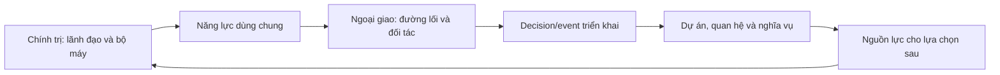
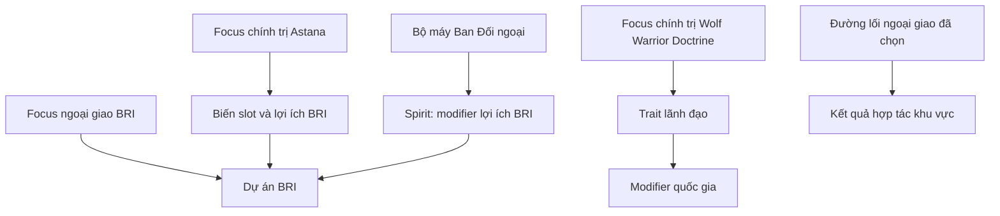
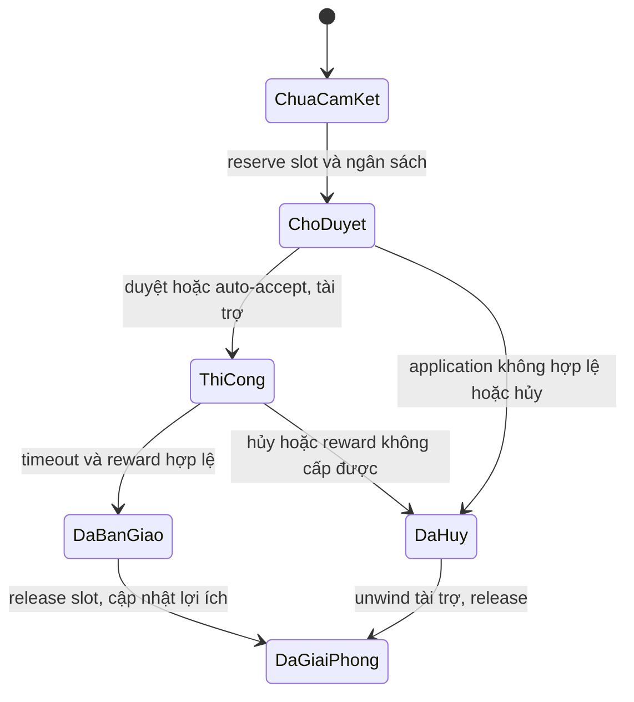
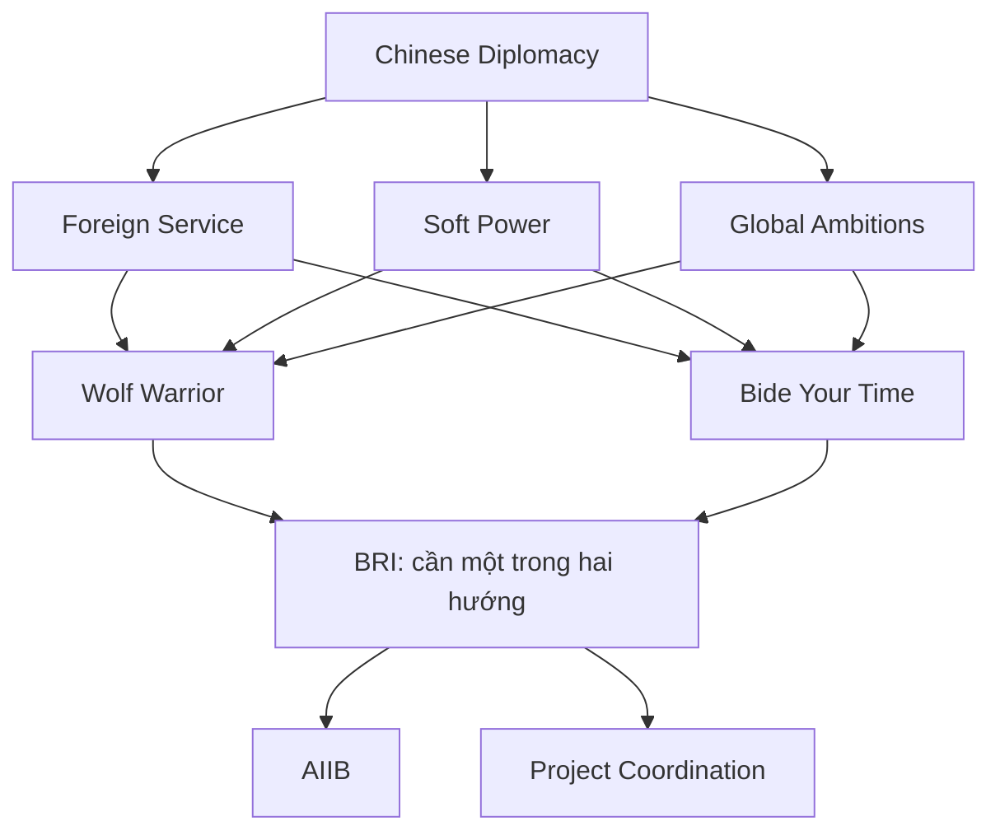
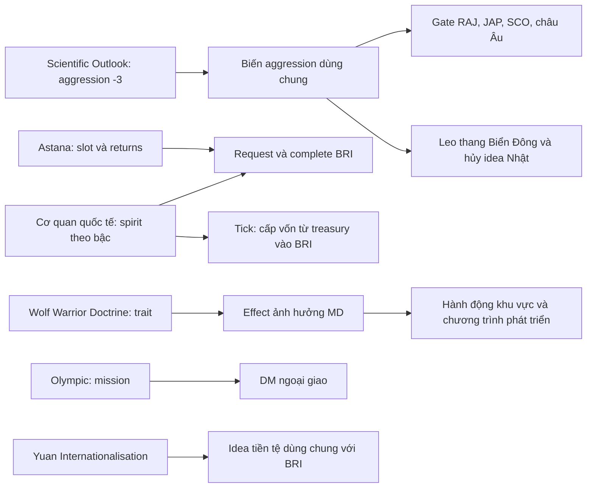
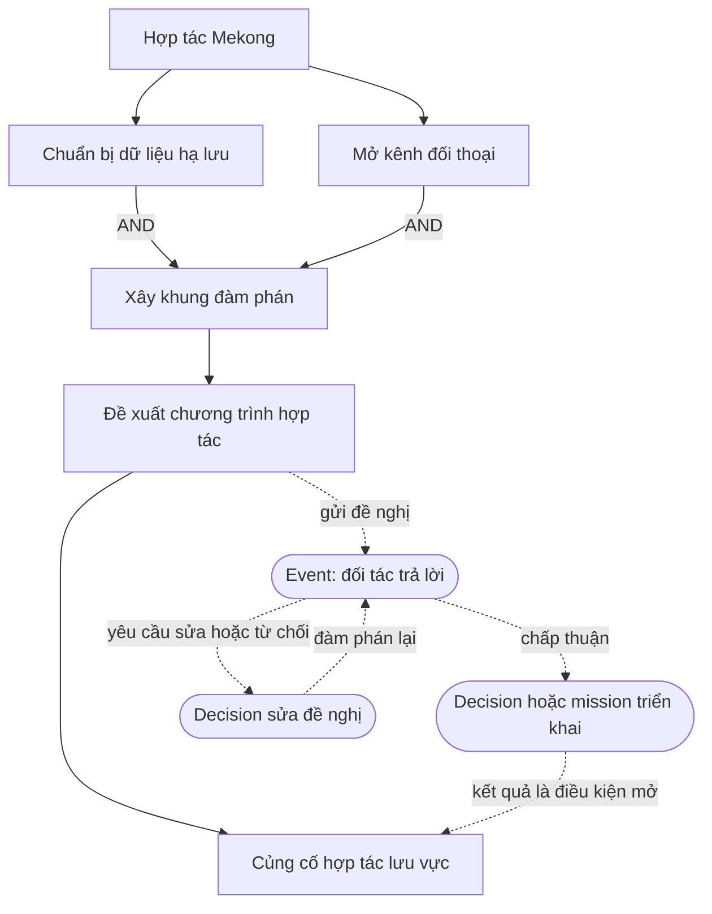

# Phân tích chính trị và ngoại giao/phát triển đối ngoại Trung Quốc — Millennium Dawn

> **Bổ sung chuyên sâu ngày 14/10/2026:** mục **12–16** phân tích toàn bộ hai nhánh đối ngoại và các đường truyền ảnh hưởng từ chính trị; mục **17–18** tra từng focus trong bộ **81 + 69**. Mục 10 và 11.2 lưu đề xuất Việt Nam ở lần viết trước, không phải quyết định giữ nội dung cũ hay điều kiện bắt buộc cho một thiết kế mới.

> **Nguyên tắc thiết kế Việt Nam:** mục **19** chuyển các bài học kiến trúc và layout của Ngoại giao khu vực thành nguyên tắc xây nội dung mới, kèm sơ đồ minh họa. Đây là định hướng thiết kế, chưa chốt danh sách focus, tọa độ, chi phí hoặc reward.

## 1. Phạm vi, nguồn và phương pháp

> Đọc code ngày **14/10/2026**, từ bản MD Workshop `2777392649` đang cài. Đây là phân tích thiết kế/script; **chưa chạy engine, playtest hoặc xác nhận cân bằng Trung Quốc**. Nhân vật, tuyến thay thế và mục tiêu chiến lược mô tả nội dung mod, không xác nhận lịch sử ngoài đời.

**Kết luận:** chính trị và ngoại giao có cây tương đối độc lập. Chính trị cung cấp lãnh đạo, đặc tính, bộ máy và năng lực dự án; ngoại giao chọn cách sử dụng năng lực đó, đối tác và mục tiêu. Liên kết chính nằm ở trait, spirit, dynamic modifier và biến dự án dùng chung. Việt Nam có thể học cách phân trách nhiệm này, tận dụng BoP/cohesion/tier hiện có.

| Đoạn nội dung trong `05_china.txt` | Focus thường | Phạm vi |
|---|---:|---|
| Chính trị trước `# Military` | 70 | Sáu cụm lãnh đạo/chương trình nhà nước |
| Ngoại giao từ `# Diplomacy` | 81 | Biển Đông, tiểu lục địa Ấn Độ, Nhật và SCO |
| Phát triển đối ngoại từ tiêu đề tương ứng đến trước `CHI_coastal_sez_2nd_generation` | 69 | Đường lối, BRI và các khu vực đối tác |
| **Ba phần trong báo cáo** | **220** | **70 + 81 + 69** |

Toàn file có 558 focus thường. Không tính cửa sổ inlay là focus thường. Không đếm 20 focus kinh tế/vùng nằm tiếp sau ngoại giao vào phần phát triển đối ngoại.

Phương pháp: dùng parser của repo lấy ID, cost, prerequisite, mutex, available, reward và AI; cộng đệ quy `relative_position_id` để tính tọa độ tuyệt đối; đọc định nghĩa effect/trigger/idea/trait/DM/decision/event/on_action/history liên quan. Nguồn và số dòng ở mục 11.

Trong 150 focus đối ngoại, phép rà prerequisite và `has_completed_focus` **không tìm thấy tham chiếu trực tiếp tới 70 focus chính trị**. Đây là kết quả trong phạm vi nêu trên, không phủ nhận liên kết gián tiếp qua effect, modifier, trait hoặc AI. Snapshot đang cài không đại diện cho mọi phiên bản upstream.

## 2. Cấu trúc nội dung và vòng lặp gameplay

| Nhánh | Câu hỏi của người chơi | Hành động | Hậu quả |
|---|---|---|---|
| Chính trị | Ai lãnh đạo và bộ máy có năng lực gì? | Chọn chính sách, điều chỉnh BoP, chuẩn bị đại hội, chọn cơ quan | Kế nhiệm, trait, spirit và năng lực quốc gia |
| Đối ngoại | Dùng năng lực ấy với ai và theo điều kiện nào? | Chọn đường lối, mở hợp tác, triển khai, xử lý phản ứng | Quan hệ, ảnh hưởng, dự án và nghĩa vụ |

Đây là vòng lặp thiết kế tổng quát; không có nghĩa mọi khoản lợi ích ngoại giao đều viết trực tiếp vào BoP.

Nội dung được xây theo năm lớp: **chủ đề → chính sách focus → triển khai decision/mission → phản hồi event → trạng thái bền qua trait/idea/DM/flag/ledger**. Focus nhỏ có thể cấp kết quả trực tiếp; không phải mọi focus cần đủ năm lớp.

## 3. Nhánh chính trị

### 3.1. Nội dung qua các tuyến lãnh đạo

| Cụm | Focus | Vai trò trong chiến dịch của mod |
|---|---:|---|
| Giang Trạch Dân | 12 | Chính sách đầu chiến dịch, phát triển vùng, chuẩn bị kế nhiệm |
| Hồ Cẩm Đào | 10 | Quản trị, đánh giá cán bộ, giám sát và cân bằng phát triển |
| Chương trình nhà nước dùng chung | 10 | Kế hoạch, ngân hàng, DNNN, y tế, thương mại và đường sắt |
| Tăng Khánh Hồng | 9 | Tổ chức, mạng lưới cán bộ, ven biển và kế nhiệm |
| Tập Cận Bình | 18 | Kỷ luật, tập trung chỉ đạo, BRI, công nghiệp và củng cố chế độ |
| Bạc Hy Lai | 11 | Tuyến thay thế trong gameplay, huy động và tái phân phối |
| **Tổng** | **70** | **12 + 10 + 10 + 9 + 18 + 11** |

Các cửa lãnh đạo kiểm `has_country_leader`. Hoàn thành tiền đề không tự bảo đảm tuyến kế tiếp mở: đồ thị focus phải phù hợp trạng thái nhân sự.

### 3.2. BoP, decision và kế nhiệm

`CHI_factional_balance` khởi đầu **-0,35**. Trái: Princeling/Shanghai; phải: Tuanpai/Youth League. Vùng trung tâm `CHI_collective_leadership_active` từ **-0,30 đến +0,30**. Các vùng ngoài có bộ modifier khác nhau.

Vùng trung tâm khai báo PP/ngày +0,05, modifier ổn định +0,10, tốc độ xây dựng +0,03 và `consumer_goods_factor = -0.02`. Đây là modifier đang áp dụng trong vùng, không phải thưởng một lần.

| Decision | PP | Trường thời gian | BoP khi chọn |
|---|---:|---|---:|
| `CHI_back_princeling_network` | 75 | `days_remove = 180` | -0,20 |
| `CHI_promote_youth_league` | 75 | `days_remove = 180` | +0,20 |

**Không diễn giải `days_remove = 180` thành cooldown chung 180 ngày.** Code không tự chứng minh hai nút khóa chung hoặc dùng `days_re_enable`. Bộ Việt Nam 75 PP/±0,05/cooldown chung 180 là thiết kế riêng.

Trait có thể tạo drift BoP hằng ngày. Lựa chọn chính sách và lãnh đạo vì thế cùng ảnh hưởng thanh trước mốc kế nhiệm.

`CHI_current_congress_mission` chuyển sang mission đại hội tiếp theo. Các đoạn kế nhiệm dùng tooltip dự báo theo vùng BoP, flag chống chọn lại, đổi country leader và ghi `CHI_ic_leader`. Người mới mang trait drift khác, ảnh hưởng các lựa chọn tiếp theo.

**AI có luật riêng:** một số đoạn đặt lại BoP theo historical/global path flag trước khi chọn người kế nhiệm. Không coi kết quả AI là kết quả tự nhiên của thanh trước mốc đó.

### 3.3. Bộ máy là năng lực tăng dần

History khởi tạo ba slot cơ quan `CHI_ic_slot_1/2/3`. `CHI_gain_commission_influence` đọc các slot; on_action gọi nó khi có `CHI_ic_initialized`. Các cơ quan có spirit theo bậc.

Ví dụ `CHI_international_department_1/2/3` có hiệu ứng quan hệ/đầu tư và `CHI_bri_returns_multiplier` **0,05/0,10/0,15**. Chính trị vì thế tác động hiệu quả dự án đối ngoại qua modifier, không cần kéo prerequisite giữa hai cây. Không suy ra mọi cơ quan đều tăng BRI hoặc mọi tổ hợp slot đều cân bằng.

## 4. Nhánh ngoại giao và phát triển đối ngoại

### 4.1. Nội dung khu vực và công cụ phát triển

**81 focus khu vực** tạo tình huống: đối tác, biên giới, biển, tổ chức và lựa chọn hợp tác/gây sức ép/quân sự trong kịch bản mod.

**69 focus phát triển đối ngoại** tạo công cụ: mở bộ máy ngoại giao, chọn đường lối, BRI và hành lang hợp tác. Hai phần giúp người chơi vừa có vấn đề cần giải quyết, vừa có công cụ thực hiện mục tiêu.

### 4.2. Hai đường lối dùng chung nền

`Expand Foreign Service`, `Soft Power Projection`, `Global Ambitions` xuất phát từ root `CHI_Chinese_Diplomacy`. Cả hai đường lối cần **đủ ba focus** và loại trừ nhau.

| Đóng góp trực tiếp của focus | Wolf Warrior Diplomacy | Bide Your Time |
|---|---:|---:|
| `CHI_chinese_aggression` | +3 | -3 |
| `foreign_influence_modifier` qua DM | +0,15 | Không cấp ở trường này |
| `foreign_influence_continent_modifier` qua DM | Không cấp ở trường này | +0,10 |
| `political_power_factor` qua DM | +0,05 | +0,03 |
| `improve_relations_maintain_cost_factor` | +0,30 | -0,25 |
| `opinion_gain_monthly_factor` | -0,15 | +0,10 |
| `trade_opinion_factor` | -0,10 | +0,20 |
| `war_support_factor` | +0,05 | Không cấp ở trường này |

Bảng là đóng góp riêng, không phải tổng modifier quốc gia. Wolf Warrior còn đặt opinion modifier bất lợi với các nước democratic; Bide Your Time cấp `diplomatic_charm` cho các nước khác đang tồn tại.

BRI dùng **một block prerequisite chứa hai ID đường lối**, nên hoàn thành một trong hai là đủ. Không yêu cầu hai focus mutex cùng hoàn thành.

### 4.3. BRI có vòng đời dài

BRI có capacity và số dự án cam kết, ngân sách nội bộ, application, tài trợ cash/loan, mission, bàn giao, rank đối tác, lợi ích đầu tư, ledger nợ/default và tick định kỳ. Các loại dự án gồm cảng, đường sắt, đường ống, viễn thông, SEZ, khai khoáng, điện và prestige.

Khởi tạo có **6 slot**, giá dự án **40**, lợi ích cơ sở **4**. Đây là biến/đơn vị chương trình; không quy đổi tự động ra PP. Astana và Project Coordination Cell mỗi cái thêm 2 slot: **6 + 2 + 2 = 10**, chưa tính nguồn khác.

Focus BRI cấp `CHI_bri_treasury`, trừ treasury quốc gia và gọi effect khởi tạo. Ngân sách nội bộ và tiền quốc gia là hai tài khoản khác nhau, không được cộng lẫn khi tính lợi ích.

### 4.4. Một focus khu vực nhớ đường lối trước đó

`CHI_Mekong_Riparian_Cooperation` dùng ba nhánh reward:

| Trạng thái trước đó | Treasury change | Engagement | Score | Phản ứng |
|---|---:|---:|---|---|
| Wolf Warrior | -160 | +6 | Predatory +2 | Hợp tác LAO/CAM/BRM; opinion `mekong_water_pressure` với SIA/VIE nếu tồn tại |
| Bide Your Time | -110 | +4 | Win-win +3 | Hợp tác LAO/CAM/BRM/SIA/VIE; thêm ổn định cho LAO/CAM nếu tồn tại |
| Fallback trong effect | -130 | +5 | Không cấp hai score trên | Hợp tác LAO/CAM/BRM/SIA/VIE |

Fallback là nhánh code, chưa chứng minh luôn đi tới được bằng đồ thị hợp lệ. Đây không phải ba option độc lập xuất hiện cùng lúc.

Cách xây nội dung đáng học: **một chủ đề và một focus chung, kết quả đọc lựa chọn trước đó**. Không cần nhân đôi cây Mekong để thể hiện hai đường lối.

## 5. Liên kết thực tế giữa hai nhánh

| Kiểu liên kết | Writer | Reader/kết quả | Ý nghĩa |
|---|---|---|---|
| Năng lực dự án | Chính trị: Astana thêm slot/hệ số lợi ích | BRI đọc capacity và công thức lợi ích | Chính trị tăng khả năng thực hiện chính sách bên ngoài |
| Trait lãnh đạo | `CHI_wolf_warrior_doctrine` cấp trait | Modifier ảnh hưởng/PP/chi phí quan hệ | Chính sách nhân sự ảnh hưởng hoạt động đối ngoại |
| Spirit bộ máy | Ban Đối ngoại theo bậc | Complete dự án đọc `modifier@CHI_bri_returns_multiplier` | Bộ máy tăng hiệu quả dự án |
| Nguồn lực chung | Chính trị/kinh tế tạo nguồn lực và chi phí | Ngoại giao dùng treasury, PP và capacity | Hai nhánh cạnh tranh cùng nguồn lực |
| Lựa chọn đường lối | Wolf Warrior/Bide Your Time | Focus khu vực và event đọc trạng thái đã hoàn thành | Quyết định cũ quay lại ở nội dung mới |
| AI profile | Global path flags, trạng thái lãnh đạo | `ai_will_do`, đoạn kế nhiệm | Đường đi AI; không phải khóa người chơi |

**Hai ID gần tên có trách nhiệm khác nhau:** `CHI_wolf_warrior_doctrine` thuộc chính trị, cấp trait; `CHI_Wolf_Warrior_Diplomacy` thuộc ngoại giao, cấp DM và trạng thái đường lối. Hoàn thành cái thứ nhất không đồng nghĩa cái thứ hai đã hoàn thành.

Liên kết này cho phép hai cây nằm xa nhau về layout nhưng vẫn dùng cùng năng lực quốc gia. Không cần biến mỗi focus ngoại giao thành con của một focus chính trị.

## 6. Kiến trúc focus, effect, event, decision và modifier

### 6.1. Phân trách nhiệm

| Lớp | Nhiệm vụ | Ví dụ |
|---|---|---|
| Focus | Đồ thị nội dung, điều kiện, cam kết, thưởng ban đầu | Astana, hai đường lối, BRI |
| Scripted trigger | Gom luật để nhiều caller cùng đọc | `CHI_bri_can_request`, `CHI_bri_reserved_application_is_valid` |
| Scripted effect | Giao dịch/chuyển trạng thái tái sử dụng | Request/start/complete/cancel/release |
| Decision | Hành động người chơi hiện tại | Chỉnh BoP, xin dự án cảng, tái cấu trúc nợ |
| Mission | Theo dõi việc có thời hạn và caller khi kết thúc | `CHI_bri_project_mission` |
| Event | Lựa chọn, thông báo, phản ứng của nước khác | `chi_bri`, `CHI_political_events`, `CHI_foreign` |
| Trait | Đặc tính lãnh đạo khi đang áp dụng | Drift BoP, Wolf Warrior Spirit |
| Idea | Chính sách/trạng thái/năng lực theo bậc | Ban Đối ngoại, spirit BRI |
| Dynamic modifier | Ánh xạ biến sang modifier engine | Political System, Diplomacy Modifier, BRI Presence |
| On_action | Tick định kỳ và phản ứng khi thế giới đổi | Tick BRI, ảnh hưởng cơ quan, cleanup đối tác |
| History | Khởi tạo leader, biến, slot, DM | Country CHI |
| Localisation/GUI | Giải thích điều kiện, hậu quả và dữ liệu | Tooltip kế nhiệm, inlay cơ quan |

### 6.2. Modifier tổng hợp nhiều nguồn

Focus cộng vào biến `CHI_foreign_influence_modifier_diplomacy`; DM ánh xạ biến đó sang hiệu ứng engine. History gắn DM chính trị/kinh tế; root ngoại giao gắn DM ngoại giao.

Ưu điểm: nhiều chính sách cùng xây một trạng thái quốc gia, không cần mỗi focus một spirit. Rủi ro: **DM + trait + idea + vùng BoP** có thể cùng tăng một modifier. Tooltip focus chỉ là phần tăng thêm.

Nếu trait Wolf Warrior Spirit và focus Wolf Warrior Diplomacy cùng áp dụng, các đóng góp đã đọc cộng thành:

- `foreign_influence_modifier`: **0,15 + 0,15 = 0,30**.
- `political_power_factor`: **0,05 + 0,05 = 0,10**.
- `improve_relations_maintain_cost_factor`: **0,25 + 0,30 = 0,55**.

Đây là tổng đóng góp của hai nguồn, không phải kết quả cuối sau mọi modifier/cap của engine. Phải kiểm runtime trước khi kết luận sức mạnh tương đối.

### 6.3. Phân biệt tiền và thời gian

| Trường/lệnh | Ý nghĩa |
|---|---|
| Focus `cost` | Đơn vị thời gian focus |
| Decision `cost` | PP |
| `treasury_change` + `modify_treasury_effect` | Giao dịch ngân khố MD |
| `CHI_bri_treasury` | Ngân sách nội bộ chương trình |
| `int_investment_change` | Thay đổi đầu tư quốc tế qua effect MD; không tự gọi là thu tiền mặt |
| `days_remove` | Thời gian decision đang hoạt động |
| `days_re_enable` | Thời gian tái mở decision theo cơ chế engine |
| `days_mission_timeout` | Thời gian mission tới timeout; timeout có thể là hoàn thành |

Mission BRI dùng **730 ngày timeout để gọi complete**. Không áp cách hiểu “deadline hết là fail” của nhiệm vụ Việt Nam cho mission này.

### 6.4. Vòng đời dự án

Đây là sơ đồ suy ra từ effect, không phải enum duy nhất trong script. Code dùng nhiều flag/biến để biểu diễn trạng thái.

Request reserve slot/ngân sách và lưu `bri_project_cost_committed`. Start kiểm application, tài trợ cash hoặc loan và kích hoạt mission. Complete chỉ cộng completed/rank/lợi ích khi reward thực sự được cấp. Hủy hoặc bàn giao không thành công có nhánh unwind rồi release. Học cách quản lý vòng đời này có ích hơn việc sao chép số lượng focus.

### 6.5. Ledger và tick

Ledger nợ dùng mảng debtor/principal/rate, cần giữ index đồng bộ. Tick xử lý trả nợ, grace/default và cleanup. On_action còn phản ứng khi đối tác biến mất hoặc quan hệ đổi.

**Tên biến không đủ để xác định chiều tiền:** `CHI_bri_monthly_tick` tính `bri_contribution` từ `CHI_bri_monthly_income_base + modifier@CHI_bri_monthly_income`, chặn dưới 0 và giới hạn theo ngân khố đang có. Sau đó nó **trừ treasury quốc gia và cộng ngân sách BRI**. Vì vậy, trong đoạn này “monthly income” là nguồn cấp vào chương trình từ ngân khố, không phải tiền miễn phí sinh ra cho quốc gia. Tick còn gọi recalc presence, process loans, schedule application và mark dirty. Phải đọc từng giao dịch khi tính lợi ích ròng.

Xóa flag default không đồng nghĩa xóa nợ: ledger vẫn tồn tại và tick có thể đặt default lại. Đây là bài học về tách **trạng thái hiển thị** với **nghĩa vụ**. Việt Nam chưa cần sao chép hệ thống tín dụng nhiều nước để có nội dung đối ngoại sâu.

## 7. Layout và đồ thị prerequisite

### 7.1. Tọa độ tuyệt đối đo từ script

| Cụm | Focus | X | Y | Root |
|---|---:|---|---|---|
| Chính trị | 70 | 0–17 | 0–18 | Three Represents: (9,0) |
| Ngoại giao khu vực | 81 | 26–88 | 0–8 | Chinese Diplomacy: (55,0) |
| Phát triển đối ngoại | 69 | 41–65 | 1–13 | Dùng root ngoại giao |

Đây là đơn vị script, không phải pixel hoặc khoảng cách đo trong game. Cụm phát triển nằm trong bề rộng ngoại giao và đi xuống sâu hơn. Bảng chưa chứng minh đường nối/overlap đã hợp lý trong UI.

### 7.2. Chính trị: trục thời gian và các cánh lãnh đạo

| Node | Tọa độ |
|---|---|
| Three Represents | (9,0) |
| Hu Jintao Reign | (3,5) |
| Eleventh Five Year Plan | (9,5) |
| Zeng Qinghong Reign | (15,5) |
| Chinese Dream | (5,11) |
| Chongqing Model Nationalisation | (13,11) |

Chương trình nhà nước gần trục giữa; các tuyến lãnh đạo ở hai cánh. Gate nhân sự quyết định tuyến khả dụng. Không nhất thiết mọi tuyến thay thế đều được khai báo mutex.

70 focus có **4 entry mutex**, tương ứng hai cặp đối xứng: 610 Office/Lighter Touch và Xi Jinping Thought/Two Establishments. Không đếm 4 entry thành 4 cặp lựa chọn.

### 7.3. Đối ngoại: nền chung → lựa chọn → hội tụ

| Node | Tọa độ | Prerequisite |
|---|---|---|
| Chinese Diplomacy | (55,0) | Root |
| Expand Foreign Service | (53,1) | Root |
| Soft Power Projection | (55,1) | Root |
| Global Ambitions | (57,1) | Root |
| Wolf Warrior Diplomacy | (50,2) | AND ba nền tảng |
| Bide Your Time | (61,2) | AND ba nền tảng |
| Belt and Road Initiative | (55,4) | OR hai đường lối |
| AIIB Founding | (55,5) | BRI |
| Project Coordination Cell | (58,5) | BRI |
| Mekong Riparian Cooperation | (58,8) | Digital Silk Road Initiative |

Sơ đồ giải thích đồ thị, không tái tạo tọa độ màn hình. W/Q là mutex; BRI nhận OR. Nhiều block prerequisite riêng là AND; nhiều ID trong cùng một block là OR.

### 7.4. Nhịp thời lượng

| Cost | Chính trị | Ngoại giao khu vực | Phát triển đối ngoại |
|---:|---:|---:|---:|
| 1 | 1 | 0 | 0 |
| 3 | 10 | 19 | 12 |
| 5 | 17 | 38 | 29 |
| 7 | 26 | 19 | 23 |
| 10, gồm mặc định | 14 | 5 | 4 |
| 15 | 2 | 0 | 1 |
| **Tổng** | **70** | **81** | **69** |

Phân phối cho thấy chính trị dành nhiều lịch focus cho các chính sách lớn; ngoại giao có nhiều node cost 3/5. Đây là phân tích nhịp nội dung, chưa phải kết luận cost từng node cân bằng.

### 7.5. Bài học bố cục

- Đặt năng lực chung ở giữa; đối tác/khu vực tỏa sang hai bên.
- Cặp đường lối rõ tên/vị trí; phần chung phía dưới hội tụ OR.
- Dùng prerequisite cho quan hệ nội dung bắt buộc; available cho lãnh đạo, nguồn lực và ngày.
- Hai cây độc lập vẫn liên hệ qua modifier; không kéo dây ngang xuyên cây cho mọi ảnh hưởng.
- Cần kiểm UI thực về độ rộng, shortcut, overlap và dây nối. Chưa nghiệm thu layout Trung Quốc trong game.

## 8. Luồng gameplay tiêu biểu

### 8.1. Từ chính trị tới lợi ích dự án

1. Đi tuyến chính trị có Astana khi lãnh đạo phù hợp: thêm 2 slot và hệ số lợi ích cơ sở +0,05.
2. Bộ máy Ban Đối ngoại cấp modifier BRI theo bậc đang áp dụng.
3. Root ngoại giao → ba nền tảng → một đường lối → BRI mở hệ thống dự án.
4. Khi bàn giao thành công, complete đọc các hệ số đang áp dụng.

Công thức từ `CHI_bri_complete_project`:

`int_investment_change = CHI_bri_return_per_project × (1 + CHI_bri_returns_multiplier_base + modifier@CHI_bri_returns_multiplier)`.

Ví dụ chỉ tính các nguồn đã nêu: cơ sở 4, Astana +0,05, Ban Đối ngoại bậc 3 +0,15 → **4 × (1 + 0,05 + 0,15) = 4,8**. Đây là giá trị đưa vào effect đầu tư quốc tế, không phải khẳng định thu 4,8 ngân khố/tháng. Đoạn effect đọc modifier lúc complete; chưa thấy snapshot hệ số lợi ích lúc ký trong đoạn đã xét.

### 8.2. Chuỗi xin dự án cảng

1. Bên nhận chọn `BRI_apply_for_port_project`: cost 30 PP, `days_re_enable = 540`, kiểm request/host.
2. Ghi loại dự án 1; reserve slot/ngân sách, lưu giá đã cam kết và giữ pipeline busy.
3. Nếu auto-accept, start ngay; nếu không, đặt pending và gọi `chi_bri.9`.
4. Start kiểm application hợp lệ, tài trợ cash hoặc loan, kích hoạt mission.
5. Mission 730 ngày gọi complete; thành công cập nhật completed/rank/lợi ích; reward không cấp được thì unwind tài trợ.
6. Release xóa busy/pending/financing và trả slot.

Luồng mô tả caller được đọc; chưa xác minh routing của mọi event, AI chấp thuận hoặc bàn giao công trình trong engine.

### 8.2a. Event duyệt là nơi đối tác có quyền trả lời

`chi_bri.9` là event ẩn, chuyển lời gọi tới CHI qua `chi_bri.10`. Event `.10` kiểm `original_tag = CHI` và có hai option:

| Option | Caller chuyển trạng thái | AI trong script |
|---|---|---|
| `.a`: duyệt | `FROM = { CHI_bri_start_project = yes }` | Base 8; thêm 3 nếu bên xin có chính phủ communism, thêm 2 nếu cùng faction |
| `.d_opt`: từ chối | `FROM = { CHI_bri_cancel_project = yes }` | Base 2; thêm 5 nếu opinion với CHI dưới -10, thêm 3 nếu GDP/người thuộc ngưỡng trigger; factor 0 nếu bên xin có chính phủ communism |

Các trọng số không phải xác suất cố định 80%/20%; điều kiện làm thay đổi tổng trọng số. `FROM` nhắm bên xin trong đường gọi được thiết kế này; cần kiểm chuỗi event thực trong engine để nghiệm thu scope. Event ra quyết định, effect thực hiện giao dịch; không nhân đôi logic tài trợ trong từng option.

### 8.3. Chính sách quay lại trong nội dung khu vực

Đường lối ngoại giao đã hoàn thành được đọc tại Mekong. Một focus chung tạo gói chi phí, engagement và phản ứng đối tác khác nhau. Đây là “trí nhớ chính sách” bằng một reader có điều kiện, thay vì nhân đôi cây nội dung.

### 8.4. Bộ máy và giá trị cơ hội

Chọn cơ quan quốc tế sử dụng slot hữu hạn để lấy lợi ích đối ngoại, thay cho cơ quan khác. Chi phí cơ hội đến từ giới hạn bộ máy. Chưa tính giá trị mọi tổ hợp cơ quan; không kết luận một tổ hợp cân bằng hoặc không thống trị tổ hợp khác.

## 9. Điểm mạnh, rủi ro và giới hạn kiểm chứng

### 9.1. Điểm mạnh

- Hai cây mở tương đối độc lập nhưng dùng chung năng lực quốc gia.
- Chính trị ảnh hưởng đối ngoại bằng slot, hệ số lợi ích và chi phí quan hệ đo được.
- Một quyết định đường lối có nhiều reader, tạo hậu quả dài hạn.
- Effect chung tập trung giao dịch, bàn giao, hủy và release.
- Đối tác có hành động/phản ứng, không chỉ là mục tiêu tăng opinion.
- Layout phân nền tảng, lựa chọn và hội tụ.

### 9.2. Rủi ro cần tránh khi học theo

| Rủi ro | Biểu hiện | Cách giảm khi áp dụng |
|---|---|---|
| Bonus nhiều lớp | Trait + DM + spirit + BoP cùng tăng modifier | Bảng nguồn thưởng, hiển thị đóng góp và tổng |
| Nhiều nguồn quyết định cùng việc | Leader thật và `CHI_ic_leader`; tooltip và effect kế nhiệm | Một luật tính, UI đọc cùng luật |
| Scope quốc tế khó theo dõi | ROOT/FROM/PREV, recipient/investor đổi scope | Caller rõ, guard nước tồn tại/state hợp lệ |
| Ledger nhân tổ hợp trạng thái | Pending, cash/loan, default/grace, war/annex | Bản đầu giới hạn hợp đồng/trạng thái |
| AI khác người chơi | AI bị đặt lại BoP/path trước lựa chọn | Báo riêng luật người chơi và AI |
| Tooltip mở khóa khác luật thật | `unlock_decision_tooltip` chỉ thông báo | Đối chiếu visible/available/activation |
| Mốc chỉ nằm trong AI | `ai_will_do date` không khóa người chơi | Gate ngày ở available nếu là luật chung |
| Module lớn, nhiều caller | Khu vực, kinh tế và state machine cùng file | Chia trách nhiệm và giữ định nghĩa duy nhất |

Ví dụ: Astana kiểm lãnh đạo trong available; ngày nằm trong trọng số AI. Không dùng ngày đó làm bằng chứng người chơi cũng bị khóa tới mốc tương ứng.

### 9.3. Những điều chưa chứng minh

Chưa kết luận dominance hai đường lối, lợi ích ròng BRI, softlock mọi tuyến, performance loop nhiều quốc gia, save migration, UI thực tế hay độ đúng lịch sử. Các phép đếm/tọa độ/số học không thay playtest hoặc audit upstream MD. Không sửa bug Trung Quốc trong đợt viết báo cáo.

## 10. Áp dụng cho Việt Nam với phạm vi gọn

### 10.1. Tách mục tiêu đối ngoại và cách thực hiện

**Ngoại giao chọn đối tác/mục tiêu; chính trị quyết định năng lực và cách triển khai cam kết.** BoP tập thể/tập trung không mặc định tương ứng thân Mỹ/thân Trung Quốc.

| Cơ chế Việt Nam có | Reader đối ngoại đề xuất | Giới hạn |
|---|---|---|
| BoP | Chọn quy trình chuẩn/cấp tốc khi mở hợp đồng | Dự án đã ký giữ timer |
| Cohesion | Điều kiện xử lý phản đối trong nước | Không tạo thanh đồng thuận ngoại giao thứ hai |
| Tier cán bộ | Quyền/thời gian ký đã chốt | Cùng nguồn tham số |
| Tier công vụ | Điều kiện dự án cần phối hợp hành chính | Chưa chốt thưởng/giá mới |
| Tier kiểm tra | Điều kiện nghiệm thu dự án nhạy cảm | Không bắt mọi hợp đồng qua chuỗi kiểm tra dài |
| Tier dân vận | Điều kiện dự án có tác động dân cư | Chỉ dùng khi có hậu quả xã hội thực sự |

Đây là **đề xuất**, không khẳng định các reader đã triển khai trong engine. Mỗi dự án chỉ dùng tier có tác động rõ tới lựa chọn/kết quả; không mặc định kiểm đủ bốn tier.

### 10.2. Mẫu nội dung tối thiểu

`Focus đối tác → event chọn một ưu tiên → decision thực hiện → kết quả bàn giao`.

Một hợp tác công nghệ có thể cho chọn đào tạo nhân lực hoặc tiếp nhận công nghệ với điều kiện khác nhau. Dùng PP/ngân khố, công nghệ và năng lực hiện có; chưa thêm điểm uy tín, điểm ảnh hưởng đối tác hoặc ledger vay quốc tế riêng.

Mỗi chuỗi phải ghi caller, đối tượng, gate, giá, lịch, kết quả, từ chối/hủy, guard nhận thưởng và tooltip. Giá/timer mới vào B1 và tính bằng script sau khi người dùng chốt.

### 10.3. Kiến trúc nên giữ

Giữ effect triển khai chung, trigger dùng cho available/tooltip/AI, phân biệt trait/idea/DM, trạng thái dự án hữu hạn, hậu quả quay lại và layout nền chung → lựa chọn → hội tụ.

Chưa sao chép nhiều slot cơ quan mới, drift BoP theo lãnh đạo, mạng lưới đầu tư toàn cầu, debtor/loan/default, GUI quốc tế hoặc các tuyến chinh phục. Làm một chuỗi mẫu có hậu quả rõ trước khi mở rộng.

### 10.4. Tình trạng Việt Nam khi lập báo cáo

Snapshot đang đọc vẫn có `VIE_is_collective_zone`, `VIE_is_central_zone` và các gate dùng `check_variable` với ID BoP `VIE_leadership_balance`. Cách đọc này chưa chứng minh lấy được giá trị thanh engine; cần sửa sang trigger BoP thật trước khi dùng làm reader đối ngoại.

Hai decision lặp lại mới được chốt **75 PP, ±0,05, cooldown chung 180 ngày, hiệu lực ngay, không thêm thưởng**. Báo cáo không triển khai hoặc tuyên bố chúng hoạt động.

Giữ 74 node chính trị. Focus đối ngoại/phát triển mới cần thống kê/phạm vi riêng; chưa chốt số lượng. Đợt viết báo cáo không sửa gameplay, tài liệu nguồn, B1 hoặc CSV.

## 11. Danh mục bằng chứng và câu hỏi thiết kế

### 11.1. Nguồn chính

Đường dẫn là bản Workshop đang cài; số dòng có thể đổi khi MD cập nhật.

| Nguồn | Nội dung |
|---|---|
| [Chính trị](</D:/SteamLibrary/steamapps/workshop/content/394360/2777392649/common/national_focus/05_china.txt:52>) | 70 focus, chính sách/lãnh đạo |
| [Astana](</D:/SteamLibrary/steamapps/workshop/content/394360/2777392649/common/national_focus/05_china.txt:2179>) | Slot/lợi ích BRI |
| [Root ngoại giao](</D:/SteamLibrary/steamapps/workshop/content/394360/2777392649/common/national_focus/05_china.txt:9766>) | DM và nội dung khu vực |
| [Nền tảng và đường lối](</D:/SteamLibrary/steamapps/workshop/content/394360/2777392649/common/national_focus/05_china.txt:14498>) | AND/OR/mutex |
| [BRI](</D:/SteamLibrary/steamapps/workshop/content/394360/2777392649/common/national_focus/05_china.txt:15154>) | Mở hệ thống, chi ngân khố |
| [Mekong](</D:/SteamLibrary/steamapps/workshop/content/394360/2777392649/common/national_focus/05_china.txt:15592>) | Reward theo đường lối |
| [BoP](</D:/SteamLibrary/steamapps/workshop/content/394360/2777392649/common/bop/CHI.txt:1>) | Vùng và modifier |
| [Trait](</D:/SteamLibrary/steamapps/workshop/content/394360/2777392649/common/country_leader/CHI_traits.txt:83>) | Wolf Warrior Spirit; drift ở đầu file |
| [Ban Đối ngoại](</D:/SteamLibrary/steamapps/workshop/content/394360/2777392649/common/ideas/05_china.txt:2461>) | Spirit theo bậc |
| [DM ngoại giao](</D:/SteamLibrary/steamapps/workshop/content/394360/2777392649/common/dynamic_modifiers/99_CHI_dynamic_modifiers.txt:191>) | Biến → modifier |
| [Effect BRI](</D:/SteamLibrary/steamapps/workshop/content/394360/2777392649/common/scripted_effects/05_CHI_scripted_effects.txt:562>) | Request/start/complete/cancel/release |
| [Ledger](</D:/SteamLibrary/steamapps/workshop/content/394360/2777392649/common/scripted_effects/05_CHI_scripted_effects.txt:1897>) | Trả nợ/default |
| [Đại hội](</D:/SteamLibrary/steamapps/workshop/content/394360/2777392649/common/decisions/05_CHI_decisions.txt:1974>) | Mission, kế nhiệm, AI |
| [Xin dự án](</D:/SteamLibrary/steamapps/workshop/content/394360/2777392649/common/decisions/05_CHI_decisions.txt:8079>) | Cost/gate/caller |
| [Mission BRI](</D:/SteamLibrary/steamapps/workshop/content/394360/2777392649/common/decisions/05_CHI_decisions.txt:8574>) | Timeout bàn giao |
| [Decision phe phái](</D:/SteamLibrary/steamapps/workshop/content/394360/2777392649/common/decisions/05_CHI_decisions.txt:11639>) | 75 PP, ±0,20, days_remove 180 |
| [Application event](</D:/SteamLibrary/steamapps/workshop/content/394360/2777392649/events/05_china.txt:7358>) | Caller application BRI |
| [On_action](</D:/SteamLibrary/steamapps/workshop/content/394360/2777392649/common/on_actions/99_CHI_on_actions.txt:191>) | Tick BRI; ảnh hưởng cơ quan gần dòng 321 |
| [Inlay](</D:/SteamLibrary/steamapps/workshop/content/394360/2777392649/common/focus_inlay_windows/chi_national_committee_inlay_window.txt:1>) | UI lãnh đạo/slot |
| [History](</D:/SteamLibrary/steamapps/workshop/content/394360/2777392649/history/countries/CHI - China.txt:3146>) | Leader ID/slot |
| [Trigger Việt Nam](common/scripted_triggers/VIE_md_triggers_politics.txt) | Cách đọc BoP cần sửa |

### 11.2. Quyết định trước khi viết chuỗi mẫu Việt Nam

1. Chuỗi đầu là hợp tác công nghệ, hạ tầng hay an ninh?
2. Tier nào tạo lựa chọn có ý nghĩa? Không dùng cả bốn chỉ vì chúng tồn tại.
3. Thất bại trả phần vốn chưa dùng, mất cơ hội hay để lại nghĩa vụ? Hiển thị trước khi chọn.
4. Đối tác phản ứng qua event/điều kiện nào? Tách giả định gameplay với căn cứ lịch sử.
5. Mỗi phần thưởng nằm ở idea, DM hay reward trực tiếp? Một owner để tránh cấp trùng.

**Hướng ưu tiên:** sửa nền BoP, giữ 74 node chính trị, dùng một focus đối tác hiện có làm chuỗi mẫu; nối bằng tier và trạng thái dự án rồi mới mở rộng. Báo cáo này phân tích và đề xuất, chưa sửa gameplay hoặc chốt tham số mới.

---

## 12. Phân tích sâu: phạm vi và cách đọc 150 focus đối ngoại

### 12.1. Kết luận kiến trúc sau khi đọc toàn bộ

**81 focus khu vực** là bốn bài toán địa chính trị có cơ chế riêng: Biển Đông, tiểu lục địa Ấn Độ, Nhật Bản và SCO. **69 focus phát triển đối ngoại** vừa xây bộ công cụ dùng chung, vừa kể hành trình mở rộng hoạt động từ dự án sang ảnh hưởng quốc tế. Hai nhánh giao nhau qua đường lối đã chọn, mức gây sức ép, ảnh hưởng ở đối tác, idea, biến dự án và phản ứng nước ngoài.

Chính trị ảnh hưởng tới cả hai bằng **trạng thái được viết ra**, không chỉ bằng việc cấp tiền hoặc mở một focus. Các trường hợp quan trọng bị phần tổng quan làm mờ gồm: Hồ Cẩm Đào giảm `CHI_chinese_aggression`; Olympic ghi vào DM ngoại giao qua mission; chính sách tiền tệ trong cây chính trị cùng sửa các idea nhân dân tệ mà nhánh BRI dùng; các focus của Tập tạo opinion modifier với nước ngoài; bộ máy quốc tế tăng cả lợi ích bàn giao lẫn mức chuyển ngân sách vào BRI.

Đọc theo bốn câu hỏi: **mục tiêu nào → dùng công cụ nào → trạng thái nào xác nhận tiến triển → ai chịu hậu quả**. Một tên focus mang ý nghĩa lịch sử hoặc chiến lược chưa chứng minh script thực hiện đầy đủ ý nghĩa đó.

### 12.2. Phân nhóm kiểm đủ số lượng

| Phần | Cụm | Số focus | Ranh giới theo ID |
|---|---|---:|---|
| Ngoại giao khu vực | Root dùng chung | 1 | `CHI_Chinese_Diplomacy` |
| Ngoại giao khu vực | Biển Đông | 17 | `CHI_The_South_China_Sea` → `CHI_The_Sea_Within_The_Sea` |
| Ngoại giao khu vực | Tiểu lục địa Ấn Độ | 27 | `CHI_The_Indian_Subcontinent` → `CHI_The_Five_Fingers_Doctrine` |
| Ngoại giao khu vực | Nhật Bản | 18 | `CHI_the_japan_question` → `CHI_break_the_first_island_chain` |
| Ngoại giao khu vực | SCO | 18 | `CHI_Form_the_SCO` → `CHI_An_Alliance_to_Rival_NATO` |
| **Tổng khu vực** | | **81** | **1 + 17 + 27 + 18 + 18** |
| Phát triển đối ngoại | Ba nền tảng, hai đường lối và hai chuỗi chính sách | 15 | `CHI_Expand_Foreign_Service` → `CHI_Responsible_Stakeholder` |
| Phát triển đối ngoại | Khởi động BRI, tài chính và bốn cửa hợp tác khu vực | 8 | `CHI_Belt_and_Road_Initiative` → `CHI_seventeen_plus_one_mechanism` |
| Phát triển đối ngoại | FOCAC và chương trình châu Phi | 13 | `CHI_Forum_on_China_African_Cooperation` → `CHI_TV_and_Internet_Access` |
| Phát triển đối ngoại | Học thuyết cho vay, số/y tế, tiền tệ và kết quả toàn cầu | 12 | `CHI_Predatory_Lending_Doctrine` → `CHI_Tianxia_Realized` |
| Phát triển đối ngoại | Mỹ Latinh | 6 | `CHI_Forum_China_CELAC` → `CHI_Monroe_Doctrine_Inverted` |
| Phát triển đối ngoại | Trung Đông | 6 | `CHI_Arab_League_Cooperation_Forum` → `CHI_Gulf_Yuan_Settlement` |
| Phát triển đối ngoại | Thái Bình Dương | 5 | `CHI_Pacific_Island_Forum_Pivot` → `CHI_Second_Island_Chain_Reach` |
| Phát triển đối ngoại | Tây Âu | 4 | `CHI_Rome_Memorandum` → `CHI_Geneva_Carve_Out` |
| **Tổng phát triển** | | **69** | **15 + 8 + 13 + 12 + 6 + 6 + 5 + 4** |

Đây là phân nhóm phân tích, không phải tám category engine của nhánh phát triển. Các prerequisite có thể nối giữa những cụm này. 20 focus kinh tế/vùng tiếp sau vẫn nằm ngoài phạm vi.

### 12.3. Phân biệt bốn loại kết quả

| Dạng script | Có thể kết luận gì? | Ví dụ |
|---|---|---|
| Effect thật trong `completion_reward` | Ghi trạng thái/áp dụng thưởng ngay khi focus hoàn thành, nếu nhánh điều kiện đi tới | Wolf Warrior ghi DM; Astana cộng slot |
| `effect_tooltip` / `custom_effect_tooltip` | Mô tả hoặc xem trước; cần tìm nơi thực thi thật | Treaty of Friendship xem trước idea sau chấp thuận |
| `country_event` tới đối tác | Focus gửi đề nghị/tạo phản ứng; option của bên nhận quyết định phần còn lại | Nhật trả lời Tokyo Communiqué |
| Decision/mission/idea `on_remove` | Focus mở quá trình; caller về sau ghi kết quả | Scarborough standoff, Olympic, Information Warfare |

**Không phải cả 150 focus đều có đàm phán, hợp đồng và mission.** Nhiều focus phát triển trực tiếp cộng counter hoặc modifier cho nước ngoài. Chiều sâu của BRI có thật, nhưng không nên gán vòng đời dự án BRI cho mọi chương trình được đặt tên trong cây.

## 13. Đi sâu 81 focus ngoại giao khu vực

### 13.1. Biển Đông: ba phương pháp, hai biến chung, nhiều bước xác nhận

Sau root Biển Đông, người chơi chọn một trong ba nhánh mutex:

| Lựa chọn | Chuỗi | Tiến triển được đo bằng gì? | Kết quả trong kịch bản mod |
|---|---|---|---|
| **Cabbage Strategy** | Sansha → Scarborough → Cabbage Tightens → Air Patrol Zone | Aggression >9/>19/>29; flag thắng Scarborough; decision standoff | Tăng sức ép và hiện diện, giảm framework, gây phản ứng và áp spirit cho bên tranh chấp |
| **Spirit of Zheng He** | Maritime Silk Road → Duterte Pivot/Treasure Fleet → Code of Conduct | Framework >0/>9/>14/>29; JDZ đã ký; ít nhất hai flag codified | Phát triển chung, thiết lập cơ chế quản lý và spirit kiểm soát thực tế trong mod |
| **Mandate of the Seas** | Liu Huaqing → PLAN Buildup/Reclaim → Secure → Sea Within the Sea | >11/>17 dockyard; aggression >24; hơn hai lần clash; ultimatum; kiểm soát state | Từ tuần tra và năng lực hải quân sang tối hậu thư, war goal và kết quả sau kiểm soát lãnh thổ |

`CHI_chinese_aggression` nằm trong [-50,50], dùng chung toàn đối ngoại. `CHI_scs_framework` cũng nằm trong [-50,50], dùng riêng cho cơ chế Biển Đông. Vì vậy, một tuyến hợp tác tại Nhật hoặc chính sách của Hồ có thể làm khó một ngưỡng aggression ở Biển Đông; một hành động leo thang Biển Đông có thể làm mất điều kiện hợp tác tại Nhật hoặc châu Âu.

**Cabbage có bằng chứng gameplay nằm ngoài cây.** `CHI_scs_standoff_philippines` tốn 100 PP, hoạt động 60 ngày, tăng aggression +1 lúc chọn. Khi kết thúc, script đọc `ic_ratio` với PHI: >3 đặt `CHI_scarborough_won`, tăng aggression +3; >1,2 đặt contested và giảm framework 5; nhánh còn lại giảm aggression 3 và cấp setback. Đây là phép thử tỷ lệ công nghiệp được script dùng, không phải mô phỏng trận hải chiến hoặc so lực lượng cảnh sát biển thật. Focus kế tiếp cần flag **won**, nên hoàn thành Scarborough Model chưa đủ.

**Nhánh phát triển chung không đồng nghĩa đối tác luôn có quyền phủ quyết.** Decision `CHI_scs_joint_development_VIE` kiểm hòa bình, opinion VIE>0 và framework>0, tốn 75 PP, có `days_remove=90`, tái mở 730 ngày. `complete_effect` ghi JDZ, framework +2, idea doanh thu 1.825 ngày và tài nguyên dầu tại state 526/813; đoạn này không gọi một event xin VIE chấp thuận. Nó là hành động đơn phương được gate bằng quan hệ, khác cơ chế đối tác trả lời ở một số focus khác.

**Nhánh quân sự có bước chuyển rõ ràng:** focus chuẩn bị mở decision; clash tích lũy mở Reclaim; decision đòi nhượng bộ gửi event; flag ultimatum mở Secure; Secure mới cấp war goal với từng nước có flag phù hợp. `create_wargoal` chưa phải tuyên chiến. Sea Within the Sea yêu cầu kiểm soát state 526, 813, 943 và hòa bình; không phải thưởng tự động sau khi cấp war goal.

**Điểm thiết kế mạnh:** ba cách theo đuổi cùng một mục tiêu vùng biển, mỗi cách có điều kiện tiến triển khác. **Giới hạn:** tuyến hợp tác vẫn phục vụ mục tiêu quyền lực của CHI trong kịch bản mod, không thể lấy tên Zheng He/Code of Conduct làm bằng chứng về một tuyến hòa bình thuần túy hoặc nội dung lịch sử.

Nguồn: [focus Biển Đông](</D:/SteamLibrary/steamapps/workshop/content/394360/2777392649/common/national_focus/05_china.txt:9795>), [standoff](</D:/SteamLibrary/steamapps/workshop/content/394360/2777392649/common/decisions/05_CHI_decisions.txt:5126>), [JDZ Việt Nam](</D:/SteamLibrary/steamapps/workshop/content/394360/2777392649/common/decisions/05_CHI_decisions.txt:5480>).

### 13.2. Tiểu lục địa Ấn Độ: chọn quan hệ trong một mạng lưới

27 focus kết hợp nhiều tuyến, thay vì một lựa chọn duy nhất thân/đánh Ấn Độ:

- **Nepal:** hỗ trợ Maoist hoặc tôn trọng trung lập. Hỗ trợ đọc NPM có tồn tại hay không để gửi event cho lực lượng đó hoặc tăng popularity cộng sản tại NEP và mở decision hỗ trợ.
- **Bhutan:** bỏ yêu sách hoặc Doklam standoff. Doklam viết vào cơ chế tension/readiness biên giới RAJ–CHI, tác động BHU và bên bảo đảm; không chỉ sửa opinion.
- **Pakistan:** Iron Brothers → CPEC → dự án quân sự/chống khủng bố → Gwadar. Lựa chọn đối lập là rút khỏi Pakistan, chấm dứt tiếp cận quân sự rồi tái định hướng sang RAJ.
- **Afghanistan–Pakistan–Tajikistan:** QCCM → đàm phán hoặc joint operations → xử lý nguyên nhân cực đoan hóa. Reader gồm ảnh hưởng, GDP/người, chiến tranh và quyền kiểm soát state 592; reward có liên hệ hệ thống đe dọa Uighur.
- **Ấn Độ:** gặp gỡ biên giới → Treaty of Friendship → New Alliance, hoặc Gwadar AND Doklam → hoạt động biên giới → mạng lưới căn cứ/đối tác → tối hậu thư Bhutan/Nepal → hai kết quả gây sức ép cuối.

Đặc sắc là **chi phí cơ hội của quan hệ**: rút guarantee/military access với PAK và thay opinion tạo không gian cho RAJ; tiếp tục PAK mở lợi ích kỹ thuật, hành lang và căn cứ, nhưng dẫn tới tuyến khác. Chính sách bên ngoài cũng xử lý vấn đề trong nước qua `CHI_modify_uighur_threat`.

| Cửa quan trọng | Gate thật bổ sung cho prerequisite | Hàm ý |
|---|---|---|
| Treaty of Friendship | Aggression <-9; RAJ opinion>24; không bị Bandung rejected; chưa hoàn thành Wolf Warrior Diplomacy | Phải xây môi trường quan hệ phù hợp; giảm aggression không gỡ được khóa Wolf Warrior |
| New Alliance | Aggression <-19; RAJ opinion>74 và influence>20; tương thích chính phủ; điều kiện core ở 475/591 | Liên minh gắn với quan hệ, thể chế và trạng thái lãnh thổ |
| String of Pearls | Có military access/đối tác là subject, hoặc nước không còn tồn tại, với BAN/BRM/CBD/PAK/SRI | Phải có mạng lưới trước khi đạt focus; không hiểu focus tự tạo toàn bộ mạng lưới |
| Bring the Tiger to Heel | Hai prerequisite Bhutan/Nepal AND; đã chọn Wolf Warrior Diplomacy | War goal puppet RAJ là đích của một tuyến cụ thể |
| Five Fingers Doctrine | Cùng nền trên, Wolf Warrior, aggression≥30 | Reward tách nhánh theo vùng kiểm soát: gói biến modifier hoặc core/war goal |

**Cần đọc event để biết kết quả ngoại giao.** Treaty of Friendship gửi `sino_indian.11` tới RAJ; option chấp thuận cấp idea cho cả RAJ và CHI, từ chối làm xấu quan hệ. Ngược lại, New Alliance trực tiếp thực hiện thao tác faction trong reward; không thấy event hỏi RAJ trong chính focus đó. Quyền trả lời của đối tác không được áp dụng nhất quán cho mọi tầng.

Tên Tackle the Root Causes of Radicalization dễ khiến người đọc nghĩ đây chỉ là phát triển/an ninh. Reward thực còn duyệt `every_other_country` có chính phủ fascism để CHI cấp war goal lật chính phủ. Phải đánh giá gameplay từ effect, không chỉ từ chủ đề tên gọi.

Nguồn: [cụm Ấn Độ](</D:/SteamLibrary/steamapps/workshop/content/394360/2777392649/common/national_focus/05_china.txt:10769>), [Treaty/New Alliance](</D:/SteamLibrary/steamapps/workshop/content/394360/2777392649/common/national_focus/05_china.txt:11826>), [event RAJ trả lời](</D:/SteamLibrary/steamapps/workshop/content/394360/2777392649/events/05_china.txt:4649>).

### 13.3. Nhật Bản: cùng mục tiêu chiến lược, hai cách tạo đòn bẩy

18 focus có hai cánh mutex tại Historical Reckoning/Fukuda Doctrine Revisited, rồi hội tụ ở Break the First Island Chain.

**Cánh đối đầu** xây ba trục: ký ức lịch sử–phản đối Yasukuni; tuyên bố Diaoyu–dân quân biển; đất hiếm–tẩy chay kinh tế. Chúng tăng aggression, spirit huy động và `CHI_senkaku_pressure`, dẫn tới Senkaku Crisis. Decision cấm vận đất hiếm áp DM lên **capital state của JAP**, có gate chống tác dụng khi JAP đã có flag chống chịu; không phải mô phỏng đầy đủ thị trường đất hiếm quốc tế.

**Cánh thực dụng** dùng văn hóa, RCEP, nhà đầu tư và bảo đảm quan hệ để tăng ảnh hưởng. Quad Wedge gửi phản ứng tới USA; Tokyo Communiqué gửi đề nghị tới JAP. JAP có ba mức trả lời: chấp thuận đầy đủ, chấp thuận một phần và từ chối. Các flag full/partial được capstone đọc, nên thành công ngoại giao không nhất thiết là một kết quả nhị phân.

**Hai cánh hội tụ về giảm hiệu lực chuỗi đảo thứ nhất trong kịch bản mod**, không hội tụ về hòa giải có giá trị giống nhau. Cánh đối đầu có thao tác chuyển state 827 và core, spirit forced neutrality, chấm dứt military access của Mỹ. Cánh thực dụng áp state modifier và spirit kiểu Finlandization; flag Mỹ tái khẳng định Quad có thể đổi spirit đó thành thời hạn 730 ngày. Đây là kết quả viết trong mod, không khẳng định CHI có khả năng hay quyền thực hiện điều đó ngoài đời.

Quan hệ hợp tác có thể mất sau khi đạt được:

| Idea đã có | Điều kiện `cancel` | Hậu quả thiết kế |
|---|---|---|
| `CHI_japan_soft_power` | Aggression>5 | Hoạt động ở khu vực khác có thể phá lợi ích văn hóa |
| `CHI_sez_japanese_investors` | Aggression>0 | Đầu tư Nhật đặc biệt nhạy với mức gây sức ép chung |
| `CHI_sino_japanese_understanding` | Aggression>10 | Thỏa thuận có điều kiện duy trì |

Vì thế, aggression vừa là **gate mở nội dung**, vừa là **điều kiện giữ lợi ích**. Điều này tạo đánh đổi toàn chiến dịch; đồng thời cũng khiến sự kiện ở một khu vực có thể ảnh hưởng quá rộng nếu tooltip không nói rõ.

Nguồn: [cụm Nhật](</D:/SteamLibrary/steamapps/workshop/content/394360/2777392649/common/national_focus/05_china.txt:12365>), [JAP trả lời Tokyo](</D:/SteamLibrary/steamapps/workshop/content/394360/2777392649/events/05_china.txt:6715>), [idea bị hủy](</D:/SteamLibrary/steamapps/workshop/content/394360/2777392649/common/ideas/05_china.txt:2223>).

### 13.4. SCO: thiết kế tổ chức bằng ba tầng lựa chọn

18 focus SCO xây một tổ chức có **thành viên, loại hợp tác, cohesion và tương quan quyền lực CHI–SOV**. `is_sco` kiểm bốn idea thành viên, còn `global.sco_members` là danh sách dùng bởi một số loop/trigger. Danh sách và trạng thái thành viên không mặc định là một nguồn dữ liệu duy nhất.

| Tầng | Lựa chọn | Hệ quả |
|---|---|---|
| Mục đích tổ chức | Kinh tế / chính trị / quân sự, ba nhánh mutex | Spirit và công cụ nghiên cứu, hỗ trợ, chống khủng bố hoặc quốc phòng khác nhau |
| Phân chia quyền lực | Chinese Dominance / Equal Partners | Balance, cohesion, quan hệ với SOV và cửa Split/Merge CSTO |
| Cách mở rộng | SCO Plus / Exclusive Core | Phạm vi đối tác và cường độ tác động; quyền xin một số tư cách được kiểm ở trigger/decision |

Hướng quân sự yêu cầu các thành viên có chính phủ tương thích CHI qua `all_sco_members_are_china_ruling_party`. Đây là gate dựa trên **chính phủ hiện tại**, không phải prerequisite một focus chính trị Trung Quốc.

Split CSTO cần Chinese Dominance AND Strengthen Security Framework, SOV đã rời SCO, aggression≥2 và balance≥2. Merge CSTO cần Equal Partners AND Strengthen Security Framework, cohesion>5,99, balance nằm khoảng -2,01..2,01 và điều kiện chính phủ trong khối SOV. Hai con đường hội tụ ở An Alliance to Rival NATO, nhưng capstone còn cần lãnh đạo faction, hòa bình, cohesion≥8 và aggression≥3.

Các biến tổ chức còn có đời sống ngoài cây: on_action tháng gửi event khi cohesion<2/>8 hoặc balance>5/<-5, có flag hạn chế lặp trong 365 ngày. Điều này giúp tổ chức phản ứng với trạng thái tích lũy, thay vì chỉ tồn tại như một thưởng focus.

**Phát triển đối ngoại còn hỗ trợ mở rộng SCO:** trigger eligibility của Libya và Nigeria đọc China–Africa Development Fund. Đây là liên kết thực giữa **69 phát triển → tư cách trong hệ thống của 81 khu vực**, nằm ở scripted trigger, không phải dây prerequisite trong cây.

Nguồn: [focus SCO](</D:/SteamLibrary/steamapps/workshop/content/394360/2777392649/common/national_focus/05_china.txt:13343>), [trigger SCO](</D:/SteamLibrary/steamapps/workshop/content/394360/2777392649/common/scripted_triggers/99_CHI_scripted_triggers.txt:4>), [tick SCO](</D:/SteamLibrary/steamapps/workshop/content/394360/2777392649/common/on_actions/99_CHI_on_actions.txt:228>).

## 14. Đi sâu 69 focus phát triển đối ngoại

### 14.1. Ba nền tảng và hai đường lối tạo hiệu quả trước khi mở BRI

Expand Foreign Service giảm chi phí duy trì quan hệ 0,10. Soft Power Projection gọi thay đổi ảnh hưởng cơ sở 5 với mỗi nước khác tồn tại. Global Ambitions tăng auto influence cap 1 và modifier ảnh hưởng khác lục địa 0,10. Cả ba là điều kiện AND của hai đường lối.

Điểm cần hiểu về ảnh hưởng: `change_influence_percentage` lấy modifier của **bên gây ảnh hưởng**, cộng hệ số cùng/khác lục địa thích hợp, trừ phòng thủ của bên nhận, áp các hệ số đặc biệt và chặn phần tăng theo headroom. Do đó, tham số `percent_change=5` không bảo đảm tăng đúng 5 điểm phần trăm cuối cùng. Trait Wolf Warrior của chính trị có reader thực trong effect này.

Hai chuỗi đường lối sau đó định hình cách dùng quyền lực:

- **Wolf Warrior:** Debt Trap tăng lợi ích bàn giao; Challenge Dollar thêm spirit tiền tệ; Information Warfare và Media Offensive cấp spirit tạm; New World Order tăng ảnh hưởng và công cụ can thiệp chính trị. Cả chuỗi Wolf Warrior tới New World Order cộng aggression cơ sở **3+1+1+1+5=11**, trước các nguồn khác và clamp.
- **Bide Your Time:** Belt and Road Vision cấp vốn chương trình và hệ số lợi ích; Community of Shared Future mở thiện cảm; Digital Silk Road ghi chỉ số viễn thông; Peaceful Development cải thiện chi phí/quan hệ; Responsible Stakeholder thêm lợi ích và giảm bureaucracy. Cả chuỗi tương ứng giảm aggression **3+2+2+5=12**, trước nguồn khác.

**Các tên gần nhau không cùng trách nhiệm:** Belt and Road Vision là focus chính sách riêng của Bide, còn Belt and Road Initiative mở hệ thống chung cho cả hai. Digital Silk Road thuộc chuỗi Bide; Digital Silk Road Initiative thuộc nền Project Coordination Cell và có thể đi ở cả hai đường lối.

Nguồn: [nền tảng và đường lối](</D:/SteamLibrary/steamapps/workshop/content/394360/2777392649/common/national_focus/05_china.txt:14498>), [effect ảnh hưởng MD](</D:/SteamLibrary/steamapps/workshop/content/394360/2777392649/common/scripted_effects/00_influence_scripted_effects.txt:1055>).

### 14.2. BRI có hai loại tiến triển cần đọc riêng

**Tiến triển qua dự án thực:** bên nhận xin một trong tám loại; CHI reserve slot/ngân sách chương trình; duyệt hoặc từ chối; start tài trợ bằng cash/loan; mission; bàn giao reward hợp lệ; tăng rank/counter/lợi ích; release. `CHI_bri_can_request` kiểm capacity, vốn chương trình và eligibility; railway còn có điều kiện quan hệ địa lý/đối tác trong trigger kiểm application đã reserve.

**Tiến triển qua focus được đặt tên:** nhiều focus khu vực trực tiếp tăng completed projects, mines, railways, telecom, presence hoặc engagement, đồng thời áp modifier. Lithium Triangle ghi completed+1; Five Stars Highway ghi completed+2 và railways+3; Beidou Latin ghi completed+2. Các đóng góp này không chứng minh đã đi qua mission dự án 730 ngày.

Vì vậy, capstone đọc `CHI_bri_completed_projects` đang đọc **counter từ nhiều nguồn**, không chỉ đếm số hợp đồng thực đã nghiệm thu. Một focus kể về chương trình quy mô lớn có thể rút ngắn đường tới capstone bằng thưởng counter ngay lập tức.

| Thành phần | Writer | Reader và ý nghĩa |
|---|---|---|
| Capacity | BRI unlock +6; Astana +2; AIIB +1; Coordination Cell +2; nguồn idea khác | `committed_projects < project_slots`; số cam kết đồng thời |
| Ngân sách chương trình | Focus cấp vốn; tick chuyển tiền quốc gia vào; request trừ giá | Có đủ vốn để reserve dự án mới hay không |
| Hệ số lợi ích | Astana, Debt Trap/Vision, AIIB, học thuyết cho vay, Polar; Ban Đối ngoại | Complete thành công tính tăng `int_investments` |
| Completed/type counters | Complete dự án và focus chương trình trực tiếp | Gate hội nghị, hành lang và capstone |
| Engagement khu vực | Focus/chuỗi theo từng vùng | Gate kết quả khu vực; không đồng nghĩa opinion hay influence của từng nước |
| Global presence | Focus/event, reward/rank dự án, cleanup đối tác | Gate toàn cầu và recalc DM presence |
| Predatory/win-win score | Focus, decision, event | Một số event/ending; phải kiểm scope writer là CHI hay bên nhận |

Capacity từ bốn nguồn đầu là **6+2+1+2=11**, chưa tính idea khác. `CHI_bri_unlock` **cộng** 6 slot, không đặt lại về 6, nên Astana có thể cộng trước khi mở BRI mà vẫn được giữ trong đoạn này.

### 14.3. Tiền quốc gia, vốn chương trình và đầu tư quốc tế là ba đại lượng

| Giao dịch | Treasury quốc gia CHI | `CHI_bri_treasury` | Đại lượng khác |
|---|---:|---:|---|
| Belt and Road Initiative | -30 | +200 | Khởi động hệ thống |
| Belt and Road Vision | -100 | +75 | Returns base +0,05 |
| Silk Road Fund | -50 | +50 | Mức cấp vốn tháng base +5 |
| Tick tháng | Trừ khoản contribution giới hạn theo treasury | Cộng contribution | Không tạo tiền quốc gia |
| Reserve một dự án giá cơ sở 40 | Chưa tài trợ cash/loan ở bước này | -40 | Committed +1 |
| Bàn giao thành công | Không có khoản thu cố định 4 trong đoạn complete | Không cộng lại vốn reserve tại complete thành công | `int_investments` tăng theo công thức |

Ở start, nếu bên nhận đủ cash, script trừ treasury bên nhận và cộng treasury CHI theo giá đã cam kết; nếu không đủ thì đi nhánh loan. Đây là giao dịch khác với reserve vốn chương trình. Vì thế không cộng/trừ hai tài khoản làm một và không diễn giải chương trình BRI giống hệt tài trợ vốn hạ tầng ngoài đời.

Returns tại complete = `4 × (1 + returns_base + modifier@CHI_bri_returns_multiplier)`. `modify_international_investment_effect` thật sự **cộng vào `int_investments`**; dòng này không cộng treasury và không thiết lập một khoản thu tiền mặt tháng trực tiếp.

Ví dụ tách nguồn: Astana +0,05, AIIB +0,15, Debt Trap +0,10, Predatory Lending +0,20 và Ban Đối ngoại bậc 3 +0,15 → **4×1,65=6,6** tăng vào đầu tư quốc tế, nếu bàn giao hợp lệ. Đây là cấu hình ví dụ kiểm số học, không kết luận lợi ích ròng hoặc dominance khi chưa tính ngân sách, loan, thời gian và phản ứng.

Ban Đối ngoại bậc 3 còn thêm `CHI_bri_monthly_income=5`. BRI unlock base 8 + Silk Road Fund 5 + Win-Win 3 + cơ quan 5 = **21 đơn vị chuyển từ treasury quốc gia vào chương trình mỗi tháng**, nếu đủ tiền, trước nguồn khác. Nâng năng lực có thể tăng cam kết chi ngân sách, không chỉ tăng thưởng.

Nguồn: [BRI unlock/complete](</D:/SteamLibrary/steamapps/workshop/content/394360/2777392649/common/scripted_effects/05_CHI_scripted_effects.txt:562>), [tick tháng](</D:/SteamLibrary/steamapps/workshop/content/394360/2777392649/common/scripted_effects/05_CHI_scripted_effects.txt:1052>), [effect đầu tư MD](</D:/SteamLibrary/steamapps/workshop/content/394360/2777392649/common/scripted_effects/00_budget_effects.txt:1530>).

### 14.4. Học thuyết cho vay là một lựa chọn riêng với đường lối ngoại giao

Predatory Lending Doctrine và Win-Win Cooperation mutex, nhưng prerequisite chung chỉ là Project Coordination Cell. Không thấy điều kiện bắt Predatory phải chọn Wolf Warrior hoặc Win-Win phải chọn Bide trong hai focus này. Về gate của hai cặp, có **bốn tổ hợp**; khả năng hoàn thành toàn bộ tuyến của từng tổ hợp vẫn cần kiểm runtime.

Predatory cộng returns base 0,20 và mở Asset Seizure. Decision đó nhắm danh sách debtor default, cần tài sản reclaimable, tốn 50 PP; chỉ nhánh reclaim thành công mới giảm nợ, cộng presence và nhận treasury+25. Win-Win thêm mức chuyển vốn tháng base 3 và mở Debt Restructuring; decision tốn 100 PP, sửa ledger và cải thiện quan hệ với debtor.

Sự tách này tạo biểu đạt: đường lối biểu hiện quốc tế và cách xử lý nghĩa vụ tài chính có thể khác nhau. Khi đọc một focus khu vực có `has_completed_focus=CHI_Wolf_Warrior_Diplomacy`, phải nhớ nó đang đọc **đường lối ngoại giao**, không đọc học thuyết cho vay.

Nguồn: [hai học thuyết](</D:/SteamLibrary/steamapps/workshop/content/394360/2777392649/common/national_focus/05_china.txt:16512>), [decision tái cấu trúc/thu hồi](</D:/SteamLibrary/steamapps/workshop/content/394360/2777392649/common/decisions/05_CHI_decisions.txt:7606>).

### 14.5. Các khu vực có chức năng riêng trong tiến trình toàn cầu

| Khu vực | Nội dung và lựa chọn | Chức năng trong gameplay |
|---|---|---|
| Ấn Độ Dương | Cảng/hành lang với SRI, BAN và phía Đông Phi; gói khác theo đường lối | Mở hoạt động hàng hải và cửa Thái Bình Dương; nối nhiều engagement |
| Trung Á | KAZ/UZB/TAJ/KYR/TRK; SOV nhận opinion khác giữa hai đường lối | Hành lang phát triển gắn với phản ứng của cường quốc cùng khu vực |
| Mekong | Wolf Warrior ưu tiên LAO/CAM/BRM và gây pressure với SIA/VIE; Bide hợp tác cả năm | Một focus dùng trí nhớ đường lối để đổi đối tượng, giá và phản ứng |
| Châu Phi | FOCAC → fund → năng lượng/lao động/nông nghiệp/y tế; leverage hoặc write-off; giáo dục/nghiên cứu | Cụm dài nhất về chương trình phát triển và lựa chọn khai thác/nhượng bộ |
| Mỹ Latinh | CELAC → lithium hoặc dầu → highway → Beidou → security umbrella | Từ nguyên liệu và kết nối sang ảnh hưởng chiến lược, kéo phản ứng USA |
| Trung Đông | Forum → Suez; Iran hoặc Vision 2030 → Beijing Communiqué → Gulf Yuan | Từ hợp tác kinh tế sang trung gian và vai trò thanh toán; kết nối nhánh tiền tệ chung |
| Thái Bình Dương | Pivot → Honiara/concession → sáng kiến nhiều nước và Second Island Chain | Từ quan hệ phát triển sang training/basing, có phản ứng AST |
| Châu Âu | 17+1 → Rome/Piraeus → CAI → Geneva | Độ sâu thị trường bị ràng buộc bởi aggression và ngày; khác nhánh quân sự |

**Châu Phi có ba lớp lựa chọn độc lập:** cheap/clean energy; cheap labor/workers rights; leverage/write-off. Chúng không bị buộc hoàn toàn theo đường lối chính. Clean Energy còn cần công nghệ phù hợp. Write Off Debts duyệt các nước đủ điều kiện, xóa loan bằng effect thật và tính chi treasury **30 cho mỗi nước được chọn bởi loop**, không phải một phí cố định 30 cho cả chương trình.

**Trung Đông có hội tụ sau mutex:** Iran/Vision 2030 cùng đi tới Beijing Communiqué; muốn Gulf Yuan còn phải hoàn thành Suez và có idea `rmb_reserve_currency`. Đây là liên kết giữa chương trình vùng với tiến triển tiền tệ toàn cầu.

**Các phản ứng không đồng đều:** Iran, Beidou Latin và Honiara gọi event bên ngoài; Suez, Rome và Piraeus có nhiều thay đổi trực tiếp/counter. Không coi mọi quan hệ được đặt tên là hợp đồng song phương có chấp thuận và quyền hủy đầy đủ.

### 14.6. Capstone cần thành tích, nhưng khác nhau về ý nghĩa và reward

| Focus | Gate quan trọng | Kết quả thực trong focus/event đã đọc |
|---|---|---|
| BRI Forum Beijing | Polar prerequisite; completed>7 | Presence+10, momentum 1.095 ngày, mở summit decision |
| Petroyuan Settlement | Presence>49 | Idea thanh toán và event; không tự nâng toàn bộ nước sang tiền tệ mới |
| Renminbi Internationalization | Presence>99 | Idea reserve; đổi `chinese_yuan` thành `chinese_yuan_2` ở các nước đang có idea cấp đầu |
| Eurasian Land Bridge | Renminbi OR Polar; presence>149; railways≥5 | Idea và presence+20 |
| African Continental Integration | Leverage OR Write-off, AND TV/Internet; Africa engagement>29; completed>14 | Idea, presence+25, score theo đường lối, event |
| Pax Sinica | Eurasian; Wolf Warrior; presence>199; completed>29 | Idea và event `.50`; event cấp 150 PP, stability+0,10, war support+0,05, presence+50 |
| Tianxia Realized | African Integration; Bide; presence>174; completed>24; win-win>20; aggression<10 | Idea consensus và event `.96`; các option đã đọc chủ yếu xác định bên xem thông báo, không có gói thưởng tương đương `.50` |

Các ngưỡng `completed>7/14/24/29` tương đương ít nhất 8/15/25/30 **nếu counter là số nguyên**. `presence` không nhất thiết có cùng cách đếm với project; giữ phép so sánh code khi diễn giải.

Presence DM dùng giá trị tạm clamp [0,200], nhưng không clamp chính `CHI_bri_global_presence` trong effect recalc. Tại đầu vào 200, công thức cho PP factor +0,15, trade opinion +0,25, consumer goods factor -0,075 và monthly population +0,30. Đây là modifier script với đơn vị riêng của engine, không quy đổi monthly population thành tăng dân số 30%. Capstone/event vẫn có thể ghi presence lớn hơn 200 trong biến gốc.

**Thiết kế phân biệt lộ trình quyền lực cưỡng chế và lộ trình đồng thuận, nhưng tên gọi/đích đến không chứng minh hai lộ trình cân bằng.** Điều kiện đầu vào, tác động quốc tế và thưởng event khác nhau; chưa có playtest để kết luận tuyến nào mạnh hơn.

Nguồn: [capstone BRI](</D:/SteamLibrary/steamapps/workshop/content/394360/2777392649/common/national_focus/05_china.txt:16708>), [presence DM recalc](</D:/SteamLibrary/steamapps/workshop/content/394360/2777392649/common/scripted_effects/05_CHI_scripted_effects.txt:579>), [Pax event](</D:/SteamLibrary/steamapps/workshop/content/394360/2777392649/events/05_china.txt:8081>), [Tianxia event](</D:/SteamLibrary/steamapps/workshop/content/394360/2777392649/events/05_china.txt:9146>).

## 15. Các focus chính trị ảnh hưởng tới hai nhánh đối ngoại như thế nào?

### 15.1. Phân loại độ mạnh của bằng chứng

1. **Liên kết chuyên biệt:** chính trị ghi biến/trait/idea/quan hệ mà hệ thống đối ngoại thực sự đọc hoặc sử dụng. Astana, Scientific Outlook, Wolf Warrior trait, Olympic và tiền tệ thuộc nhóm này.
2. **Năng lực dùng chung:** PP, treasury, công nghệ, số dockyard, modifier nghiên cứu/xây dựng. Ảnh hưởng thực nhưng không chứng minh một hợp đồng đối ngoại cụ thể được tăng thưởng.
3. **Liên kết qua nhân sự/bộ máy:** BoP → kế nhiệm → focus có gate lãnh đạo; chọn cơ quan → tăng influence cơ quan → spirit theo bậc. Có nhiều bước và cần phân biệt người chơi/AI.
4. **Chưa thấy reader chuyên biệt trong phạm vi:** focus có tên liên quan đối ngoại nhưng effect không nối tới hai nhánh đã xét. Không suy ra liên kết từ tên.

Đã rà cả 70 focus chính trị. Phép so sánh focus reference trong 150 focus đối ngoại vẫn không thấy prerequisite hoặc `has_completed_focus` trỏ về một trong 70 ID đó. Điều này **không** có nghĩa nhánh chính trị không ảnh hưởng ngoại giao: liên kết mạnh nhất đi qua trạng thái, như bảng dưới.

### 15.2. Ma trận những ảnh hưởng quan trọng đã xác minh

| Focus chính trị | Ghi/cấp gì? | Reader hoặc tác dụng tới hai nhánh | Giới hạn |
|---|---|---|---|
| `CHI_scientific_outlook_on_development` | Aggression -3 | Gate hợp tác RAJ/JAP/SCO/châu Âu; gate leo thang Biển Đông; `cancel` idea Nhật; phản ứng QUAD | Không xóa flag đã chọn Wolf Warrior Diplomacy |
| `CHI_astana_speech` | Slots +2; returns base +0,05; bonus hạ tầng/xây dựng | Request đọc capacity; complete đọc returns; nghiên cứu hỗ trợ nền dự án | Không mở BRI hoặc ép đi Bide |
| `CHI_wolf_warrior_doctrine` | Trait `CHI_wolf_warrior_spirit` | Effect ảnh hưởng MD đọc +0,15 foreign influence; modifier PP+0,05 và chi phí quan hệ+0,25 | Không ghi aggression; không đặt completed của focus đường lối đối ngoại |
| `CHI_beijing_action_plan_green_olympics` | Mở preparations/mission; xem trước thưởng | `CHI_olympic_mission.timeout_effect` ghi ngoại giao foreign influence+0,05 và chính trị PP factor+0,10 | Không cộng hai số ngay trong reward focus; điều kiện mission phải kiểm engine |
| `CHI_yuan_internationalisation` | Đổi các nước đang dùng yuan/yuan2 sang yuan3; CHI nhận yuan3 nếu chưa có | Cùng tập idea với Renminbi Internationalization; `visible` của luật dự trữ yuan đọc cả hai focus | Luật hiển thị cấp cao theo focus chính trị; không có prerequisite giữa hai cây bắt thứ tự |
| `CHI_document_nine` | Opinion modifier từ các nước trong `global.democratic_countries` về CHI | Quan hệ quốc tế thay đổi, ảnh hưởng các gate/event cần opinion khi nước thuộc danh sách liên quan | Không tự đổi returns/slots; phải xét reader từng đối tác |
| `CHI_made_in_china_2025` | Opinion với USA và loop EU; công nghệ/công nghiệp | Quan hệ nền cho phản ứng/đàm phán và năng lực công nghiệp dùng chung | CAI focus kiểm aggression/war, không trực tiếp kiểm đã làm Made in China |
| `CHI_western_institutional_engagement` | Idea 5 năm: trade opinion+0,10, return on investment+0,015 | Năng lực thương mại/đầu tư chung cùng hoạt động với diplomacy/BRI | ROI modifier này khác `CHI_bri_returns_multiplier` |
| `CHI_wto_accession_drive` | WTO idea tạm 1 năm; `on_remove` thành WTO member | Trade opinion/research/building trong nền hội nhập | Không trực tiếp mở 69 focus hoặc giảm timer BRI |
| `CHI_wto_implementation` | Nếu chưa WTO drive: idea 5 năm; nếu đã: economy trade opinion+0,25 và các modifier | Chính sách trước đó đổi hiệu quả nền thương mại/kinh tế | Có reader WTO drive **trong cây chính trị**, không phải gate đối ngoại |
| `CHI_organisation_department_mandate` | Slot 1=1, gọi apply commission ideas | Tác động lịch phát triển bộ máy và PP/năng lực theo tier | 1 là Ban Tổ chức, **không phải** Ban Đối ngoại (4) |
| `CHI_defence_industry_consolidation` | Thêm dockyard ở 540 và nhà máy/bonus | Một dockyard góp vào gate >11/>17 của Biển Đông; năng lực quân sự chung | Không bảo đảm đã đạt ngưỡng hoặc cấp khả năng expeditionary hoàn chỉnh |
| `CHI_the_great_western_development`, `CHI_western_development_strategy`, `CHI_western_pipeline_corridor` | Công trình/tài nguyên/modifier vùng; các guard ownership | Hậu phương kinh tế của hoạt động đối ngoại; một số hệ thống vùng dùng state 592 | Hạ tầng không thay điều kiện owns/controls; không có reader BRI chuyên biệt đã thấy |
| `CHI_quiet_succession_engineering` | Trait Zeng: PP gain+0,10 và drift; DM PP gain+0,02 | Ngân sách PP và tiến trình nhân sự | Không phải khóa một tuyến đối ngoại |
| `CHI_abolish_term_limits`, `CHI_leader_of_the_people` | Trait/idea; PP, stability, drift, năng lực quân sự | Nguồn lực và khả năng giữ người lãnh đạo hiện tại | Chưa chứng minh đổi một timer/hợp đồng BRI cụ thể |
| `CHI_leading_small_group_doctrine`, `CHI_mass_line_education`, `CHI_two_establishments`, `CHI_governance_moderenisation` | PP/bureaucracy/corruption/research/construction | Năng lực chi trả và thực hiện ở cấp quốc gia | Không có gate tier bộ máy riêng cho mọi dự án BRI |
| `CHI_davos_boycott` | Political DM foreign subversive activities -0,15; consumer goods; BoP | Modifier dùng chung với các công cụ can thiệp chính trị đối ngoại | Không làm mất opinion ở Davos/WEF hoặc khóa BRI chỉ vì tên boycott |
| `CHI_cadre_rotation`, `CHI_common_prosperity_original`, `CHI_the_securitate_restructured` | PP gain/factor, ổn định và nền kinh tế | Tuyến Bo vẫn có nguồn lực để sử dụng cây đối ngoại chung | Không có khóa 150 focus theo Bo/Xi/Hu trong các focus đã xét |
| `CHI_jiang_doctrine_taiwan`, `CHI_cross_strait_military_posture` | Idea Đài Loan; giảm cost focus Đài Loan | Liên kết với nhánh Đài Loan ngoài tập 81+69 | Không đưa vào bằng chứng ảnh hưởng trực tiếp hai nhánh chỉ vì là chính sách đối ngoại |
| `CHI_china_among_the_starts` | Giảm cost các focus không gian | Chương trình không gian ngoài phạm vi | Tên Beidou Latin không đủ để khẳng định focus này giảm cost Beidou Latin |

Các focus còn lại chủ yếu ghi BoP, nguồn lực, modifier chính trị/kinh tế hoặc chương trình trong nước. Không nên điền một ảnh hưởng trực tiếp tới BRI cho từng node chỉ để đủ danh sách; bằng chứng trọng tâm nằm ở những writer/reader nêu trên.

### 15.3. Ba đường truyền phải hiểu đến caller cuối

**A. Hồ Cẩm Đào → mức gây sức ép → quyền lựa chọn ở nhiều khu vực.** Scientific Outlook trừ 3 aggression; Treaty cần <-9, New Alliance cần <-19, nhà đầu tư Nhật bị hủy khi >0, các focus châu Âu kiểm <20/<25. Một chính sách trong nước có thể làm dễ cửa hợp tác và làm chậm leo thang. Đây là ảnh hưởng trực tiếp tới biến chung, không chỉ là thưởng ngân sách. Tuy vậy, điều kiện `NOT has_completed_focus=Wolf Warrior Diplomacy` độc lập với giá trị aggression: phải thỏa cả hai khi focus yêu cầu.

**B. Tập → Astana + cơ quan → capacity và lợi ích dự án.** Astana khả dụng khi Xi lãnh đạo và có Leading Small Group Doctrine; cộng slot/returns có thể xảy ra trước hoặc sau BRI. BRI unlock cộng slot nền, request giữ chỗ, complete dùng hệ số **tại thời điểm bàn giao**. Nếu năng lực cơ quan tăng giữa lúc ký và lúc complete, công thức có thể đổi vì chưa snapshot hệ số trong đoạn đã xét. Đây là liên kết tăng hiệu quả hoạt động, không phải liên kết mở cây bằng prerequisite.

**C. Chính sách lãnh đạo → trait ảnh hưởng → cùng công cụ ở cả hai nhánh.** Wolf Warrior Doctrine cấp trait, effect MD thật đọc `modifier@foreign_influence_modifier` khi tăng ảnh hưởng dương. Với đầu vào cơ sở 5, chỉ trait+0,15, bỏ qua defense/continent/special modifiers và chưa chạm cap, phần tăng là **5×1,15=5,75**. Những focus tăng ảnh hưởng Nhật, Nepal, Pakistan, Mekong hoặc đối tác BRI có thể dùng cùng cơ chế này. Cần giữ rõ điều kiện ví dụ; không áp 5,75 cho mọi nước mọi lúc.

### 15.4. Bộ máy chính trị có ảnh hưởng mạnh, nhưng không phải thưởng của một focus đối ngoại

History 2000 đặt slot 1/2/3 lần lượt là Tổ chức/Tuyên truyền/Mặt trận thống nhất. Ban Đối ngoại là mã **4**, được chọn qua inlay. On_action `on_monthly_CHI` gọi `CHI_gain_commission_influence`; mỗi slot có cơ quan đó tăng influence cơ quan **0,25 cho mỗi lần gọi**, clamp 0..100. Reader tier dùng >34/>69/>99. Không diễn giải mức 0,25 thành tăng hằng ngày.

| Ban Đối ngoại | Returns BRI | Các modifier hữu ích khác | Chi ngân sách phát sinh qua BRI tick |
|---|---:|---|---|
| Bậc 1 | +0,05 | ROI+0,01; duy trì quan hệ -0,10; lend-lease tension -0,10 | Không thêm `CHI_bri_monthly_income` ở bậc này |
| Bậc 2 | +0,10 | ROI+0,01; duy trì quan hệ -0,15; trade opinion+0,10; cùng ideology+0,15 | Không thêm ở bậc này |
| Bậc 3 | +0,15 | ROI+0,02; foreign influence+0,05; trade opinion+0,25; cùng ideology+0,15 | Thêm 5 vào contribution tháng |

Chi phí cơ hội chắc chắn là **slot để phát triển cơ quan**. Trong effect apply tier đã đọc, đạt influence cấp idea theo bậc; đổi slot không được chứng minh tự xóa toàn bộ spirit đã đạt. Vì thế không mô tả đây như loadout chỉ có tác dụng khi đang trang bị, nếu chưa kiểm lifecycle đầy đủ.

Inlay chọn Ban Đối ngoại còn kiểm đang có mission đại hội, có slot trống và chưa chọn cơ quan này ở slot khác. Không thể giả định người chơi bật/tắt cơ quan tự do bất cứ tháng nào hoặc đặt cả ba slot vào một cơ quan để nhân tốc độ tăng.

BoP quyết định bối cảnh kế nhiệm và có modifier nguồn lực, nhưng không thấy gate `is_power_balance_in_range` trong 150 focus đối ngoại. Tác động **BoP → người kế nhiệm → focus chính trị khả dụng → writer ngoại giao** là đường gián tiếp. Với AI, các đoạn kế nhiệm còn có override theo global path flag; không lấy kết quả AI làm bằng chứng người chơi bị khóa cùng cách.

Nguồn: [cơ quan và tier](</D:/SteamLibrary/steamapps/workshop/content/394360/2777392649/common/scripted_effects/05_CHI_scripted_effects.txt:44>), [spirit Ban Đối ngoại](</D:/SteamLibrary/steamapps/workshop/content/394360/2777392649/common/ideas/05_china.txt:2461>), [inlay chọn cơ quan](</D:/SteamLibrary/steamapps/workshop/content/394360/2777392649/common/focus_inlay_windows/chi_national_committee_inlay_window.txt:270>), [history](</D:/SteamLibrary/steamapps/workshop/content/394360/2777392649/history/countries/CHI - China.txt:3147>).

### 15.5. Liên kết tiền tệ nằm ngoài file Trung Quốc và có luật thứ tự rõ hơn

`AA_law_expanded_economics.txt` định nghĩa các idea dự trữ `chinese_yuan`, `_2`, `_3`. Trường `visible` đọc focus của CHI:

| Luật/idea dự trữ | Khi nào được hiển thị? | Một số modifier trong định nghĩa |
|---|---|---|
| `chinese_yuan` | CHI chưa hoàn thành cả Renminbi Internationalization lẫn Yuan Internationalisation chính trị | Trade opinion+0,10; consumer goods-0,025; investment cost+0,05 |
| `chinese_yuan_2` | CHI đã hoàn thành Renminbi Internationalization nhưng chưa hoàn thành focus chính trị | Trade opinion+0,20; ROI+0,015; international market income+0,10 |
| `chinese_yuan_3` | CHI đã hoàn thành Yuan Internationalisation chính trị | Trade opinion+0,25; ROI+0,02; international market income+0,15 |

Các idea này còn có `on_add/on_remove` cập nhật `global.cny_reserve_adoption_count` và gọi `calculate_reserve_roi_bonus`. Điều kiện adoption/AI xét quan hệ, influence, faction, nền kinh tế và chiến tranh với CHI. Đây là bằng chứng **focus chính trị ảnh hưởng hệ thống lan truyền tiền tệ quốc tế**, ngoài tập prerequisite của 150 focus.

Nếu focus chính trị hoàn thành trước, luật cấp 3 đã có cửa hiển thị; Renminbi Internationalization về sau chỉ swap những nước **còn có** yuan cấp 1, không hạ nước đã có cấp 3 trong reward đã đọc. Nếu focus đối ngoại hoàn thành trước, bước chính trị có thể nâng các nước đang ở cấp 1/2 lên cấp 3. Nguồn lực ROI của luật tiền tệ là modifier riêng, không tự cộng vào `CHI_bri_returns_multiplier`.

`petroyuan_settlement` và `rmb_reserve_currency` là hai idea khác; không đồng nhất chúng với ba luật dự trữ trên. Cụ thể, Gulf Yuan đọc `rmb_reserve_currency`; hoàn thành focus chính trị cấp yuan3 chưa đủ để thỏa gate đó.

Nguồn: [yuan cấp 1](</D:/SteamLibrary/steamapps/workshop/content/394360/2777392649/common/ideas/AA_law_expanded_economics.txt:875>), [cấp 2](</D:/SteamLibrary/steamapps/workshop/content/394360/2777392649/common/ideas/AA_law_expanded_economics.txt:1039>), [cấp 3](</D:/SteamLibrary/steamapps/workshop/content/394360/2777392649/common/ideas/AA_law_expanded_economics.txt:1207>).

## 16. Liên kết chéo, điểm đáng học và những chỗ không nên sao chép nguyên trạng

### 16.1. Ma trận liên kết giữa 81 và 69

| Writer/cam kết | Reader | Loại hệ quả |
|---|---|---|
| Wolf Warrior Diplomacy | Treaty RAJ, Assuage/Quad Wedge JAP, Equal Partners SCO | Khóa bằng trạng thái focus dù aggression có giảm về sau |
| Wolf Warrior Diplomacy | Bring Tiger/Five Fingers; Pax Sinica | Mở mục tiêu cưỡng chế và kết quả toàn cầu |
| Bide Your Time | Tianxia Realized | Chọn kết quả đồng thuận, thêm gate win-win/aggression |
| Hai đường lối | Indian Ocean, Central Asia, Mekong, 17+1, African Integration | Một focus chung đổi giá, đối tượng và phản ứng |
| Hành động Biển Đông/JAP/RAJ/SCO | Aggression → gate châu Âu/ending BRI | Cách xử lý một khu vực ảnh hưởng cơ hội ở khu vực khác |
| Hành động phát triển/tiền tệ/an ninh Thái Bình Dương | Aggression → cooperation gates và `cancel` idea Nhật | Chiến lược phát triển cũng có thể làm hỏng quan hệ đã xây |
| China–Africa Development Fund | Trigger eligibility Libya/Nigeria trong SCO | Thành quả phát triển mở không gian tham gia tổ chức |
| Renminbi Internationalization | `rmb_reserve_currency` → Gulf Yuan | Tầng năng lực toàn cầu là điều kiện chương trình vùng |
| Influence modifiers chính trị/ngoại giao/cơ quan | Effect ảnh hưởng MD; gate influence RAJ/JAP/đối tác | Hiệu quả công cụ và khả năng đi tới bước sau |

Một hậu quả đáng chú ý: on_action kiểm aggression>30 và chưa có `quad_formed` để đặt global flag rồi gọi `china_scs.60`. Không cần nguồn tăng aggression xuất phát từ Biển Đông. Đây là phản ứng chiến lược dùng chung, nhưng flag đã đặt không được chứng minh tự xóa khi aggression giảm.

### 16.2. Các chỗ nghi ngờ hoặc lệch giữa ý định và code

Các mục dưới là **phát hiện khi đọc script**, chưa là bug đã tái hiện trong engine và không được sửa trong đợt này.

| Phát hiện | Bằng chứng | Cách đọc đúng trong báo cáo |
|---|---|---|
| Assuage Japanese Concerns đòi sẵn flag của chuỗi chấp thuận | Available cần `CHI_JAP_threat_reduction`; writer thực thấy tại event `.222.a` mà chính focus gọi. Writer trong focus còn nằm ở `effect_tooltip` | Nguy cơ chuỗi tự khóa nếu không có nguồn khởi tạo khác; không kể đây là tuyến đã chứng minh đi được |
| Gate “hai trong ba” không thay thế prerequisite AND | Senkaku Crisis có ba prerequisite block riêng; Tokyo Communiqué cũng có ba block riêng, nhưng available dùng count 2/3 | Vẫn cần cả ba prerequisite theo đồ thị; OR pressure/count trong available không bỏ được prerequisite |
| Preview Duterte không khớp event đã đọc | Focus preview `CHI_the_duterte_precedent` và framework+5; `.32.a` ghi opinion và debt idea cho PHI, không có hai writer ấy | Không cộng framework+5 vào tính đường đi chỉ vì preview |
| Hai biến viễn thông chưa thấy reader gameplay | `CHI_bri_telecom_returns_bonus`, `CHI_bri_telecom_tier_discount`: rà `.txt/.gui/.yml` thấy writer focus và tooltip, chưa thấy dùng trong công thức/gate | Có biến/hiển thị không chứng minh bonus viễn thông hoặc discount đã hoạt động |
| Score châu Phi có writer ở scope nước nhận | Cheap/Clean Energy, Labor/Rights, Hospitals, Leverage, Schools đặt một số `CHI_bri_*score` bên trong `every_other_country`; Write-off dùng `ROOT.CHI_bri_winwin_score` rõ ràng | Không cộng tất cả vào score của CHI để chứng minh đủ ending; phải xác nhận scope |
| CAI có hai trạng thái idea khác nhau | Focus cấp `CHI_cai_active_phase`; event kiểm đình chỉ `.95` đọc `CHI_eu_market_access` | Chưa chứng minh focus ấy tự kích hoạt vòng kiểm đình chỉ như ý định |
| Một số biến thưởng Five Fingers chưa nằm trong DM đã đọc | Reward ghi `CHI_political_power_gain_dipomacy`, `CHI_annex_cost_factor_diplomacy`; `CHI_diplomacy_modifier` không ánh xạ hai trường đó | Ghi biến chưa bảo đảm modifier quốc gia có tác dụng |
| Gộp faction trong Merge CSTO cần kiểm scope | Loop nước trong faction SOV chạy `add_to_faction = CHI` ở scope từng nước | Không khẳng định toàn khối đã vào faction CHI nếu chưa kiểm semantics/runtime |
| String of Pearls cần military access trước khi mở các decision seek basing | Gate focus đọc access/subject/nonexistence cho năm đối tác, reward mới activate decision xin basing | Phải tìm nguồn access trước đó; không vẽ chuỗi đơn giản “làm focus rồi mới xin access” |
| CPI/ảnh hưởng và phản ứng có guard không đồng nhất | Một số focus kiểm country_exists, một số scope trực tiếp; Form SCO ghi array trước khi đối tác trả lời | Không khẳng định mọi nước biến mất/từ chối đều được cleanup đầy đủ |

Đợt parser đầu tiên cũng gặp `#` nằm **bên trong chuỗi log**. Bộ strip comment đơn giản của repo có thể làm hỏng việc đọc phần còn lại của file nếu dùng nguyên trạng. Lần bổ sung này giữ chuỗi có dấu ngoặc kép trước khi bỏ comment, rồi đối chiếu đủ 558 focus với danh sách khai báo. Đây là lưu ý phương pháp phân tích, không sửa parser chung của repo.

### 16.3. Những cấu trúc đáng học cho một thiết kế Việt Nam mới

1. **Mỗi khu vực là một bài toán có điều kiện tiến triển riêng.** Không chỉ thay quốc kỳ rồi lặp “tăng quan hệ → nhận thưởng”.
2. **Đường lối có nhiều reader.** Giá, đối tượng, lựa chọn khả dụng và khả năng giữ lợi ích cùng đọc cam kết trước đó.
3. **Chính trị viết năng lực; đối ngoại sử dụng năng lực.** Liên kết bằng writer/reader có mục đích rõ, tránh dây prerequisite cho mọi thứ.
4. **Đối tác có phản hồi ở những cam kết quan trọng.** Mức chấp thuận đầy đủ/một phần/từ chối của Tokyo là mẫu hữu ích, nếu không bị gate tự khóa.
5. **Thành quả là điều kiện của bước sau.** Flag thắng standoff, rank dự án, mạng lưới đối tác và cohesion có giá trị hơn việc chỉ kiểm “đã hoàn thành focus trước”.
6. **Các lợi ích có điều kiện duy trì.** Hành động sau này có thể khiến quan hệ hợp tác cũ khó giữ; người chơi cần được báo trước phạm vi hậu quả.

Những phần nên giảm quy mô khi áp dụng: ledger tín dụng nhiều nước, số biến engagement/score, các loop áp thưởng hàng loạt, các capstone chuyển lãnh thổ/faction trực tiếp và bộ biến chỉ phục vụ tooltip. Chiều sâu nên đến từ vài cam kết có hậu quả được kiểm chứng, không từ số lượng trạng thái chưa có reader.

### 16.4. Phạm vi kiểm chứng của lần bổ sung

- Đối chiếu **558** focus thường; phạm vi **70 chính trị + 81 khu vực + 69 phát triển**, tổng **220**.
- Đọc prerequisite theo từng block để giữ AND/OR; rà mutex, available, bypass, reward và đường lối đọc chéo.
- Truy nguồn đến trait, idea/`cancel`/`on_remove`, DM, trigger, effect, decision, event, history, on_action và inlay ở các liên kết phân tích trên.
- Rà nơi dùng của các biến nghi ngờ trên snapshot MD cài; không lấy localisation làm bằng chứng thực thi.
- Phụ lục 17–18 ghi đủ **150 ID**, cost, prerequisite và vai trò từng focus; có link tới dòng khai báo thật. Các mô tả là tóm tắt, không thay toàn bộ available/reward trong source.
- **Chưa chạy HOI4, chưa playtest, chưa xác nhận đường đi không softlock, cân bằng, routing scope quốc tế hoặc save/load.** Không sửa script Trung Quốc hay nội dung Việt Nam trong lần bổ sung.

Kiểm tài liệu sau bổ sung: đủ 150 dòng catalog không trùng ID; cost, ID/thứ tự prerequisite và mutex khớp AST nguồn; 200 link local có file thật và số dòng trong phạm vi; heading không trùng, code fence ghép cặp, UTF-8 và `git diff --check` sạch. Đây là kiểm tính nhất quán tài liệu, không thay kiểm engine.

### 16.5. Dấu nhận diện snapshot nguồn

Root nguồn: `D:/SteamLibrary/steamapps/workshop/content/394360/2777392649`. SHA-256 giúp nhận biết ba file trọng tâm có đổi sau lần phân tích này hay không; không đại diện cho toàn bộ bản mod hoặc toàn bộ các file phụ đã đọc.

| File tương đối từ root MD | SHA-256 |
|---|---|
| `common/national_focus/05_china.txt` | `B2284A4E90FFB4B3A38CD0FF171034D54FE3F8D3108CFFB7CC7D273BF6E1EF76` |
| `common/scripted_effects/05_CHI_scripted_effects.txt` | `5975E51B2240960C5B26BB9B9960D73005031EE00EE59431BDCAC8336CB0D3D0` |
| `events/05_china.txt` | `CBBF4D8F7D1AD42E00736E1E833890D9B3CD2CBEDCCA3B3152C647E4C9B24149` |

## 17. Danh mục từng focus: 81 focus ngoại giao khu vực

Tên trong cột prerequisite/mutex được lược tiền tố `CHI_`; OR trong ngoặc là nhiều ID **cùng một block**, AND là các block riêng. Cost là giá trị script, không phải số PP hay số ngày đã quy đổi. “Khóa với” liệt kê các khai báo mutex của node; tóm tắt kết quả không bao gồm mọi effect/AI.

### 17.1. Root — 1 focus

| Focus — link nguồn | Cost | Prerequisite | Khóa với | Vai trò, kết quả và gate đáng chú ý |
|---|---:|---|---|---|
| [CHI_Chinese_Diplomacy](</D:/SteamLibrary/steamapps/workshop/content/394360/2777392649/common/national_focus/05_china.txt:9766>) | 5 | — | — | Gắn CHI_diplomacy_modifier; root chung cho bốn khu vực và nhánh phát triển. |

### 17.2. Biển Đông — 17 focus

| Focus — link nguồn | Cost | Prerequisite | Khóa với | Vai trò, kết quả và gate đáng chú ý |
|---|---:|---|---|---|
| [CHI_The_South_China_Sea](</D:/SteamLibrary/steamapps/workshop/content/394360/2777392649/common/national_focus/05_china.txt:9795>) | 5 | `Chinese_Diplomacy` | — | Mở category Biển Đông theo tooltip, cấp Blue National Soil; cửa ba chiến lược. |
| [CHI_The_Cabbage_Strategy](</D:/SteamLibrary/steamapps/workshop/content/394360/2777392649/common/national_focus/05_china.txt:9828>) | 5 | `The_South_China_Sea` | `The_Spirit_Of_Zheng_He`; `The_Mandate_Of_The_Seas` | Mở dân quân biển; gửi phản ứng PHI/VIE/MAY/JAP/USA; aggression+5, framework-3; cần hòa bình. |
| [CHI_The_Sansha_Administrative_Upgrade](</D:/SteamLibrary/steamapps/workshop/content/394360/2777392649/common/national_focus/05_china.txt:9893>) | 7 | `The_Cabbage_Strategy` | — | Mở xây đảo/runway/SAM/radar/civilian; radar bonus; aggression+3, framework-1; chi treasury 5. |
| [CHI_The_Scarborough_Model](</D:/SteamLibrary/steamapps/workshop/content/394360/2777392649/common/national_focus/05_china.txt:9949>) | 5 | `The_Sansha_Administrative_Upgrade` | — | Mở ba standoff; aggression+3, framework-3; cần aggression>9 và hòa bình. |
| [CHI_The_Cabbage_Tightens](</D:/SteamLibrary/steamapps/workshop/content/394360/2777392649/common/national_focus/05_china.txt:9997>) | 5 | `The_Scarborough_Model` | — | Mở Natuna; nâng spirit quân sự; aggression+5, framework-3; cần thắng Scarborough và aggression>19. |
| [CHI_The_Air_Patrol_Zone](</D:/SteamLibrary/steamapps/workshop/content/394360/2777392649/common/national_focus/05_china.txt:10048>) | 7 | `The_Cabbage_Tightens` | — | Đổi sang ADIZ; aggression+10, framework-10; áp pressure spirit cho claimant; cần aggression>29. |
| [CHI_The_Spirit_Of_Zheng_He](</D:/SteamLibrary/steamapps/workshop/content/394360/2777392649/common/national_focus/05_china.txt:10113>) | 5 | `The_South_China_Sea` | `The_Cabbage_Strategy`; `The_Mandate_Of_The_Seas` | Mở DOC; phản ứng PHI/VIE/MAY; framework+5, aggression-2. |
| [CHI_The_Maritime_Silk_Road_Initiative](</D:/SteamLibrary/steamapps/workshop/content/394360/2777392649/common/national_focus/05_china.txt:10172>) | 3 | `The_Spirit_Of_Zheng_He` | — | Mở joint development và công cụ ASEAN; framework+3; cần framework>0. |
| [CHI_The_Duterte_Pivot](</D:/SteamLibrary/steamapps/workshop/content/394360/2777392649/common/national_focus/05_china.txt:10217>) | 5 | `The_Maritime_Silk_Road_Initiative` | — | Đề nghị PHI qua event .32; cần PHI opinion>10 và framework>9; preview không khớp toàn bộ event. |
| [CHI_The_Treasure_Fleet_Returns](</D:/SteamLibrary/steamapps/workshop/content/394360/2777392649/common/national_focus/05_china.txt:10269>) | 3 | `The_Maritime_Silk_Road_Initiative` | — | Framework+5, thiện cảm ASEAN và news; cần framework>14, đã ký JDZ đầu tiên. |
| [CHI_The_Code_Of_Conduct](</D:/SteamLibrary/steamapps/workshop/content/394360/2777392649/common/national_focus/05_china.txt:10321>) | 3 | `The_Duterte_Pivot` AND `The_Treasure_Fleet_Returns` | — | Event .40, đổi spirit de facto sovereignty, framework+10; cần framework>29 và hai flag codified. |
| [CHI_The_Mandate_Of_The_Seas](</D:/SteamLibrary/steamapps/workshop/content/394360/2777392649/common/national_focus/05_china.txt:10386>) | 5 | `The_South_China_Sea` | `The_Cabbage_Strategy`; `The_Spirit_Of_Zheng_He` | Mở tuần tra/dragon blessing; aggression+3, framework-3; gửi phản ứng nhiều đối tác. |
| [CHI_Liu_Huaqing_Doctrine](</D:/SteamLibrary/steamapps/workshop/content/394360/2777392649/common/national_focus/05_china.txt:10451>) | 5 | `The_Mandate_Of_The_Seas` | — | Mở exercise, navy XP và giảm cost doctrine; aggression+5; cần trên 11 dockyard. |
| [CHI_The_PLAN_Expeditionary_Buildup](</D:/SteamLibrary/steamapps/workshop/content/394360/2777392649/common/national_focus/05_china.txt:10505>) | 5 | `Liu_Huaqing_Doctrine` | — | Nâng spirit blue-water, carrier tech bonus, mở deployment; aggression+3; cần trên 17 dockyard. |
| [CHI_Reclaim_The_Heavenly_Waters](</D:/SteamLibrary/steamapps/workshop/content/394360/2777392649/common/national_focus/05_china.txt:10557>) | 3 | `Liu_Huaqing_Doctrine` | — | Mở tối hậu thư; aggression+5, framework-10; cần aggression>24 và một claimant có clash>2. |
| [CHI_Secure_The_Heavenly_Waters](</D:/SteamLibrary/steamapps/workshop/content/394360/2777392649/common/national_focus/05_china.txt:10626>) | 5 | `The_PLAN_Expeditionary_Buildup` AND `Reclaim_The_Heavenly_Waters` | — | Cấp war goal với claimant đã bị ultimatum; nâng spirit; aggression+5; cần hai prerequisite AND. |
| [CHI_The_Sea_Within_The_Sea](</D:/SteamLibrary/steamapps/workshop/content/394360/2777392649/common/national_focus/05_china.txt:10722>) | 10 | `Secure_The_Heavenly_Waters` | — | Spirit Sea Within the Sea, mở Taiping; aggression+5, framework-10; cần controls 526/813/943 và hòa bình. |

### 17.3. Tiểu lục địa Ấn Độ — 27 focus

| Focus — link nguồn | Cost | Prerequisite | Khóa với | Vai trò, kết quả và gate đáng chú ý |
|---|---:|---|---|---|
| [CHI_The_Indian_Subcontinent](</D:/SteamLibrary/steamapps/workshop/content/394360/2777392649/common/national_focus/05_china.txt:10769>) | 5 | `Chinese_Diplomacy` | — | Event RAJ .33 và category tiểu lục địa; available/bypass theo tồn tại RAJ. |
| [CHI_Support_Nepals_Maoists](</D:/SteamLibrary/steamapps/workshop/content/394360/2777392649/common/national_focus/05_china.txt:10807>) | 7 | `The_Indian_Subcontinent` | `Respect_Nepalese_Neutrality` | Hỗ trợ NPM qua event hoặc cộng sản NEP qua decision; gọi tăng ảnh hưởng; aggression+1. |
| [CHI_Respect_Nepalese_Neutrality](</D:/SteamLibrary/steamapps/workshop/content/394360/2777392649/common/national_focus/05_china.txt:10869>) | 7 | `The_Indian_Subcontinent` | `Support_Nepals_Maoists` | Đề nghị NEP trung lập qua event; preview modifier hợp tác; aggression-1; NEP không có chiến tranh. |
| [CHI_Guarantee_Bangladesh](</D:/SteamLibrary/steamapps/workshop/content/394360/2777392649/common/national_focus/05_china.txt:10929>) | 3 | (`Respect_Nepalese_Neutrality` OR `Support_Nepals_Maoists`) | — | Đề nghị guarantee BAN qua event; preview thỏa thuận; aggression+1; cần BAN hòa bình và influence>40. |
| [CHI_Drop_Claims_on_Bhutan](</D:/SteamLibrary/steamapps/workshop/content/394360/2777392649/common/national_focus/05_china.txt:10987>) | 3 | (`Respect_Nepalese_Neutrality` OR `Support_Nepals_Maoists`) | `Doklam_Road_Standoff` | Giảm bất đồng BHU, opinion và diplomacy DM; aggression-2; thay đổi opinion cán bộ trong nước. |
| [CHI_Doklam_Road_Standoff](</D:/SteamLibrary/steamapps/workshop/content/394360/2777392649/common/national_focus/05_china.txt:11050>) | 5 | (`Respect_Nepalese_Neutrality` OR `Support_Nepals_Maoists`) | `Drop_Claims_on_Bhutan` | Tăng tension+5/readiness+15 biên giới RAJ–CHI; phản ứng BHU/bảo đảm; aggression+2; cần state 589. |
| [CHI_Iron_Brothers](</D:/SteamLibrary/steamapps/workshop/content/394360/2777392649/common/national_focus/05_china.txt:11124>) | 5 | `The_Indian_Subcontinent` | `Disengage_from_Pakistan` | Hợp tác PAK, mở huấn luyện và gọi ảnh hưởng; aggression+1; gửi event .38. |
| [CHI_Joint_Military_Projects](</D:/SteamLibrary/steamapps/workshop/content/394360/2777392649/common/national_focus/05_china.txt:11176>) | 3 | `The_China_Pakistan_Economic_Corridor` | — | Đề nghị dự án quân sự PAK; preview random breakthrough một trong bốn specialization. |
| [CHI_Cooperate_on_Counterterrorism](</D:/SteamLibrary/steamapps/workshop/content/394360/2777392649/common/national_focus/05_china.txt:11220>) | 3 | `The_China_Pakistan_Economic_Corridor` | — | Giảm Uighur threat 10; đề nghị phối hợp PAK qua event .40. |
| [CHI_The_China_Pakistan_Economic_Corridor](</D:/SteamLibrary/steamapps/workshop/content/394360/2777392649/common/national_focus/05_china.txt:11263>) | 7 | `Iron_Brothers` | — | CPEC: modifier hạ tầng state 421/592, trade opinion+0,02, ảnh hưởng PAK và event. |
| [CHI_Militarize_Gwadar_Port](</D:/SteamLibrary/steamapps/workshop/content/394360/2777392649/common/national_focus/05_china.txt:11320>) | 5 | `Joint_Military_Projects` AND `Cooperate_on_Counterterrorism` | — | Đề nghị quyền Gwadar qua event; preview basing/military access; aggression+2; thay đổi opinion quân đội. |
| [CHI_The_Quadrilateral_Cooperation_and_Coordination_Mechanism](</D:/SteamLibrary/steamapps/workshop/content/394360/2777392649/common/national_focus/05_china.txt:11376>) | 3 | `Cooperate_on_Counterterrorism` | — | QCCM spirit 1.825 ngày và event PAK/AFG/TAJ; cần state 592 và chính phủ AFG phù hợp. |
| [CHI_Support_Negotiations](</D:/SteamLibrary/steamapps/workshop/content/394360/2777392649/common/national_focus/05_china.txt:11427>) | 3 | `The_Quadrilateral_Cooperation_and_Coordination_Mechanism` | `Joint_Operations` | Aggression-2; cửa đàm phán kiểm influence>20 và trạng thái chiến tranh các bên. |
| [CHI_Joint_Operations](</D:/SteamLibrary/steamapps/workshop/content/394360/2777392649/common/national_focus/05_china.txt:11491>) | 3 | `The_Quadrilateral_Cooperation_and_Coordination_Mechanism` | `Support_Negotiations` | Event joint operations .20; aggression+1; cần influence>30, state 592 và TAL/TTP tồn tại. |
| [CHI_Tackle_the_Root_Causes_of_Radicalization](</D:/SteamLibrary/steamapps/workshop/content/394360/2777392649/common/national_focus/05_china.txt:11562>) | 5 | (`Joint_Operations` OR `Support_Negotiations`) | — | Giảm Uighur threat 40, buffer idea, event; còn cấp war goal lật chính phủ fascism; gate hòa bình/GDP/influence. |
| [CHI_Disengage_from_Pakistan](</D:/SteamLibrary/steamapps/workshop/content/394360/2777392649/common/national_focus/05_china.txt:11651>) | 5 | `The_Indian_Subcontinent` | `Iron_Brothers` | Rút guarantee PAK, mở quan hệ RAJ, gọi ảnh hưởng và event .48. |
| [CHI_End_Joint_Military_Exercises](</D:/SteamLibrary/steamapps/workshop/content/394360/2777392649/common/national_focus/05_china.txt:11702>) | 3 | `Disengage_from_Pakistan` | — | Rút military access PAK; mở joint exercises RAJ theo tooltip. |
| [CHI_Strategic_Realignment](</D:/SteamLibrary/steamapps/workshop/content/394360/2777392649/common/national_focus/05_china.txt:11735>) | 5 | `End_Joint_Military_Exercises` | — | Thay opinion PAK/RAJ, đề nghị tái định hướng, news; aggression-3. |
| [CHI_The_Border_Personnel_Meetings](</D:/SteamLibrary/steamapps/workshop/content/394360/2777392649/common/national_focus/05_china.txt:11780>) | 5 | `Strategic_Realignment` | — | Đối thoại biên giới, diplomacy opinion gain/intel defense, mở de-escalation; aggression-2. |
| [CHI_Sino_Indian_Treaty_of_Friendship](</D:/SteamLibrary/steamapps/workshop/content/394360/2777392649/common/national_focus/05_china.txt:11826>) | 7 | (`The_Border_Personnel_Meetings` OR `Drop_Claims_on_Bhutan`) | `Strike_Across_the_Himalayas` | Đề nghị hiệp ước RAJ; aggression-2; cần aggression<-9, opinion>24 và chưa Wolf Warrior. |
| [CHI_A_New_Alliance](</D:/SteamLibrary/steamapps/workshop/content/394360/2777392649/common/national_focus/05_china.txt:11899>) | 7 | `Sino_Indian_Treaty_of_Friendship` | — | Thao tác faction trực tiếp với RAJ; cần aggression<-19, opinion>74, influence>20 và các gate chính phủ/core. |
| [CHI_Strike_Across_the_Himalayas](</D:/SteamLibrary/steamapps/workshop/content/394360/2777392649/common/national_focus/05_china.txt:11965>) | 5 | `Militarize_Gwadar_Port` AND `Doklam_Road_Standoff` | `Sino_Indian_Treaty_of_Friendship` | Activate ba decision tấn công biên giới; cần Gwadar AND Doklam và state 589. |
| [CHI_String_of_Pearls](</D:/SteamLibrary/steamapps/workshop/content/394360/2777392649/common/national_focus/05_china.txt:12024>) | 5 | `Militarize_Gwadar_Port` | — | Mở/activate xin basing năm nước; aggression+5; gate đòi military access/subject/nonexistence trước. |
| [CHI_Annex_Bhutan](</D:/SteamLibrary/steamapps/workshop/content/394360/2777392649/common/national_focus/05_china.txt:12095>) | 7 | `Strike_Across_the_Himalayas` AND `String_of_Pearls` | — | Yêu sách và event BHU nhượng bộ/từ chối; preview annex/war goal; aggression+5. |
| [CHI_Puppet_Nepal](</D:/SteamLibrary/steamapps/workshop/content/394360/2777392649/common/national_focus/05_china.txt:12161>) | 5 | `Strike_Across_the_Himalayas` AND `String_of_Pearls` | — | Event NEP nhượng bộ/từ chối; preview autonomy/puppet war goal; aggression+5. |
| [CHI_Bring_the_Tiger_to_Heel](</D:/SteamLibrary/steamapps/workshop/content/394360/2777392649/common/national_focus/05_china.txt:12222>) | 10 | `Puppet_Nepal` AND `Annex_Bhutan` | `The_Five_Fingers_Doctrine` | War goal puppet RAJ; aggression+10; cần Bhutan AND Nepal và đã chọn Wolf Warrior. |
| [CHI_The_Five_Fingers_Doctrine](</D:/SteamLibrary/steamapps/workshop/content/394360/2777392649/common/national_focus/05_china.txt:12277>) | 10 | `Puppet_Nepal` AND `Annex_Bhutan` | `Bring_the_Tiger_to_Heel` | Nhánh reward theo kiểm soát vùng: biến modifier hoặc core/war goal; cần Wolf Warrior và aggression≥30. |

### 17.4. Nhật Bản — 18 focus

| Focus — link nguồn | Cost | Prerequisite | Khóa với | Vai trò, kết quả và gate đáng chú ý |
|---|---:|---|---|---|
| [CHI_the_japan_question](</D:/SteamLibrary/steamapps/workshop/content/394360/2777392649/common/national_focus/05_china.txt:12365>) | 5 | `Chinese_Diplomacy` | — | Đề nghị phản ứng JAP .250 và category chiến lược Nhật; bypass nếu JAP không còn tồn tại. |
| [CHI_the_historical_reckoning](</D:/SteamLibrary/steamapps/workshop/content/394360/2777392649/common/national_focus/05_china.txt:12403>) | 7 | `the_japan_question` | `the_fukuda_doctrine_revisited` | Core state 939, opinion cán bộ, aggression+1; mở cánh đối đầu. |
| [CHI_the_nanjing_memorial_mandate](</D:/SteamLibrary/steamapps/workshop/content/394360/2777392649/common/national_focus/05_china.txt:12454>) | 3 | `the_historical_reckoning` | — | Patriotic education spirit, aggression+1; trục huy động ký ức lịch sử. |
| [CHI_the_diaoyu_sovereignty_declaration](</D:/SteamLibrary/steamapps/workshop/content/394360/2777392649/common/national_focus/05_china.txt:12489>) | 5 | `the_historical_reckoning` | — | Diaoyu patrol spirit và event JAP .204; aggression+1; mở patrol decision. |
| [CHI_the_rare_earth_lever](</D:/SteamLibrary/steamapps/workshop/content/394360/2777392649/common/national_focus/05_china.txt:12537>) | 3 | `the_historical_reckoning` | — | Mở embargo đất hiếm theo tooltip; aggression+1; tác dụng thật nằm ở decision. |
| [CHI_the_yasukuni_protest_doctrine](</D:/SteamLibrary/steamapps/workshop/content/394360/2777392649/common/national_focus/05_china.txt:12576>) | 3 | `the_nanjing_memorial_mandate` | — | Freeze opinion JAP, event và news; aggression+2; preview nhượng bộ không phải thưởng ngay. |
| [CHI_the_maritime_militia_initiative](</D:/SteamLibrary/steamapps/workshop/content/394360/2777392649/common/national_focus/05_china.txt:12624>) | 3 | `the_diaoyu_sovereignty_declaration` | — | Maritime militia spirit; mở deployment; aggression+1. |
| [CHI_anti_japanese_boycott_campaign](</D:/SteamLibrary/steamapps/workshop/content/394360/2777392649/common/national_focus/05_china.txt:12663>) | 5 | `the_rare_earth_lever` | — | Boycott spirit 730 ngày, phản ứng JAP/news, pressure+10, aggression+2. |
| [CHI_the_senkaku_crisis](</D:/SteamLibrary/steamapps/workshop/content/394360/2777392649/common/national_focus/05_china.txt:12712>) | 7 | `the_yasukuni_protest_doctrine` AND `the_maritime_militia_initiative` AND `anti_japanese_boycott_campaign` | — | Senkaku crisis event/news; aggression+3; gate JAP controls 939, hòa bình và các điều kiện pressure/count. |
| [CHI_the_fukuda_doctrine_revisited](</D:/SteamLibrary/steamapps/workshop/content/394360/2777392649/common/national_focus/05_china.txt:12786>) | 7 | `the_japan_question` | `the_historical_reckoning` | Mở cánh thực dụng; đề nghị JAP .220, aggression-1; JAP không nationalist và không chiến tranh với CHI. |
| [CHI_the_panda_diplomacy_renewal](</D:/SteamLibrary/steamapps/workshop/content/394360/2777392649/common/national_focus/05_china.txt:12859>) | 5 | `the_fukuda_doctrine_revisited` | — | Ảnh hưởng/quan hệ văn hóa, soft-power idea và event; aggression-1; idea có điều kiện cancel. |
| [CHI_the_rcep_acceleration](</D:/SteamLibrary/steamapps/workshop/content/394360/2777392649/common/national_focus/05_china.txt:12919>) | 5 | `the_fukuda_doctrine_revisited` | — | Gọi ảnh hưởng và mở push RCEP signing; aggression-1. |
| [CHI_assuage_japanese_concerns](</D:/SteamLibrary/steamapps/workshop/content/394360/2777392649/common/national_focus/05_china.txt:12961>) | 7 | `the_fukuda_doctrine_revisited` | — | Mở DM hợp tác công nghiệp và invitations; aggression-2; gate có flag threat reduction từ trước. |
| [CHI_the_anime_generation_gambit](</D:/SteamLibrary/steamapps/workshop/content/394360/2777392649/common/national_focus/05_china.txt:13031>) | 3 | `the_panda_diplomacy_renewal` | — | Gọi ảnh hưởng, cultural imports idea, aggression-1. |
| [CHI_the_china_plus_one_counteroffensive](</D:/SteamLibrary/steamapps/workshop/content/394360/2777392649/common/national_focus/05_china.txt:13070>) | 5 | `the_rcep_acceleration` | — | Japanese investors idea và gọi ảnh hưởng; aggression-1; cần aggression<0; idea bị hủy khi >0. |
| [CHI_the_quad_wedge_strategy](</D:/SteamLibrary/steamapps/workshop/content/394360/2777392649/common/national_focus/05_china.txt:13116>) | 5 | `assuage_japanese_concerns` AND `the_anime_generation_gambit` | — | Gây nghi ngờ JAP–USA, event USA và mở bilateral channel; aggression-2; cần influence>40, chưa Wolf Warrior. |
| [CHI_the_tokyo_communique](</D:/SteamLibrary/steamapps/workshop/content/394360/2777392649/common/national_focus/05_china.txt:13174>) | 7 | `the_anime_generation_gambit` AND `the_china_plus_one_counteroffensive` AND `the_quad_wedge_strategy` | — | Đề nghị JAP .224: full/partial/reject; aggression-3; cần influence>70, aggression<-19 và ba prerequisite AND. |
| [CHI_break_the_first_island_chain](</D:/SteamLibrary/steamapps/workshop/content/394360/2777392649/common/national_focus/05_china.txt:13243>) | 10 | (`the_tokyo_communique` OR `the_senkaku_crisis`) | — | Hội tụ hai cánh; reward khác theo tuyến, state 827/spirit/quan hệ Mỹ; vẫn cần JAP không nationalist và influence>30. |

### 17.5. SCO — 18 focus

| Focus — link nguồn | Cost | Prerequisite | Khóa với | Vai trò, kết quả và gate đáng chú ý |
|---|---:|---|---|---|
| [CHI_Form_the_SCO](</D:/SteamLibrary/steamapps/workshop/content/394360/2777392649/common/national_focus/05_china.txt:13343>) | 5 | `Chinese_Diplomacy` | — | Spirit SCO, event năm nước và ghi global member array; cần các nước hòa bình. |
| [CHI_Emphasize_Economic_Cooperation](</D:/SteamLibrary/steamapps/workshop/content/394360/2777392649/common/national_focus/05_china.txt:13398>) | 5 | `Form_the_SCO` | `Emphasize_Political_Cooperation`; `Emphasize_Military_Cooperation` | Chuyển spirit SCO hướng kinh tế, opinion doanh nghiệp, cohesion+1, aggression-1. |
| [CHI_Civilian_Technology_Sharing](</D:/SteamLibrary/steamapps/workshop/content/394360/2777392649/common/national_focus/05_china.txt:13466>) | 7 | `Emphasize_Economic_Cooperation` | — | Civilian research sharing, bonus công nghệ CHI/thành viên, cohesion+5. |
| [CHI_Development_Assistance](</D:/SteamLibrary/steamapps/workshop/content/394360/2777392649/common/national_focus/05_china.txt:13518>) | 5 | `Civilian_Technology_Sharing` | — | Mở đề xuất development bank megaproject; aggression-1. |
| [CHI_Counter_Terrorism_Cooperation](</D:/SteamLibrary/steamapps/workshop/content/394360/2777392649/common/national_focus/05_china.txt:13554>) | 5 | `Crack_Down_on_the_Three_Evils` | — | CT defense cho CHI/thành viên, cohesion+1, mở intel sharing; prerequisite ở nhánh chính trị SCO. |
| [CHI_Emphasize_Political_Cooperation](</D:/SteamLibrary/steamapps/workshop/content/394360/2777392649/common/national_focus/05_china.txt:13597>) | 5 | `Form_the_SCO` | `Emphasize_Economic_Cooperation`; `Emphasize_Military_Cooperation` | Chuyển spirit SCO hướng chính trị, opinion cán bộ, cohesion+1. |
| [CHI_Crack_Down_on_the_Three_Evils](</D:/SteamLibrary/steamapps/workshop/content/394360/2777392649/common/national_focus/05_china.txt:13659>) | 3 | `Emphasize_Political_Cooperation` | — | Mở crackdown và chống ly khai; cohesion+1. |
| [CHI_Emphasize_Military_Cooperation](</D:/SteamLibrary/steamapps/workshop/content/394360/2777392649/common/national_focus/05_china.txt:13696>) | 5 | `Form_the_SCO` | `Emphasize_Economic_Cooperation`; `Emphasize_Political_Cooperation` | Chuyển spirit SCO quân sự; cohesion-1, balance+1, aggression+1; cần chính phủ các thành viên tương thích. |
| [CHI_Military_Technology_Sharing](</D:/SteamLibrary/steamapps/workshop/content/394360/2777392649/common/national_focus/05_china.txt:13771>) | 7 | `Emphasize_Military_Cooperation` | — | Military tech sharing/bonus; cần các thành viên tương thích chính phủ. |
| [CHI_Strengthen_Security_Framework](</D:/SteamLibrary/steamapps/workshop/content/394360/2777392649/common/national_focus/05_china.txt:13852>) | 3 | `Military_Technology_Sharing` | — | Mở air-defense megaproject; aggression+1; cần balance≥1. |
| [CHI_Chinese_Dominance](</D:/SteamLibrary/steamapps/workshop/content/394360/2777392649/common/national_focus/05_china.txt:13900>) | 7 | (`Civilian_Technology_Sharing` OR `Military_Technology_Sharing` OR `Crack_Down_on_the_Three_Evils`) | `Equal_Partners` | Balance+3, aggression+2, opinion cán bộ và phản ứng SOV; cần aggression≥0. |
| [CHI_Equal_Partners](</D:/SteamLibrary/steamapps/workshop/content/394360/2777392649/common/national_focus/05_china.txt:13973>) | 5 | (`Civilian_Technology_Sharing` OR `Military_Technology_Sharing` OR `Crack_Down_on_the_Three_Evils`) | `Chinese_Dominance` | Hợp tác SOV, cohesion+2; cần SOV trong SCO, chưa Wolf Warrior, aggression≤1 và balance≤2. |
| [CHI_SCO_Plus_Expansion](</D:/SteamLibrary/steamapps/workshop/content/394360/2777392649/common/national_focus/05_china.txt:14039>) | 5 | (`Chinese_Dominance` OR `Equal_Partners`) AND (`Development_Assistance` OR `Counter_Terrorism_Cooperation`) | `SCO_Exclusive_Core` | Mở phạm vi dialogue theo tooltip, cohesion+2/balance+1; cần cohesion≥4. |
| [CHI_SCO_Exclusive_Core](</D:/SteamLibrary/steamapps/workshop/content/394360/2777392649/common/national_focus/05_china.txt:14103>) | 5 | (`Chinese_Dominance` OR `Equal_Partners`) AND (`Development_Assistance` OR `Counter_Terrorism_Cooperation`) | `SCO_Plus_Expansion` | Củng cố core SCO, cohesion+3 và opinion thành viên; cần cohesion≥6. |
| [CHI_Exploit_Economic_Clout](</D:/SteamLibrary/steamapps/workshop/content/394360/2777392649/common/national_focus/05_china.txt:14170>) | 7 | (`SCO_Plus_Expansion` OR `SCO_Exclusive_Core`) | — | Gọi ảnh hưởng mức cơ sở 1 với SCO/observer hoặc 4 với core; cohesion+1; mở railway megaproject. |
| [CHI_Split_CSTO](</D:/SteamLibrary/steamapps/workshop/content/394360/2777392649/common/national_focus/05_china.txt:14245>) | 7 | `Chinese_Dominance` AND `Strengthen_Security_Framework` | `Merge_with_CSTO` | Tạo faction SCO, đề nghị các nước rời CSTO; cần SOV rời SCO, aggression≥2 và balance≥2. |
| [CHI_Merge_with_CSTO](</D:/SteamLibrary/steamapps/workshop/content/394360/2777392649/common/national_focus/05_china.txt:14352>) | 7 | `Equal_Partners` AND `Strengthen_Security_Framework` | `Split_CSTO` | Tạo faction và thao tác gộp với các nước faction SOV; cohesion+2, balance=0; cần kiểm scope runtime. |
| [CHI_An_Alliance_to_Rival_NATO](</D:/SteamLibrary/steamapps/workshop/content/394360/2777392649/common/national_focus/05_china.txt:14429>) | 10 | (`Split_CSTO` OR `Merge_with_CSTO`) | — | Faction goal global hegemony; cần faction leader, hòa bình, cohesion≥8 và aggression≥3. |

## 18. Danh mục từng focus: 69 focus phát triển đối ngoại

Tên trong cột prerequisite/mutex được lược tiền tố `CHI_`; OR trong ngoặc là nhiều ID **cùng một block**, AND là các block riêng. Cost là giá trị script, không phải số PP hay số ngày đã quy đổi. “Khóa với” liệt kê các khai báo mutex của node; tóm tắt kết quả không bao gồm mọi effect/AI.

### 18.1. Nền tảng và đường lối — 15 focus

| Focus — link nguồn | Cost | Prerequisite | Khóa với | Vai trò, kết quả và gate đáng chú ý |
|---|---:|---|---|---|
| [CHI_Expand_Foreign_Service](</D:/SteamLibrary/steamapps/workshop/content/394360/2777392649/common/national_focus/05_china.txt:14498>) | 5 | `Chinese_Diplomacy` | — | Diplomacy DM giảm duy trì quan hệ 0,10; nền tảng chung thứ nhất. |
| [CHI_Soft_Power_Projection](</D:/SteamLibrary/steamapps/workshop/content/394360/2777392649/common/national_focus/05_china.txt:14534>) | 5 | `Chinese_Diplomacy` | — | Gọi tăng ảnh hưởng cơ sở 5 với mọi nước khác tồn tại; kết quả đọc modifier và phòng thủ. |
| [CHI_Global_Ambitions](</D:/SteamLibrary/steamapps/workshop/content/394360/2777392649/common/national_focus/05_china.txt:14571>) | 5 | `Chinese_Diplomacy` | — | Auto influence cap+1 và khác lục địa+0,10 qua DM; nền tảng chung thứ ba. |
| [CHI_Wolf_Warrior_Diplomacy](</D:/SteamLibrary/steamapps/workshop/content/394360/2777392649/common/national_focus/05_china.txt:14608>) | 7 | `Expand_Foreign_Service` AND `Soft_Power_Projection` AND `Global_Ambitions` | `Bide_Your_Time` | Đường lối cưỡng chế: aggression+3, ảnh hưởng/PP/war support tăng, quan hệ đắt/xấu hơn. |
| [CHI_Bide_Your_Time](</D:/SteamLibrary/steamapps/workshop/content/394360/2777392649/common/national_focus/05_china.txt:14681>) | 7 | `Expand_Foreign_Service` AND `Soft_Power_Projection` AND `Global_Ambitions` | `Wolf_Warrior_Diplomacy` | Đường lối kiềm chế: aggression-3, chi phí quan hệ giảm, trade/opinion/PP và ảnh hưởng khác lục địa tăng. |
| [CHI_Debt_Trap_Diplomacy](</D:/SteamLibrary/steamapps/workshop/content/394360/2777392649/common/national_focus/05_china.txt:14747>) | 7 | `Wolf_Warrior_Diplomacy` | — | Returns base BRI+0,10; không tự phát hành khoản vay hoặc chiếm tài sản. |
| [CHI_Challenge_Dollar_Hegemony](</D:/SteamLibrary/steamapps/workshop/content/394360/2777392649/common/national_focus/05_china.txt:14779>) | 5 | `Wolf_Warrior_Diplomacy` | — | RMB promotion spirit 730 ngày, opinion USA, aggression+1. |
| [CHI_Information_Warfare](</D:/SteamLibrary/steamapps/workshop/content/394360/2777392649/common/national_focus/05_china.txt:14825>) | 5 | `Debt_Trap_Diplomacy` | — | Spirit 365 ngày, aggression+1; cyber investment+5 được thực thi khi idea on_remove. |
| [CHI_Media_Offensive](</D:/SteamLibrary/steamapps/workshop/content/394360/2777392649/common/national_focus/05_china.txt:14869>) | 3 | `Challenge_Dollar_Hegemony` | — | Media spirit 365 ngày, aggression+1. |
| [CHI_New_World_Order](</D:/SteamLibrary/steamapps/workshop/content/394360/2777392649/common/national_focus/05_china.txt:14907>) | 7 | `Information_Warfare` AND `Media_Offensive` | — | Aggression+5 và DM công cụ ảnh hưởng/coup/popularity/subversion; đích chuỗi Wolf Warrior. |
| [CHI_Belt_and_Road_Vision](</D:/SteamLibrary/steamapps/workshop/content/394360/2777392649/common/national_focus/05_china.txt:14949>) | 5 | `Bide_Your_Time` | — | BRI treasury+75, quốc gia-100, returns base+0,05; chính sách riêng của Bide. |
| [CHI_Community_of_Shared_Future](</D:/SteamLibrary/steamapps/workshop/content/394360/2777392649/common/national_focus/05_china.txt:14989>) | 5 | `Bide_Your_Time` | — | Opinion cộng đồng tương lai với các nước khác; aggression-2. |
| [CHI_Digital_Silk_Road](</D:/SteamLibrary/steamapps/workshop/content/394360/2777392649/common/national_focus/05_china.txt:15029>) | 3 | `Belt_and_Road_Vision` | — | Chi 30, telecom built+2, ghi telecom returns bonus+0,20; chưa thấy reader gameplay cho bonus này. |
| [CHI_Peaceful_Development](</D:/SteamLibrary/steamapps/workshop/content/394360/2777392649/common/national_focus/05_china.txt:15069>) | 5 | `Community_of_Shared_Future` | — | Aggression-2; DM quan hệ/ảnh hưởng/thương mại và opinion quốc tế. |
| [CHI_Responsible_Stakeholder](</D:/SteamLibrary/steamapps/workshop/content/394360/2777392649/common/national_focus/05_china.txt:15114>) | 5 | `Digital_Silk_Road` AND `Peaceful_Development` | — | Aggression-5; trade opinion, bureaucracy và ảnh hưởng khác lục địa; đích chuỗi Bide. |

### 18.2. BRI và cửa khu vực — 8 focus

| Focus — link nguồn | Cost | Prerequisite | Khóa với | Vai trò, kết quả và gate đáng chú ý |
|---|---:|---|---|---|
| [CHI_Belt_and_Road_Initiative](</D:/SteamLibrary/steamapps/workshop/content/394360/2777392649/common/national_focus/05_china.txt:15154>) | 10 | (`Wolf_Warrior_Diplomacy` OR `Bide_Your_Time`) | — | Mở BRI: quốc gia-30, chương trình+200, unlock effect và news; prerequisite Wolf OR Bide. |
| [CHI_AIIB_Founding](</D:/SteamLibrary/steamapps/workshop/content/394360/2777392649/common/national_focus/05_china.txt:15197>) | 7 | `Belt_and_Road_Initiative` | — | Returns base+0,15, capacity+1; gửi lời mời AIIB tới các đối tác tồn tại. |
| [CHI_Silk_Road_Fund](</D:/SteamLibrary/steamapps/workshop/content/394360/2777392649/common/national_focus/05_china.txt:15273>) | 7 | `AIIB_Founding` | — | Chương trình+50/quốc gia-50; mức cấp vốn tháng base+5. |
| [CHI_Project_Coordination_Cell](</D:/SteamLibrary/steamapps/workshop/content/394360/2777392649/common/national_focus/05_china.txt:15312>) | 3 | `Belt_and_Road_Initiative` | — | Capacity+2; nền cho học thuyết cho vay, số và tiền tệ. |
| [CHI_Maritime_Silk_Road_Indian_Ocean](</D:/SteamLibrary/steamapps/workshop/content/394360/2777392649/common/national_focus/05_china.txt:15344>) | 7 | `Silk_Road_Fund` | — | Gói theo đường lối: treasury-250/-175, engagement Nam Á/Châu Phi, score/opinion; fallback-200. |
| [CHI_Central_Asia_Connectivity](</D:/SteamLibrary/steamapps/workshop/content/394360/2777392649/common/national_focus/05_china.txt:15455>) | 7 | `Silk_Road_Fund` | — | Gói theo đường lối: treasury-200/-125, engagement Trung Á, phản ứng SOV; fallback-150. |
| [CHI_Mekong_Riparian_Cooperation](</D:/SteamLibrary/steamapps/workshop/content/394360/2777392649/common/national_focus/05_china.txt:15592>) | 7 | `Digital_Silk_Road_Initiative` | — | Gói theo đường lối: treasury-160/-110, engagement Đông Nam Á và quan hệ Mekong; fallback-130. |
| [CHI_seventeen_plus_one_mechanism](</D:/SteamLibrary/steamapps/workshop/content/394360/2777392649/common/national_focus/05_china.txt:15683>) | 7 | `Silk_Road_Fund` | — | Gói châu Âu theo đường lối; treasury-130/-80, fallback-100; cần date>2012.1.1 và aggression<25. |

### 18.3. Châu Phi — 13 focus

| Focus — link nguồn | Cost | Prerequisite | Khóa với | Vai trò, kết quả và gate đáng chú ý |
|---|---:|---|---|---|
| [CHI_Forum_on_China_African_Cooperation](</D:/SteamLibrary/steamapps/workshop/content/394360/2777392649/common/national_focus/05_china.txt:15805>) | 5 | `Silk_Road_Fund` | — | FOCAC: chương trình+75, Africa engagement+5, presence+5, opinion; quốc gia-50; mở summit. |
| [CHI_China_Africa_Development_Fund](</D:/SteamLibrary/steamapps/workshop/content/394360/2777392649/common/national_focus/05_china.txt:15860>) | 5 | `Forum_on_China_African_Cooperation` | — | Chương trình+100, Africa engagement+3, gọi ảnh hưởng FOCAC; quốc gia-75. |
| [CHI_Invest_in_Cheap_Energy](</D:/SteamLibrary/steamapps/workshop/content/394360/2777392649/common/national_focus/05_china.txt:15908>) | 5 | `China_Africa_Development_Fund` | `Invest_in_Clean_Energy` | Fossil plant tại CHI, counter powerplants+2, modifier tài nguyên/dân số nước đối tác; chi 2,25. |
| [CHI_Invest_in_Clean_Energy](</D:/SteamLibrary/steamapps/workshop/content/394360/2777392649/common/national_focus/05_china.txt:15973>) | 5 | `China_Africa_Development_Fund` | `Invest_in_Cheap_Energy` | Cần công nghệ điện sạch; chi 50 cộng effect hạ tầng năng lượng; counter+2, modifier và score tại scope đối tác. |
| [CHI_Outsource_Cheap_Labor](</D:/SteamLibrary/steamapps/workshop/content/394360/2777392649/common/national_focus/05_china.txt:16047>) | 3 | (`Invest_in_Cheap_Energy` OR `Invest_in_Clean_Energy`) | `Workers_Rights` | Modifier nhà máy/tài nguyên ở đối tác, predatory score trong loop; không mặc định score viết về CHI. |
| [CHI_Workers_Rights](</D:/SteamLibrary/steamapps/workshop/content/394360/2777392649/common/national_focus/05_china.txt:16098>) | 3 | (`Invest_in_Cheap_Energy` OR `Invest_in_Clean_Energy`) | `Outsource_Cheap_Labor` | Modifier nhà máy và win-win score ở đối tác; aggression-1. |
| [CHI_Agriculture](</D:/SteamLibrary/steamapps/workshop/content/394360/2777392649/common/national_focus/05_china.txt:16155>) | 5 | `China_Africa_Development_Fund` | — | Chi 10, ổn định/opinion đối tác đủ ảnh hưởng; aggression-1. |
| [CHI_Develop_Hospitals](</D:/SteamLibrary/steamapps/workshop/content/394360/2777392649/common/national_focus/05_china.txt:16205>) | 3 | `Agriculture` | — | Chi 20, aggression-1; prestige/win-win counter trong scope đối tác. |
| [CHI_Leverage_Influence](</D:/SteamLibrary/steamapps/workshop/content/394360/2777392649/common/national_focus/05_china.txt:16252>) | 5 | `Develop_Hospitals` AND (`Outsource_Cheap_Labor` OR `Workers_Rights`) | `Write_Off_Debts` | Gọi ảnh hưởng đối tác đủ gate, predatory score trong loop; aggression+2. |
| [CHI_Write_Off_Debts](</D:/SteamLibrary/steamapps/workshop/content/394360/2777392649/common/national_focus/05_china.txt:16306>) | 5 | `Develop_Hospitals` AND (`Outsource_Cheap_Labor` OR `Workers_Rights`) | `Leverage_Influence` | Xóa loan ledger thật; quốc gia trả 30 mỗi nước được loop chọn; ROOT win-win+5 mỗi nước; aggression-2. |
| [CHI_Friendship_Schools](</D:/SteamLibrary/steamapps/workshop/content/394360/2777392649/common/national_focus/05_china.txt:16376>) | 3 | `Forum_on_China_African_Cooperation` | — | Chi 10, opinion Confucius/win-win trong loop đối tác; aggression-1. |
| [CHI_Joint_Research](</D:/SteamLibrary/steamapps/workshop/content/394360/2777392649/common/national_focus/05_china.txt:16423>) | 3 | `Friendship_Schools` | — | Chi 20, tech-sharing CHI/châu Phi, CHI win-win+3; aggression-1. |
| [CHI_TV_and_Internet_Access](</D:/SteamLibrary/steamapps/workshop/content/394360/2777392649/common/national_focus/05_china.txt:16471>) | 3 | `Joint_Research` | — | Chi 30, CHI telecom+3/presence+3; aggression-1. |

### 18.4. Học thuyết, công cụ và kết quả toàn cầu — 12 focus

| Focus — link nguồn | Cost | Prerequisite | Khóa với | Vai trò, kết quả và gate đáng chú ý |
|---|---:|---|---|---|
| [CHI_Predatory_Lending_Doctrine](</D:/SteamLibrary/steamapps/workshop/content/394360/2777392649/common/national_focus/05_china.txt:16512>) | 7 | `Project_Coordination_Cell` | `Win_Win_Cooperation` | Returns base+0,20, opinion bất lợi với nước democratic; mở Asset Seizure. |
| [CHI_Win_Win_Cooperation](</D:/SteamLibrary/steamapps/workshop/content/394360/2777392649/common/national_focus/05_china.txt:16565>) | 7 | `Project_Coordination_Cell` | `Predatory_Lending_Doctrine` | Mức chuyển vốn tháng base+3, aggression-1; mở Debt Restructuring; độc lập cặp đường lối ngoại giao. |
| [CHI_Digital_Silk_Road_Initiative](</D:/SteamLibrary/steamapps/workshop/content/394360/2777392649/common/national_focus/05_china.txt:16609>) | 3 | `Project_Coordination_Cell` | — | Chi 150, telecom+5, ghi discount25 chưa thấy reader; mở Surveillance Export. |
| [CHI_Health_Silk_Road](</D:/SteamLibrary/steamapps/workshop/content/394360/2777392649/common/national_focus/05_china.txt:16649>) | 5 | (`Digital_Silk_Road` OR `Silk_Road_Fund`) | — | Chi 80, win-win+5/hospitals+3, modifier y tế ở đối tác; cần date>2017.1.1. |
| [CHI_Petroyuan_Settlement](</D:/SteamLibrary/steamapps/workshop/content/394360/2777392649/common/national_focus/05_china.txt:16708>) | 5 | `Project_Coordination_Cell` | — | Idea thanh toán dầu bằng yuan và event .30; cần presence>49. |
| [CHI_BRI_Forum_Beijing](</D:/SteamLibrary/steamapps/workshop/content/394360/2777392649/common/national_focus/05_china.txt:16760>) | 3 | `Polar_Silk_Road` | — | Presence+10, momentum 1.095 ngày, mở summit; cần completed>7. |
| [CHI_Renminbi_Internationalization](</D:/SteamLibrary/steamapps/workshop/content/394360/2777392649/common/national_focus/05_china.txt:16813>) | 5 | `Petroyuan_Settlement` | — | Idea reserve currency, nâng yuan1 thành yuan2 ở nước đang có; cần presence>99. |
| [CHI_Polar_Silk_Road](</D:/SteamLibrary/steamapps/workshop/content/394360/2777392649/common/national_focus/05_china.txt:16868>) | 7 | `Health_Silk_Road` | — | Quan hệ Bắc Cực, observer spirit, Arctic engagement+5/presence+5/returns+0,05; không war với SOV. |
| [CHI_Eurasian_Land_Bridge](</D:/SteamLibrary/steamapps/workshop/content/394360/2777392649/common/national_focus/05_china.txt:16929>) | 5 | (`Renminbi_Internationalization` OR `Polar_Silk_Road`) | — | Land bridge spirit và presence+20; cần presence>149, railways≥5; prerequisite Renminbi OR Polar. |
| [CHI_African_Continental_Integration](</D:/SteamLibrary/steamapps/workshop/content/394360/2777392649/common/national_focus/05_china.txt:16989>) | 7 | (`Leverage_Influence` OR `Write_Off_Debts`) AND `TV_and_Internet_Access` | — | African century spirit/presence+25, score theo đường lối và event; cần Africa engagement>29, completed>14. |
| [CHI_Pax_Sinica](</D:/SteamLibrary/steamapps/workshop/content/394360/2777392649/common/national_focus/05_china.txt:17070>) | 10 | `Eurasian_Land_Bridge` | — | Pax spirit và event thưởng .50; cần Wolf Warrior, presence>199 và completed>29. |
| [CHI_Tianxia_Realized](</D:/SteamLibrary/steamapps/workshop/content/394360/2777392649/common/national_focus/05_china.txt:17131>) | 15 | `African_Continental_Integration` | — | Consensus spirit và event .96; cần Bide, presence>174, completed>24, win-win>20, aggression<10. |

### 18.5. Mỹ Latinh — 6 focus

| Focus — link nguồn | Cost | Prerequisite | Khóa với | Vai trò, kết quả và gate đáng chú ý |
|---|---:|---|---|---|
| [CHI_Forum_China_CELAC](</D:/SteamLibrary/steamapps/workshop/content/394360/2777392649/common/national_focus/05_china.txt:17208>) | 5 | `Silk_Road_Fund` | — | CELAC: quốc gia-50/chương trình+60, LatAm engagement+5/presence+4, opinion; aggression-1. |
| [CHI_Lithium_Triangle_Accord](</D:/SteamLibrary/steamapps/workshop/content/394360/2777392649/common/national_focus/05_china.txt:17261>) | 7 | `Forum_China_CELAC` | — | Chi 7,5, lithium-supply spirit, LatAm+4/completed+1/mines+2, tài nguyên/modifier; không phải mission riêng. |
| [CHI_Petrocaribe_Successor](</D:/SteamLibrary/steamapps/workshop/content/394360/2777392649/common/national_focus/05_china.txt:17336>) | 7 | `Forum_China_CELAC` | — | Quốc gia-150/chương trình+100, LatAm+4/presence+3, aggression+4; phản ứng USA và event trì hoãn; date>2014.1.1. |
| [CHI_Five_Stars_Highway](</D:/SteamLibrary/steamapps/workshop/content/394360/2777392649/common/national_focus/05_china.txt:17415>) | 7 | (`Lithium_Triangle_Accord` OR `Petrocaribe_Successor`) | — | Chi 250, LatAm+6/presence+8/completed+2/railways+3, modifier đối tác; date>2017.1.1. |
| [CHI_Beidou_Latin_Constellation](</D:/SteamLibrary/steamapps/workshop/content/394360/2777392649/common/national_focus/05_china.txt:17501>) | 7 | `Five_Stars_Highway` | — | Chi 100, LatAm+4/presence+5/completed+2/telecom+2, spirit/modifier và phản ứng USA; date>2015.1.1. |
| [CHI_Monroe_Doctrine_Inverted](</D:/SteamLibrary/steamapps/workshop/content/394360/2777392649/common/national_focus/05_china.txt:17605>) | 10 | `Beidou_Latin_Constellation` | — | Presence+20/completed+1, security umbrella spirit/category và event; cần LatAm>19, completed>9. |

### 18.6. Trung Đông — 6 focus

| Focus — link nguồn | Cost | Prerequisite | Khóa với | Vai trò, kết quả và gate đáng chú ý |
|---|---:|---|---|---|
| [CHI_Arab_League_Cooperation_Forum](</D:/SteamLibrary/steamapps/workshop/content/394360/2777392649/common/national_focus/05_china.txt:17680>) | 5 | `Silk_Road_Fund` | — | Chi 40, Middle East+4/presence+3, opinion Arab League; aggression-1. |
| [CHI_Suez_Eastern_Bank](</D:/SteamLibrary/steamapps/workshop/content/394360/2777392649/common/national_focus/05_china.txt:17735>) | 5 | `Arab_League_Cooperation_Forum` | — | Chi 180, Middle East+4/Africa+2/completed+1/presence+1, opinion EGY. |
| [CHI_TwentyFive_Year_Iran_Accord](</D:/SteamLibrary/steamapps/workshop/content/394360/2777392649/common/national_focus/05_china.txt:17780>) | 7 | `Arab_League_Cooperation_Forum` | `Vision_2030_Partnership` | Quốc gia-200/chương trình+80, Middle East+5/presence+8, immunity spirit, phản ứng USA; aggression+3; cần PER. |
| [CHI_Vision_2030_Partnership](</D:/SteamLibrary/steamapps/workshop/content/394360/2777392649/common/national_focus/05_china.txt:17852>) | 5 | `Arab_League_Cooperation_Forum` | `TwentyFive_Year_Iran_Accord` | Quốc gia-120/chương trình+120, Middle East+4/presence+3, quan hệ SAU/UAE. |
| [CHI_Beijing_Communique](</D:/SteamLibrary/steamapps/workshop/content/394360/2777392649/common/national_focus/05_china.txt:17913>) | 7 | (`TwentyFive_Year_Iran_Accord` OR `Vision_2030_Partnership`) | — | Middle East+5/presence+10/completed+1, aggression-3, guarantor spirit và lời mời SAU/PER; cần engagement>7. |
| [CHI_Gulf_Yuan_Settlement](</D:/SteamLibrary/steamapps/workshop/content/394360/2777392649/common/national_focus/05_china.txt:18003>) | 7 | `Beijing_Communique` AND `Suez_Eastern_Bank` | — | Presence+15/completed+1, petrodollar spirit/event; cần Middle East>19 và rmb_reserve_currency. |

### 18.7. Thái Bình Dương — 5 focus

| Focus — link nguồn | Cost | Prerequisite | Khóa với | Vai trò, kết quả và gate đáng chú ý |
|---|---:|---|---|---|
| [CHI_Pacific_Island_Forum_Pivot](</D:/SteamLibrary/steamapps/workshop/content/394360/2777392649/common/national_focus/05_china.txt:18059>) | 5 | `Maritime_Silk_Road_Indian_Ocean` | — | Chi 60, Pacific+5/presence+3, opinion đảo và event; cửa quan hệ Thái Bình Dương. |
| [CHI_Honiara_Security_Pact](</D:/SteamLibrary/steamapps/workshop/content/394360/2777392649/common/national_focus/05_china.txt:18112>) | 7 | `Maritime_Silk_Road_Indian_Ocean` | — | Chi 80, Pacific+5/presence+6/aggression+5, phản ứng AST và training category; cần SOL có pivot opinion. |
| [CHI_Tonga_Tuna_Concession](</D:/SteamLibrary/steamapps/workshop/content/394360/2777392649/common/national_focus/05_china.txt:18181>) | 5 | `Pacific_Island_Forum_Pivot` AND `Honiara_Security_Pact` | — | Chi 11,25, Pacific+3/completed+1/monthly contribution base+2, modifier/công trình TON/VAN/FIJ; aggression+2. |
| [CHI_Eight_Country_Initiative](</D:/SteamLibrary/steamapps/workshop/content/394360/2777392649/common/national_focus/05_china.txt:18258>) | 3 | `Tonga_Tuna_Concession` | — | Chi 100, Pacific+6/presence+8/aggression+3, event; cần Pacific>7. |
| [CHI_Second_Island_Chain_Reach](</D:/SteamLibrary/steamapps/workshop/content/394360/2777392649/common/national_focus/05_china.txt:18319>) | 10 | `Tonga_Tuna_Concession` | — | Chi 150, Pacific+5/presence+15/completed+1/aggression+8, basing spirit và đề nghị/AST response; cần Pacific>19. |

### 18.8. Tây Âu — 4 focus

| Focus — link nguồn | Cost | Prerequisite | Khóa với | Vai trò, kết quả và gate đáng chú ý |
|---|---:|---|---|---|
| [CHI_Rome_Memorandum](</D:/SteamLibrary/steamapps/workshop/content/394360/2777392649/common/national_focus/05_china.txt:18401>) | 5 | `seventeen_plus_one_mechanism` | — | Chi 60, Europe+5/presence+6/completed+1, opinion ITA/event; cần ITA tồn tại và aggression<20. |
| [CHI_Piraeus_Model](</D:/SteamLibrary/steamapps/workshop/content/394360/2777392649/common/national_focus/05_china.txt:18466>) | 5 | `seventeen_plus_one_mechanism` | — | Chi 120, Europe+4/completed+2/monthly contribution base+3, opinion cảng châu Âu; date>2016.1.1. |
| [CHI_Comprehensive_Agreement_Investment](</D:/SteamLibrary/steamapps/workshop/content/394360/2777392649/common/national_focus/05_china.txt:18524>) | 7 | `Rome_Memorandum` AND `Piraeus_Model` | — | Chi 100, Europe+6/presence+8, active-phase idea 1.825 ngày/counter và event .95; date>2020.12.1, aggression<20. |
| [CHI_Geneva_Carve_Out](</D:/SteamLibrary/steamapps/workshop/content/394360/2777392649/common/national_focus/05_china.txt:18614>) | 5 | `Comprehensive_Agreement_Investment` | — | Chi 80, Europe+4/presence+6/completed+1, opinion SWI; cần Europe>12. |

---

## 19. Nguyên tắc kiến trúc và layout cho Ngoại giao khu vực Việt Nam

**Kiến trúc đề xuất: gốc chung → các cụm khu vực độc lập → nhiều cách tiếp cận → kết quả có điều kiện.** Chiều ngang giúp người chơi chọn nơi tập trung nguồn lực; chiều dọc thể hiện quan hệ đã tiến xa đến đâu và Việt Nam có thể làm gì tiếp theo.

Bố cục cần giúp người chơi nhìn thấy **mục tiêu, lựa chọn và bước chuyển tiếp**, đồng thời để các hành động ngoài cây quyết định thành quả thực tế. Các nguyên tắc dưới đây phục vụ thiết kế mới từ đầu, không yêu cầu giữ nhánh ngoại giao hiện có hoặc sao chép số focus của Trung Quốc.

### 19.1. Học cấu trúc theo bài toán, thống nhất cách đọc cây

Điểm đáng học là Trung Quốc không dùng một mẫu duy nhất cho cả 81 focus khu vực.

| Cụm Trung Quốc | Kiến trúc nổi bật | Nguyên tắc áp dụng cho Việt Nam |
|---|---|---|
| Biển Đông | Một vấn đề chung, ba phương pháp, mỗi phương pháp có điều kiện tiến triển riêng | Một vấn đề quan trọng cần nhiều cách xử lý có đánh đổi |
| Tiểu lục địa Ấn Độ | Quan hệ với nhiều nước ảnh hưởng lẫn nhau | Lựa chọn đối tác tạo cơ hội và chi phí trong mạng lưới khu vực |
| Nhật Bản | Hai cách tạo đòn bẩy hội tụ về mục tiêu chung; kết quả đọc tuyến đã đi | Hội tụ giữ dấu vết của lựa chọn trước đó |
| SCO | Chọn mục đích tổ chức, phân chia quyền lực và cách mở rộng | Nội dung đa phương có lựa chọn về cách hợp tác và phản ứng của thành viên |

**Thống nhất cách đọc cây, rồi cho mỗi cụm một cấu trúc phù hợp với bài toán của nó.** Không ép Trung Quốc, Mekong, ASEAN và Mỹ có cùng số tầng hoặc cùng một cặp lựa chọn. Những rủi ro script ở mục 16.2 vẫn phải được xét khi học các mẫu này; cấu trúc có ý nghĩa không chứng minh mọi đường đi đã hoạt động trong engine.

### 19.2. Mỗi cụm có một bài toán chủ đạo và đích đến rõ

Trước khi đặt focus, viết một câu xác định nhiệm vụ của cụm. Các ví dụ dưới là định hướng nội dung, chưa phải cấu trúc cụm đã chốt.

| Cụm | Bài toán chủ đạo | Thành quả đáng theo đuổi |
|---|---|---|
| Quan hệ Việt–Trung | Phát triển hợp tác trong khi quản lý bất đồng và rủi ro gián đoạn | Có cơ chế xử lý bất đồng và phương án dự phòng |
| Mekong và láng giềng | Thương lượng giữa nhu cầu kết nối, điện năng và lợi ích hạ lưu | Thỏa thuận thực hiện được, đem lại kết quả phù hợp ưu tiên đã chọn |
| ASEAN | Tập hợp các nước có lợi ích khác nhau quanh một sáng kiến | Có đối tác tham gia và cơ chế hợp tác hoạt động |
| An ninh biển | Bảo vệ hoạt động trên biển trong điều kiện có sức ép | Duy trì hoạt động, kiểm soát sự cố và có công cụ ứng phó |
| Đối tác phát triển | Chọn điều kiện hợp tác và khả năng khai thác lợi ích | Chương trình được triển khai, mở được cơ hội tiếp theo |

Một cụm phải trả lời được: **bắt đầu ở đâu, lựa chọn khó nằm ở đâu, và thế nào là thành công?** Một chuyến thăm đáng trở thành focus khi mở cơ chế đối thoại, gửi đề nghị quan trọng hoặc thay đổi lựa chọn tiếp theo.

Khi một vấn đề liên quan nhiều cụm, xác định một nơi chịu trách nhiệm triển khai. Ví dụ, cụm an ninh biển xử lý sự cố; cụm quan hệ Việt–Trung đọc hậu quả và mở đối thoại tiếp theo. Hai cụm sử dụng cùng kết quả, không tổ chức lại cùng một sự cố hoặc cấp thưởng trùng.

### 19.3. Chiều dọc thể hiện tiến triển của quan hệ

Mẫu tham khảo: **thiết lập cơ chế → chuẩn bị công cụ → lựa chọn cam kết → triển khai → củng cố thành quả**.

| Tầng | Chức năng | Thay đổi người chơi phải nhận thấy |
|---|---|---|
| Thiết lập cơ chế | Mở vấn đề, đối tác và phạm vi hợp tác | Có nội dung hoặc kênh hành động mới |
| Chuẩn bị công cụ | Tạo khả năng thực hiện các phương án sau | Có thêm phương án hoặc khả năng đáp ứng điều kiện |
| Lựa chọn cam kết | Chọn điều kiện, phạm vi hoặc mức tham gia | Lợi ích, nghĩa vụ và cơ hội về sau thay đổi |
| Triển khai | Mở chương trình, gửi đề nghị, xử lý phản hồi | Xuất hiện việc phải thực hiện và kết quả cần theo dõi |
| Củng cố thành quả | Công nhận kết quả, mở hợp tác sâu hơn | Thành quả cũ trở thành nền cho bước mới |

Không phải cụm nào cũng cần đủ năm tầng. Xuống một tầng phải có **thay đổi về quyền lựa chọn hoặc trạng thái quan hệ**. Chuỗi dài chỉ tăng opinion lần lượt không tạo đủ chiều sâu dù có nhiều focus.

### 19.4. Chọn AND/OR theo ý nghĩa nội dung trước khi vẽ dây

| Kiểu đồ thị | Khi nên dùng | Ví dụ thiết kế |
|---|---|---|
| Tỏa nhánh rồi hội tụ OR | Có nhiều con đường hợp lệ tới cùng mục tiêu | Đạt thỏa thuận bằng đàm phán song phương hoặc sáng kiến nhiều bên |
| Các chức năng song song rồi hội tụ AND | Thành công cần những năng lực bổ sung cho nhau | Có dữ liệu phục vụ thương lượng AND có kênh đối thoại |
| Chuỗi theo giai đoạn, có cửa kiểm kết quả | Bước sau cần thành quả thực tế của bước trước | Đề nghị hợp tác → được chấp thuận → triển khai thành công → mở rộng |

Quan hệ nội bộ bắt buộc phải hiện bằng prerequisite. `available` kiểm trạng thái ngoài đồ thị như phản hồi đối tác, kết quả chương trình, ngày hoặc năng lực liên nhánh; tooltip giải thích đúng điều còn thiếu.

Bài học từ Nhật trong mục 16.2: gate nói “hai trong ba” không tạo lựa chọn nếu prerequisite đã bắt đủ cả ba. **Hình vẽ, prerequisite và luật mở khóa phải cùng diễn đạt một ý nghĩa.** Mũi tên hội tụ cần được ghi rõ là AND, OR hay chỉ minh họa luồng triển khai.

### 19.5. Mutex dành cho cam kết thực sự loại trừ nhau

Các quan hệ bổ sung cho nhau có lối vào song song. Hợp tác với Nhật và Hàn Quốc, hoặc đối thoại song phương và vận động ASEAN, có thể cùng tồn tại.

Mutex phù hợp với:

- Hai gói điều kiện thay thế nhau của **cùng một thỏa thuận**.
- Hai phương án sử dụng **cùng một quyền tiếp cận hoặc nguồn lực độc quyền**.
- Một thay đổi chính sách lâu dài làm phương án đối lập không còn khả thi.

Cặp mutex đặt cạnh nhau, cùng hàng; tên thể hiện rõ điều người chơi cam kết. Khi lập trình, khai báo loại trừ hai chiều; nhóm ba lựa chọn kiểm từng cặp.

**Ưu tiên tạm thời hoặc cách xử lý một sự cố nên nằm ở event/decision**, để người chơi điều chỉnh khi hoàn cảnh đổi. Chi phí cơ hội về ngân sách và lịch focus đã có thể buộc chọn thứ tự, không mặc định cần khóa vĩnh viễn các quan hệ có thể cùng phát triển.

### 19.6. Hội tụ giữ khác biệt giữa các con đường

Hai tuyến cùng mở một focus cuối, nhưng kết quả có thể khác về phạm vi hợp tác, chi phí duy trì, nghĩa vụ đã nhận, đối tác tham gia và khả năng ứng phó khi quan hệ xấu đi.

Ví dụ, một chương trình kết nối có thể đạt được bằng nguồn tài trợ tập trung hoặc nhiều đối tác cùng tham gia. Cả hai hoàn thành mục tiêu kết nối, nhưng để lại nghĩa vụ và phương án dự phòng khác nhau.

**Focus hội tụ ghi nhận mục tiêu đã đạt; reward và nội dung về sau đọc cách mục tiêu ấy được đạt.** Cấu trúc này giảm lượng nội dung phải nhân đôi mà vẫn giữ lựa chọn người chơi. Chỉ giữ trạng thái cũ khi có nơi đọc và hậu quả cụ thể; không tạo thêm biến chỉ để ghi lịch sử không được sử dụng.

Focus cuối toàn nhánh, nếu có, công nhận nhiều cấu hình thành công hợp lệ. Không bắt hoàn thành mọi quan hệ đối tác để chứng minh Việt Nam đã có vị thế quốc tế. Mỗi cấu hình cần đáp ứng mục tiêu thật, không chỉ đạt một số lượng focus tùy ý.

### 19.7. Dành chỗ cho phản hồi, trì hoãn và sửa đề nghị

Focus gửi đề nghị mở quá trình. Bước tiếp theo đọc kết quả thật: chấp thuận, chấp thuận một phần, từ chối hoặc triển khai chưa đạt. Không dùng cờ “đã gửi/đã lên lịch” thay cho cờ kết quả.

Một cụm Mekong có thể dùng cấu trúc sau. **Sơ đồ là ví dụ nguyên tắc, chưa là danh sách focus hoặc layout đã chốt.** Hộp chữ nhật biểu diễn focus; hình bo tròn biểu diễn xử lý ngoài cây. Đường liền là prerequisite, đường đứt là luồng triển khai hoặc điều kiện kết quả.

Luật của ví dụ:

- **Xây khung đàm phán** cần dữ liệu **AND** kênh đối thoại.
- **Củng cố hợp tác lưu vực** cần prerequisite là focus đề xuất, đồng thời cần kết quả triển khai phù hợp trong `available`.
- Đàm phán lại qua decision/event; không chạy lại focus đề xuất đã hoàn thành.
- Chấp thuận một phần có thể mở chương trình quy mô nhỏ hơn hoặc yêu cầu điều chỉnh; nó không tự được tính ngang thành công đầy đủ.
- Một lần trả lời hoặc bàn giao chỉ ghi thưởng/kết quả một lần; phản hồi đang chờ phải đọc cam kết còn hiệu lực.

Thất bại có thể khiến mục tiêu chưa đạt. Cụm vẫn cần hành động để sửa điều kiện, tìm đối tác khác hoặc chuyển ưu tiên; không làm phần còn lại mất tác dụng chỉ vì một lần từ chối. Phương án dự phòng có chi phí và kết quả riêng, không bảo đảm mọi mục tiêu luôn thành công.

### 19.8. Layout tổng thể: cụm ngang, tiến triển dọc, hội tụ trong cụm

- **Gốc chung ngắn:** mở các cụm, mỗi cụm có cửa vào nhận diện rõ. Không lặp lại hàng nền tảng giống nhau cho từng đối tác khi đã có năng lực chung ở Phát triển đối ngoại.
- **Đặt gần các cụm có tương tác:** láng giềng, Mekong, ASEAN và an ninh biển. Quan hệ giữa các cụm cần được thể hiện bằng bố cục và tooltip.
- **Mỗi cụm có trục riêng:** root, điểm gom và focus cuối ở vị trí dễ theo dõi; các cột chuyên đề nhất quán theo chiều dọc.
- **Lựa chọn đặt ngang:** cặp phương án và các chức năng song song ở cùng hàng, dễ so sánh.
- **Hội tụ nằm dưới mọi tiền đề:** nhìn thấy quá trình đi tới kết quả; không kéo một dây root thừa xuyên toàn cụm nếu các tiền đề đã bảo đảm root.
- **Diện tích theo tầm quan trọng:** cụm nhiều quyết định được dành bề rộng/độ sâu phù hợp; không ép các cụm bằng nhau để tạo đối xứng.
- **Ưu tiên dây trong cụm:** liên kết xuyên khu vực qua trạng thái dùng chung có reader rõ; phụ thuộc nội bộ bắt buộc vẫn hiện bằng prerequisite.
- **Có khoảng trống giữa cụm và tầng chuyển tiếp:** dành chỗ cho tên focus, đường nối và các bước bổ sung về sau.

Khi chuyển sang tọa độ thật: chọn trục và tính **tọa độ tuyệt đối trước**, sau đó đổi thành độ lệch `x/y` từ anchor. Anchor là prerequisite trực tiếp đã khai báo trước; node con nằm dưới mọi cha. Gap cùng hàng tối thiểu **2 đơn vị** theo quy ước repo, đồng thời phải xem tên/hộp focus ở cỡ hiển thị thực tế.

Trước khi chốt layout, lập bảng: **node → vai trò → prerequisite AND/OR → mutex → available → anchor → tọa độ tuyệt đối**. Sơ đồ phải được kiểm bằng mắt về dây cắt node, tên focus và khoảng trống. Tọa độ hợp lệ chưa chứng minh bố cục dễ đọc hoặc render đúng trong HOI4.

### 19.9. Tiêu chí xét duyệt nội dung và bố cục

Với từng focus, hỏi: **nó mở lựa chọn đáng cân nhắc, xác nhận bước tiến thực tế hoặc để lại hậu quả mà nội dung sau sử dụng hay không?** Nếu chưa có câu trả lời cụ thể, xem lại vai trò hoặc gộp với nội dung liên quan.

| Kiểm tra | Yêu cầu trước khi chốt |
|---|---|
| Mục tiêu cụm | Có bài toán chủ đạo, điểm vào và định nghĩa thành công |
| Tiến triển | Mỗi tầng thay đổi quyền lựa chọn hoặc trạng thái quan hệ |
| Lựa chọn | Có đánh đổi; quan hệ có thể cùng tồn tại không bị mutex vô cớ |
| Gate | Prerequisite/AND/OR/available khớp ý nghĩa; không đòi sẵn kết quả của chính chuỗi |
| Phản hồi | Đối tác có cách trả lời phù hợp; có đường sửa đề nghị hoặc chuyển ưu tiên |
| Hội tụ | Giữ hậu quả của tuyến đã đi; công nhận nhiều con đường hợp lệ |
| Liên kết | Mỗi trạng thái có writer và reader; một nơi triển khai và cấp thưởng |
| Layout | Trục/cột rõ, không chồng node, hội tụ dưới cha, tên/dây dễ đọc |
| Kiểm chứng | Phân biệt sơ đồ ý tưởng, kiểm file tĩnh và nghiệm thu trong game |

Nguồn nguyên tắc: phân tích Trung Quốc ở mục 13, 15, 16 và danh mục 17; quy ước repo tại [md-focus](.claude/skills/md-focus/SKILL.md) và [thiết kế nhánh focus](.claude/skills/md-focus/references/focus-branch-design.md). Mục này ghi định hướng nội dung/kiến trúc, chưa tạo hoặc sửa focus game.
