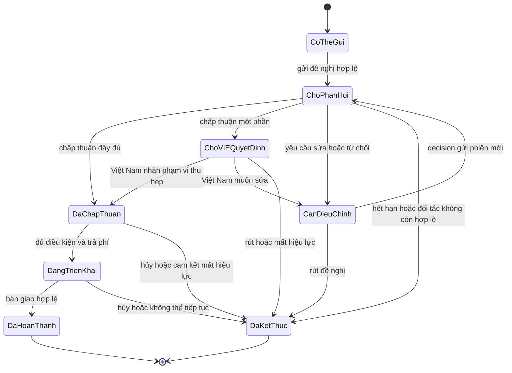
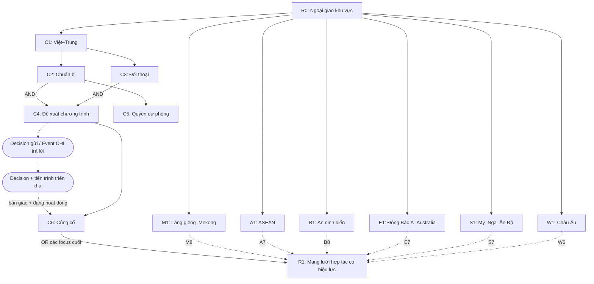

# Plan code Ngoại giao khu vực Việt Nam — Nội dung, kiến trúc, layout và gameplay

> **Cập nhật phạm vi C theo yêu cầu mở rộng:** [đặc tả Việt–Trung 18 node](VIE_CHINA_EXPANDED_BRANCH_DESIGN_VI.md) là bản phát triển nội dung mới để review; [catalog/layout ứng viên](artifacts/vie_china_expanded/catalog_and_layout.md) tính toàn nhánh **51 − 6 + 18 = 63 focus**. Các mục 13–14/17.1, catalog 51 node và SVG/PNG bên dưới là **baseline trước mở rộng**, chưa hợp nhất với bản C mới; không dùng chúng để chứng nhận bản 63 node. Sáu cụm khác giữ nguyên. Giá/timer B1 chưa đổi; hai chương trình dân sự–lãnh sự mới chưa định giá. L1 vẫn mở, chưa sang cân bằng L2 hoặc code gameplay.

> **Rà soát có kiểm soát — Lượt 1:** [B1](VIE_REGIONAL_DIPLOMACY_B1_VI.md) là bảng số chuẩn; [hồ sơ L1](VIE_REGIONAL_DIPLOMACY_L1_REVIEW_VI.md) ghi giao diện, ownership và changelog. Đã chọn gate cohesion cho gói sâu C/E, B1 mở từ X, S1 giữ XIII với phạm vi riêng; R0 dùng đường F02 **hoặc** công cụ mặc định đại hội. [Bảng tính cohesion](VIE_REGIONAL_DIPLOMACY_L1_CALCULATIONS_VI.md) và [bảng bất biến](VIE_REGIONAL_DIPLOMACY_INVARIANTS_VI.csv) đi kèm. E104 chỉ có kế hoạch chuyển tại 19.6, sau khi C qua kiểm; J5 giữ FAIL như nợ đã biết. **Chưa sang Lượt 2; xem J1/J2/J4/J5 hiện hành trong hồ sơ L1.** Chỉ sửa thiết kế, không sửa gameplay hoặc nhánh chính trị.

> Ngày lập/cập nhật: **15/10/2026**. Trạng thái: **bản thiết kế đề xuất, chưa có thay đổi gameplay**. Phạm vi hiện tại là **toàn nhánh Ngoại giao khu vực**, gồm bảy cụm và gốc chung. Mục **15–24** là kế hoạch tổng thể hiện hành; mục **1–14** lưu kế hoạch đợt mẫu Việt–Trung và đặc tả chương trình đầu tiên. Các giới hạn “chỉ Việt–Trung” trong đợt mẫu không giới hạn phạm vi thiết kế tổng thể.

> **Đầu ra tổng thể:** đề xuất **51 focus**, catalog đầy đủ, đồ thị AND/OR, layout thử có tọa độ/anchor, bảy chương trình khác nhau, luồng event/decision, nguồn modifier, bộ tham số thử và kế hoạch tích hợp–kiểm chứng. Số lượng, định danh mới và giá trị thử là đề xuất của báo cáo, chưa phải code hoặc tham số đã được người dùng chốt.

Đọc kế hoạch tổng thể từ **mục 15**; catalog tại **16**, gameplay từng cụm tại **17**, kiến trúc script tại **18–19**, modifier/tham số tại **20–21**, layout tại **22**, tích hợp và nghiệm thu tại **23–24**. Chi tiết chương trình Việt–Trung ở **13–14** được dùng lại, với các điều chỉnh ghi rõ ở kế hoạch tổng thể.

> **Bổ sung P0 ngày 15/10/2026:** mục **13** viết bản nháp bối cảnh đầu chiến dịch năm 2000, mục tiêu cụm Việt–Trung, chương trình hợp tác đầu tiên và bảng lựa chọn–hậu quả. Căn cứ lịch sử được dẫn nguồn riêng; chương trình và các phương án gameplay là đề xuất thiết kế, chưa chốt tham số để code.

> **Đặc tả chương trình:** mục **14** đề xuất hai gói thí điểm/mở rộng, bảng hành động, quy tắc phản hồi, triển khai, hủy và dự phòng bằng điều chỉnh nhịp giao thương. Đây là bản thiết kế để xét duyệt nội dung; tên ID, provider, giá, timer và giá trị modifier còn phải xác định trước khi code.

## 1. Mục tiêu và phạm vi

Người chơi mở hợp tác, lựa chọn điều kiện cam kết, xử lý phản hồi và xây phương án dự phòng. Thành quả hợp tác phải thay đổi lựa chọn tiếp theo; nghĩa vụ đã nhận phải có hậu quả cụ thể.

Đợt triển khai đầu gồm **gốc Ngoại giao khu vực và một cụm Việt–Trung hoàn chỉnh**. Cụm này thử ba chức năng có thể bổ sung cho nhau: hợp tác kinh tế–kết nối, đối thoại quản lý bất đồng và chuẩn bị phương án dự phòng khi quan hệ gián đoạn.

| Nội dung | Phạm vi đợt đầu |
|---|---|
| Gốc Ngoại giao khu vực | Sau IX đã giải quyết, đọc F02 hoặc đường công cụ mặc định đại hội; không bắt làm F02; gate là giả định gameplay |
| Cụm Việt–Trung | Một mục tiêu hợp tác cụ thể, lựa chọn cam kết, đối thoại và phương án dự phòng |
| Phản hồi đối tác | Chấp thuận đầy đủ, chấp thuận một phần, yêu cầu điều chỉnh hoặc từ chối |
| Triển khai | Hành động thực hiện chương trình đã được chấp thuận và ghi kết quả |
| Củng cố thành quả | Công nhận các kết quả hợp lệ, giữ khác biệt của cam kết đã chọn |
| Lào, Campuchia và Mekong; ASEAN; an ninh biển; các đối tác lớn | Chỉ ghi ranh giới trách nhiệm trong tài liệu; chưa tạo focus hoặc event cho các cụm này |

Phát triển đối ngoại, ledger vay quốc tế, GUI mới, hệ thống điểm ngoại giao mới và hệ thống khủng hoảng biển mới nằm ngoài đợt này. Các vấn đề đó không được bổ sung chỉ để làm cho cụm Việt–Trung có nhiều trạng thái hơn.

Thiết kế mới lấy nguyên tắc tại [báo cáo Trung Quốc, mục 19](CHINA_POLITICS_DIPLOMACY_ARCHITECTURE_REPORT_VI.md#19-nguyên-tắc-kiến-trúc-và-layout-cho-ngoại-giao-khu-vực-việt-nam). Đề xuất cũ tại mục 10 và 11.2 của báo cáo không phải điều kiện bắt buộc cho thiết kế này.

## 2. Những việc cần đặc tả trước khi code gameplay

Kiến trúc đã đủ để lập kế hoạch, nhưng nội dung cụ thể còn cần được viết thành bảng dưới đây. Không chuyển các khái niệm như “hợp tác sâu” thành bonus quốc gia khi chưa xác định người chơi làm gì và nhận được gì.

| Hạng mục | Đầu ra phải có |
|---|---|
| Mục tiêu hợp tác đầu tiên | Tên chương trình, đối tượng, bối cảnh, lợi ích cần đạt và định nghĩa thành công |
| Các gói cam kết | Quyền lợi, nghĩa vụ, phần có thể thương lượng và điều loại trừ giữa các gói |
| Đối thoại | Vấn đề cần xử lý, hành động có thể chọn và kết quả mà bước sau sử dụng |
| Phương án dự phòng | Hành động cụ thể, chi phí cơ hội, điều kiện thực hiện và mức giảm tác động gián đoạn |
| Phản hồi | Ý nghĩa của đầy đủ/một phần/sửa/từ chối; quyền lựa chọn tiếp theo của Việt Nam |
| Triển khai | Caller, thời điểm trả phí, thời lượng, điều kiện bàn giao, hủy và phần chi phí được hoàn nếu có |
| Thành quả cuối | Những cấu hình thành công hợp lệ, nghĩa vụ còn lại và cơ hội được mở |

Mỗi focus dùng mẫu đặc tả:

`Tên → vai trò → prerequisite AND/OR → mutex → available → lựa chọn → giá → kết quả → reader về sau`.

Mỗi event/decision/mission bổ sung: **scope, caller, điều kiện còn hiệu lực, giao dịch, thời gian, kết quả và cách kết thúc**.

Mục 13–14 đề xuất chương trình hợp tác cụ thể, các gói và luật vận hành. Các quyết định chưa chốt gồm số focus; tên và ID cuối cùng; mốc ngày; ngưỡng quan hệ; PP/ngân khố; timer; giá sửa/hủy; giá trị reward và tham số duy trì. Ghi chúng là **chưa chốt**, không điền số mặc định rồi coi là yêu cầu đã được thống nhất.

Khi chọn chương trình có tên hoặc mốc lịch sử, tra nguồn chính thức phù hợp thời kỳ trước khi viết mô tả. Phân biệt căn cứ lịch sử với phương án giả định của gameplay.

## 3. Đơn vị nội dung và cách chuyển sang focus

Các hàng dưới là **vai trò triển khai**, không phải danh sách bảy focus đã chốt. Một vai trò có thể nằm trong focus, event hoặc decision tùy lựa chọn của người chơi.

| Vai trò | Lớp dự kiến | Kết quả bắt buộc |
|---|---|---|
| Mở Ngoại giao khu vực | Focus gốc | Có nội dung/hành động mới, có nguồn mở khóa thật |
| Thiết lập hợp tác Việt–Trung | Focus | Xác định vấn đề, phạm vi và khả năng chuẩn bị đề nghị |
| Chuẩn bị chương trình | Focus khi có tiến triển dài hạn; decision nếu là thao tác tạm thời | Có khả năng đáp ứng điều kiện hoặc lựa chọn mới |
| Lựa chọn điều kiện cam kết | Event; focus mutex nếu là cam kết lâu dài thực sự loại trừ | Lưu điều kiện đã chọn và hậu quả về sau |
| Gửi đề nghị, nhận phản hồi | Focus/effect gửi; event đối tác trả lời | Phản hồi đúng đề nghị; chưa cấp thưởng bàn giao |
| Triển khai hoặc sửa đề nghị | Decision, event và mission nếu có việc cần theo dõi thời hạn | Thực hiện phạm vi đã được chấp thuận hoặc mở đàm phán lại |
| Củng cố thành quả | Focus hội tụ | Đọc kết quả thực tế và điều kiện duy trì, công nhận cách đạt mục tiêu |

Quan hệ bổ sung có thể cùng thực hiện. Không mutex toàn tuyến hợp tác với tuyến đối thoại hoặc dự phòng. Các gói thay thế của cùng một thỏa thuận có thể mutex nếu lựa chọn đó phải thể hiện trực tiếp trên cây.

Prerequisite biểu diễn phụ thuộc nội bộ bắt buộc. `available` biểu diễn trạng thái bên ngoài đồ thị như phản hồi, kết quả triển khai hoặc năng lực liên nhánh. Focus hội tụ không được mở chỉ nhờ hoàn thành focus gửi đề nghị.

## 4. Kiến trúc code và file dự kiến

Tên file mới trong bảng là đề xuất, cần kiểm không trùng định nghĩa trước khi tạo. File chỉ được tạo khi có nội dung thực để nạp.

| File hoặc nhóm file | Trách nhiệm |
|---|---|
| `common/national_focus/VIE_md_focus.txt` | Gốc, focus Việt–Trung, prerequisite, mutex, available và layout; reward gọi effect riêng |
| `common/scripted_triggers/VIE_md_triggers_diplomacy.txt` — mới | Luật dùng chung cho đề nghị, phản hồi hợp lệ, triển khai và thành quả |
| `common/scripted_effects/VIE_md_effects_diplomacy.txt` — mới | Reward focus; gửi/nhận đề nghị; giao dịch; bắt đầu, bàn giao và hủy |
| `events/VIE_md_diplomacy_events.txt` — mới | Lựa chọn điều kiện, phản hồi đối tác, thông báo kết quả; namespace riêng không trùng |
| `common/decisions/VIE_md_diplomacy_decisions.txt` — mới | Sửa đề nghị, triển khai, hủy hoặc xử lý nghĩa vụ đã đặc tả |
| `common/decisions/categories/VIE_md_diplomacy_categories.txt` — mới nếu cần | Category có nguồn mở khóa và gate đạt được |
| `localisation/english/replace/VIE_md_diplomacy_l_english.yml` — mới | Title/desc, option, decision, category và tooltip khớp code |
| Idea/opinion modifier | Chỉ thêm khi có thưởng hoặc quan hệ cụ thể, nguồn cấp và vòng đời rõ |
| On_action | Chỉ thêm nếu cần kiểm định kỳ; không tạo tick thường xuyên khi caller hiện có đã đủ |
| Sprite/icon | Dùng provider đã xác minh cho bản thử; tài nguyên mới theo quy trình mỹ thuật của repo |

Định danh mới dùng prefix `VIE_` và tên theo hệ thống/đối tượng/hành động. Không dùng tên giống nhau cho focus, idea và tooltip. Định danh MD và engine phải được xác minh từ định nghĩa thật; tên file mới không chứng minh effect đã tồn tại.

Focus cam kết chính sách; event lựa chọn phương án; effect thực hiện giao dịch và chuyển trạng thái. Trigger gom luật để các caller dùng thống nhất. Tooltip chỉ mô tả, không thay effect thực thi.

## 5. Vòng đời đề nghị và triển khai

Sơ đồ dưới mô tả hành vi cần có, chưa quy định enum hoặc tên flag trong script. “Có thể gửi” chỉ đạt được sau khi đủ điều kiện đã đặc tả.



### 5.1. Dữ liệu tối thiểu

Mỗi chương trình cần trạng thái hiện tại, điều kiện cam kết đã chọn, phạm vi được chấp thuận, nhận diện phiên đề nghị và dấu đã cấp thưởng. Nếu có hoàn vốn, lưu khoản đã trả và khoản được hoàn theo luật của chính chương trình.

Chọn một nguồn dữ liệu cho từng trạng thái. Không đồng thời dùng nhiều flag/biến biểu diễn cùng một việc mà không có luật đồng bộ. Không tạo score, ledger hoặc biến lịch sử nếu chưa có reader cụ thể.

### 5.2. Những luật phải bảo đảm

- Mỗi đề nghị chỉ có một phiên đang chờ hợp lệ. Phản hồi trễ phải kiểm phiên và điều kiện cam kết trước khi ghi kết quả.
- Chấp thuận một phần là đề nghị có phạm vi khác; Việt Nam phải có cách nhận hoặc sửa, không tự tính như thành công đầy đủ.
- Focus đề xuất hoàn thành một lần; decision/event xử lý đàm phán lại. Không chạy lại focus để thử lại.
- Chi phí đề nghị, triển khai, sửa và hủy được ghi riêng. Khoản engine trừ qua decision `cost` không bị trừ thêm trong effect.
- Giao dịch ngân khố dùng effect MD đã xác minh. Công trình qua effect tự trả phí không bị trừ thêm cùng khoản tiền.
- Bàn giao chỉ ghi reward khi kết quả thật được cấp; gọi lặp không nhận thêm lợi ích.
- Hủy xử lý đúng trạng thái, vốn đã dùng và nghĩa vụ còn lại; không mặc định hoàn toàn bộ tiền.
- Đối tác biến mất, chiến tranh hoặc quan hệ thay đổi được xử lý theo điều kiện duy trì đã đặc tả. Không áp một luật hủy chung cho mọi hợp tác.
- Timeout phản hồi khác timeout triển khai. Chốt ý nghĩa từng timer trước khi chọn trường mission/decision của engine.

## 6. Ranh giới với các hệ thống khác

| Hệ thống | Liên kết trong đợt này |
|---|---|
| Chính trị | Đọc kỳ/công cụ cơ sở, BoP và cohesion theo giao diện L1; gói sâu C/E cần cadre_cohesion_required, không nhân phí gửi. Lịch ký tier/kiêm nhiệm còn hoãn theo kế hoạch chuyển E104; không tính là reader ngoại giao đang hoạt động |
| Kinh tế/quân sự | Xác định nơi thực hiện và cấp thưởng; không cấp cùng kết quả tại cả bàn giao ngoại giao và focus chuyên ngành |
| Phát triển đối ngoại | Ghi nhu cầu công cụ dùng chung; chưa xây toàn nhánh hoặc bắt cụm đầu phụ thuộc một focus chưa có |
| An ninh biển | Chính trị giữ XI08, XIII01–04, XIII10–11; cụm B chuẩn bị/cứu nạn và đọc kết quả chính trị khi có provider, không tạo lại sự cố đó |
| Nội dung MD Trung Quốc | Rà caller tác động trực tiếp tới VIE nếu chương trình mới giao nhau; chưa sửa script Trung Quốc |

Bản đầu phải chơi được với những provider thực đã có. Nếu hậu quả biển chưa có nguồn hợp lệ, không dùng một flag không ai ghi để khóa thành quả Việt–Trung; ghi liên kết đó là phần tích hợp về sau.

Thông tin Việt Nam ở mục 10.4 của báo cáo Trung Quốc là snapshot ngày 14/10/2026. Trước khi dùng BoP hoặc runtime chính trị, đọc code hiện tại; không lấy nhận xét snapshot làm bằng chứng cần sửa lại một hệ thống đã thay đổi.

## 7. Tích hợp với cây hiện tại và công cụ sinh code

Nội dung ngoại giao hiện có không quyết định thiết kế mới. Tuy nhiên, trước khi thay một ID cũ, phải thống kê prerequisite, anchor, shortcut, event, decision, scheduler, effect và localisation còn dùng nó.

Lập bảng chuyển đổi cho đúng phần thay thế:

`ID cũ → consumer đang dùng → thay bằng gì → có còn caller cũ cấp thưởng không → kiểm chứng`.

Không xóa toàn nhánh ngoại giao cũ trong đợt chỉ triển khai Việt–Trung. Nội dung được thay phải hết caller cấp thưởng trùng; tham chiếu từ phần ngoài phạm vi cần được chuyển có chủ đích. Lưu nội dung bị bỏ theo quy ước repo khi thực sự thay thế.

**Phụ thuộc công cụ đã xác minh:** [tools/build_political_runtime.py:682](tools/build_political_runtime.py#L682) tìm focus `VIE_asean_integration` để xác định điểm kết thúc vùng chính trị. Nếu ID hoặc vị trí mốc thay đổi, cập nhật ranh giới generator và bộ hồi quy tương ứng trước khi sinh lại. Không giữ thiết kế cũ chỉ vì công cụ đang dùng ID đó làm mốc.

Generator chính trị có ghi vào nhiều file. Thử thay đổi ranh giới trên bản sao tạm bằng bộ hồi quy hiện có; chỉ sinh lại checkout khi phạm vi ghi đã được kiểm và cần thiết. Giữ các thay đổi người dùng đang làm trong cây focus, runtime và font.

## 8. Layout và giao diện

1. Chốt đồ thị AND/OR/mutex và trạng thái mở khóa từ bảng nội dung.
2. Đặt trục cụm Việt–Trung trong vùng không chồng cây hiện tại; ghi khoảng dành cho các cụm tương lai trong tài liệu, không tạo node rỗng.
3. Lập bảng `node → vai trò → prerequisite → available → tọa độ tuyệt đối → anchor → x/y tương đối`.
4. Anchor là prerequisite trực tiếp đã khai báo trước; node hội tụ thấp hơn mọi cha; gap cùng hàng tối thiểu 2 đơn vị.
5. Xem sơ đồ có tên/icon để kiểm dây cắt node, tên dài và khoảng trống; sau đó kiểm trong HOI4.

Tooltip phải cho biết điều kiện còn thiếu, khoản chi ở bước hiện tại, việc đang chờ đối tác và nghĩa vụ sau khi chọn. Không trình bày tên biến, scope hoặc cơ chế epoch như nội dung người chơi phải học.

Giữ hai mẫu ngoại giao đã chọn và các export của chúng. Khi có yêu cầu tạo hoặc tích hợp tài nguyên mới, dùng [md-art](.claude/skills/md-art/SKILL.md); không suy ra việc lập plan này là yêu cầu vẽ bộ icon mới.

## 9. Các bước triển khai và điều kiện hoàn tất

| Bước | Công việc | Đầu ra/điều kiện hoàn tất |
|---|---|---|
| P0 — Đặc tả | Viết mục tiêu, gói cam kết, phản hồi, dự phòng, giao dịch và thành quả | Mọi vai trò có hành động và hậu quả; các giá/timer/reward cần dùng đã được xác định |
| P1 — Ánh xạ | Tra provider MD/engine, rà nội dung cũ, thống kê writer/reader và tác động generator | Không còn định danh suy đoán hoặc gate không có nguồn ghi; có kế hoạch chuyển từng consumer |
| P2 — Luồng hợp tác | Viết trigger/effect/event/decision cho đề nghị, phản hồi và triển khai | Cả đầy đủ/một phần/sửa/từ chối/hủy đều có đường kết thúc hoặc tiếp tục hợp lệ |
| P3 — Cây focus | Tích hợp gốc và focus Việt–Trung, hội tụ, layout, loc và icon đã xác minh | Cây đọc đúng AND/OR, mọi focus có tác dụng thật và reward không trùng caller |
| P4 — Kiểm chứng | Kiểm tĩnh, kịch bản trạng thái và kiểm trong game | Có kết quả kiểm thực, ghi rõ lỗi còn mở và phạm vi chưa nghiệm thu |

P2 có thể được phát triển trên bản thử riêng trước khi thay nội dung live. Không đưa focus chỉ có log hoặc tooltip mở khóa giả vào bản hoàn chỉnh.

Không tạo framework ngoại giao tổng quát hoặc generator mới chỉ để triển khai một cụm. Tách file và effect theo trách nhiệm đủ cho phạm vi này; mở rộng khi cụm thứ hai tạo nhu cầu tái sử dụng thực.

## 10. Kiểm chứng cần thực hiện khi có code

### 10.1. Kiểm tĩnh theo repo

Các lệnh dưới là **checklist tương lai**, chưa được chạy cho nội dung mới vì chưa có script gameplay.

```powershell
python tools/audit/audit.py
python tools/audit/live.py
python tools/audit/ev.py
python tools/audit_loc_errors.py
python tools/verify_all_loc.py
git diff --check
```

Nếu thêm công trình/state scope: chạy `python tools/audit/prov.py`. Nếu đổi icon/sprite/texture: chạy `python tools/audit_dds_and_gfx.py` và kiểm provider ngoài repo. Nếu sửa ranh giới generator: chạy `python tools/audit/political_generator_regressions.py` cùng kiểm runtime chính trị liên quan.

Đọc diagnostics kể cả khi exit code bằng 0. Ghi baseline lỗi có sẵn để phân biệt lỗi mới. Không tuyên bố sạch toàn mod chỉ vì phần ngoại giao mới không phát sinh lỗi.

### 10.2. Kịch bản hành vi

| Ca kiểm | Kết quả cần xác nhận |
|---|---|
| Đủ điều kiện, chấp thuận đầy đủ | Triển khai đúng gói, đúng chi phí, bàn giao một lần |
| Chấp thuận một phần | Việt Nam được nhận hoặc sửa; chi phí/reward khớp phạm vi thu hẹp |
| Từ chối hoặc yêu cầu sửa | Có decision điều chỉnh khi đủ điều kiện, không chạy lại focus |
| Phản hồi cũ tới sau phiên mới | Không ghi đè cam kết hoặc cấp thưởng sai |
| Thiếu PP/ngân khố tại thời điểm trả phí | Không bắt đầu giao dịch không đủ khả năng chi trả |
| Hủy trước và trong triển khai | Hoàn vốn/nghĩa vụ đúng luật, không nhận reward bàn giao |
| Đối tác biến mất hoặc cam kết mất hiệu lực | Luồng chờ kết thúc hoặc chuyển trạng thái theo thiết kế |
| Callback bàn giao/hủy chạy lặp | Không thưởng hoặc hoàn tiền hai lần |
| Thiếu một tiền đề AND; chỉ đạt một tuyến OR | Gate khớp đồ thị, không tự khóa hoặc mở sớm |
| Kết quả khác nhau đi tới hội tụ | Focus đọc đúng cách đạt mục tiêu và nghĩa vụ còn lại |
| Save/load khi đang chờ hoặc triển khai | Giữ đúng phiên, timer và giao dịch; cần kiểm trong engine |

Các giao dịch và luồng bất đồng bộ cần bộ kiểm kịch bản đọc script thực. Không chỉ kiểm tên flag hoặc sao chép biểu thức của implementation thành “test”. Fixture tĩnh không chứng minh routing scope hoặc timer engine hoạt động.

### 10.3. Nghiệm thu trong game

Kiểm lượt chơi mới với MD + VIE: node/dây/mutex, hover, phản hồi CHI, decision sửa đề nghị, timer, bàn giao, hủy, save/load và `error.log`. Kiểm cả tiến triển theo thời gian bình thường; autocomplete chỉ giúp kiểm từng focus, không thay luồng gameplay.

Nếu có trọng số lựa chọn đối tác hoặc hành vi AI mới, đọc tài liệu AI của repo trước khi thiết kế và kiểm riêng đường đi AI. Không triển khai thêm hệ thống AI quốc gia ngoài yêu cầu của cụm này.

## 11. Định nghĩa hoàn thành và bước tiếp theo

Đợt đầu hoàn thành khi người chơi có thể đi trọn cụm Việt–Trung: mở hợp tác, chọn điều kiện, nhận phản hồi, triển khai hoặc sửa đề nghị, và đạt thành quả có hậu quả về sau. Phương án dự phòng phải có tác dụng cụ thể; từng kết quả hợp lệ phải giữ khác biệt của cam kết. Các ca từ chối/hủy không để chuỗi chờ vô hạn hoặc cấp thưởng sai.

Điều kiện hoàn thành còn gồm tham chiếu khép kín, localisation đúng, layout dễ đọc, bảo toàn phần ngoài phạm vi và báo riêng kết quả kiểm tĩnh/kiểm trong game. Cập nhật changelog cây focus và tình trạng thực hiện trong plan khi gameplay được thay đổi.

**P0 đã có bối cảnh tại mục 13 và đặc tả hành động tại mục 14, chưa hoàn tất.** Bước tiếp theo là chuyển các vai trò thành danh sách focus/decision/event cụ thể, xác định tham số rồi tra provider. Chưa chốt số focus, ID, chi phí, timer hoặc giá trị reward. Các phương án trong plan vẫn là đề xuất thiết kế.

## 12. Nguồn và tình trạng kiểm tra tài liệu

- [Báo cáo kiến trúc Trung Quốc](CHINA_POLITICS_DIPLOMACY_ARCHITECTURE_REPORT_VI.md): bài học kiến trúc, writer/reader và mục 19.
- [Hướng dẫn repo](.claude/CLAUDE.md), [quy ước](.claude/docs/conventions.md), [chuẩn focus](VIE_focus_coding_standards.md).
- [md-focus](.claude/skills/md-focus/SKILL.md), [thiết kế nhánh](.claude/skills/md-focus/references/focus-branch-design.md), [validation](.claude/docs/validation.md).
- [Generator chính trị](tools/build_political_runtime.py): phụ thuộc mốc `VIE_asean_integration` đã đọc trong checkout.

Lần lập plan chỉ tạo tài liệu Markdown. Chưa xác minh provider cho các chương trình chưa được chọn, chưa tạo script ngoại giao mới và chưa chạy HOI4 cho nội dung này.

## 13. P0 — Bối cảnh đầu chiến dịch và nội dung cụm Việt–Trung

### 13.1. Phạm vi và trạng thái bản nháp

**Bài toán của cụm: phát triển hợp tác có lợi, xử lý bất đồng bằng hành động phù hợp và duy trì khả năng lựa chọn khi hợp tác bị gián đoạn.** Người chơi quyết định phạm vi cam kết và mức chuẩn bị; đối tác có quyền trả lời; kết quả thực hiện quyết định bước phát triển tiếp theo.

Bản nháp lấy chiến dịch bắt đầu trong năm **2000** làm nền. Trước khi viết history hoặc gate ngày, đối chiếu ngày bookmark thực và trạng thái VIE/CHI trong snapshot MD đang dùng. Mốc lịch sử không tự trở thành ngày khóa gameplay; nếu dùng luật ngày hoặc cho đi sớm theo kịch bản thay thế, phải ghi riêng trong đặc tả.

Mục này hoàn thiện định hướng nội dung của P0. Nó chưa thay cho bảng tham số, mapping engine hoặc nghiệm thu chương trình.

### 13.2. Điểm xuất phát có căn cứ lịch sử

| Căn cứ | Hàm ý cho nội dung đầu chiến dịch |
|---|---|
| Quan hệ hai nước đã bình thường hóa từ năm 1991 | Bắt đầu từ phát triển hợp tác và xử lý vấn đề còn lại; không yêu cầu người chơi hoàn thành focus “bình thường hóa” để nhận lại một kết quả đã có. [Bộ Ngoại giao](https://mofa.gov.vn/tin-chi-tiet/chi-tiet/quan-he-viet-nam-trung-quoc-vuon-len-tam-cao-moi-589.html) |
| Hiệp ước biên giới trên đất liền được ký ngày 30/12/1999 | Phân biệt ký hiệp ước với các bước thực hiện; không diễn giải đầu năm 2000 thành toàn bộ công việc biên giới đã hoàn tất. [Cổng thông tin Chính phủ](https://chinhphu.vn/giai-doan-1986-2003-muoi-tam-nam-su-nghiep-doi-moi/iii-chinh-phu-nhiem-ky-quoc-hoi-khoa-x-1997-2002-2962) |
| Hai bên thống nhất các văn bản kỹ thuật phục vụ phân giới, cắm mốc trong giai đoạn 2000–2002; công tác phân giới, cắm mốc hoàn tất ngày 31/12/2008 | Nội dung về thực hiện và phối hợp biên giới có tiến trình dài. Không đặt mọi thành quả của giai đoạn này vào một reward đầu chiến dịch. [Bộ Ngoại giao](https://mofa.gov.vn/tin-chi-tiet/chi-tiet/xay-dung-duong-bien-gioi-viet-nam-trung-quoc-hoa-binh-huu-nghi-hop-tac-va-on-dinh-lau-dai--589.html) |
| Hiệp định phân định Vịnh Bắc Bộ và hợp tác nghề cá được ký ngày 25/12/2000, có hiệu lực ngày 30/6/2004 | Nếu bookmark trước ngày ký, không khởi tạo hai hiệp định như kết quả đã hoàn thành. Phân biệt lịch sử vùng vịnh với chương trình thương mại được đề xuất bên dưới. [Bộ Ngoại giao](https://mofa.gov.vn/tin-chi-tiet/chi-tiet/quan-he-viet-nam-trung-quoc-vuon-len-tam-cao-moi-589.html) |

Các nguồn trên dùng để xác định thứ tự sự kiện. Không dùng số liệu hoặc mô tả quan hệ của những năm về sau trong các bài đó làm trạng thái kinh tế năm 2000. Phần này chưa thêm chuỗi phân giới hay hiệp định biển vào phạm vi code.

### 13.3. Mục tiêu gameplay của cụm

| Mục tiêu | Việc người chơi có thể làm | Thành quả cần quan sát được |
|---|---|---|
| Có hợp tác đem lại lợi ích | Chọn phạm vi, gửi đề nghị, đáp ứng điều kiện và triển khai | Có chương trình vận hành và lợi ích đúng phạm vi được hai bên chấp thuận |
| Có công cụ xử lý bất đồng | Dùng kênh đối thoại để sửa điều kiện hoặc xử lý vướng mắc của chương trình | Có phương án tiếp tục, thu hẹp hoặc kết thúc cam kết; không phải chỉ tăng opinion |
| Có khả năng duy trì hoạt động | Dành nguồn lực chuẩn bị phương án dự phòng | Khi chương trình gặp gián đoạn, tác động được giảm theo mức chuẩn bị thực đã có |

Ba mục tiêu bổ sung cho nhau. Cùng phát triển hợp tác và chuẩn bị dự phòng là lựa chọn hợp lệ. BoP không được mặc định thành trục thân hoặc chống Trung Quốc; chỉ đọc năng lực chính trị khi có ảnh hưởng cụ thể tới hành động trong chương trình.

### 13.4. Chương trình đầu tiên đề xuất: phối hợp thương mại biên giới

**Tên làm việc: “Chương trình phối hợp thương mại biên giới Việt–Trung”.** Đây là chương trình giả định phục vụ thiết kế gameplay, chưa được xác định là một hiệp định lịch sử có đúng tên và đúng gói điều kiện này.

Mục tiêu cụ thể là đưa một phạm vi giao thương đã thỏa thuận vào hoạt động với quy trình phối hợp rõ: đầu mối liên lạc, thông báo yêu cầu, xử lý vướng mắc và đánh giá triển khai. Việt Nam chọn quy mô hợp tác và phần năng lực trong nước dành cho chương trình.

Chương trình có ba tuyến nội dung:

| Tuyến | Nội dung bản nháp | Đánh đổi |
|---|---|---|
| Hợp tác kinh tế–kết nối | Chuẩn bị đề nghị, chọn phạm vi thí điểm hoặc mở rộng, thương lượng và thực hiện | Phạm vi lớn mở cơ hội lớn hơn nhưng cần thêm nguồn lực, phối hợp và điều kiện duy trì |
| Đối thoại quản lý bất đồng | Thiết lập đầu mối cho chương trình; giải quyết khác biệt về điều kiện hoặc việc thực hiện | Tiếp tục thương lượng có thể giữ điều kiện mong muốn nhưng trì hoãn lợi ích; nhận phạm vi thu hẹp có thể triển khai sớm hơn |
| Phương án dự phòng | Chuẩn bị tổ chức vận chuyển, lưu giữ hoặc điều chỉnh nhịp giao thương trong phạm vi chương trình | Tốn nguồn lực trước khi có gián đoạn; giảm thiệt hại khi cần nhưng không tạo thêm cùng khoản lợi ích hợp tác |

Mục 14 chọn **điều chỉnh nhịp giao thương** làm hành động dự phòng đề xuất cho bản đầu. Chưa triển khai cả một hệ thống logistics, xây nhà máy, đường sắt hoặc mở hợp đồng với đối tác khác. Chương trình không tự xử lý tranh chấp lãnh thổ và không có reward chuyển state, core hoặc faction.

### 13.5. Bảng lựa chọn và hậu quả dự kiến

Các gói và hậu quả dưới là bản nháp để xét ý nghĩa lựa chọn; chưa phải option hoặc modifier engine đã được chốt.

| Tình huống | Lựa chọn người chơi | Lợi ích hoặc cơ hội | Chi phí cơ hội/nghĩa vụ | Nội dung đọc hậu quả |
|---|---|---|---|---|
| Chuẩn bị đề nghị | Thí điểm phạm vi hạn chế | Yêu cầu triển khai gọn hơn; có thể chứng minh khả năng phối hợp trước | Lợi ích và phạm vi ban đầu nhỏ hơn; muốn mở rộng cần thêm thỏa thuận | Phản hồi, triển khai và điều kiện mở rộng |
| Chuẩn bị đề nghị | Đề nghị phạm vi mở rộng | Có cơ hội đạt gói hợp tác lớn hơn | Cần năng lực và nguồn lực lớn hơn; đối tác có thể đề nghị thu hẹp | Phản hồi và nghĩa vụ thực hiện |
| Đối tác chấp thuận một phần | Nhận phạm vi thu hẹp | Bắt đầu thực hiện phần hai bên đã đồng ý | Chưa đạt toàn bộ mục tiêu của đề nghị ban đầu | Chi phí, reward và thành quả theo phạm vi thực |
| Đối tác yêu cầu sửa hoặc Việt Nam chưa đồng ý | Điều chỉnh và thương lượng lại | Có cơ hội đạt điều kiện phù hợp hơn | Thêm thời gian và chi phí đàm phán theo đặc tả | Phiên đề nghị mới; phản hồi cũ mất quyền ghi kết quả |
| Đề nghị không còn phù hợp | Rút đề nghị, giữ hoặc chuyển ưu tiên | Giữ phần nguồn lực chưa cam kết | Không nhận lợi ích bàn giao song phương | Trạng thái kết thúc, hành động có thể thực hiện tiếp |
| Trước hoặc trong hợp tác | Chuẩn bị phương án dự phòng | Giảm tác động nếu chương trình bị gián đoạn | Dành nguồn lực cho bảo đảm thay vì mở rộng ngay | Hành động ứng phó của chính chương trình |
| Chương trình phát sinh vướng mắc | Dùng kênh đối thoại, tiếp tục với phạm vi điều chỉnh hoặc kết thúc | Có lựa chọn phù hợp mức hợp tác và chuẩn bị đã có | Có thể mất lợi ích, phát sinh phí hoặc còn nghĩa vụ theo cam kết | Trạng thái vận hành và điều kiện củng cố thành quả |

Từ chối không tự tạo một lần gửi lại miễn phí. Đặc tả tiếp theo phải xác định điều gì thay đổi để đề nghị mới có cơ hội được xét lại: phạm vi, điều kiện, năng lực, quan hệ hoặc thời gian. Không tạo chuỗi spam event chỉ để thử đến khi đối tác chấp thuận.

### 13.6. Phản hồi đối tác và quyền lựa chọn của Việt Nam

| Phản hồi | Cách xử lý trong nội dung |
|---|---|
| Chấp thuận đầy đủ | Mở triển khai đúng đề nghị; chưa coi ký kết là hoàn thành chương trình |
| Chấp thuận một phần | Đưa phạm vi mới cho Việt Nam nhận hoặc sửa; chỉ triển khai sau khi hai bên đồng ý |
| Yêu cầu điều chỉnh | Nêu phần cần thay đổi để người chơi có hành động thương lượng có ý nghĩa |
| Từ chối | Kết thúc phiên hiện tại; Việt Nam có thể điều chỉnh khi đủ điều kiện hoặc rút đề nghị |

Không mô tả cùng một phản hồi như luôn phụ thuộc vào một giá trị opinion. Khi viết đặc tả, xác định yếu tố đối tác thực sự xét và những thông tin người chơi cần biết. Cách chọn option của AI và trọng số chưa được thiết kế ở P0 này.

### 13.7. Thành công và các kết quả có thể cùng được công nhận

**Thành công của hợp tác được xác nhận bằng phạm vi đã thống nhất và thực hiện được.** Không dùng số focus hoàn thành hoặc một nhãn “quan hệ tốt” thay cho kết quả đó.

| Kết quả | Điều kiện ý nghĩa | Khác biệt còn lại |
|---|---|---|
| Hợp tác phạm vi rộng vận hành | Gói mở rộng được hai bên đồng ý và triển khai hợp lệ | Lợi ích lớn hơn đi cùng nghĩa vụ thực hiện và duy trì lớn hơn |
| Hợp tác chọn lọc vận hành | Gói hạn chế hoặc thu hẹp được hai bên đồng ý và triển khai hợp lệ | Lợi ích nhỏ hơn, phạm vi nghĩa vụ gọn hơn; cơ hội mở rộng cần được thương lượng |
| Hợp tác vận hành có dự phòng | Một trong hai kết quả trên, đồng thời có phương án dự phòng đã thực hiện | Có thêm cách ứng phó với gián đoạn; không thưởng lại toàn bộ thành quả hợp tác |
| Chưa đạt thỏa thuận, đã chuẩn bị dự phòng | Đề nghị bị rút/từ chối, hành động dự phòng trong nước đã hoàn tất | Có năng lực ứng phó nhưng **không** được tính là bàn giao hợp tác song phương |

Focus hội tụ, nếu dùng, công nhận các cấu hình hợp tác thành công hợp lệ và đọc phạm vi/nghĩa vụ tương ứng. Nó không bắt người chơi phải gửi gói mở rộng hoặc làm đủ mọi quan hệ đối tác. Dự phòng là thành quả riêng có thể cùng tồn tại, không phải một nhánh ngoại giao đối lập bị khóa vĩnh viễn.

### 13.8. Ranh giới nội dung và phần P0 còn phải viết

Cụm Việt–Trung chịu trách nhiệm đề nghị thương mại này, phản hồi và đối thoại về việc thực hiện. Vướng mắc trong chương trình chỉ tạo hậu quả trong phạm vi đã đặc tả. Không tự biến một gián đoạn giao thương thành sự kiện an ninh biển hoặc áp hậu quả lên toàn bộ đối tác.

Phần an ninh biển về sau có thể cung cấp bối cảnh ảnh hưởng quan hệ, nhưng không là gate bắt buộc chưa có writer trong bản đầu. Các mục tiêu Mekong/ASEAN/đối tác khác tiếp tục nằm ngoài đợt này.

Danh sách công việc đặt ra khi viết bản nháp mục 13:

1. Chọn phạm vi thí điểm và mở rộng cụ thể, tiêu chí triển khai và lợi ích riêng của mỗi gói.
2. Chọn một hành động dự phòng, xác định gián đoạn nào nó xử lý và tác dụng có thể kiểm chứng.
3. Viết từng hành động đối thoại: mở kênh, sửa điều kiện, xử lý vướng mắc; xác định phần nào là focus dài hạn và phần nào là decision/event.
4. Ghi giá, timer, thời điểm chi trả, hủy/hoàn vốn và điều kiện duy trì cho từng cam kết.
5. Lập writer/reader cho mỗi kết quả, chọn nơi cấp thưởng và tra provider trước khi ánh xạ sang ID/trigger/effect.

Mục 14 tiếp tục các việc 1–3 và đề xuất luật giao dịch, writer/reader cho việc 4–5. Tham số bằng số và ánh xạ provider vẫn còn mở; tình trạng hiện tại được ghi ở mục 14.10.

## 14. P0 — Đặc tả chương trình phối hợp thương mại biên giới

### 14.1. Đơn vị triển khai và mục tiêu cụ thể

**Đề xuất bản đầu có một chương trình song phương, hai gói phạm vi và một hành động dự phòng trong nước.** Các mã A01–A13 bên dưới chỉ là số tham chiếu của tài liệu, không phải ID game. Nội dung không mô phỏng lượng hàng, từng cửa khẩu hoặc lịch vận tải thực.

Chương trình thiết lập đầu mối liên lạc, quy trình thông báo yêu cầu giao thương và cách xử lý vướng mắc trong phạm vi được hai bên đồng ý. Thành công là **hoàn thành việc thiết lập và đưa phạm vi đó vào vận hành**. Ký kết mở quyền triển khai; bàn giao xác nhận năng lực vận hành; lợi ích duy trì phụ thuộc chương trình còn hoạt động.

Chuẩn bị trong nước và mở kênh đối thoại là hai chức năng bổ sung. Cả hai cần có trước khi gửi đề nghị. Chuẩn bị được giữ khi một phiên đàm phán thất bại, trừ khi điều kiện cụ thể làm nó mất hiệu lực; không buộc làm lại focus để gửi đề nghị mới.

### 14.2. Hai gói điều kiện và đánh đổi

| Thành phần | Gói thí điểm | Gói mở rộng |
|---|---|---|
| Phạm vi cam kết | Một phạm vi phối hợp hạn chế, dùng để đưa quy trình chung vào hoạt động | Áp dụng cùng quy trình cho phạm vi giao thương rộng hơn, cần phối hợp nhiều hơn |
| Chuẩn bị | Đủ đầu mối, phương án thực hiện và nguồn lực cho phạm vi hạn chế | Có nền của gói thí điểm và chứng minh khả năng phối hợp thêm; không bắt đã bàn giao thí điểm mới được đề nghị mở rộng |
| Liên kết chính trị L1 | Không yêu cầu ngưỡng cohesion của gói sâu | Đọc trực tiếp VIE_leadership_cohesion ≥ politics.cadre_cohesion_required tại soạn/gửi/bắt đầu và nâng gói; không kiểm đủ các tier |
| Việc hai bên đồng ý | Đầu mối liên lạc, thông báo thay đổi yêu cầu và xử lý vướng mắc trong phạm vi thí điểm | Các nội dung đó trên phạm vi rộng hơn, kèm trách nhiệm phối hợp khi phải thu hẹp hoặc tạm dừng |
| Việc Việt Nam thực hiện | Tổ chức đầu mối và đưa quy trình đã thống nhất vào sử dụng | Bố trí thêm năng lực thực hiện và duy trì phối hợp trên phạm vi mở rộng |
| Lợi ích dự kiến | Lợi ích hợp tác thường xuyên nhỏ hơn, nghĩa vụ duy trì gọn hơn | Lợi ích hợp tác thường xuyên lớn hơn, giá triển khai và nghĩa vụ duy trì lớn hơn |
| Khi có vướng mắc | Có thể đối thoại, tạm dừng hoặc kết thúc; tổn thất theo gói nhỏ | Có thể đối thoại để giữ gói hoặc thương lượng thu hẹp; tổn thất theo gói lớn |
| Cơ hội tiếp theo | Có quyền đề nghị mở rộng khi đáp ứng điều kiện mới | Củng cố chương trình; không tự mở thêm địa bàn hay đối tác ngoài phạm vi |

**Thí điểm là một kết quả hợp tác chọn lọc có thể duy trì lâu dài.** Người chơi có ít nguồn lực có thể chọn nó để giữ khả năng làm việc khác. Mở rộng phải tạo lợi ích đủ đáng theo đuổi nhưng không được vừa rẻ hơn, nhanh hơn và ít nghĩa vụ hơn thí điểm.

Hai gói là lựa chọn trong event chuẩn bị đề nghị. Đổi gói qua đàm phán lại nên không khóa vĩnh viễn bằng hai focus mutex. Tại một thời điểm chỉ có một gói vận hành của chương trình; thay gói phải thay lợi ích và nghĩa vụ tương ứng, không cộng hai bộ thưởng.

Các nghĩa vụ trên chỉ thuộc chương trình thương mại. Không suy ra chia sẻ tình báo, quyền tiếp cận quân sự, bảo đảm xuất khẩu hoặc cam kết về tranh chấp lãnh thổ. Lợi ích kinh tế cần được ánh xạ sang modifier/effect thật ở P1; việc tăng opinion không thay cho lợi ích vận hành.

### 14.3. Bảng hành động từ chuẩn bị đến củng cố

Các hàng là **hành động hoặc chức năng**, chưa ấn định mỗi hàng thành một focus. Phí và thời gian dùng các nhóm tham số ở mục 14.8; chưa có số mặc định.

| Mã — hành động | Lớp dự kiến và caller | Điều kiện chính | Kết quả và nơi đọc tiếp |
|---|---|---|---|
| A01 — Mở hợp tác Việt–Trung | Focus trong cụm, sau gốc Ngoại giao khu vực | Root đã hoàn thành; đối tượng hợp tác hợp lệ | Mở chuẩn bị và đối thoại; không cấp lợi ích chương trình |
| A02 — Chuẩn bị phương án thực hiện | Focus chuẩn bị | A01; năng lực nền cần được xác minh | Ghi đã chuẩn bị; A04/A05 đọc. Điều kiện bổ sung của mở rộng được giải thích riêng |
| A03 — Thiết lập đầu mối đối thoại | Focus song song A02 | A01; CHI tồn tại và có thể nhận đề nghị | Mở kênh đàm phán và xử lý vướng mắc; A05/A07/A11 đọc |
| A04 — Soạn gói điều kiện | Event VIE, do hoàn thành cả A02 và A03 hoặc decision gọi | Chưa có phiên đang chờ hay thỏa thuận đang triển khai; gói mở rộng cần cohesion đạt cadre_cohesion_required | Chọn thí điểm/mở rộng khi đủ điều kiện, xem giá và nghĩa vụ; lưu dự thảo, chưa gửi hoặc trả phí triển khai |
| A05 — Gửi đề nghị | Decision VIE gọi effect rồi event CHI | Có dự thảo hợp lệ; cả A02 AND A03; đủ phí gửi/đối tác; kiểm lại ngưỡng cohesion nếu là gói mở rộng | Trả phí gốc một lần, không nhân cohesion; tạo phiên đang chờ; A06 đọc đúng phiên |
| A06 — Phản hồi của CHI | Event CHI, caller từ A05 | Phiên còn hiệu lực; đúng bên gửi/nhận; cam kết vẫn hợp lệ | Ghi chấp thuận, đề nghị thu hẹp/sửa hoặc từ chối. Gói thay đổi gửi lại cho VIE quyết định |
| A07 — Nhận, sửa hoặc rút đề nghị | Event VIE cho phản hồi khác gói; decision cho sửa/gửi lại/rút | Có phản hồi đang chờ VIE hoặc phiên cần điều chỉnh | Nhận thì khóa phạm vi thống nhất; sửa thì đóng phiên cũ và tạo dự thảo mới; rút thì kết thúc phiên |
| A08 — Bắt đầu triển khai | Decision VIE gọi effect, kích hoạt tiến trình có thời hạn | Hai bên đã đồng ý; chưa hết hạn; đủ nguồn lực; gói mở rộng vẫn đạt ngưỡng cohesion tại điểm bắt đầu | Chỉ lúc hợp lệ mới trả phí/chiếm slot; thiếu cohesion giữ chờ trong hạn, không tự gia hạn; A09/A10 đọc |
| A09 — Nghiệm thu và đưa vào vận hành | Caller kết thúc tiến trình A08 gọi effect chung | Đúng lượt triển khai; chương trình chưa bị hủy; điều kiện bàn giao còn hợp lệ | Ghi bàn giao một lần, áp lợi ích duy trì đúng gói, mở A11/A13. Không có thêm reward ở tooltip hoặc event thông báo |
| A10 — Hủy hoặc kết thúc cam kết | Decision VIE hoặc caller khi cam kết mất hiệu lực | Phiên/thỏa thuận/triển khai còn hoạt động | Đóng đúng luồng; xử lý phí theo mục 14.5; không cấp reward bàn giao |
| A11 — Xử lý vướng mắc | Event VIE và decision đối thoại; event CHI nếu thay điều kiện | Có vướng mắc chưa xử lý của chương trình đang vận hành | Tiếp tục, đề nghị thu hẹp, tạm dừng hoặc kết thúc theo mục 14.6; cập nhật lợi ích và nghĩa vụ |
| A12 — Chuẩn bị và dùng phương án dự phòng | Decision VIE chuẩn bị; option ứng phó khi A11 phát sinh | Đã mở cụm; không chuẩn bị trùng; chỉ dùng cho vướng mắc phù hợp | Chuẩn bị điều chỉnh nhịp giao thương; khi dùng thì giảm tổn thất tạm thời của chương trình |
| A13 — Củng cố hợp tác | Focus hội tụ đọc A09 và trạng thái vận hành | Đã bàn giao thí điểm OR mở rộng; chương trình đang hoạt động | Công nhận hợp tác chọn lọc hoặc rộng; mở quyền đề nghị mở rộng nếu đang thí điểm; không cấp lại lợi ích A09 |

Việc soạn gói chưa phải gửi đề nghị. Nếu A04 được gọi tự động khi đủ hai chức năng chuẩn bị, caller phải chỉ chạy một lần; decision cho phép mở lại bản dự thảo trước khi gửi. Số focus và anchor sẽ được chọn khi chuyển bảng này sang đồ thị ở bước kế tiếp.

### 14.4. Phản hồi, phạm vi thu hẹp và đàm phán lại

| Phản hồi | Trạng thái thực | Lựa chọn tiếp theo của Việt Nam |
|---|---|---|
| Đồng ý đúng gói | Phạm vi hai bên đã thống nhất, chờ triển khai | Bắt đầu khi đủ nguồn lực, hoặc rút trước hạn triển khai |
| Đề nghị thu hẹp gói mở rộng | CHI đề nghị thay bằng gói thí điểm; chưa có thỏa thuận nếu VIE chưa nhận | Nhận thí điểm, sửa điều kiện để tiếp tục đề nghị mở rộng, hoặc rút |
| Không đồng ý đầy đủ gói thí điểm | Yêu cầu sửa điều kiện của gói thí điểm; không tạo thêm gói thứ ba trong bản đầu | Điều chỉnh và gửi phiên mới, hoặc rút; chưa có quyền triển khai |
| Yêu cầu điều chỉnh | Nêu trở ngại cụ thể: phạm vi quá lớn hoặc điều kiện phối hợp chưa đáp ứng | Đổi gói hoặc đáp ứng điều kiện được nêu trước khi gửi lại |
| Từ chối | Phiên hiện tại đóng; có lý do và điều kiện xét lại nếu phù hợp | Thay đổi đề nghị/điều kiện xét lại, chuẩn bị dự phòng hoặc chuyển ưu tiên |

Phản hồi cần phân biệt **không muốn nhận cam kết** với **chưa thể thực hiện phạm vi đề nghị**. Luật cụ thể và thông tin hiển thị phải dựa trên provider đã xác minh; không dùng ngưỡng opinion tùy ý để giải thích mọi lý do. Trọng số AI sẽ được viết sau khi đọc tài liệu AI và chọn các yếu tố thực sự cần xét.

Đề xuất luật gửi lại: chỉ có một phiên đang chờ; gửi lại có phí và khoảng cách tối thiểu cần chốt; đồng thời phải đổi gói hoặc đáp ứng trở ngại được chỉ ra. Chờ hết khoảng cách không tự biến một đề nghị bị từ chối thành đề nghị khác. Phản hồi hết hạn không được ghi đè một thỏa thuận mới.

Phạm vi thực hiện và reward luôn đọc **gói đã thống nhất**, không đọc gói VIE từng muốn gửi. Bàn giao thí điểm sau khi nhận phản hồi thu hẹp là thành công của thỏa thuận thí điểm, đồng thời vẫn ghi rõ mục tiêu mở rộng ban đầu chưa đạt.

### 14.5. Triển khai, thanh toán và hủy

Đề xuất dùng **một tiến trình triển khai có thời hạn** cho mỗi gói. Nội dung đại diện cho việc bố trí đầu mối, áp dụng quy trình chung và kiểm tra khả năng phối hợp. Không tách từng việc thành nhiều mission phải trả phí lặp lại. Hai gói có giá và lịch riêng; lịch được lưu lúc bắt đầu, không đổi chỉ vì năng lực chính trị thay đổi giữa chừng.

Khi tới hạn, caller kiểm lượt triển khai, gói, đối tác và hiệu lực cam kết rồi bàn giao nếu hợp lệ. Đây là hoàn thành theo thời gian với điều kiện duy trì, không phải nhiệm vụ có nhiều mục tiêu công trình chưa được đặc tả. Nếu điều kiện không còn đáp ứng, caller kết thúc theo luật hủy thay vì giả định đã thành công.

| Thời điểm | Khoản chi/nghĩa vụ đề xuất | Khi rút hoặc hủy |
|---|---|---|
| Chuẩn bị qua focus | Dùng lịch focus; không thêm phí ngân khố nếu chưa có khoản chi cụ thể | Kết quả chuẩn bị còn dùng được; thời gian đã qua không hoàn |
| Gửi đề nghị hoặc gửi lại | PP cho mỗi lần gửi hợp lệ; chưa thu phí triển khai | PP đã dùng không hoàn; không phát sinh khoản hoàn ngân khố chưa trả |
| Đã thống nhất, chưa bắt đầu | Có hạn bắt đầu và phải đáp ứng điều kiện nguồn lực | Rút thì đóng thỏa thuận, không nhận lợi ích vận hành |
| Bắt đầu triển khai | Trả một lần phí tổ chức thực hiện bằng ngân khố; lưu dấu đã trả | Đề xuất phí này là chi phí đã sử dụng, không hoàn khi hủy; tooltip phải nói trước |
| Bàn giao và vận hành | Chỉ lúc bàn giao mới áp gói lợi ích và nghĩa vụ duy trì | Tạm dừng thì ngừng lợi ích hoạt động; kết thúc thì gỡ gói duy trì, không xóa ghi nhận đã từng bàn giao |

**Bản đầu đề xuất không có khoản vốn giữ hộ, trả góp hoặc ledger hoàn vốn.** Phí triển khai đã tiêu dùng không được mô tả như tiền dự án còn chưa giải ngân. Nếu về sau thêm công trình hoặc vốn chưa dùng, phải sửa đặc tả giao dịch trước khi áp cơ chế hoàn tiền.

Hủy được xử lý một lần và đóng timer/caller của lượt đó. Event bàn giao tới muộn sau khi hủy không nhận thưởng. Một bên biến mất hoặc chiến tranh trực tiếp VIE–CHI làm cam kết mất hiệu lực; chiến tranh với nước thứ ba hay giảm opinion chỉ tác động nếu được ghi thành điều kiện cụ thể, không tự hủy theo một luật chung suy đoán.

### 14.6. Vướng mắc và điều kiện duy trì sau bàn giao

**Tình huống thử đề xuất: việc phối hợp giao thương bị chậm do hai bên chưa thống nhất cách áp dụng yêu cầu của chương trình.** Đây là tình huống gameplay giả định. Caller sẽ được chọn ở P1; bản đầu dùng một tình huống giới hạn để kiểm toàn luồng, chưa thêm xác suất khủng hoảng lặp định kỳ.

| Phương án | Hành động có ý nghĩa | Hậu quả cần thể hiện |
|---|---|---|
| Đối thoại để giữ gói | Dành PP và thời gian xử lý vướng mắc; CHI trả lời điều chỉnh nếu cần | Trong lúc chờ có tác động tạm thời; chấp thuận giải pháp thì khôi phục đúng gói, không cấp thưởng bàn giao mới |
| Thương lượng thu hẹp | Chỉ khi đang mở rộng; đề nghị chuyển về thí điểm | Chỉ thay gói khi CHI chấp thuận; giảm lợi ích và nghĩa vụ tương ứng, không cộng lợi ích cũ và mới |
| Tạm dừng chương trình | Ngừng khai thác lợi ích và phối hợp trong lúc chưa có giải pháp | Lợi ích hoạt động ngừng; có đường nối lại nếu cam kết còn hiệu lực, hoặc kết thúc |
| Kết thúc hợp tác | Chấm dứt gói hiện tại | Gỡ lợi ích và nghĩa vụ duy trì của chương trình; muốn hợp tác mới phải đi lại luồng đề nghị phù hợp |

Tác động tạm thời do vướng mắc phải có thời hạn và caller kết thúc rõ. Không trả lời trước hạn chuyển chương trình sang tạm dừng và đóng phiên xử lý; người chơi vẫn có decision nối lại hoặc kết thúc. Một vướng mắc chỉ có một luồng xử lý đang chờ; không gửi thêm đề nghị mở rộng trong khi chưa giải quyết nó.

Tách hai dữ kiện: **đã từng bàn giao** và **đang vận hành**. Focus A13 cần cả hai tại thời điểm bắt đầu/hoàn thành theo luật được chọn; lịch sử bàn giao không đủ để nhận lợi ích của chương trình đã dừng. Nếu A13 hoàn thành trước khi có gián đoạn, focus vẫn hoàn thành nhưng lợi ích vận hành tiếp tục chịu luật duy trì chung.

Nghĩa vụ duy trì của mở rộng phải được thể hiện bằng khoản chi hoặc điều kiện thực có thể kiểm. Chưa chọn giữa phí định kỳ và điều kiện năng lực; không vừa thêm tick ngân khố vừa thêm modifier chi phí đại diện cho cùng một nghĩa vụ. P0 chỉ hoàn tất sau khi chốt cách này và hành vi khi không đáp ứng.

### 14.7. Phương án dự phòng: điều chỉnh nhịp giao thương

Đề xuất A12 có hai bước: **chuẩn bị phương án trong nước**, rồi **kích hoạt khi chương trình gặp chậm trễ phù hợp**. Chuẩn bị không cần CHI đồng ý; nó có thể đi cùng cả thí điểm và mở rộng.

| Bước | Điều kiện và chi phí | Kết quả |
|---|---|---|
| Chuẩn bị | Cụm đã mở; đủ PP và thời gian chuẩn bị; không có lượt chuẩn bị trùng | Có phương án phối hợp lịch tiếp nhận/xử lý giao thương khi quy trình song phương bị chậm |
| Kích hoạt | Đã chuẩn bị xong; có vướng mắc chậm phối hợp chưa xử lý; chưa dùng trong đợt này | Trả phí ứng phó đã chốt, giảm mức tổn thất tạm thời do chính vướng mắc đó tạo ra |
| Kết thúc ứng phó | Vướng mắc đã giải quyết hoặc hết thời hạn ứng phó | Gỡ tác dụng tạm thời; giữ năng lực đã chuẩn bị, nhưng không kích hoạt lặp cho cùng đợt |

Tác dụng được đặc tả bằng **giảm mức phạt riêng của vướng mắc chương trình**, thay vì cộng một bộ bonus thương mại thứ hai. Không làm đối tác chấp thuận, không bàn giao thay chương trình và không khôi phục toàn bộ lợi ích đang bị đình chỉ. Mức giảm phải nhỏ hơn hoặc bằng mức tổn thất tương ứng; không biến gián đoạn thành cơ hội nhận lợi ích cao hơn vận hành bình thường.

Nếu đề nghị chưa được chấp thuận, chuẩn bị vẫn là năng lực trong nước nhưng chưa có khoản phạt chương trình để giảm. Nó không tạo thu nhập hoặc thành công song phương. Nếu CHI biến mất hoặc có chiến tranh trực tiếp, phương án này không giữ một hợp tác đã mất hiệu lực.

Tác dụng này chỉ xử lý tình huống chậm phối hợp ở mục 14.6. Không tự bảo đảm toàn bộ logistics quốc gia hoặc ứng phó mọi loại khủng hoảng. Lựa chọn có ý nghĩa là bỏ PP/thời gian chuẩn bị trước, rồi cân nhắc thêm chi phí ứng phó so với tổn thất có thời hạn khi vướng mắc xảy ra.

### 14.8. Bảng tham số cần chốt và điểm thanh toán

Đây là tên mô tả tham số trong tài liệu, chưa phải biến hay modifier engine. Bảng xác định chúng được dùng ở đâu để tránh giá nằm rải rác hoặc chi trả hai lần.

| Nhóm tham số | Nơi sử dụng | Ràng buộc thiết kế |
|---|---|---|
| Phí gửi và gửi lại | A05; A07 chuyển sang A05 khi gửi phiên mới | Chọn một nơi trừ PP; gửi lại không đồng thời trả hai khoản cho cùng hành động |
| Hạn phản hồi và khoảng cách gửi lại | A05–A07 | Timeout đóng đúng phiên; khoảng cách là điều kiện cùng với sửa trở ngại, không thay nó |
| Điều kiện mở rộng | A04/A05 và A08, nâng gói sau C6 | Đọc cohesion hiện tại và cadre_cohesion_required theo 19.4; cùng luật/tooltip, không bắt completed gói sâu hoặc kiểm mọi tier |
| Hạn bắt đầu sau khi thống nhất | A08/A10 | Hết hạn chưa triển khai thì đóng thỏa thuận, không bàn giao và không thu phí triển khai |
| Giá và thời lượng triển khai từng gói | A08/A09 | Mở rộng dùng thêm nguồn lực; giá/lịch lưu khi bắt đầu; hủy không hoàn khoản đã dùng |
| Lợi ích duy trì từng gói | A09; thay gói/đình chỉ/kết thúc | Một owner áp/thay/gỡ; lợi ích mở rộng lớn hơn thí điểm, không chồng hai gói |
| Nghĩa vụ duy trì và điều kiện nối lại | Sau A09, A11 | Chọn một cách biểu diễn có provider thực và hành vi khi thiếu nguồn lực |
| Phí, hạn và tổn thất của vướng mắc | A11 | Tổn thất thuộc chương trình, có kết thúc; hết hạn trả lời dẫn tới tạm dừng |
| Phí, thời gian chuẩn bị dự phòng; phí, thời hạn và mức giảm khi dùng | A12 | Chuẩn bị riêng với kích hoạt; mức giảm không vượt mức phạt; dùng một lần mỗi đợt |

Khi định giá, so sánh cả đường đi: lịch focus, PP đàm phán, ngân khố triển khai, thời gian chờ lợi ích và nghĩa vụ duy trì. Không so hai gói chỉ bằng một modifier. Tính bằng script sau khi chọn bộ giá trị thử; ghi đơn vị của MD và engine đúng với provider được dùng.

### 14.9. Writer/reader, quyền cấp thưởng và các ca kiểm chính

| Dữ kiện | Nơi được ghi | Nơi đọc và quy tắc |
|---|---|---|
| Chuẩn bị và kênh đối thoại | A02/A03 | A04/A05; kênh cũng mở sửa đề nghị và đối thoại khi có vướng mắc |
| Dự thảo và phiên đề nghị | A04/A05; A07 đóng/sửa | A06/A07 kiểm phiên; phản hồi cũ không sửa dự thảo/thỏa thuận mới |
| Gói đã thống nhất | A06 nếu đúng dự thảo; A07 nếu VIE nhận gói thay đổi | A08/A09 lấy giá/lịch/lợi ích theo gói thực; chưa có gói khi VIE chưa nhận |
| Lượt triển khai và phí đã trả | A08 | A09/A10; callback lặp không trừ tiền, thưởng hoặc hủy lần hai |
| Đã bàn giao và trạng thái hoạt động | A09; A10/A11 thay trạng thái hoạt động | A13 đọc thành quả thật; owner lợi ích đọc trạng thái hiện tại |
| Vướng mắc và phiên đối thoại sửa | Caller A11 | Phản hồi xử lý đúng đợt; không ghi đè một chương trình mới đã bắt đầu |
| Dự phòng đã sẵn sàng và đã dùng cho đợt hiện tại | A12 | Option ứng phó kiểm đúng loại vướng mắc; không nhận tác dụng trùng |

**Một effect quản lý lợi ích chương trình** chịu trách nhiệm áp, thay gói, tạm dừng, khôi phục và gỡ. A09 gọi effect đó và ghi bàn giao; A11 chỉ thay tình trạng/gói rồi gọi cùng owner. A13 mở quyền tiếp theo và công nhận kết quả, không cộng lại thưởng vận hành. Effect quản lý giảm phạt dự phòng xử lý khoản riêng của vướng mắc, không ghi lợi ích song phương.

Các dữ kiện chỉ được lưu khi có reader như bảng này. Chọn biểu diễn tối thiểu lúc viết script; không tạo một biến cho từng ô của tài liệu. Bàn giao và vận hành là hai khái niệm cần phân biệt, không phải hai bộ thưởng.

| Ca kiểm | Dấu hiệu đạt yêu cầu |
|---|---|
| Thí điểm được nhận và triển khai | Có thành quả chọn lọc, mở A13, không bị ép nâng lên mở rộng |
| Mở rộng được nhận nhưng thiếu tiền bắt đầu | Chưa trừ tiền hoặc chạy tiến trình; còn quyền bắt đầu trước hạn khi đủ tiền |
| Mở rộng bị đề nghị thu hẹp | VIE nhận thì toàn bộ giá/lịch/reward dùng thí điểm; chưa nhận thì chưa triển khai |
| Thí điểm bị yêu cầu sửa | Có trở ngại được giải thích, không tạo gói thứ ba hoặc coi đã chấp thuận |
| Gửi lại cùng điều kiện bị từ chối | Bị chặn theo luật xét lại; không chỉ đợi event để thử vô hạn |
| Hủy đang triển khai rồi callback bàn giao tới | Không có lợi ích hoặc khoản hoàn tiền không tồn tại |
| Có vướng mắc, đã chuẩn bị dự phòng | Kích hoạt giảm đúng khoản phạt và một lần; không khôi phục lợi ích đã đình chỉ |
| Thu hẹp hoặc nối lại sau vướng mắc | Thay/khôi phục một gói; không thưởng bàn giao lần hai |
| Đã hoàn thành A13 rồi chương trình dừng | Focus vẫn hoàn thành; lợi ích vận hành dừng theo owner chung |
| Save/load khi chờ phản hồi hoặc xử lý vướng mắc | Phiên, lịch và dấu chi trả/nhận tác dụng được giữ; cần kiểm engine |

### 14.10. Đầu ra của lần viết và bước tiếp theo

Đã có đề xuất cụ thể về hai gói, bảng A01–A13, quyền trả lời của đối tác, thanh toán/hủy, vướng mắc sau bàn giao, một phương án dự phòng và quyền cấp thưởng. Các lựa chọn có kết quả khác nhau để người chơi so sánh trước khi cam kết.

**Bước tiếp theo: lập danh sách node và đồ thị cho gốc chung + cụm Việt–Trung từ bảng 14.3.** Ghi tên làm việc, vai trò, AND/OR, available, nơi gọi event/decision và kết quả đọc về sau; bố trí sơ đồ trước khi chọn tọa độ. Những thao tác có thể làm lại như gửi/sửa/xử lý vướng mắc nằm ngoài focus; hai gói được chọn trong event.

Sau đó xác định giá, timer, ngưỡng, lợi ích và cách biểu diễn nghĩa vụ duy trì; tra provider và consumer cũ để hoàn tất P0/P1. Nội dung, số focus và tham số còn là đề xuất, chưa được coi là quyết định gameplay đã chốt.

Lần này chỉ cập nhật plan Markdown. Chưa tạo hoặc sửa script gameplay, chưa chạy HOI4 và chưa xác nhận cân bằng hai gói.

---

## 15. Thiết kế tổng thể toàn nhánh Ngoại giao khu vực

### 15.1. Trải nghiệm và phạm vi hiện hành

**Người chơi xây mạng lưới hợp tác, thương lượng điều kiện và giữ khả năng hành động khi một quan hệ gặp khó khăn.** Các hành động chính là chọn ưu tiên, chuẩn bị, đề nghị, thực hiện, xử lý phản hồi và điều chỉnh cam kết. Lịch focus, PP, ngân khố và năng lực thực hiện tạo chi phí cơ hội giữa các khu vực.

Kế hoạch tổng thể đề xuất **51 focus: 2 node chung + 49 node thuộc 7 cụm**. Đây là phạm vi thiết kế đầy đủ cho lần viết này; triển khai theo từng đợt ở mục 24. Không bắt giữ số lượng hoặc nội dung ngoại giao hiện có. Chính trị, công nghiệp và quân sự giữ vai trò cung cấp năng lực; ngoại giao mở quyền hợp tác, điều kiện sử dụng và phản ứng của đối tác.

R0 cần IX đã giải quyết và đường công cụ cơ sở **F02 hoặc mặc định đại hội**, không khóa cả nhánh nếu bỏ F02. Các root cụm đọc kỳ ở catalog 16; B1 đã chọn X, S1 giữ XIII sau khi tách khỏi hồ sơ trái phiếu XIII05–08. Gate là giả định gameplay, không diễn giải thành năm hình thành quan hệ.

| Cụm | Focus | Bài toán riêng | Thành quả |
|---|---:|---|---|
| Việt–Trung | 6 | Hợp tác thương mại và xử lý gián đoạn | Chương trình chọn lọc/rộng vận hành, có đối thoại và dự phòng |
| Láng giềng–Mekong | 8 | Kết nối có lợi trong khi bảo vệ ưu tiên hạ lưu | Chương trình kết nối và cơ chế phối hợp lưu vực thực hiện được |
| ASEAN | 7 | Tập hợp các nước khác lợi ích quanh một sáng kiến cụ thể | Nhóm hợp tác có thành viên thực và nghĩa vụ rõ |
| An ninh biển | 8 | Chuẩn bị hồ sơ an toàn, phối hợp và cứu nạn | Hoàn tất kiểm thử quy trình hoặc chương trình cứu nạn; đọc riêng kết quả sự cố thuộc chính trị |
| Đông Bắc Á–Australia | 7 | Tiếp nhận công nghệ và nâng khả năng sử dụng | Một chương trình công nghệ/đào tạo bàn giao hợp lệ |
| Mỹ–Nga–Ấn Độ | 7 | Hợp tác theo lĩnh vực trong khi giữ quyền lựa chọn | Hợp tác thực với ít nhất một đối tác, điều kiện sử dụng minh bạch |
| Châu Âu | 6 | Đáp ứng tiêu chuẩn để khai thác cơ hội thị trường | Hợp tác tiêu chuẩn/thị trường hoặc đào tạo đã triển khai |
| Gốc và kết quả toàn nhánh | 2 | Mở nội dung và công nhận mạng lưới có hiệu lực | Nhiều cấu hình thành công hợp lệ, không cần làm hết 51 focus |
| **Tổng** | **51** | **49 + 2** | |

Tên chương trình dưới đây là nội dung gameplay đề xuất. Chưa gán chúng cho hiệp định lịch sử có tên/ngày cụ thể. Các mốc có thật như WTO, CPTPP, EVFTA, hiệp định biên giới hoặc sự kiện biển hiện có phải có bảng nguồn và mapping riêng khi tích hợp; không cấp lại thành quả lịch sử từ một chương trình giả định.

### 15.2. Chuyển bài học Trung Quốc thành luật thiết kế

| Bằng chứng trong báo cáo Trung Quốc | Quyết định thiết kế Việt Nam |
|---|---|
| Bốn khu vực có kiến trúc khác nhau, mục 13 | Bảy cụm có mục tiêu và luật thành công khác nhau; không dùng bảy bản sao chuỗi tăng opinion |
| Nhật có đầy đủ/một phần/từ chối, mục 13.3 | Đề nghị quan trọng có phản hồi; phạm vi khác phải được VIE nhận trước khi triển khai |
| Mekong đọc đường lối cũ, mục 14.5 | Hội tụ đọc gói đã thống nhất, đối tác thực tham gia và cách xử lý sự cố |
| BRI có vòng đời và giao dịch, mục 14.2–14.3 | Dùng luồng cam kết hữu hạn; tách PP, ngân khố và thưởng; bản này không xây ledger quốc tế |
| SCO có tổ chức và phản ứng, mục 13.4 | ASEAN có roster tham gia và hành vi rút; không tự tạo faction hoặc coi mọi thành viên đã chấp thuận |
| Chính trị ghi năng lực dùng chung, mục 15 | Ngoại giao đọc năng lực có tác dụng rõ; không gán BoP thành thân Mỹ/thân Trung Quốc |
| Gate tự khóa, score sai scope và preview không thực thi, mục 16.2 | Mỗi gate có writer đạt được; effect làm thật, tooltip mô tả; reward chỉ có một owner |

Không thêm thanh aggression, cohesion ASEAN hay điểm uy tín ngoại giao mới. Quan hệ/opinion, trạng thái hợp tác, nguồn lực và các năng lực hiện có đủ cho phạm vi này. Hậu quả giữa cụm chỉ tồn tại khi được liệt kê tại mục 19.3.

### 15.3. Phân việc giữa hai nhánh đối ngoại

Ngoại giao khu vực trả lời **với ai, để làm gì, theo điều kiện nào**. Phát triển đối ngoại về sau trả lời **công cụ chung nào giúp thực hiện**. Bản này đưa chuẩn bị tối thiểu vào từng chương trình để không phụ thuộc một nhánh chưa được thiết kế.

Hợp tác Nhật mở quyền tiếp cận chương trình công nghệ; công nghiệp triển khai nhà máy nếu dự án thật cần nó. Hợp tác Nga mở đàm phán hỗ trợ kỹ thuật; quân sự quản lý mua sắm, trang bị và huấn luyện lực lượng. An ninh biển mở quy trình ứng phó và cứu nạn; hải quân/cảnh sát biển cung cấp phương tiện thực. Không cấp thêm nhà máy, tàu hoặc tech hoàn tất chỉ vì mở quan hệ.

## 16. Catalog 51 focus đề xuất và đồ thị nội bộ

Mã R/C/M/A/B/E/S/W là tham chiếu tài liệu. Cột slug cho ID **mới dự kiến** theo mẫu `VIE_rd_<slug>`; chưa có định nghĩa game. Cost dùng 5 cho chuẩn bị, 7 cho cam kết/hội tụ theo quy ước repo, chưa quy đổi sang ngày. Ký hiệu `+` là AND giữa các block; `/` là OR trong một block. Các prerequisite trong bảng là quan hệ nội bộ thật dự kiến, không chỉ mũi tên minh họa.

**Không có mutex trong catalog bản này.** Các gói thay thế được chọn qua event của một chương trình, có thể thương lượng lại. Hợp tác với các nước khác nhau, đối thoại và dự phòng có thể cùng phát triển. Nếu về sau có một cam kết độc quyền dài hạn, thêm cặp mutex riêng cùng lý do và tác động, không khóa cả cụm.

| Mã — tên focus | Slug mới dự kiến | Cost | Prerequisite | Available bổ sung | Reward/quyền mở |
|---|---|---:|---|---|---|
| **R0 — Ngoại giao khu vực** | `regional_framework` | 5 | Root | VIE; kỳ đã giải quyết ≥IX AND (F02 OR VIE_congress_resolved); giả định gameplay | Mở category và bảy cụm theo gate kỳ riêng; đọc công cụ mặc định đại hội nếu bỏ F02 |
| **C1 — Khung hợp tác Việt–Trung** | `china_framework` | 5 | R0 | CHI hợp lệ; kỳ ≥IX, giả định gameplay | Mở chuẩn bị và đối thoại |
| **C2 — Chuẩn bị phối hợp giao thương** | `china_delivery_capacity` | 5 | C1 | Năng lực nền của VIE | Ghi chuẩn bị cho gói thương mại |
| **C3 — Đầu mối đối thoại Việt–Trung** | `china_dialogue_channel` | 5 | C1 | CHI tồn tại, chưa chiến tranh trực tiếp | Mở đàm phán và xử lý vướng mắc |
| **C4 — Đề xuất phối hợp thương mại** | `china_trade_proposal` | 7 | C2 AND C3 | Không luồng cam kết trùng | Mở soạn gói và decision gửi; không tự nhận lời |
| **C5 — Phương án điều chỉnh giao thương** | `china_trade_contingency` | 5 | C2 | Chưa có quyền chuẩn bị này | Mở decision chuẩn bị dự phòng A12 |
| **C6 — Củng cố hợp tác Việt–Trung** | `china_cooperation_consolidation` | 7 | C4 | Thí điểm hoặc mở rộng đã bàn giao và hoạt động | Công nhận đúng gói; mở đề nghị nâng gói qua decision |
| **M1 — Láng giềng và lưu vực Mekong** | `neighbourhood_framework` | 5 | R0 | Có bên phù hợp; kỳ ≥IX, giả định gameplay | Mở kênh láng giềng và chuẩn bị lưu vực |
| **M2 — Kênh hợp tác với Lào** | `laos_cooperation_channel` | 5 | M1 | LAO hợp lệ | Mở đề nghị kết nối LAO |
| **M3 — Kênh hợp tác với Campuchia** | `cambodia_cooperation_channel` | 5 | M1 | CAM hợp lệ | Mở đề nghị kết nối CAM |
| **M4 — Dữ liệu và ưu tiên hạ lưu** | `mekong_downstream_assessment` | 5 | M1 | Chưa có kết quả chuẩn bị tương đương | Ghi năng lực hồ sơ, mở ưu tiên dữ liệu/vận hành |
| **M5 — Tham vấn lưu vực** | `mekong_consultation_channel` | 5 | M1 | Có đối tác nhận tham vấn | Mở lời mời và quyền trả lời theo nước |
| **M6 — Đề xuất phối hợp lưu vực** | `mekong_cooperation_proposal` | 7 | M4 AND M5 | Không phiên lưu vực trùng | Mở hai phạm vi nhiều bên/song phương sửa |
| **M7 — Chương trình kết nối láng giềng** | `neighbour_connectivity_program` | 7 | M2 OR M3 | Bên được chọn đã mở kênh | Mở đề nghị LAO hoặc CAM; chưa thưởng công trình |
| **M8 — Kết nối có phối hợp hạ lưu** | `mekong_cooperation_consolidation` | 7 | M6 AND M7 | Phối hợp và kết nối đã vận hành đúng gói | Công nhận hai chức năng, giữ roster/phạm vi |
| **A1 — Phát huy hợp tác ASEAN** | `asean_framework` | 5 | R0 | Tư cách qua provider MD; kỳ ≥X, giả định gameplay | Mở nội dung sáng kiến, không gia nhập lại |
| **A2 — Tham khảo ưu tiên thành viên** | `asean_partner_consultation` | 5 | A1 | Có thành viên đủ tư cách | Mở tham vấn về sáng kiến |
| **A3 — Nhóm công tác khu vực** | `asean_working_group` | 5 | A1 | Quyền tổ chức phù hợp | Mở đầu mối chương trình |
| **A4 — Chọn lĩnh vực phối hợp** | `asean_sector_initiative` | 5 | A3 | Có đầu mối | Event chọn chủ đề/nhóm thực hiện |
| **A5 — Quy trình tham vấn và ngoại lệ** | `asean_consultation_rules` | 5 | A2 | Đã có tham khảo ý kiến | Ghi quy trình xử lý ngoại lệ/rút |
| **A6 — Đề xuất sáng kiến khu vực** | `asean_initiative_proposal` | 7 | A4 AND A5 | Chưa có phiên sáng kiến trùng | Gửi lời mời theo roster, không auto-member |
| **A7 — Sáng kiến ASEAN vận hành** | `asean_operating_initiative` | 7 | A6 | Đủ bên thật theo gói và đã triển khai | Công nhận tổ chức có hiệu lực, mở sửa roster |
| **B1 — Hợp tác an toàn biển** | `maritime_safety_framework` | 5 | R0 | Nội dung cứu nạn hợp lệ; kỳ ≥X, giả định gameplay | Mở công cụ an toàn/cứu nạn, không mở lại sự cố chính trị |
| **B2 — Hồ sơ yêu cầu cứu nạn** | `rescue_assistance_dossier` | 5 | B1 | Có yêu cầu phối hợp cứu nạn | Mở hồ sơ yêu cầu trợ giúp/phạm vi chia sẻ, không lập lại hồ sơ tranh chấp |
| **B3 — Đầu mối liên lạc cứu nạn** | `rescue_contact_channel` | 5 | B1 | Có đầu mối cứu nạn phù hợp | Mở thông báo cứu nạn và xác nhận đầu mối; không tạo kênh tranh chấp thứ hai |
| **B4 — Tiêu chí phối hợp cứu nạn** | `rescue_coordination_standards` | 5 | B2 | Hồ sơ cứu nạn đã chuẩn bị | Ghi tiêu chí bàn giao/hồ sơ trợ giúp để B6/B7 đọc |
| **B5 — Chuẩn bị phối hợp cứu nạn** | `rescue_coordination_preparation` | 5 | B3 | Năng lực cứu nạn được xác minh | Mở chuẩn bị phối hợp cứu nạn theo BoP; không tự triển khai chấp pháp |
| **B6 — Kiểm thử quy trình cứu nạn** | `rescue_protocol_validation` | 7 | B4 AND B5 | Một kiểm thử quy trình cứu nạn hợp lệ, không luồng trùng | Mở kiểm thử giả định cứu người/tàu gặp nạn, không gọi lại XI08/XIII |
| **B7 — Hợp tác cứu nạn trên biển** | `maritime_rescue_cooperation` | 7 | B4 | Có đối tác và năng lực gói được chọn | Mở đề nghị trao đổi/diễn tập cứu nạn |
| **B8 — Năng lực phối hợp cứu nạn** | `rescue_coordination_capability` | 7 | B6 OR B7 | Kiểm thử cứu nạn đạt mục tiêu hoặc hợp tác cứu nạn đã bàn giao | Công nhận đúng kết quả cứu nạn, không dùng kết quả chính trị thay bàn giao |
| **E1 — Đông Bắc Á và Australia** | `east_asia_pacific_framework` | 5 | R0 | Có đối tác hợp lệ; kỳ ≥X, giả định gameplay | Mở ba kênh đối tác |
| **E2 — Kênh hợp tác Nhật Bản** | `japan_cooperation_channel` | 5 | E1 | JAP hợp lệ | Mở quyền đề nghị JAP ở E5/E6 |
| **E3 — Kênh hợp tác Hàn Quốc** | `korea_cooperation_channel` | 5 | E1 | KOR hợp lệ | Mở quyền đề nghị KOR ở E5/E6 |
| **E4 — Kênh hợp tác Australia** | `australia_cooperation_channel` | 5 | E1 | AST hợp lệ | Mở quyền đề nghị AST ở E6 |
| **E5 — Tiếp nhận và khai thác công nghệ** | `technology_absorption_program` | 7 | E2 OR E3 | Bên chọn đã mở kênh; category thật | Mở gói JAP/KOR; riêng gói sâu kiểm cadre_cohesion_required, không khóa focus/gói nhỏ |
| **E6 — Đào tạo và quản trị chương trình** | `training_management_program` | 7 | E2 OR E3 OR E4 | Đối tác được chọn có kênh | Mở gói đào tạo; riêng gói sâu kiểm cadre_cohesion_required, không khóa focus/gói nhỏ |
| **E7 — Khai thác hợp tác đã bàn giao** | `east_partner_delivered_cooperation` | 7 | E5 OR E6 | Ít nhất một chương trình bàn giao hợp lệ | Công nhận lĩnh vực thực và quyền hợp tác sâu |
| **S1 — Đối thoại với đối tác lớn** | `major_partner_framework` | 5 | R0 | Có đối tác hợp lệ; kỳ ≥XIII, giả định gameplay; chương trình riêng với XIII05–08 | Mở USA/SOV/RAJ theo lĩnh vực, không xử lý hồ sơ trái phiếu trong nước |
| **S2 — Kênh hợp tác với Mỹ** | `usa_cooperation_channel` | 5 | S1 | USA hợp lệ | Mở đào tạo/tiêu chuẩn dân sự USA |
| **S3 — Kênh hợp tác với Nga** | `russia_cooperation_channel` | 5 | S1 | SOV hợp lệ | Mở hỗ trợ kỹ thuật SOV, reader ngành thật |
| **S4 — Kênh hợp tác với Ấn Độ** | `india_cooperation_channel` | 5 | S1 | RAJ hợp lệ | Mở trao đổi/đào tạo hoạt động biển RAJ |
| **S5 — Hợp tác theo lĩnh vực** | `sector_cooperation_proposal` | 7 | S2 OR S3 OR S4 | Bên chọn đã mở kênh; không phiên trùng | Mở đề nghị đúng lĩnh vực/đối tác |
| **S6 — Rà điều kiện và quyền lựa chọn** | `commitment_terms_review` | 5 | S2 OR S3 OR S4 | Quy trình chưa được mở | Mở rà điều kiện/sửa/chuyển đối tác có phí |
| **S7 — Quan hệ có cam kết rõ ràng** | `major_partner_clear_commitments` | 7 | S5 AND S6 | Một chương trình thực cùng quyền rà điều kiện | Công nhận hợp tác và cách giữ quyền lựa chọn |
| **W1 — Hợp tác với đối tác châu Âu** | `europe_framework` | 5 | R0 | Có đối tác quốc gia hợp lệ; kỳ ≥XI, giả định gameplay | Mở GER/FRA/ITA cho chương trình thử |
| **W2 — Đầu mối hợp tác châu Âu** | `europe_partner_channels` | 5 | W1 | Đối tác được chọn tồn tại | Mở kênh theo từng nước, không tag EU |
| **W3 — Chuẩn bị đáp ứng tiêu chuẩn** | `market_standards_preparation` | 5 | W1 | Năng lực trong nước cần chuẩn bị | Ghi khả năng đề nghị gói tiêu chuẩn |
| **W4 — Hỗ trợ tiêu chuẩn và thị trường** | `standards_market_proposal` | 7 | W2 AND W3 | Đối tác/gói thật, chưa cam kết trùng | Mở đề nghị, nghiệm thu và quyền sửa một lần |
| **W5 — Đào tạo với đối tác châu Âu** | `europe_training_program` | 7 | W2 | Bên chọn có kênh | Mở đề nghị đào tạo độc lập W4 |
| **W6 — Hợp tác châu Âu có kết quả** | `europe_delivered_cooperation` | 7 | W4 OR W5 | Chương trình phù hợp đã bàn giao | Công nhận đúng loại kết quả, không tự ký EVFTA |
| **R1 — Mạng lưới hợp tác có hiệu lực** | `effective_regional_network` | 7 | C6 OR M8 OR A7 OR B8 OR E7 OR S7 OR W6 | Ba cụm còn hiệu lực, nhóm gần + đối tác + bảo đảm | Mở quản lý ưu tiên duy trì, refresh lợi ích R1 |

Focus mở chương trình phải mở category/decision thật hoặc gửi đề nghị có guard. Focus chuẩn bị ghi năng lực mà các decision đọc. Focus cuối đọc kết quả thực; nó không tự bàn giao chương trình hoặc cộng lại gói thưởng. Bypass không được đặt cờ chấp thuận hay hoàn thành để bỏ qua đối tác đã từ chối.

## 17. Nội dung và gameplay riêng của bảy cụm

### 17.1. Việt–Trung — thương mại, đối thoại và dự phòng

Giữ chương trình ở mục 13–14. **Điều chỉnh ánh xạ:** C4 trở thành focus đề xuất, hoàn thành lần đầu mở event VIE soạn gói và quyền gửi đề nghị; decision gửi vẫn thu PP. C5 mở quyền chuẩn bị dự phòng qua decision; không đồng thời cấp trạng thái đã chuẩn bị. C6 đọc C4 và kết quả bàn giao thật. Mở rộng sau thí điểm được thực hiện bằng decision khi C6 đã hoàn thành; không thêm focus chỉ để nâng cùng một gói.

Luồng: C1 → C2/C3 → C4 → chọn thí điểm/mở rộng → CHI trả lời → VIE nhận/sửa/rút → triển khai → vận hành → C6. C5 bổ sung phương án điều chỉnh nhịp giao thương. Nhận thí điểm sau đề nghị mở rộng chỉ cấp lợi ích thí điểm.

Event đặc trưng là **vướng mắc áp dụng yêu cầu giao thương**: đối thoại giữ gói, thương lượng thu hẹp, tạm dừng hoặc kết thúc. Dự phòng giảm khoản phạt tạm thời của vướng mắc, không buộc CHI đồng ý. Tổn thất thuộc chương trình, không tự áp tới mọi quan hệ hoặc tạo sự cố biển.

### 17.2. Láng giềng–Mekong — mạng lưới và lợi ích hạ lưu

M2 và M3 mở đàm phán riêng với LAO/CAM. M4 tạo hồ sơ dữ liệu phục vụ lựa chọn ưu tiên; M5 mở kênh tham vấn. M6 cần cả hai để gửi chương trình phối hợp lưu vực. M7 là chương trình kết nối song phương độc lập, cần M2 OR M3 và chấp thuận đối tác được chọn. M8 cần M6 AND M7, cùng kết quả vận hành của hai chức năng.

| Chương trình | Lựa chọn | Đối tác và phản hồi | Kết quả |
|---|---|---|---|
| Phối hợp lưu vực | Ưu tiên chia sẻ dữ liệu/cảnh báo, hoặc phối hợp vận hành phục vụ điện năng | Roster thử LAO/CAM/SIA; mỗi nước nhận lời mời riêng. Ít nhất 2 nước nhận phạm vi cần thiết mới triển khai gói nhiều bên | Gói dữ liệu giảm tác động của một tình huống thiếu thông tin; gói vận hành có lợi ích lớn hơn nhưng cần điều kiện thực hiện nghiêm hơn |
| Kết nối láng giềng | Phối hợp giao thương, hoặc đào tạo đầu mối và dịch vụ hỗ trợ | VIE chọn LAO hoặc CAM đã mở kênh; nước đó có quyền nhận/sửa/từ chối | Một chương trình song phương bàn giao, không đòi cả hai nước đều đồng ý |

Tình huống đặc trưng: thông tin dự kiến về hoạt động ảnh hưởng hạ lưu tới chậm. Người chơi dùng gói dữ liệu đã vận hành để xử lý sớm, thương lượng điều chỉnh, hoặc chấp nhận tác động tạm thời. Đây là tình huống được viết cho chương trình, chưa mô phỏng dòng chảy hay lượng điện thật.

Nếu không đủ hai bên cho gói lưu vực, event cho sửa thành hợp tác song phương dữ liệu. Gói này có lợi ích nhỏ và vẫn có thể đáp ứng phần phối hợp của M8; nó không được gọi là cơ chế toàn lưu vực. CHI có thể được mời ở một gói mở rộng sau, khi caller phản hồi và tương tác với C đã kiểm; không bắt CHI tham gia để bản đầu chơi được. Nước rút chỉ mất phần đóng góp của mình; không xóa thành quả của nước còn lại.

### 17.3. ASEAN — xây một sáng kiến có người tham gia

A1 mở cụm dựa trên tư cách hiện tại được provider MD xác nhận; không “gia nhập ASEAN” lại nếu VIE đã là thành viên tại bookmark. A2 thu ý kiến, A3 mở nhóm công tác. A4 chọn chủ đề thực hiện; A5 thiết kế cách tham vấn/giải quyết bất đồng; A6 cần cả hai để gửi sáng kiến. A7 đọc tổ chức đã hoạt động, không chỉ số event đã gửi.

Chủ đề thử là **phối hợp xử lý gián đoạn thương mại khu vực**. Hai cách tổ chức được chọn trong event: nhóm nhỏ triển khai cùng phạm vi, hoặc khung tham vấn rộng với cam kết nhẹ hơn. Nhóm nhỏ có lợi ích theo chương trình rõ hơn nhưng ít nước tham gia; khung rộng tiếp cận nhiều nước hơn nhưng không tự tạo cùng lợi ích sâu.

Roster thử gồm **5 bên ngoài VIE: SIA, MAY, INS, PHI, SIN**, cần kiểm tag và tư cách thật trước code. Ngưỡng thử là 3 bên đồng ý cho khung rộng, 2 bên cho nhóm nhỏ. Roster chỉ đại diện cho sáng kiến này; không định nghĩa lại toàn bộ ASEAN. Các nước không tồn tại/không đủ tư cách được đánh dấu không hợp lệ, không coi là chấp thuận. Nếu không đủ người thì sửa phạm vi hoặc kết thúc, không tự hạ ngưỡng để luôn thành công.

Event đặc trưng: một thành viên muốn thêm ngoại lệ thực hiện. VIE nhận ngoại lệ thì giảm phạm vi lợi ích chung; tiếp tục thương lượng thì kéo dài chờ; chuyển nhóm nhỏ cần xác nhận lại đúng roster. Không trực tiếp điều khiển lựa chọn chủ quyền của thành viên hoặc dùng `add_to_faction` thay cho hợp tác.

A7 yêu cầu đủ người cho gói đã chọn và triển khai thành công. Thành viên rút làm recalc số tham gia thật; nếu dưới ngưỡng, lợi ích chung tạm dừng, có decision sửa gói/mời bổ sung. Không chạy lại A6. Đối thoại ASEAN có thể hỗ trợ vận động phản hồi ở B, nhưng không thay sự đồng ý của từng nước.

### 17.4. An ninh biển — ba công cụ bổ sung và một kết quả có điều kiện

**Ownership đã chốt ở L1:** chính trị giữ XI08, XIII01–04, XIII10–11 và mọi phản hồi/hiện diện đã viết cho các hồ sơ đó. Cụm B giữ tám node, chuyển phần trùng sang **hồ sơ trợ giúp**, **đầu mối cứu nạn** và **kiểm thử/hợp tác cứu nạn**. Tên/slug tài liệu đã đổi theo catalog 16 cho đúng cứu nạn; mã B1–B8, cost, đồ thị và tọa độ giữ nguyên. Mapping cũ→mới ở hồ sơ L1; chưa đổi ID/loc trong game vì các ID này chưa được triển khai.

B2 chuẩn bị phạm vi trợ giúp/chia sẻ dữ liệu; B4 chốt tiêu chí kiểm thử và nghiệm thu. B3 mở đầu mối chuyên môn; B5 chuẩn bị quy trình phối hợp. B6 cần B4 AND B5 và kiểm thử quy trình đã chuẩn bị, không trả thêm cùng khoản chuẩn bị. B7 là hợp tác cứu nạn với đối tác có quyền trả lời; B8 đọc B6 OR B7 cùng kết quả tương ứng.

| Nội dung | Quyền lựa chọn | Hậu quả |
|---|---|---|
| Kiểm thử quy trình cứu nạn | Chọn phạm vi chia sẻ thông tin và yêu cầu trợ giúp theo hồ sơ đã chuẩn bị | Đầu mối trả lời, thiếu thông tin thì cần bổ sung; không tự tính là đã cứu người hoặc đã giải quyết tranh chấp |
| Hợp tác cứu nạn | Trao đổi đầu mối/đào tạo, hoặc phối hợp diễn tập | Quy mô lớn cần năng lực quân sự phù hợp; không tự cấp tàu, căn cứ hoặc quyền tiếp cận quân sự |
| Kết thúc kiểm thử/cứu nạn | Đối chiếu tiêu chí kết quả, ghi phần thực hiện/không thực hiện và nghĩa vụ trợ giúp còn lại | Kết quả đúng hồ sơ mở B8; không dùng completed focus chính trị để tự bàn giao cứu nạn |

Bản thử B6 là **kiểm thử cứu nạn giả định gameplay**, chỉ phát sinh trong phạm vi quy trình, không lịch thêm XI08/XIII hoặc tình huống đối đầu khác. Kết quả sự cố chính trị chỉ được đọc qua giao diện cùng đối tượng nếu có consumer xác minh; B không ghi lại kết quả/cấp lại thưởng của nó. Không sửa caller Trung Quốc.

B8 có hai đường: kiểm thử quy trình cứu nạn đạt tiêu chí hoặc chương trình hợp tác cứu nạn bàn giao thật. Không cấp war goal, core, chuyển state hoặc phương tiện chấp pháp. B1 đã chuyển về X theo lựa chọn người dùng; kỳ mở là giả định gameplay cho chương trình cứu nạn mới, không phải năm hình thành mọi quan hệ biển. Nguồn bối cảnh DOC có trong hồ sơ L1.

**Rủi ro nội dung cho L3:** sau bỏ phần tranh chấp đã thuộc chính trị, B chưa đủ bảy thành phần của yêu cầu L3; đặc biệt thiếu hai gói khác loại, hai event khác cấu trúc, yếu tố phản hồi đối tác và hậu quả kỳ sau. Tám vai trò trên giữ được nhưng chưa chứng minh tám focus đều cần thiết. N1 giữ FAIL cho B; chưa tự giảm cụm/node hoặc dùng các bước chuẩn bị rỗng để lấp số.

### 17.5. Đông Bắc Á–Australia — tiếp nhận và khai thác hợp tác

E2 mở kênh JAP, E3 mở kênh KOR, E4 mở kênh AST. E5 mở chương trình tiếp nhận công nghệ với JAP OR KOR; E6 mở đào tạo/quản trị với JAP OR KOR OR AST. Các quan hệ này không mutex và E7 chỉ cần một chức năng đã bàn giao hợp lệ.

**Gate L1 đã chọn:** riêng gói sâu của E5/E6 cần VIE_leadership_cohesion ≥ politics.cadre_cohesion_required tại soạn/gửi/bắt đầu/nâng gói. Gói nhỏ và focus mở quyền không bị khóa theo ngưỡng này. Phản hồi chấp thuận vẫn có thể ghi khi cohesion giảm trong lúc chờ, nhưng chưa có quyền start gói sâu tới khi đạt lại; không gia hạn tự động. Sau start giữ timer, không hủy hồi tố chỉ vì cohesion giảm.

| Chương trình | Gói trực tiếp | Gói xây năng lực |
|---|---|---|
| Công nghệ JAP/KOR | Một bonus nghiên cứu có lần dùng, triển khai ngắn hơn, không mở rộng hợp tác sâu ngay | Triển khai dài và tốn thêm ngân khố; bonus cùng lĩnh vực và quyền đề nghị dự án tiếp theo |
| Đào tạo/quản trị | Đào tạo cho phạm vi một chương trình | Đào tạo kèm hỗ trợ quản trị nhiều hoạt động; giá cao hơn và cần duy trì trao đổi |

Không có gói nào tự hoàn thành tech hoặc cấp research slot. P1 chọn category công nghệ thực theo mô tả; `CAT_industry` và `CAT_electronics` đã có khai báo trong snapshot MD, còn lựa chọn cuối phải khớp công nghệ mục tiêu. Nhật/Hàn không mặc định đưa cùng một bộ thưởng: dự án thử Nhật ưu tiên quy trình công nghiệp, Hàn ưu tiên điện tử; đây là phân vai gameplay, không khẳng định phân công lịch sử độc quyền.

Event đặc trưng: đối tác đưa điều kiện sử dụng/phạm vi hỗ trợ. VIE có thể nhận phạm vi hạn chế để triển khai sớm, đầu tư thêm khả năng tiếp nhận để xin gói rộng, hoặc rút. Thưởng nghiên cứu cấp tại bàn giao một lần; gián đoạn về sau dừng lợi ích trao đổi còn hoạt động, không cố “thu hồi” bonus đã dùng.

### 17.6. Mỹ–Nga–Ấn Độ — hợp tác theo lĩnh vực

S2/S3/S4 mở các kênh USA/SOV/RAJ riêng; tag là theo MD, cần kiểm tồn tại và đối tượng tại lúc gửi. S5 dùng một kênh đã mở để đề nghị chương trình theo lĩnh vực. S6 cần một trong các kênh S2/S3/S4 để thiết lập quy trình rà điều kiện cam kết, không đặt trục ý thức hệ mới. S7 cần S5 AND S6 và ít nhất một chương trình đã bàn giao.

**Ownership với XIII05–08:** catalog chính trị 7.4 xác định các node đó là công bố nghĩa vụ trái phiếu, cơ cấu kỳ hạn, bảo vệ người mua và trách nhiệm bên phân phối/bảo lãnh. Chính trị là owner duy nhất của các hồ sơ vốn/chủ nợ/người mua và hậu quả kỳ sau ấy. S chỉ sở hữu đề nghị kỹ thuật/đào tạo với nước ngoài theo chương trình riêng; không sửa kỳ hạn trái phiếu, cứu dự án hay cấp bảo lãnh/tái cấp hỗ trợ của XIII. Một record có cùng đối tượng/source epoch không được xử lý lại qua S6. S1 giữ XIII là **giả định gameplay để phân kỳ nội dung mới**, không khẳng định các quan hệ chỉ hình thành lúc này. Hợp đồng E104/XIII09/XIII12 tiếp tục thuộc kế hoạch chuyển riêng 19.6.

| Đối tác | Chương trình thử | Lựa chọn có ý nghĩa |
|---|---|---|
| USA | Đào tạo và tiêu chuẩn sử dụng công nghệ dân sự | Tiếp nhận trong phạm vi hẹp, hoặc chuẩn bị thêm để xin gói sâu với điều kiện sử dụng rõ |
| SOV | Hỗ trợ kỹ thuật và bảo đảm cho năng lực đã có | Hỗ trợ ngắn hạn, hoặc đào tạo/bảo đảm dài hơn; reader quân sự phải có thật trước khi nhận thưởng chuyên ngành |
| RAJ | Đào tạo và trao đổi kỹ thuật phục vụ hoạt động biển | Gói trao đổi kiến thức, hoặc phối hợp thực hành cần năng lực trong nước |

Giữ nhiều quan hệ là hợp lệ. Đánh đổi đến từ lịch, nguồn lực, điều kiện của từng lĩnh vực và phản hồi, không từ khóa “thân Mỹ thì cấm Nga”. Đề nghị đòi quyền độc quyền hoặc tiếp cận quân sự nằm ngoài các gói thử; không lén thêm chúng vào option nhận hỗ trợ kỹ thuật.

Tình huống đặc trưng: điều kiện sử dụng thay đổi khi chuẩn bị chương trình tiếp theo. VIE nhận giới hạn mới, thương lượng phạm vi hoặc chuyển chương trình sang đối tác đã mở kênh. Chuyển đối tác là đề nghị mới có chi phí, không chuyển tiền/reward đã cấp giữa hai nước. Tình huống chỉ tác động tới chương trình chịu điều kiện đó; không hủy toàn bộ quan hệ với các nước còn lại.

### 17.7. Châu Âu — tiêu chuẩn, thị trường và đào tạo

W2 mở đàm phán với danh sách đối tác thử GER/FRA/ITA. Đây là các đối tác quốc gia; không scope tới một tag “EU” giả định. W3 chuẩn bị tiêu chuẩn; W4 cần W2 AND W3 để đề nghị hợp tác tiêu chuẩn/thị trường với một đối tác được chọn. W5 mở đào tạo với đối tác đã có kênh. W6 đọc W4 OR W5 và kết quả thực.

**Ownership với X05–X08:** chính trị sở hữu quy trình chấp thuận đầu tư, ngoại lệ tiếp cận thị trường, thẩm tra ngành nhạy cảm và quyền truy cập dữ liệu trong nước. W3 chỉ lập hồ sơ/bằng chứng đáp ứng yêu cầu kỹ thuật của gói đang đề nghị; W4 thương lượng và nghiệm thu hỗ trợ theo hồ sơ ấy. W không mở lại lựa chọn ngoại lệ X06, tự cấp quyền dữ liệu X08 hoặc thưởng lại cải cách X05/X07. Nếu chương trình cần dữ liệu mà record chính trị không cho chia sẻ, phải chọn phạm vi được phép hoặc dừng gói, không dùng W3 để ghi đè. Tên “tiêu chuẩn” ở hai nhánh không chứng minh cùng một kết quả: quy trình nội địa có một owner chính trị; dịch vụ hỗ trợ/đánh giá của đối tác có một owner W, cùng hồ sơ không nhận hai lần reward. Chưa thêm flag/quyền giả hoặc khoản hoàn PP mới.

Chương trình thử **hỗ trợ đáp ứng tiêu chuẩn và kết nối thị trường** có hai ưu tiên: tiếp cận cơ hội trước trong phạm vi đã đáp ứng, hoặc đầu tư thêm khả năng đáp ứng tiêu chuẩn để mở hợp tác sâu hơn. Gói thứ hai dài và tốn hơn; không tự ký EVFTA hay biến mọi nước châu Âu thành bên chấp thuận.

Event đặc trưng: khâu đánh giá yêu cầu bổ sung. Có thể trả phí sửa và kéo dài triển khai một lần, nhận phạm vi hẹp hơn nếu đối tác đồng ý, hoặc kết thúc. Tiêu chí nghiệm thu được viết trước lúc ký; không lấy tên focus “đạt tiêu chuẩn” làm bằng chứng chương trình đã nghiệm thu. W5 là đường đạt W6 độc lập qua đào tạo, không bypass W3/W4 khi muốn thưởng thị trường.

## 18. Kiến trúc code và dữ liệu

### 18.1. Cấu trúc file cho toàn nhánh

| File dự kiến | Nội dung và owner |
|---|---|
| `common/national_focus/VIE_md_focus.txt` | 51 node dự kiến, shortcut, prerequisite, available, log và caller reward |
| `common/scripted_triggers/VIE_md_triggers_diplomacy.txt` | Luật chung cho gửi/triển khai/bàn giao; luật thành công riêng C/M/A/B/E/S/W |
| `common/scripted_effects/VIE_md_effects_diplomacy.txt` | Chuyển trạng thái/giao dịch chung và refresh modifier; không gom mọi nội dung khu vực vào một effect quá lớn |
| `common/scripted_effects/VIE_md_effects_diplomacy_regions.txt` | Reward từng focus, effect đặc trưng từng chương trình và reader liên cụm |
| `events/VIE_md_diplomacy_events.txt` | Event VIE/đối tác, namespace mới dự kiến `vie_rd`; nhóm số riêng cho từng cụm |
| `common/decisions/VIE_md_diplomacy_decisions.txt` | Gửi/sửa/bắt đầu/hủy và mission theo chương trình; chia file theo cụm nếu nội dung đã lớn |
| `common/decisions/categories/VIE_md_diplomacy_categories.txt` | Category chung và bảy nhóm hoạt động, có nguồn mở thật |
| `common/ideas/VIE_md_diplomacy_ideas.txt` | Gói song phương, gói tổ chức và các idea tạm thời khi có nguồn cấp/gỡ rõ |
| `common/opinion_modifiers/VIE_md_diplomacy_opinions.txt` | Quan hệ do phản hồi/hành động, thời hạn và đối tượng rõ |
| `common/dynamic_modifiers/VIE_md_diplomacy_modifiers.txt` | Chỉ tổng hợp những đóng góp quốc gia cần cộng nhiều nguồn; không thay targeted idea song phương |
| `common/on_actions/VIE_md_diplomacy_on_actions.txt` | Hook VIE để duy trì/cleanup nếu caller chương trình không đủ; phải nạp chung đúng cấu trúc MD |
| `localisation/english/replace/VIE_md_diplomacy_l_english.yml` | Focus, option, decision, mission, idea, opinion và tooltip |

Tên mới trong bảng là **đề xuất tạo**, không phải provider hiện có. Trước code kiểm collision trong repo + MD và chuẩn thứ tự trường; `ai_will_do` đặt cuối theo nguồn chính của repo. Giữ các sprite/master ngoại giao hiện có, tra provider cho icon thử; chưa tạo hoặc thay artwork trong đợt viết plan.

### 18.2. Một giao thức chung, luật nội dung riêng

Giao thức tái sử dụng chỉ gồm: **soạn → gửi → nhận phản hồi → xác nhận phạm vi → triển khai → bàn giao → duy trì/kết thúc**. C/M/A/B/E/S/W có eligibility, đối tác, gói và reward riêng. Phản hồi của nhóm nhiều bên ghi theo từng người; không dùng response enum song phương để đại diện cho toàn tổ chức.

Không xây generator hoặc bộ thông dịch dự án mới. Định nghĩa effect chung sau khi C và một chương trình E đã chứng minh cùng nhu cầu; event vẫn viết rõ scope và nội dung của từng cụm. “Dự án công nghệ” và “xử lý sự cố” dùng chung guard/giao dịch khi phù hợp, không bị ép có cùng deadline hay kết quả.

| Dữ liệu tối thiểu theo chương trình | Nơi ghi | Nơi đọc/xóa |
|---|---|---|
| Trạng thái và gói dự thảo | Soạn/sửa/gửi | Eligibility gửi, event phản hồi; xóa dự thảo khi kết thúc |
| Đối tác hoặc roster | Gửi đề nghị | Phản hồi, triển khai và cleanup; giữ đúng nước đã nhận cam kết |
| Phạm vi hai bên đã nhận | Event chấp thuận đúng gói hoặc VIE nhận gói sửa | Giá/lịch/reward; thay chỉ sau thỏa thuận mới |
| Lượt cam kết, phí đã trả, timer | Bắt đầu triển khai | Complete/cancel; đóng timer khi kết thúc |
| Bàn giao đã ghi và tình trạng hoạt động | Complete/duy trì | Focus cuối, quyền mở rộng và owner modifier |
| Phiên phản hồi/vướng mắc | Caller gửi và xử lý | Chống trả lời trễ/trùng; đóng phiên trước chuyển tiếp |
| Dự phòng/khả năng sửa | Focus mở quyền, decision hoàn thành chuẩn bị | Option ứng phó; không lưu biến chỉ phục vụ kể lịch sử |

Đề xuất tối đa **hai chương trình đang triển khai đồng thời của VIE** trong bản thử. Đề nghị/đối thoại đang chờ không chiếm slot triển khai. Mỗi chương trình chỉ một lượt hoạt động; nâng hoặc đổi gói là chuyển có kiểm soát, không mở bản sao. Giới hạn này là năng lực triển khai của VIE, không phải hai slot BRI hay hệ thống cho vay toàn cầu.

### 18.3. Hợp đồng scope và phản hồi bất đồng bộ

Quốc gia chủ chương trình là VIE; nước nhận event là đối tác thực. Ở event đối tác, `ROOT` là bên nhận, không mặc định VIE. Effect chuyển trạng thái phải scope rõ về chủ chương trình và đọc đúng bên đã gửi; event thông báo không tự đổi chủ khoản tiền. Mỗi khoản chi nằm ở nước phải trả nó.

Phải có bảng caller → ROOT/FROM/đối tác → phiên → reader cho từng event. Khi lưu phiên, **không giả định biến quốc gia chung là bản chụp riêng của event đã queue**. P1 phải xác minh cách giữ nhận diện lượt trong caller thực. Nếu chưa truyền/giữ được lượt bất biến, dùng giao thức tuần tự và không mở phiên thay thế trong lúc event cũ còn có quyền trả lời. Đây là điều kiện kỹ thuật phải giải quyết trước P2, không coi thêm một biến version là đã xử lý.

Deadline/cancel đóng quyền ghi kết quả của luồng cũ. Nếu đối tác không còn hợp lệ thì caller cleanup kết thúc phiên và trả slot đúng một lần. Không cho event cũ nhận gói mới vì vô tình đọc lại biến đã bị thay. Test cả người chơi ở VIE lẫn người chơi ở nước nhận khi event đang mở.

### 18.4. Giao dịch và thứ tự cập nhật

Trước giao dịch: kiểm lượt còn hiệu lực → kiểm đối tượng → kiểm phí/năng lực → ghi dấu bắt đầu hợp lệ → trả phí qua owner → đặt lịch/slot. Nếu không đủ tiền, giữ trạng thái chờ bắt đầu và không nhận slot. Bàn giao: kiểm lại lượt → cấp reward hợp lệ → ghi bàn giao → trả slot → refresh lợi ích. Hủy: vô hiệu callback → gỡ trạng thái hoạt động cần gỡ → trả slot → đóng phiên.

Giá helper công trình MD đã bao gồm phí thì không trừ thêm cùng khoản. Gói đào tạo/hỗ trợ có phí dịch vụ riêng phải ghi tên và lý do. Bản đầu không thêm loan/debt/refund ledger. Phí gửi PP và phí tổ chức đã dùng không hoàn; sửa do yêu cầu bổ sung chỉ thu khoản đã hiển thị trước.

## 19. Event, decision, mission và liên kết giữa các cụm

### 19.1. Catalog event theo vai trò

Namespace `vie_rd` và dải số là dự kiến mới, phải kiểm không trùng trước tạo. Dải không có nghĩa phải viết hết mọi ID trong khoảng. Mỗi event hiển thị có title/desc/option/ảnh provider; event ẩn chỉ điều phối và có caller.

| Dải dự kiến | Cụm | Event bắt buộc theo vai trò |
|---|---|---|
| 10–29 | C | VIE chọn gói; CHI phản hồi; VIE nhận phạm vi thu hẹp; kết quả; vướng mắc/giải pháp |
| 30–59 | M | Chọn ưu tiên lưu vực; từng nước trả lời; tổng hợp roster; thu hẹp; thông tin tới chậm; kết quả kết nối |
| 60–89 | A | Chọn chủ đề/cách tổ chức; từng thành viên trả lời; ngoại lệ; sửa roster; rút; kết quả |
| 90–119 | B | Hồ sơ/đầu mối trợ giúp; phản hồi thông tin cứu nạn; kiểm thử quy trình; hợp tác cứu nạn; nghiệm thu, không gọi lại sự cố chính trị |
| 120–149 | E | Chọn đối tác/gói; trả lời điều kiện tiếp nhận; điều chỉnh; kết quả công nghệ/đào tạo |
| 150–179 | S | Chọn lĩnh vực; đối tác trả lời; điều kiện sử dụng thay đổi; đổi đối tác; kết quả |
| 180–209 | W | Chọn phạm vi; đối tác trả lời; yêu cầu bổ sung; phạm vi hẹp; kết quả |
| 210–229 | Chung | Thông báo hết hạn/kết thúc nếu cần; không thay các effect thật bằng event thông báo |

Option chung: chấp thuận đầy đủ, đề nghị phạm vi khác, yêu cầu sửa, từ chối. Caller cụ thể chỉ dùng option có ý nghĩa; không bắt một sự cố biển có “chấp thuận gói đào tạo”. Mỗi option thay trạng thái hoặc gửi phản hồi thật, không chỉ log/tooltip.

### 19.2. Decision và mission

| Hành động | Visible | Available và giao dịch | Kết thúc |
|---|---|---|---|
| Soạn/sửa | Focus chương trình đã mở quyền | Không có luồng chưa đóng; gói sâu C/E kiểm cadre_cohesion_required; sửa có thay đổi thực | Lưu dự thảo hợp lệ, chưa cấp reward |
| Gửi/gửi lại | Có dự thảo | Đối tác hợp lệ, đủ PP, hết chờ gửi và xử lý trở ngại; kiểm lại cohesion cho gói sâu C/E | Trả phí gốc một lần, không nhân cohesion; mở phản hồi |
| Bắt đầu | Đã thống nhất gói | Chưa hết hạn, đủ tiền/năng lực/slot; gói sâu C/E đạt ngưỡng cohesion hiện tại | Chỉ khi đủ mới trả phí/chiếm slot; thiếu thì giữ chờ trong hạn, không tự gia hạn |
| Mission triển khai | Đang thực hiện | Timer của gói lưu lúc bắt đầu | Timeout gọi bàn giao nếu hợp lệ; cancel gọi kết thúc |
| Chuẩn bị dự phòng/phối hợp | C5 mở dự phòng C; B5 mở quy trình cứu nạn riêng | Chưa làm trùng; đủ điều kiện đã đặc tả; B6 chỉ đọc kết quả chuẩn bị B5 | Hết chuẩn bị mới ghi sẵn sàng; BoP chỉ áp danh sách ở 19.4 |
| Xử lý vướng mắc | Có tình huống hoạt động | Đúng phiên và quyền phản ứng | Giữ/sửa/tạm dừng/kết thúc; không thưởng bàn giao lại |
| Mời bổ sung/thu hẹp | Roster không đủ hoặc phạm vi cần sửa | Không có phiên nhóm đang sửa; giới hạn lời mời | Roster thật được cập nhật sau phản hồi |
| Tạm dừng/nối lại | Đã bàn giao, trạng thái tương ứng | Cam kết còn hiệu lực, đáp ứng điều kiện nối lại | Refresh lợi ích; không reset dấu đã nhận reward |
| Hủy/rút | Cam kết hiện tại còn tồn tại | Tooltip phí đã dùng và hậu quả | Đóng caller, slot và quyền phản hồi của lượt |

`days_remove`, `days_re_enable` và `days_mission_timeout` phải theo nhiệm vụ thật của engine. Không coi `days_remove` là cooldown hoặc mọi timeout là thất bại. Dùng mission cho hạn bắt đầu/phản hồi/triển khai có caller rõ; tránh cùng một việc có cả mission và event trễ làm hai nguồn bàn giao.

### 19.3. Liên kết chéo được phép trong bản này

| Writer | Reader | Hậu quả và giới hạn |
|---|---|---|
| C: kênh đối thoại, cách xử lý gián đoạn | B: liên lạc trợ giúp khi đối tác cứu nạn là CHI | Chỉ mở liên hệ đúng chương trình; không giải quyết tranh chấp hoặc tự tạo chấp thuận cứu nạn |
| Chính trị: kết quả sự cố với CHI | C: đối thoại tiếp theo, B: công cụ áp dụng nếu có reader | Cùng đối tượng và một owner chính trị; không hủy thương mại bằng flag gửi sự kiện, không thưởng lại ở B |
| M: chương trình dữ liệu bàn giao | A: ưu tiên chia sẻ thông tin cho sáng kiến | Thêm nội dung/giảm một chi phí chuẩn bị nếu được chốt; không cộng lại reward M |
| A: các bên thật đang hợp tác | B: vận động bên đó trả lời hỗ trợ | Sửa eligibility của lời mời; không auto-accept hoặc thao tác faction |
| E/W: đào tạo, đáp ứng tiêu chuẩn đã nghiệm thu | C/M/S: gói cần năng lực tương ứng | Chỉ đọc năng lực có owner; không biến mọi dự án thành cần làm E/W |
| Chính trị: kỳ/công cụ cơ sở, BoP và cohesion | Root cụm; chuẩn bị B5/S5; lựa chọn/start gói sâu C/E | Ba giao diện thiết kế có consumer ở 19.4; không có biến phản chiếu; tác dụng đổi lựa chọn của BoP còn chưa được chứng minh |
| Chính trị: tier cán bộ và VIE_dual_role_active tạm | Lịch ký hợp đồng chung khi chuyển E104 | Liên kết hoãn theo 19.6, không đếm là reader ngoại giao đang hoạt động; kiêm nhiệm không rút chuẩn bị |

BoP chỉ đọc quy trình khi có tác dụng được đặc tả, không cộng drift vì chọn nước. Snapshot hiện tại của `VIE_is_collective_zone`/`VIE_is_central_zone` đã dùng `power_balance_value`; nhận xét lỗi cũ tại báo cáo Trung Quốc 10.4 không là yêu cầu sửa lại. Không tạo prerequisite ngang giữa mọi focus ở bảy cụm; trạng thái chương trình đọc qua trigger với tooltip nguồn rõ.

### 19.4. Giao diện chính trị đã chốt và giới hạn kiểm chứng

**G — kỳ và công cụ cơ sở:** R0 đọc kỳ IX đã giải quyết và điều kiện công cụ cơ sở **F02 hoặc mặc định đại hội** như nhánh chính trị. Provider đã đọc: resolver ghi VIE_congress_resolved; decision chương trình dùng flag này để mở đường không cần F02. Không thấy một scripted trigger riêng chỉ chứa điều kiện cơ sở; dùng biểu thức nguồn dưới đây, không bịa tên trigger hoặc gọi nguyên VIE_politics_can_select vốn có thêm hạn/chốt programme. Root cụm đọc kỳ ở catalog. Đây là gate thiết kế giả định gameplay, chưa là sửa script.

```pdx
# Dieu kien co so cua R0, sau khi da kiem ky IX
OR = {
    has_completed_focus = VIE_publish_responsibility_rules
    has_country_flag = VIE_congress_resolved
}
```

Tooltip trước: kỳ đã giải quyết, và một trong hai nguồn công cụ cơ sở còn thiếu. Tooltip sau: nguồn mở thực tế F02/đại hội, không tính là đã bàn giao chương trình. AI dùng cùng điều kiện; F02 chỉ có trọng số, không bảo đảm luôn được AI chọn. Không kéo hạn chọn programme nội trị sang R0.

**P — chuẩn bị theo BoP:** politics.prepare_days chỉ áp **B5: chuẩn bị phối hợp cứu nạn** và **S5: soạn hồ sơ hợp tác theo lĩnh vực** sau focus; không thay focus cost. B6 dùng kết quả B5, không rút/thu phí chuẩn bị lần nữa. Khi bắt đầu chốt một timer theo BoP; đổi BoP giữa chừng không viết lại timer. Tooltip nêu lịch trước chọn và ngày đã chốt sau chọn. Chênh lịch có thể tính được, nhưng chưa có bằng chứng nó đủ đổi lựa chọn. **Người dùng đã chọn giữ lịch này, để J2 FAIL và chưa đóng L1**; không tự thêm deadline để làm PASS.

**C — gate cohesion đã chọn:** riêng gói sâu C và E5/E6 cần VIE_leadership_cohesion ≥ politics.cadre_cohesion_required ở soạn, gửi/gửi lại, bắt đầu và nâng gói. Không khóa gói nhỏ, focus mở quyền hoặc tự bác phản hồi đã chấp thuận. Nếu giảm trước start thì chờ phục hồi trong hạn bắt đầu hiện có hoặc thương lượng gói nhỏ theo luật, không tự gia hạn/thu phí triển khai khi chưa hợp lệ. Sau start không hủy hoặc viết lại timer chỉ vì cohesion giảm. Phí gửi giữ giá gốc B1, không nhân hệ số cohesion.

Tooltip C trước: cohesion hiện tại/ngưỡng đọc từ B1, gói nhỏ còn mở, nguồn phục hồi chính trị và thời gian; sau: gói đã chọn/đã trả, điều kiện cần giữ trước start. Phép thử sau một lần vượt phản đối dùng đúng cohesion_initial, override_cohesion và recovery của JSON chính trị, có bảng mọi band và kết quả riêng trong báo cáo tính L1. Không thêm tham số chuẩn bị do kiêm nhiệm hoặc bonus phục hồi đa phương chưa có caller.

**T — liên kết hoãn, chưa đếm là active:** lịch ký dự kiến đọc idea tier cán bộ và tạm đọc VIE_dual_role_active; có kiêm nhiệm lấy min(lịch tier, politics.combined.sign_days). Mảng roster thiết kế chưa có provider xác minh; runtime tier vừa có biến vừa có idea. Ngoại giao không tạo bản sao và không sửa chính trị. Hiện chưa có cửa sổ ký ngoại giao ngoài kế hoạch chuyển 19.6, nên không tính tier/kiêm nhiệm thành hai reader thực. Bảng giao diện, phép thử và các bất biến được bàn giao cùng hồ sơ L1.

### 19.5. Ownership giữa 74 node chính trị và ngoại giao

| Chủ đề / hồ sơ | Owner | Phạm vi nhánh kia được đọc |
|---|---|---|
| Sự cố biển XI08, XIII01–04, XIII10–11 | Chính trị | B đọc hồ sơ/kết quả, không gọi lại sự cố hoặc cấp lại thưởng; B chỉ sở hữu trợ giúp/kiểm thử/cứu nạn mới |
| Hồ sơ vốn, trái phiếu và bảo lãnh XIII05–08 | Chính trị | S không sửa kỳ hạn, cứu dự án, bảo lãnh hoặc phát lại hỗ trợ; S sở hữu chương trình kỹ thuật/đào tạo nước ngoài khác đối tượng, theo 17.6 |
| Quy trình mở cửa/quyền dữ liệu X05–X08 | Chính trị | W3 lập bằng chứng cho gói kỹ thuật cụ thể; W4 sở hữu hỗ trợ/đánh giá đối tác, không ghi đè quy trình/ngoại lệ/quyền nội địa, theo 17.7 |
| Hợp đồng kỹ thuật E104 → XIII09/XIII12 | Hiện tại chính trị; đích là một owner giao thức chung | Chỉ thực hiện kế hoạch chuyển ở 19.6 sau C; trước đó E/S/W không ghi vào hợp đồng này |

Owner được xác định theo đúng hồ sơ/đối tượng/source epoch, không dùng tên “quan hệ lớn” hoặc “tiêu chuẩn” để thưởng một kết quả ở hai nhánh. Không sửa node chính trị. Bảng này làm rõ S/W nhưng **không đóng J5** khi chuyển hợp đồng thật chưa được kiểm.

### 19.6. Kế hoạch chuyển E104 — chỉ tài liệu, chưa thực hiện

1. **Điều kiện vào:** C qua kiểm toàn vòng, gồm phản hồi/giao dịch/hủy/callback/nghĩa vụ, save/load và bằng chứng engine. Completed C6 hoặc fixture Python không thay điều kiện này.
2. **Mapping instance đầu tiên:** giữ đối tác/đối tượng/source epoch, pending/deadline/lịch ký, hỗ trợ đã hứa/đã trả/đã mất, quyền đã cấp/dùng/thu hồi, cảnh báo, trạng thái và nghĩa vụ/checkpoint của E104. Writer cũ giữ quyền tới lúc chuyển.
3. **Adapter được đề xuất riêng sau C:** chỉ một owner xử lý hợp đồng; caller chính trị dùng giao thức chung, XIII09/XIII12 đọc đúng instance. Giữ giá/lịch/nghĩa vụ từ JSON chính trị. Không thêm phí gửi/phí tháng/slot lần hai chỉ vì chuyển nhãn.
4. **Chiều ngược:** bàn giao ngoại giao ghi chứng cứ gắn đúng hợp đồng/đối tác/source epoch. XIII09 vẫn cần pending/phản hồi an ninh; XIII12 vẫn cần cảnh báo/lợi ích còn lại/điều kiện sửa. Không dùng cờ chung “đã nhận công nghệ” để vượt các gate ấy.
5. **Kiểm trước chuyển thật:** trình mapping/adapter cụ thể ở công việc riêng; kiểm phản hồi cũ, nghĩa vụ còn lại, thanh toán và bonus một lần, migration save. Chưa sửa hoặc chạy generator chính trị trong L1.
6. **Nợ J5:** E104 được chọn làm instance đầu tiên của một giao thức/một sổ chung; chỉ sau chuyển và kiểm thực mới xét đóng nợ. Hiện J5 giữ FAIL, không đổi định nghĩa bất biến.

## 20. Reward, modifier và quyền duy trì

### 20.1. Phân loại và nguồn cấp

| Loại kết quả | Nơi lưu/thực hiện | Owner |
|---|---|---|
| Mở quyền, phản hồi, bàn giao | Trạng thái/flag có writer và reader | Effect chương trình |
| Quan hệ song phương | Opinion modifier với đúng target, có thời hạn | Option phản hồi/hành động, không mọi focus cùng cộng opinion |
| Hiệu quả trao đổi với một đối tác | Idea có `targeted_modifier` nếu trường hỗ trợ | Refresh chương trình song phương |
| Lợi ích quốc gia từ nhiều nguồn | Một DM riêng ánh xạ tổng đóng góp | Refresh ngoại giao; không ghi vào DM chính trị hoặc BRI CHI |
| Bonus nghiên cứu/đào tạo có lần dùng | Reward trực tiếp tại bàn giao | Effect complete, guard đã cấp |
| Vướng mắc và dự phòng | Idea tạm thời hoặc đóng góp DM có thời hạn rõ | Effect tình huống và cleanup |

Không dùng `int_investments` như tiền mặt hoặc thưởng quốc gia vì tên “đầu tư”. Không cấp resource/công trình ở nước khác qua loop chỉ để tạo cảm giác quan hệ sâu. Nếu cần dự án công trình thật, viết hợp đồng state/province/ownership/phí riêng rồi đưa vào đợt nội dung tương ứng.

Các đóng góp quốc gia ở mục 20.2 đi qua **một DM tổng hợp duy nhất**. Idea trao đổi, nếu cần để hiển thị thời hạn, không đồng thời chứa cùng `research_speed_factor` mà DM đã cấp. Targeted trade opinion là nguồn riêng theo nước, không cộng lại vào trade opinion quốc gia. Mỗi nguồn có mã owner để refresh tính lại từ trạng thái, không cộng tăng dần mỗi lần gọi.

### 20.2. Bộ giá trị thử đề xuất cho modifier

Các số dưới là **đóng góp mới dự kiến**, chưa kiểm cân bằng tổng cùng chính trị/kinh tế/quân sự. Trường đã thấy trong script MD không chứng minh mọi cách đặt scope đều đúng; targeted/state modifier phải kiểm semantics trong engine trước nhận nghiệm thu.

| Nguồn | Gói nhỏ/tiêu chuẩn | Gói sâu/mở rộng | Vòng đời |
|---|---|---|---|
| C thương mại | Targeted trade opinion với CHI +0,05 | +0,10; chi duy trì lớn hơn | Chỉ lúc vận hành; không mô tả thành tăng GDP 5%/10% |
| M kết nối | Targeted trade opinion với nước ký +0,05 | +0,08 nếu phạm vi rộng hợp lệ | Theo đối tác và hiệu lực cam kết |
| A sáng kiến | Đóng góp trade opinion quốc gia +0,02 | +0,03 với nhóm thực hiện sâu | Roster đủ ngưỡng và hoạt động; chọn một gói |
| E công nghệ | Một bonus nghiên cứu 10%, 1 lần dùng, category đúng lĩnh vực | 15%, 1 lần dùng, thêm quyền đề nghị chương trình sâu | Thưởng một lần; không auto-unlock tech |
| E/W đào tạo | Đóng góp research speed +0,005 | +0,01 cho trao đổi sâu | Idea trao đổi 730 ngày; mỗi chương trình chỉ một gói |
| S hỗ trợ kỹ thuật | Một bonus nghiên cứu 10%, 1 lần dùng, category xác minh | 15%, 1 lần dùng và quyền hỗ trợ tiếp | Không cấp XP/trang bị trùng với quân sự |
| W thị trường | Targeted trade opinion với bên ký +0,05 | +0,08 sau nghiệm thu đầy đủ | Không tăng trực tiếp thương mại với cả châu Âu |
| R1 mạng lưới | Improve relations maintain cost factor -0,05 | Không có gói cộng thêm | Chỉ khi mạng lưới còn đáp ứng mục tiêu R1 |
| Vướng mắc C | Phạt đóng góp political power factor -0,02 trong lúc xử lý | -0,03 cho gói mở rộng | Tối đa 90 ngày theo bộ thử; không cả phạt riêng lẫn phạt tổng lần hai |
| Dự phòng C đã kích hoạt | Giảm mức phạt C xuống -0,01 | Giảm xuống -0,015 | Một lần mỗi đợt; không tạo PP dương từ gián đoạn |

Gói dữ liệu M và cứu nạn B ưu tiên **mở/đổi option, giảm phí hoặc tác động trong tình huống**. Không cần một bonus quốc gia vĩnh viễn cho mọi năng lực. Hồ sơ pháp lý không tự cộng attack, training không tự thêm ships, tiêu chuẩn không tự xây factory.

Owner DM cộng các đóng góp quốc gia rồi clamp riêng phần mới: research speed tối đa **+0,03**, trade opinion quốc gia tối đa **+0,05**, giảm duy trì quan hệ tối đa **0,10**. Targeted trade opinion của các chương trình này với cùng một nước tối đa **+0,10**; dùng một idea tổng hợp theo nước nếu nhiều chương trình cùng tác động. Đây là trần của hệ thống mới, không phải cap engine hoặc tổng quốc gia.

### 20.3. Duy trì và trạng thái sau bàn giao

Đề xuất chọn **phí ngân khố định kỳ** cho các chương trình thường xuyên, thay lựa chọn còn mở ở mục 14.6. Một hook tháng của VIE duyệt danh sách chương trình hữu hạn đã hoạt động, không `every_country` hằng ngày. Đóng góp modifier được refresh từ trạng thái; không cộng lại biến mỗi tháng.

Nếu không đủ tiền duy trì, chương trình đó chuyển tạm dừng và gỡ lợi ích thường xuyên; không vay tự động. Decision nối lại cần phí/tháng và điều kiện hợp lệ, không trả lại phí triển khai hoặc nhận bonus một lần nữa. Thứ tự trả phí tháng là ưu tiên do VIE chọn trong decision; khi chưa chọn, ưu tiên các gói nhỏ đã hoạt động trước để có quy tắc xác định, không phụ thuộc thứ tự file ngẫu nhiên.

Bonus nghiên cứu đã bàn giao giữ theo cơ chế engine, không cố gỡ một bonus đã tiêu dùng. Lịch sử thành công giữ riêng với trạng thái vận hành. Member rút, nước biến mất và chiến tranh trực tiếp với nước ký chỉ gỡ phần của chương trình đó; thủ tục cleanup không xóa thành quả các cụm khác.

## 21. Bảng chi phí, thời gian và điều kiện thử

### 21.1. Bộ thử giao dịch chung

Các số là **đề xuất thử nghiệm**, chưa được người dùng chốt. Ngân khố dùng đơn vị script MD, cần xác nhận quy đổi/hiển thị tại P1; không áp giá BRI 40/730 ngày cho các chương trình Việt Nam. Focus cost và PP/ngân khố được tính riêng.

| Hành động | PP | Ngân khố | Timer/gate thử |
|---|---:|---:|---|
| Gửi đề nghị | 30 | 0 | Phản hồi tối đa 60 ngày |
| Sửa và gửi lại | 20 | 0 | Ít nhất 90 ngày từ lần gửi trước; đồng thời thay phạm vi hoặc xử lý trở ngại |
| Nhận phạm vi thu hẹp | 0 | 0 | Quyết định trong 30 ngày; chưa trả phí triển khai |
| Bắt đầu sau đồng ý | 0 | Theo gói | Trong 180 ngày; còn đủ nguồn lực và slot |
| Chuẩn bị dự phòng C | 50 | 0 | 90 ngày; sau C5; chưa sẵn sàng thì chưa dùng |
| Kích hoạt dự phòng C | 20 | 0 | Tối đa 90 ngày theo đợt; một lần mỗi đợt |
| Đối thoại xử lý vướng mắc | 35 | 0 | Phản hồi 30 ngày; quá hạn thì tạm dừng |
| Sửa thực hiện W theo yêu cầu bổ sung | 20 | 1 | Gia hạn 90 ngày, tối đa một lần mỗi lượt triển khai |
| Nối lại chương trình | 20 | Phí duy trì tháng của gói | Không có triển khai/đối thoại trùng; kiểm lại hiệu lực |
| Rút/hủy | 0 | 0 | Phí tổ chức đã dùng không hoàn; không bàn giao |

Khoản sửa/gửi lại chỉ thu một lần ở decision gửi, không đồng thời thu ở option soạn. Chi phí nối lại đóng thay tháng đầu đã tạm dừng, không thu hai lần cùng tháng. Mọi timer phản hồi phải có đường hết hạn/rút; không event chờ vô hạn rồi coi như thành công.

### 21.2. Giá triển khai theo chương trình

| Chương trình | Gói nhỏ: tiền/ngày/phí tháng | Gói sâu: tiền/ngày/phí tháng | Điều kiện bổ sung |
|---|---|---|---|
| C thương mại | 2 / 180 / 0,02 | 5 / 365 / 0,05 | Gói sâu đọc cadre_cohesion_required theo 19.4 và năng lực phối hợp; không bắt completed mở rộng trước |
| M dữ liệu/kết nối | 2 / 180 / 0,02 | 4 / 365 / 0,04 | Roster hoặc bên ký đúng phạm vi; mỗi chương trình M là lượt riêng |
| A sáng kiến | 3 / 180 / 0,03 | 5 / 365 / 0,05 | Đủ 3 bên cho khung rộng hoặc 2 bên cho nhóm sâu, theo cách tổ chức |
| B cứu nạn | 1 / 120 / 0,01 | 3 / 180 / 0,03 | Gói diễn tập cần lực lượng phù hợp đã xác minh; không mua tàu bằng phí này |
| E công nghệ/đào tạo | 3 / 180 / 0,03 | 6 / 365 / 0,06 | Đối tác/category/quyền tiếp nhận phù hợp; gói sâu E5/E6 đọc ngưỡng cohesion theo 19.4 |
| S kỹ thuật/đào tạo | 2 / 180 / 0,02 | 4 / 365 / 0,04 | Đối tác hợp lệ, năng lực ngành nếu reader thưởng đòi hỏi |
| W tiêu chuẩn/đào tạo | 2 / 180 / 0,02 | 5 / 365 / 0,05 | Nghiệm thu theo gói; hỗ trợ tiêu chuẩn cần W3 |

Các phí tháng chỉ áp khi gói có trao đổi thường xuyên. Chương trình chỉ thưởng bonus một lần kết thúc nghĩa vụ sau bàn giao nếu không có idea hoạt động tiếp; phải hiển thị lựa chọn này lúc soạn. Không thu phí vô thời hạn cho một khoản thưởng đã kết thúc mà không có quyền lợi còn hoạt động.

Ví dụ C nhỏ và E sâu cùng triển khai: chi ban đầu **2 + 6 = 8** ngân khố, chiếm hai slot; nếu cả hai có trao đổi thường xuyên, phí tháng sau bàn giao là **0,02 + 0,06 = 0,08**. Chưa cộng PP gửi, lịch focus, thời gian chờ và nguồn thưởng quốc gia khác. Đây là phép tính của bộ thử, không khẳng định lợi ích ròng cân bằng.

### 21.3. Eligibility và AI

Luật cứng chung: nước ký tồn tại, đúng đối tác chương trình, chưa chiến tranh trực tiếp với VIE, không có luồng trùng, VIE đủ tiền tại điểm thanh toán. Opinion là một yếu tố phản hồi; không tự thêm ngưỡng cho every focus. Các chương trình có tên lịch sử cần chronology riêng trước khi thêm gate ngày; những chương trình giả định này mở theo năng lực.

AI giữ hai hồ sơ Historical/Hardline theo tài liệu repo, không thêm persona ngoại giao mới. Historical ưu tiên láng giềng, ASEAN và gói vừa khả năng chi; Hardline ưu tiên công cụ bảo đảm/quyền lựa chọn nhưng vẫn đọc đủ luật, không auto-annex hoặc ép đối tác nhận lời. Không đặt lại BoP, roster hay kết quả phản hồi để AI đi đúng cây như một số override Trung Quốc.

AI phải đọc cùng đường công cụ F02 hoặc mặc định đại hội, gate kỳ, gate cohesion gói sâu C/E và timer chuẩn bị B5/S5 ở 19.4. Không giả định AI luôn chọn F02 hoặc kiêm nhiệm giảm chuẩn bị; không nhân phí gửi theo cohesion. Tier/kiêm nhiệm chưa có reader ký ngoại giao thực; không cho AI gọi migration E104 trước khi C qua kiểm.

Ở event đối tác, đề xuất base weight nhận/sửa/từ chối **4/3/2**; gói không đủ năng lực nhận có weight nhận bằng 0, sửa phạm vi tăng nếu có gói nhỏ khả thi; chiến tranh trực tiếp làm lời mời mất hiệu lực thay vì xử lý bằng xác suất. Các trọng số còn phải viết theo nội dung từng đối tác và playtest; không diễn giải 4/3/2 là xác suất cố định. Focus ưu tiên phải có guard chống phá sản và program slot; AI không lặp gửi khi trở ngại chưa thay đổi.

## 22. Layout tổng thể, tọa độ và sơ đồ

### 22.1. Vùng thử và cách neo

Đã đọc checkout hiện tại bằng parser giữ chuỗi trước khi bỏ comment: **291 focus**, tọa độ X **6–257**, Y tối đa **19**. Ví dụ ASEAN cũ tại (46,12), Law of the Sea tại (76,13). Đây là snapshot checkout, không phải số focus MD hay kết quả UI engine.

Đề xuất layout thử đặt vùng mới ở **X 320–426**, gốc R0 tại **(374,0)** và các cụm ở hàng Y2. Vùng này nằm bên phải span node hiện có tại lúc đọc, giúp dựng thử mà chưa dịch chuyển chính trị/quân sự đang sửa. Tọa độ là **phương án thử**, cần quyết định vùng thay thế cuối và cập nhật shortcut sau khi mapping nội dung cũ hoàn tất. Node không chồng chưa chứng minh đường nối/name box/UI đã đạt.

| Thứ tự ngang | Cụm | Trục X | Bề rộng dự kiến | Điểm vào/cuối |
|---|---|---:|---|---|
| 1 | Việt–Trung | 326 | 320–330 | C1 Y2 / C6 Y12 |
| 2 | Láng giềng–Mekong | 342 | 338–346 | M1 Y2 / M8 Y12 |
| 3 | ASEAN | 358 | 354–362 | A1 Y2 / A7 Y12 |
| 4 | An ninh biển | 374 | 370–378 | B1 Y2 / B8 Y12 |
| 5 | Đông Bắc Á–Australia | 390 | 386–394 | E1 Y2 / E7 Y12 |
| 6 | Mỹ–Nga–Ấn Độ | 406 | 402–410 | S1 Y2 / S7 Y12 |
| 7 | Châu Âu | 422 | 418–426 | W1 Y2 / W6 Y12 |

R1 tại (374,16) nhận OR các focus cuối, sau đó kiểm cấu hình thành công thật. Khoảng trống Y13–15 dành cho dây hội tụ; chưa tạo node phụ rỗng. Các cụm gần có liên hệ được đặt cạnh: C–M–A–B; đối tác phát triển ở bên phải. Mỗi cụm có shortcut dự kiến tới root và tên hiện rõ.

[Sơ đồ đầy đủ 51 node (SVG)](VIE_REGIONAL_DIPLOMACY_LAYOUT_PLAN.svg) — [bản PNG để xem](VIE_REGIONAL_DIPLOMACY_LAYOUT_PLAN.png). Sơ đồ dựng từ chính bảng dưới, là layout thiết kế, chưa phải render từ file gameplay.

| Node | Anchor | Tọa độ tuyệt đối | x/y tương đối |
|---|---|---|---|
| R0 | Không | (374,0) | (374,0) |
| C1 | R0 | (326,2) | (-48,2) |
| C2 | C1 | (322,4) | (-4,2) |
| C3 | C1 | (330,4) | (4,2) |
| C4 | C2 | (326,6) | (4,2) |
| C5 | C2 | (320,6) | (-2,2) |
| C6 | C4 | (326,12) | (0,6) |
| M1 | R0 | (342,2) | (-32,2) |
| M2 | M1 | (338,4) | (-4,2) |
| M3 | M1 | (346,4) | (4,2) |
| M4 | M1 | (342,8) | (0,6) |
| M5 | M1 | (346,8) | (4,6) |
| M6 | M4 | (344,10) | (2,2) |
| M7 | M2 | (338,6) | (0,2) |
| M8 | M6 | (342,12) | (-2,2) |
| A1 | R0 | (358,2) | (-16,2) |
| A2 | A1 | (354,4) | (-4,2) |
| A3 | A1 | (362,4) | (4,2) |
| A4 | A3 | (362,6) | (0,2) |
| A5 | A2 | (354,6) | (0,2) |
| A6 | A4 | (358,8) | (-4,2) |
| A7 | A6 | (358,12) | (0,4) |
| B1 | R0 | (374,2) | (0,2) |
| B2 | B1 | (370,4) | (-4,2) |
| B3 | B1 | (378,4) | (4,2) |
| B4 | B2 | (370,6) | (0,2) |
| B5 | B3 | (378,6) | (0,2) |
| B6 | B4 | (374,8) | (4,2) |
| B7 | B4 | (370,8) | (0,2) |
| B8 | B6 | (374,12) | (0,4) |
| E1 | R0 | (390,2) | (16,2) |
| E2 | E1 | (386,4) | (-4,2) |
| E3 | E1 | (390,4) | (0,2) |
| E4 | E1 | (394,4) | (4,2) |
| E5 | E2 | (388,6) | (2,2) |
| E6 | E3 | (392,6) | (2,2) |
| E7 | E5 | (390,12) | (2,6) |
| S1 | R0 | (406,2) | (32,2) |
| S2 | S1 | (402,4) | (-4,2) |
| S3 | S1 | (406,4) | (0,2) |
| S4 | S1 | (410,4) | (4,2) |
| S5 | S2 | (404,6) | (2,2) |
| S6 | S4 | (410,6) | (0,2) |
| S7 | S5 | (406,12) | (2,6) |
| W1 | R0 | (422,2) | (48,2) |
| W2 | W1 | (418,4) | (-4,2) |
| W3 | W1 | (426,4) | (4,2) |
| W4 | W2 | (422,6) | (4,2) |
| W5 | W2 | (418,6) | (0,2) |
| W6 | W4 | (422,12) | (0,6) |
| R1 | B8 | (374,16) | (0,4) |

Anchor trong bảng là prerequisite trực tiếp khai báo trước. Với nhiều cha, node vẫn thấp hơn **mọi** cha. Tính `x/y tương đối = tọa độ tuyệt đối node − tọa độ tuyệt đối anchor`; gốc R0 không có anchor. Catalog và bảng layout là hai cách nhìn cùng một đồ thị, phải kiểm tự động không lệch nhau.

### 22.2. Đồ thị focus và luồng triển khai



Sơ đồ Mermaid giải thích kiến trúc, không tái tạo toàn bộ 51 node. Catalog/bảng tọa độ và sơ đồ xuất kèm là nguồn đủ node. Đường liền trong cụm C là prerequisite; đường đứt mô tả triển khai/nhãn cụm rút gọn. R1 có một block OR gồm C6/M8/A7/B8/E7/S7/W6 trong code dự kiến; không lấy mũi tên rút gọn từ root cụm làm prerequisite.

### 22.3. Luật kết quả toàn nhánh R1

R1 cần **ít nhất 3 cụm có kết quả còn hiệu lực**, gồm ít nhất một cụm gần C/M/A và một cụm đối tác E/S/W. Đồng thời có công cụ bảo đảm: dự phòng C đã chuẩn bị hoặc kiểm thử/hợp tác cứu nạn B hợp lệ. Đây là các nhóm chức năng, không điểm ngoại giao mới; không đếm lại kết quả sự cố do chính trị sở hữu.

| Cụm được tính | Điều kiện kết quả còn hiệu lực |
|---|---|
| C | C6 hoàn thành và gói thương mại còn vận hành |
| M | M8 hoàn thành; phối hợp và kết nối đều còn hiệu lực đúng phạm vi được chấp thuận |
| A | A7 hoàn thành; sáng kiến đang hoạt động, roster thật còn đạt ngưỡng của gói |
| B | B8 hoàn thành; chương trình cứu nạn còn hoạt động, hoặc kiểm thử quy trình cứu nạn đạt mục tiêu còn trong cửa sổ ghi nhận thử 730 ngày; không đếm lại kết quả sự cố chính trị |
| E/S/W | Focus cuối cụm hoàn thành; chương trình trao đổi còn hoạt động, hoặc kết quả bàn giao một lần còn trong cửa sổ ghi nhận thử 730 ngày và quan hệ hợp tác đó chưa kết thúc |

Đề xuất cửa sổ ghi nhận có thời hạn cho kết quả một lần để nó không biến thành lợi ích mạng lưới vĩnh viễn sau khi mọi hợp tác đã ngừng. Writer bàn giao ghi mốc/đánh dấu có thời hạn; tick VIE refresh R1 khi hết hạn. Giữ lịch sử đã bàn giao riêng, không thu hồi bonus nghiên cứu đã dùng. Một loại chương trình chỉ nhận bonus nghiên cứu một lần trong chiến dịch; nâng gói, ký lại hoặc đổi luồng sau cùng chương trình không cấp thêm bản sao. Định nghĩa “loại chương trình” phải cố định trong mapping trước code, không tạo ID mới để lách guard.

Ví dụ hợp lệ: C + A + E và dự phòng C; M + B + W với kết quả cứu nạn B; C + S + W và dự phòng C. Ví dụ chưa đủ: C + M + A thiếu cụm đối tác; E + S + W thiếu cụm gần; chỉ gửi ba đề nghị mà chưa có bàn giao. Một cụm có nhiều chương trình chỉ tính một lần. Không cần mọi nước hoặc cả bảy focus cuối.

R1 ghi kết quả và mở quản lý mạng lưới/ưu tiên duy trì; đóng góp giảm duy trì quan hệ tại mục 20 chỉ áp khi cấu hình còn đủ. Cụm mất hiệu lực khiến reward hoạt động được refresh, không xóa focus R1. Không thưởng theo số focus bất kỳ hoặc đưa mạng lưới ngoại giao thành faction.

## 23. Provider, nội dung cũ và kế hoạch tích hợp

### 23.1. Bằng chứng đã đọc và phần phải tra tiếp

| Thành phần | Bằng chứng hiện có | Giới hạn |
|---|---|---|
| Giao dịch treasury | MD `common/scripted_effects/00_budget_effects.txt:1487`, định nghĩa `modify_treasury_effect`, đọc `treasury_change` | Có flag MD bỏ phí; test giá thật và trạng thái flag, không coi mọi caller đều chắc đã trả |
| Đầu tư quốc tế | Cùng file, dòng 1530, `modify_international_investment_effect` cộng `int_investments` | Không dùng như cash; bản thử không cần nó |
| Targeted trade opinion | MD `common/ideas/05_china.txt:83`, targeted block có tag/`trade_opinion_factor` | Cần kiểm chiều và tác dụng UI/engine cho idea VIE mới |
| Research speed | MD `common/ideas/05_china.txt`, các idea có `research_speed_factor` | Tổng với các nguồn quốc gia khác và cap mới phải audit |
| Category nghiên cứu | MD `common/technology_tags/00_technology.txt:183/204`, `CAT_industry`/`CAT_electronics` | Cần chọn đúng category của tech và kiểm caller bonus; chưa xác minh mọi category quân sự |
| BoP VIE | `common/scripted_triggers/VIE_md_triggers_politics.txt`, wrapper dùng `power_balance_value` | Tier/cohesion/timer phải đọc runtime hiện tại trước dùng |
| ASEAN và tag đối tác | Checkout có caller/idea tham chiếu trong ngoại giao cũ | Phải tra định nghĩa membership/history actual MD; không coi tham chiếu là provider đã xác minh |
| Scope phiên event | Chưa nghiệm thu | Điều kiện chặn P2 nếu không bảo vệ được phản hồi cũ |

Nguồn MD đã đọc tại `D:/SteamLibrary/steamapps/workshop/content/394360/2777392649`; không sửa upstream. Dùng dấu snapshot của báo cáo Trung Quốc để nhận biết nội dung nguồn đổi; đọc lại phần thay đổi nếu SHA không còn khớp. Def/modifier/trigger/icon chưa có bằng chứng được ghi thành việc P1, không viết token giả như đã có.

### 23.2. Chuyển nội dung cũ có chủ đích

Rà các ID hiện có như `VIE_asean_integration`, `VIE_law_of_the_sea`, `VIE_bamboo_diplomacy`, Lào/Campuchia/Mekong, đối tác Nhật/Hàn/Ấn Độ và các node hiệp định. Lập mapping từng consumer gồm prerequisite, anchor, shortcut, event scheduler, decision, effect, AI plan, loc và audit contract.

Focus hiệp định lịch sử có owner riêng có thể giữ và đổi consumer, hoặc thay sau khi chương trình mới thực sự bao phủ vai trò của nó; không đổi EVFTA thành một hợp tác giả định rồi tự coi tương đương. Những ID được giữ tương thích phải có hành vi rõ, không để node rỗng hoặc caller thưởng cũ và mới cùng chạy.

`tools/build_political_runtime.py` hiện dùng `VIE_asean_integration` làm mốc kết thúc vùng chính trị. Trước thay mốc, sửa ranh giới generator và kiểm hồi quy trên bản sao tạm. Không chạy generator ghi đè các thay đổi người dùng đang làm. Nội dung bỏ lưu theo quy ước repo; changelog cập nhật chỉ khi triển khai gameplay.

Đường save mới là chuẩn nghiệm thu đợt thay nhánh lớn. Nếu hỗ trợ save cũ, viết migration riêng: không biến completed focus cũ thành mọi chương trình đã được đối tác đồng ý; chỉ chuyển kết quả có bằng chứng. Không nhận lại bonus nghiên cứu/tiền vì migration gọi effect complete.

## 24. Trình tự code, kiểm chứng và đầu ra nghiệm thu

### 24.1. Các đợt triển khai của toàn kế hoạch

| Đợt | Phạm vi | Điều kiện ra khỏi đợt |
|---|---|---|
| P0 — Chốt đặc tả | Xét 51 node, bảy chương trình, roster, luật kết quả, bộ số thử | Chọn bộ tham số dùng cho bản thử; danh sách gate/caller không còn mâu thuẫn |
| P1 — Provider và tích hợp | Tra engine/MD, scope phiên, tier, tag, category, sprites; mapping nội dung cũ/generator | Bảng định nghĩa và consumer khép kín; giải quyết phản hồi trễ trước code luồng |
| P2a — Cụm mẫu C | R0 + C1–C6, chương trình hai gói, dự phòng, vướng mắc | Chơi được toàn vòng; chi tiền/reward/slot đúng; hai gói có đánh đổi |
| P2b — Chương trình E thử | E1, kênh đối tác cần thiết và một chương trình công nghệ/đào tạo | Chứng minh reward khác C, tái sử dụng giao thức khi có nhu cầu thật |
| P3a — M và A | Roster nhiều bên, phản hồi từng nước, thu hẹp/rút | Không phantom member, quorum đúng gói; kết quả không tự thưởng từ lời mời |
| P3b — B và liên kết C/A | Kiểm thử/hợp tác cứu nạn; đọc hồ sơ chính trị nếu có provider | Chính trị giữ sự cố đã viết; không tạo lại caller, không thưởng/quyền lực quân sự giả; N1 của B còn phải hoàn thiện |
| P3c — E/S/W hoàn chỉnh | Các kênh/ lĩnh vực còn lại, điều kiện sử dụng/tiêu chuẩn | Mỗi lĩnh vực có kết quả riêng; không duplicate với kinh tế/quân sự/hiệp định |
| P4 — Layout/AI/loc/R1 | Toàn bộ 51 node và cấu hình kết quả | Shortcut/hover/dây rõ; AI hai profile có đường khả thi; tổng reward trong trần |
| P5 — Nghiệm thu | Lượt mới, save/load, deadline, cleanup, balance | Kiểm tĩnh và game có bằng chứng; ghi giới hạn/lỗi còn mở |

Kế hoạch đầy đủ không có nghĩa sinh cả 51 node trước khi vòng C được kiểm. Đợt mẫu là cách thực hiện kế hoạch tổng thể, không cắt bỏ các cụm đã được thiết kế. Không có lịch ngày công ước đoán khi chưa đo khối lượng event/loc/QA của hai chương trình đầu.

### 24.2. Ma trận kiểm bắt buộc

| Nhóm | Các ca chính |
|---|---|
| Đồ thị | Thiếu từng cha AND; đạt từng phía OR; capstone không tự mở từ cờ gửi; anchor trước node; không vòng lặp |
| Giao dịch | Thiếu tiền đúng thời điểm, callback lặp, helper đã thu phí, hai slot đầy, hủy trả slot một lần |
| Phản hồi | Đầy đủ/một phần/sửa/từ chối/hết hạn; VIE nhận đúng gói; reply cũ sau cancel; người chơi ở cả hai bên |
| Roster | Đúng ngưỡng, thiếu một bên, nước rút/biến mất, từ chối không thành member, đổi gói cần đồng ý đúng phạm vi |
| Duy trì | Thiếu tiền tháng, nối lại không trả hai lần, thứ tự ưu tiên, gián đoạn gỡ đúng nguồn, một nước mất không xóa mọi cụm |
| Reward | Hoàn thành/hủy/đổi gói lặp, bonus đã dùng, targeted đúng nước, DM không cộng dồn mỗi tick, cap phần mới |
| Tình huống | Dự phòng trước/sau chậm trễ, một đợt dùng một lần; B kiểm thử/cứu nạn, không gọi lại XI08/XIII; W sửa quá giới hạn |
| Liên kết | R0 mở khi bỏ F02 nhưng có mặc định đại hội, giữ mở sau hạn chọn programme; C/E sâu kiểm VIE_leadership_cohesion ≥ cadre_cohesion_required, bị khóa sau vượt phản đối và mở lại đúng nguồn phục hồi; BoP không rút hai lần; S/W không thưởng/ghi đè hồ sơ chính trị; tier/proxy là reader hoãn |
| R1 | Các cấu hình hợp lệ/thiếu nhóm, một cụm nhiều chương trình tính một, mất hiệu lực sau khi focus đã hoàn thành |
| Save và AI | Lưu khi pending/implementing/issue/suspended; AI không spam/hết tiền; profile không bỏ gate của người chơi |

Khi có code chạy audit focus, live refs, event, loc và diagnostics theo mục 10; thêm kiểm roster/scope/giao dịch đọc script thực. Công trình thêm `prov.py`, ảnh thêm provider/gfx QA, generator thêm hồi quy hiện có. Không dùng autocomplete/nochecks để chứng minh đường đi hợp lệ. Không tuyên bố engine đúng từ fixture Python.

### 24.3. Tình trạng bàn giao báo cáo

Đã viết kế hoạch tổng thể với nội dung bảy cụm, catalog 51 node, kiến trúc script, event/decision/mission, nguồn modifier, bộ giá trị thử, layout và trình tự nghiệm thu. Mục 13–14 tiếp tục là đặc tả sâu chương trình C; phần còn mở về phí duy trì có phương án đề xuất mới tại mục 20–21.

Các định danh và số thử là **đề xuất để triển khai**, không phải định nghĩa đã có hoặc quyết định đã được người dùng chốt. Provider/scoping còn phải hoàn tất ở P1; layout thử cần xem trong HOI4 và bố trí vùng thay thế cuối. Lần viết này chỉ sửa tài liệu và xuất sơ đồ, chưa sửa gameplay, chưa playtest hoặc xác nhận cân bằng.

**Cập nhật L1:** đã chọn gate cohesion C/E, B1 về X, S1 giữ XIII với ownership riêng, sửa R0 theo đường công cụ mặc định. B đổi tên/slug tài liệu và nhãn SVG/PNG, giữ số node/đồ thị/tọa độ. Ownership S/W ở 17.6/17.7 và 19.5; kế hoạch chuyển E104 ở 19.6. Theo quyết định bổ sung, giữ lịch BoP, J2 FAIL và L1 chưa đóng; J5 là nợ chuyển sau C; N1 của B vẫn chưa đạt. Kết quả J1/J2/J4/J5 được bàn giao cùng hồ sơ và bảng bất biến; chưa sang L2 hoặc nhận nghiệm thu engine.

Kiểm tài liệu hiện hành được sinh lại trong hồ sơ/B1 và báo cáo kiểm: đếm liên kết theo **số lần xuất hiện lẫn số đích duy nhất**, không giữ số đếm cũ khi thêm link. Catalog/layout/SVG cần khớp node, tên/slug và hình học; PNG được xuất lại từ SVG sau đổi nhãn. Đây là kiểm file/tài liệu, không phải audit focus gameplay, kiểm routing engine hoặc playtest.
