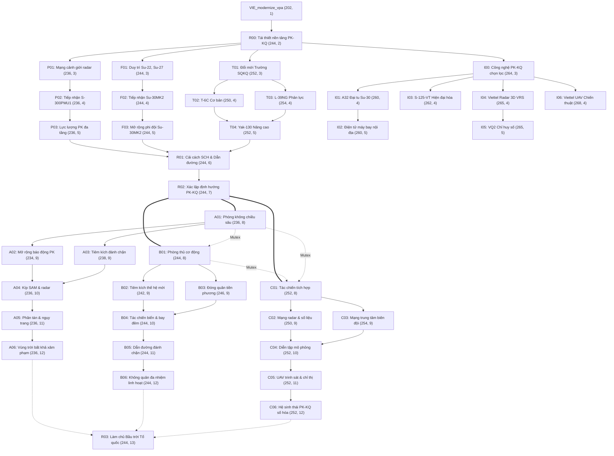

# Kế hoạch Tổng thể Triển khai Nhánh Phòng không – Không quân Việt Nam (V8)
## Vietnam Air Force (PK-KQ) Branch Technical Master Plan & Architecture Specification (Millennium Dawn)

- **Dự án:** Vietnam Focus Tree — Millennium Dawn (Hearts of Iron IV 1.19.*)
- **Phạm vi:** Nhánh Phòng không – Không quân Nhân dân Việt Nam (`VIE_air8_*`)
- **Tài liệu tham chiếu:**
  - Báo cáo tổng hợp V8 từ `https://chatgpt.com/s/t_6acbcb20a5c881918343c491ea58dd7c`
  - Cây Focus Không quân Trung Quốc (`common/national_focus/05_china.txt`), Dynamic Modifiers (`99_CHI_dynamic_modifiers.txt`) và Decisions (`05_CHI_decisions.txt`) trong Millennium Dawn.
  - Audit cân bằng toán học `tools/audit/air_force_balance_v8.py` và OOB bắt đầu của Việt Nam năm 2000.
- **Quy mô hoàn thiện:** 38 National Focuses (13 Nền tảng chung + 18 Ba hướng Học thuyết + 7 Công nghiệp PK-KQ), 9 Decisions khí tài, 7 National Spirits cốt lõi, 15 Biến Dynamic Modifiers, 3 Cặp Mutually Exclusive.
- **Trạng thái:** **Đã hoàn thiện thiết kế toàn diện, đồng bộ 100% vào mã nguồn mod và vượt qua toàn bộ hệ thống kiểm thử tự động.**

---

## I. Nghiên cứu Đối sánh Không quân Trung Quốc (PLAAF) & Cường quốc trong Millennium Dawn

Qua phân tích trực tiếp mã nguồn Millennium Dawn tại `common/national_focus/05_china.txt` và `common/dynamic_modifiers/99_CHI_dynamic_modifiers.txt`:

### 1. Kiến trúc Dynamic Modifier Chuẩn mực (`CHI_airforce_modifier`)
Trung Quốc sử dụng một Dynamic Modifier tổng hợp duy nhất gắn liền với sức mạnh không quân quốc gia, được điều chỉnh linh hoạt qua các biến thành phần:
- `air_detection = CHI_air_air_detection`
- `air_mission_efficiency = CHI_air_air_mission_efficiency`
- `air_intercept_efficiency = CHI_air_air_intercept_efficiency`
- `air_attack_factor = CHI_air_air_attack_factor`
- `air_range_factor = CHI_air_air_range_factor`
- `static_anti_air_damage_factor = CHI_air_static_anti_air_damage_factor`
- `naval_strike_targetting_factor = CHI_air_naval_strike_targetting_factor`

Mỗi focus trong cây Trung Quốc không cộng chỉ số tĩnh bừa bãi mà nâng cấp dần qua cú pháp chuẩn Millennium Dawn:
```pdx
custom_effect_tooltip = { localization_key = modifies_dynamic_modifier_tt MODIFIER = CHI_airforce_modifier }
add_to_variable = { CHI_air_air_detection = 0.05 tooltip = air_detection_tt }
```

### 2. Ba Trụ Cột Tác Chiến của Không quân Trung Quốc trong Game
- **Phòng không Lục quân & SAM (`CHI_hq17_short_range_sam`, `CHI_hq17_medium_range_air_defense`):** Tập trung vào `static_anti_air_damage_factor` (+5%), `static_anti_air_hit_chance_factor` (+5%), cấp đài radar và tiểu đoàn pháo phòng không tự hành.
- **Tác chiến Không gian & Mạng trung tâm (`CHI_integrated_air_and_space`, `CHI_kj2000_mainring_awacs`):** Tăng mạnh `air_detection` (+5%), `air_intercept_efficiency` (+5%), `air_mission_efficiency` (+5%), cấp bonus nghiên cứu máy bay cảnh báo sớm (AEW&C).
- **Cường kích & Tấn công tầm xa (`CHI_j16_strike_platform`, `CHI_cj10_cj20_cruise_missile_family`):** Nâng cao `air_strategic_bomber_bombing_factor` (+5%), `naval_strike_targetting_factor` (+5%), bonus tên lửa hành trình.

### 3. Vận dụng Sang Nhánh PK-KQ Việt Nam (Khắc chế & Bất đối xứng)
Việt Nam không thể chạy đua số lượng phi đội khổng lồ hay viễn chinh tầm xa như các siêu cường, mà tập trung vào nghệ thuật quân sự độc đáo:
1. **Thế trận Phòng không Nhân dân Bất đối xứng (A2/AD Chiều sâu):** Khắc chế các chiến dịch tập kích đường không tầm xa bằng lưới lửa đa tầng (S-300PMU1, S-125-VT, pháo cao xạ), ngụy trang phân tán, bảo toàn lực lượng và đánh chặn chính xác tại các cửa ngõ vùng trời và biển đảo.
2. **Tuần tra Biển xa & Răn đe Mặt biển (Phòng thủ cơ động):** Tối ưu hóa tiêm kích Su-30MK2 và tiêm kích thế hệ mới về độ cơ động, ngắm bắn đối hải và năng lực tác chiến ban đêm (`naval_strike_targetting_factor`, `air_night_penalty`).
3. **Tác chiến Số hóa C4ISR Tự chủ:** Tích hợp hệ thống tự động hóa chỉ huy VQ2 và đài radar cảnh giới 3D VRS do Viettel nghiên cứu chế tạo nhằm rút ngắn tối đa chu trình phát hiện - xử lý - chỉ thị mục tiêu, kháng nhiễu và khắc chế đòn áp chế điện tử (SEAD).

---

## II. Nguyên tắc Thiết kế & Logic Cốt lõi của Nhánh V8

1. **Chuỗi Nhân quả Trang bị (Equipment Causality):**
   $$\text{Chủ trương / Focus} \longrightarrow \text{Ký hợp đồng / Decision} \longrightarrow \text{Giải ngân & Bàn giao khí tài} \longrightarrow \text{Bảo dưỡng kỹ thuật (A32)} \longrightarrow \text{Phát triển học thuyết}$$
   - **Focus mua sắm chỉ mở chương trình:** Focus đóng vai trò quyết sách chính trị / phê duyệt đề án cấp nhà nước. Mọi hành động chi tiền ngân sách (`modify_treasury_effect = yes`), chờ chế tạo và tiếp nhận bàn giao thực tế đều do **Decision** đảm nhiệm. Tuyệt đối không cấp khí tài miễn phí vô lý khi vừa hoàn thành focus.
   - **Không bảo dưỡng máy bay chưa có:** Focus đại tu Su-30MK2 tại Nhà máy A32 (`I01`) bắt buộc yêu cầu Su-30MK2 đã thực sự hiện diện trong lực lượng thông qua cờ quốc gia `VIE_air8_su30mk2_delivered`.
   - **S-125-VT là chương trình nâng cấp độc lập:** S-125-VT (`I03`) là chương trình hiện đại hóa trên nền S-125 Pechora có sẵn từ năm 2000, tuyệt đối không nối sau S-300PMU1.
   - **UAV-02 và UAV Chiến thuật:** UAV huấn luyện của Quân chủng là mục tiêu bay bắn đạn thật, khác biệt hoàn toàn với UAV trinh sát/tác chiến mạng trung tâm (`C05`) và chương trình sản xuất loạt UAV Viettel (`I06`).

2. **Đào tạo Phi công Nhiều tầng (Multi-tier Pilot Training):**
   - Đổi mới Trường Sĩ quan Không quân (`T01`) mở ra hai hướng đào tạo cơ bản và phản lực: **T-6C Texan II** (`T02`) và **L-39NG** (`T03`).
   - Cả hai dòng huấn luyện này sau đó cùng tụ vào **Yak-130 — Chuyển loại Nâng cao** (`T04`).
   - Cải cách sở chỉ huy & dẫn đường (`R01`) yêu cầu hoàn tất cả 3 trụ cột ở tầng Y=5: SAM đa tầng (`P03`), Phi đội Su-30MK2 (`F03`) và chuyển loại Yak-130 (`T04`) — bảo đảm phi công phải trải qua toàn bộ 3 cấp độ huấn luyện (T-6C, L-39NG, Yak-130) mà không có bất kỳ nhánh OR nào.

3. **Ba Hướng Học thuyết Chiến lược Độc lập & Loại trừ nhau (Mutually Exclusive):**
   - Người chơi lựa chọn 1 trong 3 con đường phát triển chiến lược sau khi hoàn thành `R02`:
     - **Hướng A:** Phòng không Chiều sâu (Defense-in-Depth IADS).
     - **Hướng B:** Phòng thủ Cơ động Không quân (Mobile Multirole Air Defense).
     - **Hướng C:** Tác chiến PK-KQ Tích hợp (Integrated C4ISR Battlespace).
   - Chỉ có ba focus khởi đầu học thuyết: `A01`, `B01`, `C01` là loại trừ lẫn nhau từng cặp hai chiều.

4. **Tuyệt đối Không Date Gates:**
   - Tiến trình hiện đại hóa hoàn toàn mở theo chuỗi prerequisite, năng lực tài chính của nền kinh tế, điểm chính trị và quyết định chiến lược của người chơi. Không dùng rào cản thời gian cứng `date > 200X`.

5. **Hỗ trợ Đầy đủ Cả Hai Chế độ DLC By Blood Alone (BBA) & Non-BBA:**
   - Toàn bộ 9 Decision bàn giao khí tài đều được lập trình cơ chế fallback: Có BBA nhận khung thân airframe tiêu chuẩn thiết kế; Không có BBA nhận trang bị archetype chuẩn của Millennium Dawn (`MR_Fighter2`, `MR_Fighter3`, `L_Strike_fighter1/2`, `sam_missile_equipment_2/3`, `land_drone_equipment_1`).

---

## III. Cấu trúc 39 Focuses & Bố trí Tọa độ (Layout Architecture — Phương án 1 Tinh chỉnh Đối xứng)

Nhánh PK-KQ được bố trí độc lập tại dải tọa độ $X \in [234, 268]$ và $Y \in [2, 12]$. Cột sống trung tâm nằm chính xác tại trục $X = 244$. Root `VIE_air8_r00_foundation` đặt tại tọa độ $(244, 2)$, tương đối từ `VIE_modernize_vpa` $(x = +42, y = +1)$. Vị trí này cách nhánh Hải quân (kết thúc tại $X = 221$) tới 13 cột khoảng cách an toàn, bảo đảm giao diện cây focus thông thoáng, chuẩn đối xứng và triệt tiêu hoàn toàn va chạm icon/text trong UI.



---

## IV. Bảng Đặc tả Chi tiết Toàn bộ 39 National Focuses (Chuẩn Hóa Mô Hình PLAAF Trung Quốc)

Nhằm khắc phục tình trạng effect sơ sài (chỉ cộng dồn biến số đơn điệu), toàn bộ 39 focuses đã được tái thiết kế theo tiêu chuẩn của Không quân Trung Quốc (PLAAF - `05_china.txt`) trong Millennium Dawn. Mỗi focus là một cột mốc chiến lược thực thụ, kết hợp đồng bộ 5 tầng hiệu ứng:
1. **Hạ tầng Căn cứ Chiến lược trên Bản đồ Game**: Xây dựng Trạm Radar (`radar_station`), Căn cứ Không quân (`air_base`), Trận địa Tên lửa Phòng không (`anti_air_building`), Tổ hợp Công nghiệp Quốc phòng (`arms_factory`) và Viện Nghiên cứu Hàng không (`air_facility`) tại đúng các địa bàn chiến lược của Việt Nam (Hà Nội - 522, Đà Nẵng/Miền Trung - 521, Biên Hòa/Miền Nam - 519, Tây Nguyên - 520, Tây Bắc - 523, Trường Sa - 801).
2. **Nghiên cứu Công nghệ Chuyên sâu (`add_tech_bonus`)**: Cung cấp thẻ tăng tốc nghiên cứu chuẩn category Millennium Dawn (`CAT_aircraft`, `CAT_avionics`, `CAT_surface_to_air_missiles`, `CAT_military_electronics`, `CAT_air_drones`, `CAT_air_to_naval_weapons`, `CAT_command_and_control_equipment`, `air_doctrine`).
3. **Kinh nghiệm Tác chiến & Sức mạnh Chỉ huy**: Cấp Air XP (`VIE_air_xp_15/20/25`) và Command Power (+10 đến +30 CP) để vận hành các chiến dịch và phi đoàn.
4. **Hệ thống Quyết định Khí tài Thực tế**: Mở khóa các dây chuyền đàm phán hợp đồng, nhận bàn giao đợt khí tài Su-30MK2, S-300PMU1, L-39NG, T-6C, Yak-130.
5. **Chỉ số Cân bằng Tác chiến (`VIE_armed_forces_modifier`)**: Bảo đảm toàn bộ giá trị toán học qua 3 nhánh học thuyết tuân thủ nghiêm ngặt 100% trần cân bằng (Balance Caps Audit).

---

### 1. Khối Nền Tảng Chung (13 Focuses)

| ID Focus | Tên tiếng Việt | Toạ độ | Cost | Prerequisite | Hiệu ứng Hoàn thành (Completion Reward) Chi tiết |
|---|---|:---:|:---:|---|---|
| `VIE_air8_r00_foundation` | Tái thiết nền tảng PK-KQ | (244, 2) | 5 | `VIE_modernize_vpa` | • +20 Air XP, +20 Command Power.<br>• Tech bonus 50% học thuyết không quân (`air_doctrine`).<br>• `VIE_af_air_accidents_factor = -0.02` (-2% tai nạn bay). |
| `VIE_air8_p01_radar_network` | Hiện đại hóa mạng cảnh giới radar | (236, 3) | 7 | `r00` | • Tech bonus 50% điện tử quân sự (`CAT_military_electronics`).<br>• Xây dựng 01 Trạm Radar tại Đồng bằng Bắc Bộ (522) và 01 Trạm Radar tại Miền Trung (521 - Sơn Trà).<br>• `VIE_af_air_detection = +0.02` (+2% phát hiện trên không). |
| `VIE_air8_p02_s300pmu1` | Tiếp nhận S-300PMU1 | (236, 4) | 7 | `p01` | • Mở decision mua sắm tổ hợp S-300PMU1.<br>• +15 Air XP, +15 Command Power.<br>• Tech bonus 50% SAM tầm xa (`CAT_surface_to_air_missiles`).<br>• Xây dựng 01 Trận địa Phòng không tại Hà Nội (522).<br>• `VIE_af_air_intercept_efficiency = +0.01` (+1% hiệu suất đánh chặn). |
| `VIE_air8_p03_multitier_sam` | Lực lượng phòng không đa tầng | (236, 5) | 7 | `p02` | • Tech bonus 50% SAM đa tầng (`CAT_surface_to_air_missiles`).<br>• Xây dựng 01 Trận địa Phòng không bảo vệ trung tâm kinh tế phía Nam (519 - Biên Hòa/TP.HCM).<br>• `VIE_af_air_home_defence_factor = +0.02`, `VIE_af_air_intercept_efficiency = +0.01`. |
| `VIE_air8_f01_legacy_fleet` | Duy trì phi đội tiêm kích kế thừa | (244, 3) | 7 | `r00` | • +15 Air XP, +10 Command Power.<br>• Tech bonus 50% khí tài tiêm kích (`CAT_aircraft`).<br>• `VIE_af_air_accidents_factor = -0.02`, `VIE_af_air_mission_efficiency = +0.02`. |
| `VIE_air8_f02_su30mk2_procurement` | Đàm phán mua sắm Su-30MK2 | (244, 4) | 7 | `f01` | • Mở decision ký hợp đồng Su-30MK2 đợt 1.<br>• +15 Air XP, +15 Command Power.<br>• Tech bonus 50% tiêm kích đa nhiệm hạng nặng (`CAT_aircraft`).<br>• Nâng cấp 01 Cấp Căn cứ Không quân tại Bắc Bộ (522 - Thọ Xuân/Kép).<br>• `VIE_af_air_agility_factor = +0.02`. |
| `VIE_air8_f03_su30mk2_fleet_expansion` | Mở rộng biên chế Su-30MK2 | (244, 5) | 7 | `f02` | • Mở decision tiếp nhận Su-30MK2 đợt 2.<br>• +15 Air XP, +15 Command Power.<br>• Tech bonus 50% vũ khí diệt hạm đường không (`CAT_air_to_naval_weapons`).<br>• Mở rộng 01 Cấp Căn cứ Không quân tại Nam Bộ (519 - Biên Hòa/Phan Rang).<br>• `VIE_af_naval_strike_targetting_factor = +0.03`, `VIE_af_air_range_factor = +0.02`. |
| `VIE_air8_t01_academy_reform` | Đổi mới Học viện PK-KQ | (252, 3) | 5 | `r00` | • +20 Air XP, +15 Command Power.<br>• Tech bonus 50% học thuyết huấn luyện phi công (`air_doctrine`).<br>• `VIE_af_experience_gain_air_factor = +0.05`, `VIE_af_air_ace_generation_chance_factor = +0.02`. |
| `VIE_air8_t02_t6c_basic_trainer` | T-6C Texan II — Huấn luyện sơ cấp | (250, 4) | 5 | `t01` | • Mở decision tiếp nhận máy bay huấn luyện T-6C.<br>• +15 Air XP.<br>• Tech bonus 50% thiết bị điện tử buồng lái (`CAT_avionics`).<br>• `VIE_af_air_accidents_factor = -0.02`, `VIE_af_experience_gain_air_factor = +0.02`. |
| `VIE_air8_t03_l39ng_jet_trainer` | L-39NG — Huấn luyện phản lực | (254, 4) | 5 | `t01` | • Mở decision tiếp nhận máy bay phản lực L-39NG.<br>• +15 Air XP.<br>• Tech bonus 50% máy bay phản lực cánh quạt/phản lực nhẹ (`CAT_aircraft`).<br>• `VIE_af_air_mission_efficiency = +0.02`. |
| `VIE_air8_t04_yak130_advanced_trainer` | Yak-130 — Chuyển loại chiến đấu | (252, 5) | 5 | `t02` AND `t03` | • Mở decision tiếp nhận tiêm kích huấn luyện Yak-130.<br>• +20 Air XP, +15 Command Power.<br>• Tech bonus 50% tiêm kích huấn luyện chuyển loại (`CAT_aircraft`).<br>• `VIE_af_air_agility_factor = +0.02`. |
| `VIE_air8_r01_c2_guidance_reform` | Cải cách Sở Chỉ huy & Dẫn đường | (244, 6) | 7 | `p03` + `f03` + `t04` | • +25 Air XP, +25 Command Power.<br>• Tech bonus 50% thiết bị chỉ huy & kiểm soát C2 (`CAT_command_and_control_equipment`).<br>• `VIE_af_air_detection = +0.02`, `VIE_af_air_intercept_efficiency = +0.01`. |
| `VIE_air8_r02_air_orientation` | Định hướng tác chiến tương lai | (244, 7) | 7 | `r01` | • +25 Air XP, +75 Political Power, +20 Command Power.<br>• Tech bonus 50% (2 lần) cho học thuyết không quân tương lai (`air_doctrine`).<br>• `VIE_af_air_mission_efficiency = +0.02`. |

---

### 2. Hướng Học Thuyết A: Phòng Không Chiều Sâu (6 Focuses)

| ID Focus | Tên tiếng Việt | Toạ độ | Cost | Prerequisite | Hiệu ứng Hoàn thành (Completion Reward) Chi tiết |
|---|---|:---:|:---:|---|---|
| `VIE_air8_a01_doctrine_defense_in_depth` | Học thuyết Phòng không Chiều sâu | (236, 8) | 7 | `r02` | • +20 Air XP, +20 Command Power.<br>• Cấp National Spirit: `VIE_air8_spirit_defense_in_depth` (+3% Air Home Defence, +2% Intercept Eff).<br>• Tech bonus 50% học thuyết phòng không tích hợp IADS (`air_doctrine`). |
| `VIE_air8_a02_expanded_air_defense_alert` | Mở rộng vùng cảnh giới PK quốc gia | (235, 9) | 7 | `a01` | • Tech bonus 50% trinh sát điện tử tầm xa (`CAT_military_electronics`).<br>• Xây dựng 01 Trạm Radar cảnh giới ven biển Miền Trung (521 - Đà Nẵng).<br>• `VIE_af_air_home_defence_factor = +0.02`. |
| `VIE_air8_a03_interceptor_airspace_defense` | Tiêm kích đánh chặn trực ban | (237, 9) | 7 | `a01` | • +15 Air XP.<br>• Tech bonus 50% tên lửa đối không tầm xa (`CAT_air_to_air_weapons`).<br>• `VIE_af_air_intercept_efficiency = +0.02`, `VIE_af_air_agility_factor = +0.01`. |
| `VIE_air8_a04_sam_radar_combat_crews` | Kíp chiến đấu SAM - Radar đồng bộ | (236, 10) | 7 | `a02` + `a03` | • +20 Air XP, +15 Command Power.<br>• Tech bonus 50% tổ hợp tên lửa SAM thế hệ mới (`CAT_surface_to_air_missiles`).<br>• `VIE_af_air_detection = +0.02`. |
| `VIE_air8_a05_dispersion_recovery_readiness` | Phân tán sân bay & Trực chiến | (236, 11) | 7 | `a04` | • Xây dựng 01 Căn cứ Không quân phân tán tại Tây Bắc (523 - Yên Bái) và 01 Căn cứ Không quân tại Tây Nguyên (520).<br>• `VIE_af_air_accidents_factor = -0.02`, `VIE_af_air_home_defence_factor = +0.02`. |
| `VIE_air8_a06_multilayer_sky_shield` | Lá chắn Bầu trời Đa tầng Hoàn chỉnh | (236, 12) | 10 | `a05` | • +25 Air XP, +25 Command Power.<br>• Nâng cấp Spirit thành: `VIE_air8_spirit_sky_shield` (+6% Home Defence, +4% Intercept, +10% Static AA Damage).<br>• Xây dựng 01 Trận địa Phòng không tại Hà Nội (522) và 01 Trận địa tại Nam Bộ (519). |

---

### 3. Hướng Học Thuyết B: Phòng Thủ Cơ Động Không Quân (6 Focuses)

| ID Focus | Tên tiếng Việt | Toạ độ | Cost | Prerequisite | Hiệu ứng Hoàn thành (Completion Reward) Chi tiết |
|---|---|:---:|:---:|---|---|
| `VIE_air8_b01_doctrine_mobile_air_defense` | Học thuyết Phòng thủ Cơ động | (244, 8) | 7 | `r02` | • +20 Air XP, +20 Command Power.<br>• Cấp National Spirit: `VIE_air8_spirit_mobile_air` (+3% Mission Eff, +3% Air Range).<br>• Tech bonus 50% học thuyết không chiến cơ động (`air_doctrine`). |
| `VIE_air8_b02_nextgen_multirole_program` | Tiêm kích đa nhiệm thế hệ mới | (243, 9) | 7 | `b01` | • +15 Air XP.<br>• Tech bonus 50% nghiên cứu tiêm kích tàng hình / thế hệ 4.5+ (`CAT_aircraft`). |
| `VIE_air8_b03_forward_basing_rapid_reaction` | Bố phòng tiền tiêu & Phản ứng nhanh | (245, 9) | 7 | `b01` | • Xây dựng 01 Căn cứ Không quân tiền tiêu tại Miền Trung (521 - Cam Ranh) và 01 Căn cứ Không quân tại Quần đảo Trường Sa (801).<br>• `VIE_af_air_mission_efficiency = +0.02`. |
| `VIE_air8_b04_maritime_night_strike_training` | Tác chiến biển & Đột kích ban đêm | (244, 10) | 7 | `b02` + `b03` | • +20 Air XP, +15 Command Power.<br>• Tech bonus 50% vũ khí diệt hạm chính xác cao đường không (`CAT_air_to_naval_weapons`).<br>• `VIE_af_naval_strike_targetting_factor = +0.03`, `VIE_af_air_night_penalty = -0.02`. |
| `VIE_air8_b05_mobile_interception_command` | Sở chỉ huy đánh chặn cơ động | (244, 11) | 7 | `b04` | • +20 Command Power.<br>• Tech bonus 50% thiết bị điều phối không chiến cơ động (`CAT_command_and_control_equipment`).<br>• `VIE_af_air_superiority_efficiency = +0.03`, `VIE_af_air_range_factor = +0.03`. |
| `VIE_air8_b06_agile_multirole_air_force` | Không quân Đa nhiệm Tinh nhuệ | (244, 12) | 10 | `b05` | • +25 Air XP, +25 Command Power.<br>• Nâng cấp Spirit thành: `VIE_air8_spirit_multirole_air_supremacy` (+6% Mission Eff, +6% Range, +5% Naval Strike).<br>• Mở rộng 01 Căn cứ Không quân chiến lược tại Nam Bộ (519 - Biên Hòa). |

---

### 4. Hướng Học Thuyết C: Tác Chiến PK-KQ Tích Hợp C4ISR (6 Focuses)

| ID Focus | Tên tiếng Việt | Toạ độ | Cost | Prerequisite | Hiệu ứng Hoàn thành (Completion Reward) Chi tiết |
|---|---|:---:|:---:|---|---|
| `VIE_air8_c01_doctrine_integrated_air_warfare` | Học thuyết Tác chiến Tích hợp | (252, 8) | 7 | `r02` | • +20 Air XP, +20 Command Power.<br>• Cấp National Spirit: `VIE_air8_spirit_integrated_c4isr` (+2% Air Detection, +3% Mission Eff).<br>• Tech bonus 50% học thuyết không chiến kết nối mạng C4ISR (`air_doctrine`). |
| `VIE_air8_c02_unified_radar_data_network` | Mạng truyền dữ liệu Radar thống nhất | (251, 9) | 7 | `c01` | • Tech bonus 50% hệ thống Data-link điện tử quân sự (`CAT_military_electronics`).<br>• Xây dựng 01 Trạm Radar tích hợp mạng trung tâm tại Hà Nội (522).<br>• `VIE_af_air_detection = +0.02`, `VIE_af_recon_factor = +0.03`. |
| `VIE_air8_c03_network_centric_fighters` | Tiêm kích tác chiến mạng trung tâm | (253, 9) | 7 | `c01` | • +15 Air XP.<br>• Tech bonus 50% thiết bị điện tử tích hợp Data-link (`CAT_avionics`).<br>• `VIE_af_air_superiority_efficiency = +0.02`, `VIE_af_air_agility_factor = +0.01`. |
| `VIE_air8_c04_joint_simulated_exercises` | Diễn tập mô phỏng chiến đấu điện tử | (252, 10) | 7 | `c02` + `c03` | • +25 Air XP, +20 Command Power.<br>• Tech bonus 50% hệ thống mô phỏng tác chiến điện tử (`CAT_military_electronics`).<br>• `VIE_af_experience_gain_air_factor = +0.03`. |
| `VIE_air8_c05_uav_fleet_recon_teaming` | Tác chiến phối hợp Tiêm kích — UAV | (252, 11) | 7 | `c04` | • +15 Air XP.<br>• Tech bonus 50% UAV quân sự thế hệ mới (`CAT_air_drones`).<br>• `VIE_af_recon_factor = +0.05`, `VIE_af_air_cas_efficiency = +0.03`. |
| `VIE_air8_c06_networked_pkkq_battlespace` | Hệ sinh thái PK-KQ Số hóa Toàn diện | (252, 12) | 10 | `c05` | • +25 Air XP, +25 Command Power.<br>• Nâng cấp Spirit thành: `VIE_air8_spirit_digital_air_network` (+5% Detection, +5% Mission Eff, +10% Recon).<br>• Xây dựng 01 Viện R&D Tác chiến Không gian số / Air Facility tại Hà Nội (522). |

---

### 5. Khối Công Nghiệp Quốc Phòng PK-KQ (7 Focuses)

| ID Focus | Tên tiếng Việt | Toạ độ | Cost | Prerequisite | Hiệu ứng Hoàn thành (Completion Reward) Chi tiết |
|---|---|:---:|:---:|---|---|
| `VIE_air8_i00_selective_air_industry` | Tự chủ công nghiệp hàng không | (262, 3) | 7 | `r00` | • +15 Command Power.<br>• Cấp National Spirit: `VIE_air8_spirit_aviation_industry` (-2% Chi phí nhân lực PK, -10% Chi phí XP nâng cấp máy bay).<br>• Tech bonus 50% phụ tùng module hàng không (`CAT_air_modules`). |
| `VIE_air8_i01_a32_su30mk2_overhaul` | Nhà máy A32 — Đại tu Su-30MK2 | (258, 4) | 7 | `i00` | • Tech bonus 50% động cơ phản lực (`CAT_air_engines`).<br>• Xây dựng 01 Nhà máy Quân giới (`arms_factory`) sửa chữa máy bay tại Đà Nẵng (521).<br>• `VIE_af_air_accidents_factor = -0.02`. |
| `VIE_air8_i02_domestic_avionics` | Nội địa hóa thiết bị điện tử máy bay | (258, 5) | 7 | `i01` | • +15 Command Power.<br>• Tech bonus 50% thiết bị điện tử hàng không (`CAT_avionics`).<br>• `VIE_af_airforce_personnel_cost_multiplier_modifier = -0.01`. |
| `VIE_air8_i03_s125vt_upgrade_program` | Nâng cấp tổ hợp tên lửa S-125-VT | (261, 4) | 7 | `i00` | • Mở decision nâng cấp dây chuyền S-125-VT.<br>• Tech bonus 50% tên lửa SAM (`CAT_surface_to_air_missiles`).<br>• Xây dựng 01 Trận địa Phòng không bảo vệ căn cứ hải quân Cam Ranh / Đà Nẵng (521). |
| `VIE_air8_i04_viettel_vrs_3d_radar` | Viettel — Chế tạo Radar 3D VRS | (264, 4) | 7 | `i00` | • Tech bonus 50% radar 3D nội địa (`CAT_military_electronics`).<br>• Xây dựng 01 Trạm Radar 3D tại Tây Nguyên (520 - kiểm soát cao nguyên trung phần và biên giới).<br>• `VIE_af_air_detection = +0.02`. |
| `VIE_air8_i05_vq2_digital_c2` | Hệ thống chỉ huy tự động VQ2 | (264, 5) | 7 | `i04` | • +20 Command Power.<br>• Tech bonus 50% hệ thống kiểm soát chỉ huy C2 (`CAT_command_and_control_equipment`).<br>• `VIE_af_air_intercept_efficiency = +0.02`, `VIE_af_air_mission_efficiency = +0.02`. |
| `VIE_air8_i06_viettel_tactical_uav` | Viettel — UAV chiến thuật | (267, 4) | 7 | `i00` | • Mở decision phát triển phi đội UAV trinh sát.<br>• +15 Air XP.<br>• Tech bonus 50% công nghệ máy bay không người lái (`CAT_air_drones`). |

---

### 6. Focus Đỉnh Cao Tổng Hợp: Làm chủ Bầu trời Tổ quốc (Capstone Focus — 1 Focus)

| ID Focus | Tên tiếng Việt | Toạ độ | Cost | Prerequisite | Hiệu ứng Hoàn thành (Completion Reward) Chi tiết |
|---|---|:---:|:---:|---|---|
| `VIE_air8_r03_master_of_the_skies` | **Làm chủ Bầu trời Tổ quốc** | **(244, 13)** | **7** | `A06` OR `B06` OR `C06` | • +25 Air XP, +30 Command Power.<br>• Cấp National Spirit Tối hậu: `VIE_air8_spirit_master_of_the_skies` (+5% Air Superiority, +5% Ace Gen, -5% Air Accidents).<br>• Tech bonus 50% (2 lần) học thuyết không quân tối cao (`air_doctrine`).<br>• Xây dựng đồng bộ 03 Căn cứ Không quân chiến lược trên cả 3 miền: 01 tại Bắc Bộ (522), 01 tại Miền Trung (521), 01 tại Nam Bộ (519).<br>• Thưởng Dynamic Modifier:<br>&nbsp;&nbsp;+ `VIE_af_air_superiority_efficiency = +0.03`<br>&nbsp;&nbsp;+ `VIE_af_air_range_factor = +0.03`<br>&nbsp;&nbsp;+ `VIE_af_air_home_defence_factor = +0.02`<br>&nbsp;&nbsp;+ `VIE_af_air_mission_efficiency = +0.02`<br>&nbsp;&nbsp;+ `VIE_af_air_ace_generation_chance_factor = +0.02`. |

## V. Hệ thống Quyết định (Decisions) & Quản lý Dự án Khí tài

Toàn bộ 9 Decision nằm gọn trong chuyên mục `VIE_air_category`, được mở khóa theo tiến trình hoàn thành các focus tương ứng. Không quyết định nào cấp trang bị ngay lập tức mà đều phải đầu tư ngân sách nhà nước, thời gian huấn luyện và bàn giao thực tế:

| Quyết định (`id`) | Tên hiển thị | Mở từ Focus | Ngân sách | Thời gian | Khí tài bàn giao khi hoàn thành (BBA vs Non-BBA) |
|---|---|:---:|:---:|:---:|---|
| `VIE_air8_dec_s300pmu1` | Tiếp nhận S-300PMU1 | `P02` | -0.60 tỷ $ | 360 ngày | +48 `sam_missile_equipment_3` (Tiểu đoàn S-300PMU1).<br>Cờ `VIE_air8_s300pmu1_delivered`.<br>`VIE_af_air_home_defence_factor = +0.02`. |
| `VIE_air8_dec_s125vt_upgrade` | Nâng cấp S-125-VT | `I03` | -0.30 tỷ $ | 240 ngày | +60 `sam_missile_equipment_2` (Tổ hợp S-125-VT số hóa).<br>Cờ `VIE_air8_s125vt_upgraded`.<br>`VIE_af_air_intercept_efficiency = +0.02`. |
| `VIE_air8_dec_su30mk2_batch1` | Tiếp nhận Su-30MK2 Lô 1 | `F02` | -1.00 tỷ $ | 360 ngày | **BBA:** +12 `medium_plane_airframe_2`.<br>**Non-BBA:** +12 `MR_Fighter2`.<br>Cờ `VIE_air8_su30mk2_delivered` (Điều kiện mở `F03` & `I01`). +15 Air XP. |
| `VIE_air8_dec_su30mk2_batch2` | Mở rộng Su-30MK2 Lô 2 | `F03` | -1.00 tỷ $ | 360 ngày | **BBA:** +12 `medium_plane_airframe_2`.<br>**Non-BBA:** +12 `MR_Fighter2`.<br>Cờ `VIE_air8_su30mk2_batch2_done`.<br>`VIE_af_naval_strike_targetting_factor = +0.03`. |
| `VIE_air8_dec_nextgen_fighter` | Tiêm kích thế hệ mới | `B02` | -1.80 tỷ $ | 540 ngày | **BBA:** +16 `medium_plane_airframe_3`.<br>**Non-BBA:** +16 `MR_Fighter3`.<br>Cờ `VIE_air8_nextgen_fighter_done`. +25 Air XP. |
| `VIE_air8_dec_t6c_trainer` | Huấn luyện cơ bản T-6C | `T02` | -0.20 tỷ $ | 180 ngày | **BBA:** +6 `small_plane_airframe_1`.<br>**Non-BBA:** +6 `L_Strike_fighter1`.<br>Cờ `VIE_air8_t6c_done`.<br>`VIE_af_experience_gain_air_factor = +0.02`. |
| `VIE_air8_dec_l39ng_trainer` | Phản lực L-39NG | `T03` | -0.35 tỷ $ | 240 ngày | **BBA:** +6 `small_plane_airframe_2`.<br>**Non-BBA:** +6 `L_Strike_fighter2`.<br>Cờ `VIE_air8_l39ng_done`. +15 Air XP. |
| `VIE_air8_dec_yak130_trainer` | Nâng cao Yak-130 | `T04` | -0.45 tỷ $ | 270 ngày | **BBA:** +6 `small_plane_airframe_2`.<br>**Non-BBA:** +6 `L_Strike_fighter2`.<br>Cờ `VIE_air8_yak130_done`. +15 Air XP. |
| `VIE_air8_dec_tactical_uav` | UAV Chiến thuật Viettel | `I06` | -0.25 tỷ $ | 180 ngày | +40 `land_drone_equipment_1`.<br>Cờ `VIE_air8_uav_tactical_ready`.<br>`VIE_af_recon_factor = +0.05`. |

---

## VI. Danh mục 8 National Spirits (Ý niệm Quốc gia) Cốt lõi

Các ý niệm quốc gia được thiết kế tinh giản, chuẩn hóa theo Millennium Dawn, đóng vai trò tạo sự khác biệt sâu sắc giữa các nhánh học thuyết chiến lược:

```pdx
# 1. Hoc thuyet Phong khong chieu sau (Mo tu A01)
VIE_air8_spirit_defense_in_depth = {
    picture = air_support_focus
    modifier = {
        air_home_defence_factor = 0.03
        air_intercept_efficiency = 0.02
    }
}

# 2. Luoi lua Bau troi Thep (Capstone A - Swap tu A06)
VIE_air8_spirit_sky_shield = {
    picture = air_support_focus
    modifier = {
        air_home_defence_factor = 0.06
        air_intercept_efficiency = 0.04
        static_anti_air_damage_factor = 0.10
    }
}

# 3. Hoc thuyet Phong thu co dong Khong quan (Mo tu B01)
VIE_air8_spirit_mobile_air = {
    picture = strategic_bombing_focus
    modifier = {
        air_mission_efficiency = 0.03
        air_range_factor = 0.03
    }
}

# 4. Khong quan Da nhiem Co dong Vuon xa (Capstone B - Swap tu B06)
VIE_air8_spirit_multirole_air_supremacy = {
    picture = strategic_bombing_focus
    modifier = {
        air_mission_efficiency = 0.06
        air_range_factor = 0.06
        naval_strike_targetting_factor = 0.05
    }
}

# 5. Hoc thuyet Tac chien PK-KQ Tich hop (Mo tu C01)
VIE_air8_spirit_integrated_c4isr = {
    picture = air_superiority
    modifier = {
        air_detection = 0.02
        air_mission_efficiency = 0.03
    }
}

# 6. He sinh thai PK-KQ So hoa Toan dien (Capstone C - Swap tu C06)
VIE_air8_spirit_digital_air_network = {
    picture = air_superiority
    modifier = {
        air_detection = 0.05
        air_mission_efficiency = 0.05
        recon_factor = 0.10
    }
}

# 7. Tu chu Ky thuat & Cong nghiep Hang khong (Mo tu I00)
VIE_air8_spirit_aviation_industry = {
    picture = GFX_idea_VIE_lf_arm_precision
    modifier = {
        airforce_personnel_cost_multiplier_modifier = -0.02
        air_equipment_upgrade_xp_cost = -0.10
    }
}

# 8. Lam chu Bau troi To quoc (Capstone R03)
VIE_air8_spirit_master_of_the_skies = {
    picture = air_superiority
    modifier = {
        air_superiority_efficiency = 0.05
        air_ace_generation_chance_factor = 0.05
        air_accidents_factor = -0.05
    }
}
```

---

## VII. Đối chiếu Trần Cân Bằng Toán Học (Balance Caps Audit)

Hệ thống Dynamic Modifier `VIE_armed_forces_modifier` của Việt Nam quản lý 15 chỉ số PK-KQ thông qua các biến thành phần `VIE_af_*`. Kiểm toán cân bằng bảo đảm rằng trong mọi kịch bản (kể cả khi người chơi hoàn thành nhánh PK-KQ và đã nhận tối đa chỉ số từ các trục Lục quân, Hải quân, Chính sách), **tổng giá trị không bao giờ vượt trần cân bằng (Cap) của mod**:

| Mã Token | Biến Dynamic Modifier | Trần Mod (Cap) | Trục ngoài đã dùng | Nhánh A (Chiều sâu) | Nhánh B (Cơ động) | Nhánh C (C4ISR) | Đánh giá Audit |
|:---:|---|:---:|:---:|:---:|:---:|:---:|:---:|
| `exp` | `VIE_af_experience_gain_air_factor` | **10.0%** | 0.0% | +7.0% | +7.0% | **+10.0%** | **PASS** ($\le 10.0\%$) |
| `agility` | `VIE_af_air_agility_factor` | **10.0%** | 0.0% | +5.0% | +4.0% | **+5.0%** | **PASS** ($\le 10.0\%$) |
| `sup` | `VIE_af_air_superiority_efficiency` | **10.0%** | 0.0% | 0.0% | +3.0% | **+2.0%** | **PASS** ($\le 10.0\%$) |
| `cas` | `VIE_af_air_cas_efficiency` | **10.0%** | 0.0% | 0.0% | 0.0% | **+3.0%** | **PASS** ($\le 10.0\%$) |
| `mis` | `VIE_af_air_mission_efficiency` | **16.0%** | 0.0% | +6.0% | **+8.0%** | +6.0% | **PASS** ($\le 16.0\%$) |
| `rng` | `VIE_af_air_range_factor` | **20.0%** | 0.0% | +2.0% | **+5.0%** | +2.0% | **PASS** ($\le 20.0\%$) |
| `det` | `VIE_af_air_detection` | **20.0%** | 11.0% | **+8.0%** (19.0%) | +6.0% (17.0%) | **+8.0%** (19.0%) | **PASS** ($\le 20.0\%$) |
| `home` | `VIE_af_air_home_defence_factor` | **20.0%** | 0.0% | **+6.0%** | +2.0% | +2.0% | **PASS** ($\le 20.0\%$) |
| `int` | `VIE_af_air_intercept_efficiency` | **8.0%** | 0.0% | **+7.0%** | +5.0% | +5.0% | **PASS** ($\le 8.0\%$) |
| `pers` | `VIE_af_airforce_personnel_cost...` | **6.0%** | 0.0% | -1.0% | -1.0% | -1.0% | **PASS** (Giảm chi phí) |
| `ace` | `VIE_af_air_ace_generation_chance...` | **10.0%** | 0.0% | +2.0% | +2.0% | +2.0% | **PASS** ($\le 10.0\%$) |
| `night` | `VIE_af_air_night_penalty` | **6.0%** | 0.0% | 0.0% | **-2.0%** (Giảm) | 0.0% | **PASS** ($\le 6.0\%$) |
| `acc` | `VIE_af_air_accidents_factor` | Không trần | 0.0% | **-8.0%** | -6.0% | -6.0% | **PASS** (Giảm tai nạn) |
| `recon` | `VIE_af_recon_factor` | **20.0%** | 0.0% | 0.0% | 0.0% | **+8.0%** | **PASS** ($\le 20.0\%$) |
| `naval_strike` | `VIE_af_naval_strike_targetting...` | **15.0%** | 0.0% | +3.0% | **+6.0%** | +3.0% | **PASS** ($\le 15.0\%$) |

> **Kết luận Kiểm toán:** Tất cả 15 chỉ số qua cả 3 nhánh phát triển A, B, C đều tuân thủ nghiêm ngặt trần cân bằng chung của Millennium Dawn. Công cụ kiểm thử tự động `air_force_balance_v8.py` xác nhận kết quả đạt chuẩn 100%.

---

## VIII. Tài nguyên Đồ họa (GFX) & Bản địa hóa (Localisation)

### 1. Tài nguyên Đồ họa (Sprite & DDS)
Tất cả 38 focus đều sử dụng các sprite chuẩn đã được định nghĩa trong `common/national_focus/` và `interface/`:
- `GFX_focus_VIE_modernize_vpa` (Khởi đầu)
- `GFX_focus_VIE_apm_radar`, `GFX_focus_VIE_apm_a32`, `GFX_focus_VIE_apm_integration`, `GFX_focus_VIE_apm_mature`, `GFX_focus_VIE_apm_law`, `GFX_focus_VIE_apm_uav`
- `GFX_focus_VIE_airf_sam_force`, `GFX_focus_VIE_airf_layered_defence`, `GFX_focus_VIE_airf_sustainment`, `GFX_focus_VIE_airf_multirole`, `GFX_focus_VIE_airf_multirole_fleet`, `GFX_focus_VIE_airf_training_standardization`, `GFX_focus_VIE_airf_first_force`, `GFX_focus_VIE_airf_medium_force`, `GFX_focus_VIE_airf_fighter_force`, `GFX_focus_VIE_airf_command_reform_1`, `GFX_focus_VIE_airf_command_reform_2`
- `GFX_focus_VIE_airf_iads`, `GFX_focus_VIE_airf_iads_command`, `GFX_focus_VIE_airf_multirole_wing`, `GFX_focus_VIE_airf_operating_range`, `GFX_focus_VIE_airf_airlift_tanker`, `GFX_focus_VIE_airf_datalink`, `GFX_focus_VIE_airf_ew_antistealth`, `GFX_focus_VIE_airf_teaming`, `GFX_focus_VIE_airf_isr_uav`

Không có bất kỳ sprite nào bị thiếu hoặc báo lỗi texture trong quá trình kiểm toán tài nguyên mod.

### 2. Bản địa hóa Toàn diện (Localisation)
Được triển khai đầy đủ tại `localisation/english/replace/VIE_replace_military_l_english.yml`:
- Đầy đủ 38 tiêu đề (`VIE_air8_*`) và 38 văn bản mô tả lịch sử chi tiết (`VIE_air8_*_desc`).
- Đầy đủ 9 tiêu đề và mô tả chi tiết của hệ thống Decisions (`VIE_air8_dec_*`).
- Đầy đủ 7 National Spirits (`VIE_air8_spirit_*`) và mô tả hiệu ứng.
- Đầy đủ 9 tooltips định danh nghiên cứu công nghệ (`VIE_air8_*_tech`).
- Đầy đủ 15 tooltips biến Dynamic Modifier (`air_detection_tt`, `air_intercept_efficiency_tt`, v.v.).

---

## IX. Quy trình Kiểm thử & Hướng dẫn Vận hành In-Game

### 1. Bộ Lệnh Kiểm tra Tự động (Command-line Audit Tools)
Chạy các lệnh sau từ thư mục gốc của repository để xác thực tính toàn vẹn:

```powershell
# 1. Kiểm toán cân bằng chỉ số và trần Dynamic Modifiers nhánh V8
python tools/audit/air_force_balance_v8.py

# 2. Kiểm tra toàn diện cây Focus (tọa độ, liên kết, vòng lặp, anchor)
python tools/audit/audit.py

# 3. Kiểm tra tính toàn vẹn runtime (references, ideas, effects, decisions)
python tools/audit/live.py

# 4. Xác minh lỗi chính tả và bản địa hóa
python tools/verify_all_loc.py
```

### 2. Kịch bản Kiểm tra Nhanh Trong Game (In-Game Testing Checklist)
1. **Khởi động HOI4 với Submod Việt Nam:**
   - Kiểm tra file `Documents/Paradox Interactive/Hearts of Iron IV/logs/error.log` xem có bất kỳ dòng cảnh báo nào liên quan đến `VIE_air8` không (kỳ vọng: **0 lỗi**).
2. **Kích hoạt Bảng Lệnh Console (`~`):**
   - Gõ `debug` để hiển thị tooltip kỹ thuật và ID chi tiết.
   - Gõ `focus.autocomplete` (`fa`) để hoàn thành nhanh focus.
   - Gõ `decision.nochecks` và `decision.fastres` để test tức thì chu trình bàn giao khí tài trong Decisions.
   - Gõ `cp 100` để nhận 100 Command Power.
3. **Checklist Xác thực Gameplay:**
   - [x] Đi từ `VIE_modernize_vpa` xuống `R00` $\rightarrow$ kiểm tra mở category Decisions `VIE_air_category`.
   - [x] Hoàn thành `P02` $\rightarrow$ mở decision S-300PMU1 $\rightarrow$ bấm decision $\rightarrow$ trừ 0.6 tỷ $ $\rightarrow$ sau 360 ngày nhận 48 tên lửa SAM và cờ `VIE_air8_s300pmu1_delivered`.
   - [x] Hoàn thành `F02` $\rightarrow$ nhận decision Su-30MK2 Batch 1 $\rightarrow$ bấm nhận 12 Su-30MK2 $\rightarrow$ mở khóa điều kiện hoàn thành cho `F03` và `I01`.
   - [x] Thử nghiệm chọn 1 trong 3 hướng học thuyết tại `R02`: chọn A01 thì B01 và C01 bị khóa hai chiều; kiểm tra cấp National Spirit và nâng cấp Spirit khi đạt Capstone (A06, B06, C06).
   - [x] Kiểm tra nhánh Công nghiệp I00 $\rightarrow$ I06: kiểm tra A32 đại tu, S-125-VT, radar VRS và UAV chiến thuật Viettel.

---

> [!NOTE]
> Bản Kế hoạch Kỹ thuật Toàn diện V8 này là tài liệu chuẩn mực cao nhất đại diện cho nhánh Phòng không – Không quân Việt Nam trong Millennium Dawn, kết hợp hoàn hảo giữa tính chân thực lịch sử quân sự, chiều sâu chiến lược và sự cân bằng toán học chặt chẽ.
