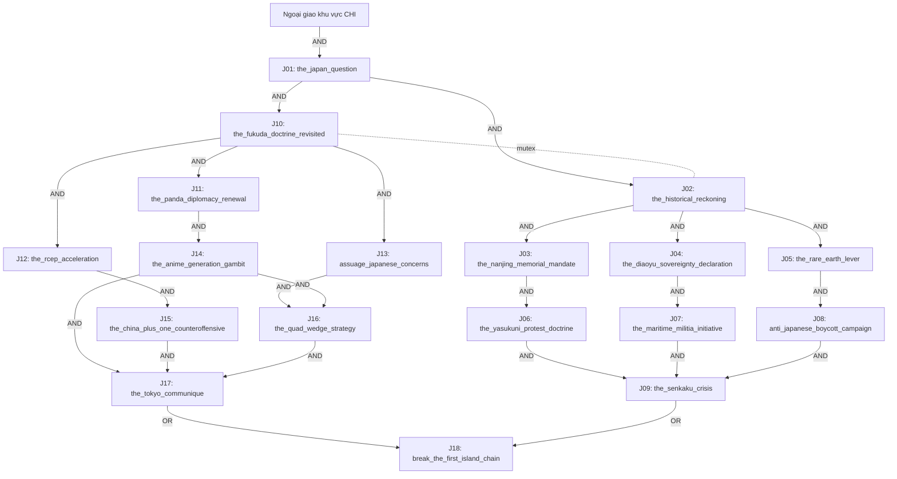

# Trung–Nhật — dữ liệu trích từ code

Chỉ kiểm cấu trúc; không mô phỏng HOI4.

| Mã | ID thật | Cost | Anchor | x/y tương đối | X/Y tuyệt đối | Prerequisite (AND giữa nhóm, OR trong nhóm) |
|---|---|---:|---|---|---|---|
| J01 | CHI_the_japan_question | 5 | CHI_Chinese_Diplomacy | (28,1) | (83,1) | (CHI_Chinese_Diplomacy) |
| J02 | CHI_the_historical_reckoning | 7 | J01 | (-3,1) | (80,2) | (J01) |
| J03 | CHI_the_nanjing_memorial_mandate | 3 | J02 | (-2,1) | (78,3) | (J02) |
| J04 | CHI_the_diaoyu_sovereignty_declaration | 5 | J02 | (0,1) | (80,3) | (J02) |
| J05 | CHI_the_rare_earth_lever | 3 | J02 | (2,1) | (82,3) | (J02) |
| J06 | CHI_the_yasukuni_protest_doctrine | 3 | J02 | (-2,2) | (78,4) | (J03) |
| J07 | CHI_the_maritime_militia_initiative | 3 | J02 | (0,2) | (80,4) | (J04) |
| J08 | CHI_anti_japanese_boycott_campaign | 5 | J02 | (2,2) | (82,4) | (J05) |
| J09 | CHI_the_senkaku_crisis | 7 | J02 | (0,3) | (80,5) | (J06) AND (J07) AND (J08) |
| J10 | CHI_the_fukuda_doctrine_revisited | 7 | J01 | (3,1) | (86,2) | (J01) |
| J11 | CHI_the_panda_diplomacy_renewal | 5 | J10 | (0,1) | (86,3) | (J10) |
| J12 | CHI_the_rcep_acceleration | 5 | J10 | (-2,1) | (84,3) | (J10) |
| J13 | CHI_assuage_japanese_concerns | 7 | J10 | (2,1) | (88,3) | (J10) |
| J14 | CHI_the_anime_generation_gambit | 3 | J10 | (0,2) | (86,4) | (J11) |
| J15 | CHI_the_china_plus_one_counteroffensive | 5 | J10 | (-2,2) | (84,4) | (J12) |
| J16 | CHI_the_quad_wedge_strategy | 5 | J10 | (2,3) | (88,5) | (J13) AND (J14) |
| J17 | CHI_the_tokyo_communique | 7 | J10 | (0,4) | (86,6) | (J14) AND (J15) AND (J16) |
| J18 | CHI_break_the_first_island_chain | 10 | J01 | (0,6) | (83,7) | (J17 OR J09) |

Mermaid thể hiện quan hệ; vị trí vẽ tự động không là tọa độ engine. Tọa độ thật ở bảng/CSV.

## Kiểm hình học nguồn

Không áp tiêu chuẩn VIE ngược thành khẳng định nguồn MD đã đạt chuẩn.

- {"type": "anchor_not_direct_parent", "focus": "CHI_the_yasukuni_protest_doctrine", "anchor": "CHI_the_historical_reckoning"}
- {"type": "anchor_not_direct_parent", "focus": "CHI_the_maritime_militia_initiative", "anchor": "CHI_the_historical_reckoning"}
- {"type": "anchor_not_direct_parent", "focus": "CHI_anti_japanese_boycott_campaign", "anchor": "CHI_the_historical_reckoning"}
- {"type": "anchor_not_direct_parent", "focus": "CHI_the_senkaku_crisis", "anchor": "CHI_the_historical_reckoning"}
- {"type": "anchor_not_direct_parent", "focus": "CHI_the_anime_generation_gambit", "anchor": "CHI_the_fukuda_doctrine_revisited"}
- {"type": "anchor_not_direct_parent", "focus": "CHI_the_china_plus_one_counteroffensive", "anchor": "CHI_the_fukuda_doctrine_revisited"}
- {"type": "anchor_not_direct_parent", "focus": "CHI_the_quad_wedge_strategy", "anchor": "CHI_the_fukuda_doctrine_revisited"}
- {"type": "anchor_not_direct_parent", "focus": "CHI_the_tokyo_communique", "anchor": "CHI_the_fukuda_doctrine_revisited"}
- {"type": "anchor_not_direct_parent", "focus": "CHI_break_the_first_island_chain", "anchor": "CHI_the_japan_question"}
