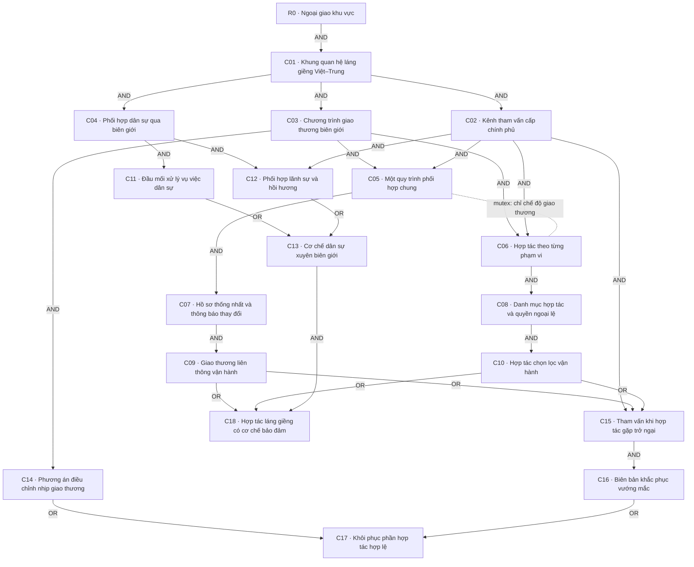

# Catalog và layout cụm C mở rộng — bản sinh

Nguồn: registry B1 design_variants.C_expanded. C: 6 → 18; toàn nhánh: 51 − 6 + 18 = 63.

ID mới đều là đề xuất, chưa có provider game. AND giữa nhóm prerequisite; OR trong nhóm.

| Node | Tên / slug mới dự kiến | Cost | Prerequisite | Mutex | Quyền/kết quả | Available |
|---|---|---:|---|---|---|---|
| C01 | Khung quan hệ láng giềng Việt–Trung / VIE_rd_china_neighbourly_framework | 5 | (R0) | — | Mở các hồ sơ hợp tác riêng, không khởi tạo thành quả. | Kỳ IX và công cụ cơ sở theo R0; CHI hợp lệ. |
| C02 | Kênh tham vấn cấp chính phủ / VIE_rd_china_government_consultation | 5 | (C01) | — | Mở đối thoại ban đầu và quyền chuyển hồ sơ vượt thẩm quyền kỹ thuật. | CHI tồn tại, chưa chiến tranh trực tiếp. |
| C03 | Chương trình giao thương biên giới / VIE_rd_china_border_trade_agenda | 5 | (C01) | — | Xác định phạm vi thương mại và hỏi điều kiện tiếp nhận của CHI. | Chưa có hồ sơ giao thương trùng. |
| C04 | Phối hợp dân sự qua biên giới / VIE_rd_china_civil_border_coordination | 5 | (C01) | — | Mở hợp tác xử lý vụ việc dân sự và lãnh sự trên đất liền. | Có đầu mối dân sự phù hợp; không thay hiệp ước/chủ quyền. |
| C05 | Một quy trình phối hợp chung / VIE_rd_china_common_trade_procedures | 7 | (C03) AND (C02) | C06 | Chọn ủy nhiệm phối hợp trong phạm vi đã thỏa thuận; không tự ký với CHI. | Cam kết kiến trúc của chương trình giao thương, chưa có cam kết đối lập. |
| C06 | Hợp tác theo từng phạm vi / VIE_rd_china_case_specific_cooperation | 7 | (C03) AND (C02) | C05 | Chọn xác nhận riêng từng phạm vi và ngoại lệ; không cấp quyền điều phối chung. | Cam kết kiến trúc của cùng chương trình giao thương, chưa có cam kết đối lập. |
| C07 | Hồ sơ thống nhất và thông báo thay đổi / VIE_rd_china_trade_document_protocol | 5 | (C05) | — | Mở soạn quy trình hồ sơ chung và thỏa thuận phương án vận hành thu hẹp từ trước. | Không có phiên soạn/gửi trùng; đủ quyền chia sẻ trong nước; chưa cần CHI nhận dự thảo. |
| C08 | Danh mục hợp tác và quyền ngoại lệ / VIE_rd_china_trade_scope_exemptions | 5 | (C06) | — | Mở soạn phạm vi riêng; phần chưa đồng ý không tự được triển khai. | Có thể soạn danh mục riêng, không có phiên trùng; chưa cần CHI nhận danh mục. |
| C09 | Giao thương liên thông vận hành / VIE_rd_china_integrated_trade_delivery | 7 | (C07) | — | Công nhận quy trình chung đã được nhận và thực hiện; không thưởng lại. | C.trade đã bàn giao đúng chế độ chung và đang hoạt động. |
| C10 | Hợp tác chọn lọc vận hành / VIE_rd_china_selective_trade_delivery | 7 | (C08) | — | Công nhận phạm vi chọn lọc đã thực hiện; không ép nâng sang chế độ chung. | C.trade đã bàn giao đúng chế độ từng phạm vi và đang hoạt động. |
| C11 | Đầu mối xử lý vụ việc dân sự / VIE_rd_china_civil_border_contacts | 7 | (C04) | — | Mở đề nghị danh bạ xác minh và chuyển đúng cơ quan của hai bên. | CHI tồn tại, có thể nhận đề nghị; chưa có luồng dân sự trùng; chưa cần CHI chấp thuận. |
| C12 | Phối hợp lãnh sự và hồi hương / VIE_rd_china_consular_return_protocol | 7 | (C04) AND (C02) | — | Mở đề nghị xác minh nhân thân, đầu mối tiếp nhận và bàn giao có đồng ý. | Có quyền soạn hồ sơ lãnh sự, CHI có thể nhận đề nghị; chưa có luồng trùng; chưa cần CHI chấp thuận. |
| C13 | Cơ chế dân sự xuyên biên giới / VIE_rd_china_border_civil_mechanism | 7 | (C11 OR C12) | — | Công nhận một cơ chế dân sự hoặc lãnh sự thực sự đã đưa vào sử dụng. | C.border_civil OR C.consular_return được hai bên nhận, bàn giao và đang hoạt động. |
| C14 | Phương án điều chỉnh nhịp giao thương / VIE_rd_china_trade_flow_contingency | 5 | (C03) | — | Mở chuẩn bị A12; chỉ decision hoàn thành mới ghi dự phòng sẵn sàng. | Không chuẩn bị trùng; dùng phí và lịch dự phòng C hiện có. |
| C15 | Tham vấn khi hợp tác gặp trở ngại / VIE_rd_china_disruption_consultation | 5 | (C02) AND (C09 OR C10) | — | Mở thương lượng cấp chương trình sau khi công cụ kỹ thuật không giải quyết được. | Chỉ mở năng lực; có thể chuẩn bị trước sự cố, không bắt tạo khủng hoảng. |
| C16 | Biên bản khắc phục vướng mắc / VIE_rd_china_agreed_remedy_record | 7 | (C15) | — | Công nhận giải pháp hai bên đã nhận; lưu đúng điều khoản được sửa. | Đã có vướng mắc thật của lượt hợp tác, giải pháp đã được chấp thuận; chưa thưởng lại bàn giao. |
| C17 | Khôi phục phần hợp tác hợp lệ / VIE_rd_china_limited_trade_resumption | 7 | (C14 OR C16) | — | Mở nối lại theo phương án đã đồng ý trước hoặc biên bản khắc phục; không tự bàn giao. | Đã từng bàn giao C.trade; có gián đoạn; có thỏa thuận/ngoại lệ còn hiệu lực và căn cứ phục hồi thực. |
| C18 | Hợp tác láng giềng có cơ chế bảo đảm / VIE_rd_china_effective_neighbourly_cooperation | 7 | (C09 OR C10) AND (C13) | — | Hội tụ thương mại và một cơ chế dân sự thực; giữ hai chế độ thương mại khác nhau. | C.trade còn hoạt động AND cơ chế dân sự/lãnh sự còn hoạt động; không yêu cầu xảy ra sự cố. |



Mermaid tự bố trí; tọa độ đề xuất thật nằm ở bảng dưới. Chưa kiểm hộp tên/dây/icon trong HOI4.

| Node | Anchor | X/Y tuyệt đối | x/y tương đối |
|---|---|---|---|
| C01 | R0 | (320,2) | (-54,2) |
| C02 | C01 | (324,4) | (4,2) |
| C03 | C01 | (314,4) | (-6,2) |
| C04 | C01 | (330,4) | (10,2) |
| C05 | C03 | (308,6) | (-6,2) |
| C06 | C03 | (316,6) | (2,2) |
| C07 | C05 | (308,8) | (0,2) |
| C08 | C06 | (316,8) | (0,2) |
| C09 | C07 | (308,10) | (0,2) |
| C10 | C08 | (316,10) | (0,2) |
| C11 | C04 | (328,6) | (-2,2) |
| C12 | C04 | (332,6) | (2,2) |
| C13 | C11 | (330,10) | (2,4) |
| C14 | C03 | (320,6) | (6,2) |
| C15 | C09 | (312,12) | (4,2) |
| C16 | C15 | (312,14) | (0,2) |
| C17 | C16 | (320,16) | (8,2) |
| C18 | C13 | (330,14) | (0,4) |

## Kiểm đã chạy

```json
{
  "legacy_total": 51,
  "legacy_c": 6,
  "proposed_c": 18,
  "proposed_total": 63,
  "delta": 12,
  "global_edges": 94,
  "min_row_gap": 4,
  "checked_completion_subsets": 262144,
  "reachable_structural_states": 365,
  "capstone_without_policy": 0,
  "both_policies_completed": 0,
  "economic_parameters_added": 0,
  "unpriced_programs": [
    "C.border_civil",
    "C.consular_return"
  ],
  "geometry_errors": [],
  "other_region_layout_cost_names_unchanged": true,
  "legacy_svg_is_expanded_diagram": false,
  "engine_tested": false,
  "c_catalog_cost": 110,
  "protected_files_unchanged_during_run": true
}
```

H1 nguyên văn yêu cầu 51 node và SVG khớp: FAIL cho bản mở rộng; người dùng đã bỏ trần C nhưng chưa có SVG tổng mới. Không đổi định nghĩa để PASS.
H2 vẫn FAIL vì bản tổng cũ chưa hợp nhất. H3 PASS nếu geometry_errors rỗng; chỉ hình học node/anchor, chưa kiểm đường dây đi qua hộp.
J2/J5 giữ FAIL theo hồ sơ L1. D2/D3 và cân bằng nội dung mới chưa đủ dữ liệu; hai chương trình mới chưa định giá.
